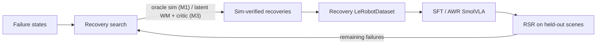

# RetryVLA

World-model-guided synthetic recovery learning for VLAs on **LIBERO-Recover**.

> Can a world model discover successful recovery action sequences from actual VLA failure
> states, and can those imagined recoveries be distilled into a VLA that recovers without
> search at inference?

Student policy: [HuggingFaceVLA/smolvla_libero](https://huggingface.co/HuggingFaceVLA/smolvla_libero)
(evaluated as-is, no nominal fine-tuning). First suite: **LIBERO-Spatial** with
`selected_bddl_scenes_spatial` from [LIBERO-Recovery](https://github.com/liulin815/LIBERO-Recovery).



## Quickstart

```bash
bash scripts/00_setup_env.sh          # conda env miniforge3/envs/retryvla (py3.12, lerobot 0.5.1)
bash scripts/01_download_assets.sh    # LIBERO-Recover scenes, LIBERO-Recovery code, HF ckpt + dataset
bash scripts/02_setup_nvidia_egl.sh   # GPU EGL rendering inside the container (12x faster sim)
source env/activate.sh
python scripts/make_split.py          # data/splits/spatial_v1.json (tracked)
pytest -q tests/test_core.py && pytest -q -m sim tests/test_sim.py
```

## Milestones

| | Command | Doc |
|---|---|---|
| M0a nominal | `scripts/launch.sh m0a retryvla.eval.eval_nominal configs/exp/m0_baseline_spatial.yaml` | [M0](experiments/M0_baseline.md) |
| M0b scene check | `scripts/launch.sh m0b retryvla.eval.verify_scenes configs/exp/m0_baseline_spatial.yaml` | |
| M0c RSR baseline | `scripts/launch.sh m0c retryvla.eval.eval_recover configs/exp/m0_baseline_spatial.yaml` | |
| M1a/b oracle CEM | `scripts/launch.sh m1a retryvla.search.run_search configs/exp/m1_oracle_cem_spatial.yaml` | [M1](experiments/M1_oracle_search.md) |
| M1 random baseline | `scripts/launch.sh m1r retryvla.search.run_search configs/exp/m1_random_search_spatial.yaml` | |
| M1c SFT | `scripts/launch.sh m1c retryvla.train.sft configs/exp/m1_sft_oracle_cem.yaml` | |
| M1d eval pi1 | `eval_recover` / `eval_nominal` with `policy.path=runs/<sft>/checkpoints/last/pretrained_model` | |
| M2-M6 | skeletons in `retryvla/{wm,critic}`, `search/scorers.py::WMCriticScorer`, `train/awr.py` | |

## Layout

```
configs/      env / policy / search / train / eval fragments + exp/*.yaml (composed via `defaults:`)
retryvla/
  envs/       libero_env.py (LiberoSim, exact snapshots), vec.py (SimPool), splits.py
  policy/     smolvla_wrapper.py (batched chunks, seeded noise)
  eval/       rollout.py (async batched engine), eval_nominal.py, eval_recover.py, verify_scenes.py
  search/     cem.py, primitives.py, scorers.py, oracle_sim.py, run_search.py
  data/       recovery_writer.py (LeRobotDataset v3), mix.py
  train/      sft.py, awr.py (M5 skeleton)
  wm/ critic/ M2 skeletons
  tracking/   run dirs, config + git snapshot, jsonl + TensorBoard
experiments/  REGISTRY.md (one row per run) + M*.md milestone docs   <- tracked record
runs/         per-run outputs (gitignored)
data/         assets + generated datasets (gitignored), splits/ (tracked)
.cursor/skills/  retryvla-ops, retryvla-experiment, retryvla-eval, retryvla-search
```

## Tracking

Every entrypoint creates `runs/<ts>_<milestone>_<tag>/` with `config.yaml`, `git.txt` (sha + dirty diff),
`metrics.jsonl`, `tb/`, `summary.json`. Register with `python scripts/register_run.py runs/<id> --note "..."`.
TensorBoard: `tensorboard --logdir runs`.
