# RetryVLA: Failure analysis — vì sao policy tốt nhất vẫn fail ~1/2 failure states (LIBERO-Recover Spatial test)

> Viết 2026-10-27. Dữ liệu: `runs/<id>/episodes.jsonl` của các eval đã có (56 test scenes x 10 trials = 560 episodes / model),
> cộng một lần **re-simulate** ~90 episode thất bại có ghi telemetry (mục 5). Không train thêm.
> Script: `scripts/analyze_failures.py` (log, CPU), `scripts/analyze_failures_resim.py` (re-sim, GPU shell 0097c39c),
> `scripts/classify_failures.py` (phân loại + strips + videos). Số liệu thô: `runs/_analysis/failures/{stats,modes}.json`.
> Spatial test là **dev set** từ M7 (xem `experiments/RESULTS.md`), nên đây là phân tích chẩn đoán, không phải số báo cáo cuối.

Models (pi1 và M7 base đều 3 training seeds; "M7 base" = pi1 + thêm 2 x 6k steps trên cùng 208 recovery, = best):

| model | runs | test RSR |
|---|---|---|
| pi0 (SmolVLA gốc) | `*_M0_recover_bddl` (phần test) | 0.118 |
| pi1-nominal (demo SFT) | `*_M1_pi1nom_recover_test` | 0.138 |
| **pi1 (RetryVLA)** | `*_M5_m5c_sft_wm_diverse_rr_recover_test`, `*_M8_seed_pi1_s{1,2}_recover_test` | **0.418 ± 0.021** |
| **M7 base (best)** | `*_M7_sft_base_recover_test`, `*_M8_seed_base_s{1,2}_recover_test` | **0.482 ± 0.019** |
| (phụ) M7 weak / M8 aug | `*_M7_sft_weak*`, `*_M8_seed_weak_s{1,2}*` / `*_M8_sft_aug*` | 0.468 / 0.457 |

## TL;DR

- **Best policy (M7 base, 3 seeds) fail 51.8% test episodes (~290 / 560 mỗi seed).** Failure *không* ngẫu nhiên:
  **73%** failure của một seed là episode mà **không seed nào** giải được; 26% episodes (147 / 560) chưa từng được giải bởi
  bất kỳ run nào trong 12 runs của 6 policy. Gripper init, capture step (proxy "level"; L1-L4 không được release) và
  trial noise **không** giải thích được (chênh <= 1-2 pt).
- **Theo task:** 3 task gần 0 (on cookie box 0.05, next to cookie box 0.13, on stove 0.18) = 24% failure; nhưng phần lớn
  failure nằm ở 2 task lớn drawer (0.48) + ramekin (0.64) = 48%. M7 sửa 44% failure của pi0, chỉ phá 13 / 66 thành công cũ.
- **Failure mode (re-sim 93 failures có telemetry, 81 fail lại):** **77% là không bao giờ nhấc được bát** —
  (a1) 30% *không chạm tới bát*, hạ / kẹp vào chỗ trống trên bàn (stove 9 / 12, cookie box 5 / 9), (a2) 42% *chạm bát nhưng
  gắp trượt* (drawer, cabinet, ramekin, next-to-cookie-box), (d) 5% *kẹt*, ép tay xuống bàn; chỉ 12% *mang tới nhưng đặt lệch*
  cạnh đĩa, 1% *đánh rơi*, **0% hết giờ khi đang làm** (=> kéo dài 520 bước không giúp). 10% là *infeasible* (bát / đĩa đã rơi
  xuống sàn ngay sau noise lúc load; toàn test: 22 eps = 3.9%, trần RSR ~0.96).
- **Data:** task yếu gần như không có recovery data (stove 14 / 208, cookie box 3, next-to-cookie-box **0**) vì chỉ có 2-10
  train scenes; nhưng thêm data cho chúng (M7 weak) không transfer, chỉ augmentation ±5 cm (M8) mới x2 test weak-task mà lại
  hại task khác => thiếu **đa dạng failure state / scene**, và hành vi còn thiếu là **re-grasp từ vị trí lạ** (grasp đầu tiên).
- **Next:** proposal / bridge nhắm vào *approach + grasp* (bridge dài hơn 50 bước, multi-step: re-localize -> approach -> grasp),
  thêm failure states (scenes_full, augmentation có kiểm soát, task-balanced mixing), lọc infeasible khỏi metric.

## 1. RSR theo task và theo scene

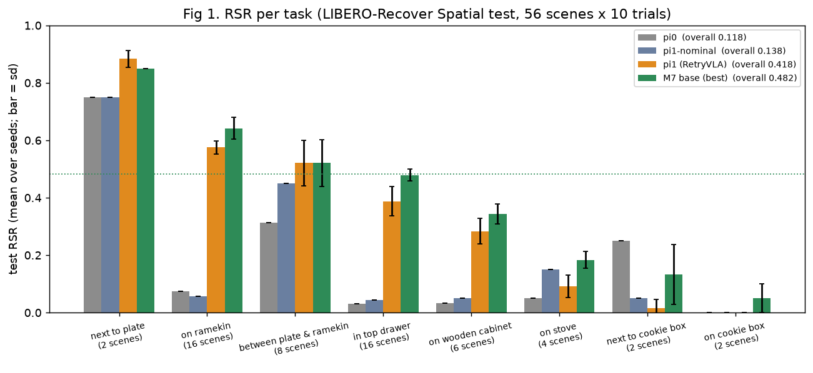

| task | test scenes | pi0 | pi1-nominal | pi1 (3 seeds) | **M7 base (3 seeds)** | M7 weak (3) | M8 aug (1) |
|---|---|---|---|---|---|---|---|
| next to plate | 2 | 0.750 | 0.750 | 0.883 | **0.850** | 0.850 | 0.900 |
| on ramekin | 16 | 0.075 | 0.056 | 0.575 | **0.642** | 0.665 | 0.600 |
| between plate & ramekin | 8 | 0.312 | 0.450 | 0.521 | **0.521** | 0.500 | 0.500 |
| in top drawer | 16 | 0.031 | 0.044 | 0.388 | **0.479** | 0.431 | 0.425 |
| on wooden cabinet | 6 | 0.033 | 0.050 | 0.283 | **0.344** | 0.383 | 0.300 |
| on stove | 4 | 0.050 | 0.150 | 0.092 | **0.183** | 0.100 | 0.200 |
| next to cookie box | 2 | 0.250 | 0.050 | 0.017 | **0.133** | 0.117 | 0.350 |
| on cookie box | 2 | 0.000 | 0.000 | 0.000 | **0.050** | 0.033 | 0.050 |
| **all** | 56 | **0.118** | **0.138** | **0.418** | **0.482** | **0.468** | **0.457** |

(Test không có task *next to ramekin*.)

- **Ba task gần 0 kể cả với model tốt nhất:** *on cookie box* (0.05), *next to cookie box* (0.13), *on stove* (0.18).
  Chúng chỉ có 8 / 56 test scenes, nhưng chiếm **~69 / 290 (24%)** số failure mỗi seed của M7.
- **Task "lớn" mới là nơi mất nhiều điểm nhất về số lượng:** *in top drawer* (16 scenes, 0.48) và *on ramekin* (16 scenes,
  0.64) cộng lại ~141 failure / seed (48%); *on wooden cabinet* 0.34, *between plate & ramekin* 0.52.
- Từ pi1 -> M7 (train thêm) gain nằm ở drawer (+0.09), ramekin (+0.07), cabinet (+0.06), stove (+0.09) và
  next-to-cookie-box (+0.12, nhưng chỉ 20 episodes); *on cookie box* đứng yên ở ~0.

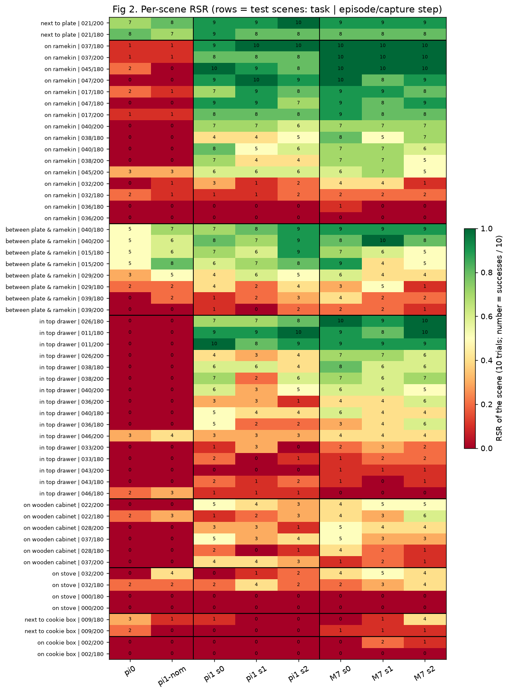

Heatmap (số = số thành công / 10 trials): trong cùng một task các scene rất khác nhau. Ví dụ *on ramekin*: 7 scene >= 8/10,
nhưng `episode_036` (cả 180 / 200) là 0/10 với mọi model; *in top drawer*: `episode_011 / 026` gần 10/10 còn `033 / 043 / 046`
~0-2/10. **5 test scenes không model M7 seed nào giải được lần nào** (30 / 30 trials fail): stove `episode_000` (cả 2 capture
steps), cookie box `episode_002/180`, ramekin `episode_036/200`, drawer `episode_046/180`. Tức là failure tập trung
theo *failure state* (scene), không rải đều.

## 2. Breakdown theo gripper init, "level" và trial noise

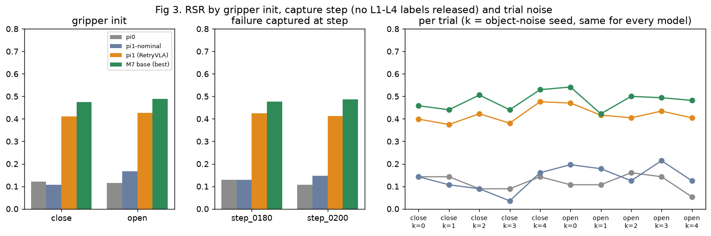

- **Gripper init không quan trọng:** M7 close 0.475 / open 0.488; pi1 0.411 / 0.426 (pi1-nominal mới lệch: 0.107 / 0.168).
- **Level L1-L4: không có** — LIBERO-Recover không release level labels (mọi episode `level = unk`). Proxy duy nhất có sẵn
  là capture step của failure state (`step_0180` vs `step_0200`, 20 bước cách nhau trong cùng một episode thất bại của pi0):
  M7 0.476 vs 0.487 — **không khác**.
- **Trial noise (k = seed nhiễu ±2 cm của object, giống nhau giữa các model):** M7 dao động 0.42-0.54 theo k, không có xu hướng.
  Noise quan trọng ở mức *từng episode* (mục 3, 4), không phải ở mức trung bình. Ngoại lệ đáng chú ý: **22 episodes (3.9%)
  là infeasible** — sau khi load với noise, bát hoặc đĩa đã rơi khỏi bàn (khoảng cách bát-đĩa 0.57-2.4 m ở *mọi* run trong 12
  runs; re-sim xác nhận bát / đĩa ở z ≈ 0, dưới sàn; 12 / 22 thuộc drawer, 5 next-to-cookie-box). Trần cứng: **RSR tối đa ~0.96**.

## 3. Consistency qua 3 seeds: "never solved" vs "stochastic"

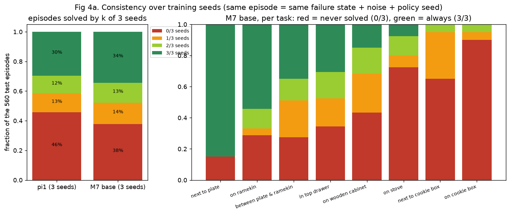

Cùng một episode (cùng failure state + noise + policy seed) với 3 training seeds:

| | 0/3 seeds | 1/3 | 2/3 | 3/3 |
|---|---|---|---|---|
| pi1 | 256 (46%) | 71 (13%) | 67 (12%) | 166 (30%) |
| **M7 base** | **212 (38%)** | 80 (14%) | 75 (13%) | 193 (34%) |

- Mỗi seed M7 fail ~290 episodes; **212 trong số đó (73%) là "never solved"** (không seed nào giải được), chỉ ~27% là
  "stochastic" (1-2 / 3 seeds). => Phần lớn failure là **hệ thống**, không phải xui; thêm seed / ensemble chỉ cứu được tối đa
  ~0.27 x 0.52 ≈ 14 pt (trần "oracle chọn seed tốt nhất": 348 / 560 = 0.62).
- Xét **tất cả 12 runs** (pi0, pi1-nominal, 3 pi1, 3 M7, 3 M7-weak, M8-aug): **147 / 560 episodes (26%) chưa từng được giải**
  bởi bất kỳ policy nào. Trong đó 22 infeasible (mục 2) và **33 episodes mà bát không hề bị chạm** ở mọi run (vị trí cuối
  của bát giống hệt nhau ±5 mm) — **18 / 33 là stove**: không policy nào thậm chí chạm được vào bát trên bếp.
- Theo task (hình phải): stove 73% episodes 0/3, cookie box 90%, next-to-cookie-box 65%; ramekin chỉ 29%, drawer 34%.

## 4. Transition pi0 -> best: fixed / still failing / broken

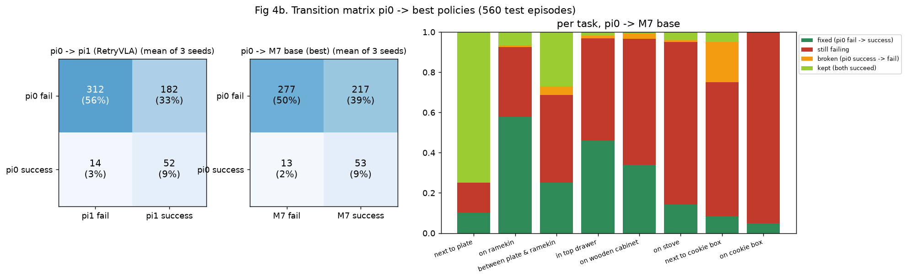

| pi0 -> M7 base (trung bình 3 seeds, 560 eps) | M7 fail | M7 success |
|---|---|---|
| **pi0 fail (494)** | **277 (50%) still failing** | **217 (39%) fixed** |
| **pi0 success (66)** | 13 (2.3%) broken | 53 (9%) kept |

- M7 sửa được **44% failure của pi0** (217 / 494) và gần như không phá cái pi0 đã làm được (13 / 66 broken, 80% kept).
- "Broken" tập trung ở *next to cookie box* (20% episodes: pi0 0.25 -> M7 0.13) — task không có recovery data nào (mục 6).
- "Still failing" theo task: cookie box 95%, stove 81%, next-to-cookie-box 67%, cabinet 63%, drawer 51%, between 44%, ramekin 35%.

## 5. Failure modes (re-simulation có telemetry)

### 5.0 Gợi ý từ log trước khi re-sim: bát nằm ở đâu lúc hết giờ?

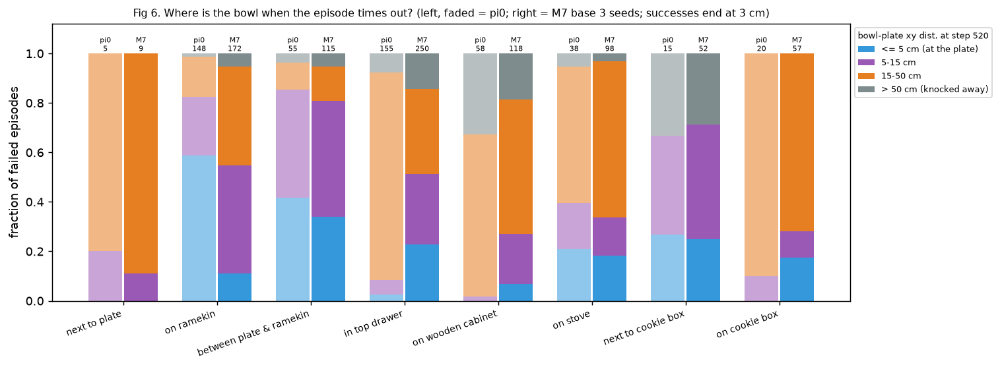

`progress` trong `episodes.jsonl` = -(khoảng cách xy bát-đĩa) ở bước cuối. Thành công kết thúc ở ~2.6 cm. Với 871 failures
của M7 (3 seeds): **19% bát nằm <= 5 cm từ tâm đĩa** (ngay cạnh / trên mép đĩa nhưng không "On"), 31% 5-15 cm, 40% 15-50 cm,
10% > 50 cm (văng khỏi bàn). Stove: bát gần như luôn ở ~45 cm = **vẫn nằm trên bếp** (18 / 33 episodes "không ai chạm vào
bát" là stove). Log không phân biệt được "không chạm" với "chạm nhưng trượt", nên cần re-sim.

### 5.1 Cách làm

- **Mẫu:** 47 failures của M7 base seed 0 + 46 của pi1 seed 0, phân tầng theo task (>= 3 / task, còn lại theo tỉ lệ),
  xen kẽ close / open (`scripts/analyze_failures_resim.py`, chạy trên GPU shell 0097c39c trong tmux, 8 sim workers).
- **Cùng protocol:** `eval_recover.instance_jobs` (cùng scene, gripper init, noise seed, policy seed, 520 bước, chunk 10)
  + `LiberoSim`; ghi mỗi bước: eef xyz, độ mở gripper, vị trí + độ dựng của bát, vị trí đĩa, **contact ngón trái / phải với bát**,
  contact robot-môi trường, contact bát-đĩa, action; video agent + wrist cam (mỗi 2 bước).
- **Không bit-exact với eval gốc:** batch của policy khác (8 vs 14-24 workers) -> numerics GPU khác -> **12 / 93 (13%) episode
  "failure" lần này lại thành công** (M7 7 / 47, pi1 5 / 46; thường thành công muộn: 64-442 bước). Khớp với mục 3: một phần
  failure là stochastic. 81 episodes fail lại được phân loại.
- **Luật phân loại** (`scripts/classify_failures.py`; "giữ bát" = cả 2 ngón chạm bát VÀ bát cao hơn vị trí nghỉ > 2.5 cm,
  "mang" = giữ >= 10 bước liên tiếp):
  (f) bát hoặc đĩa ở dưới mặt bàn (z < 0.6 m) ngay từ đầu -> infeasible; (e) vẫn đang giữ bát ở cuối, hoặc vừa nhả muộn và đang tiến về đĩa;
  không bao giờ "mang" -> (d) nếu tay gần như đứng yên (< 3 cm trong 200 bước cuối) hoặc kẹt (lệnh lớn nhưng không di chuyển
  > 20% bước + contact với môi trường > 40%), (a1) nếu không ngón nào từng chạm bát và bát không xê dịch (< 2 cm), còn lại (a2);
  đã "mang" -> (c) nếu bát cuối cùng < 10 cm từ đĩa hoặc nhả < 8 cm, còn lại (b).
  Đã kiểm tra bằng mắt các strip / video bên dưới.

### 5.2 Phân bố

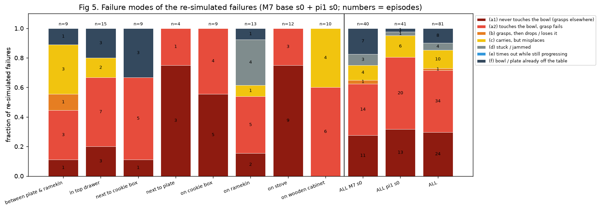

| mode | M7 s0 (40) | pi1 s0 (41) | tổng (81) | mô tả |
|---|---|---|---|---|
| **(a1) không chạm tới bát** | 11 | 13 | **24 (30%)** | không ngón nào chạm bát, bát không xê dịch; tay hạ xuống / kẹp vào chỗ trống (median 35 lần đóng gripper / episode) |
| **(a2) chạm bát nhưng gắp trượt** | 14 | 20 | **34 (42%)** | tay chạm / đẩy bát, đóng gripper nhiều lần (median 23) nhưng không lần nào kẹp chắc và nhấc lên |
| (b) gắp được rồi đánh rơi | 1 | 0 | 1 (1%) | nhấc được ~12 bước rồi tuột, không gắp lại |
| (c) mang tới nhưng đặt lệch | 4 | 6 | 10 (12%) | mang bát tới, nhả cách tâm đĩa 3-12 cm (cạnh / mép đĩa) rồi không chỉnh lại |
| (d) kẹt / đứng yên | 3 | 1 | 4 (5%) | ép tay xuống bàn cạnh bát với gripper đóng, đứng yên tới hết giờ (ramekin) |
| (e) hết giờ khi đang làm | 0 | 0 | **0 (0%)** | không episode nào còn đang mang bát / đang tiến về đĩa ở bước 520 |
| (f) infeasible | 7 | 1 | 8 (10%) | bát hoặc đĩa đã rơi xuống sàn ngay sau khi load (toàn test: 22 / 278 = 8% failures của M7 s0) |

Theo task (81 failures): **stove** 9 a1 + 3 a2 (tay không bao giờ chạm bát trên bếp); **on cookie box** 5 a1 + 4 a2;
**next to cookie box** 5 a2 + 1 a1 + 3 f; **drawer** 7 a2 + 3 a1 + 2 c + 3 f (bát trong ngăn kéo: gắp trượt);
**ramekin** 5 a2 + 4 d + 2 a1 + 1 c + 1 f; **cabinet** 6 a2 + 4 c (bát trên nóc tủ); **between** 3 a2 + 3 c + 1 a1 + 1 b + 1 f;
**next to plate** 3 a1 + 1 a2.
Thêm: **15 / 81** failures bắt đầu với bát đã ở <= 6 cm từ tâm đĩa (nằm cạnh / trên mép, chưa "On") mà policy **không bao giờ
nhấc lại** để đặt cho đúng (10 a2, 4 a1, 1 d).

Đọc: **~3 / 4 failure còn lại là lỗi ở bước approach + grasp đầu tiên từ một trạng thái lạ**, không phải ở carry / place,
và **không phải thiếu thời gian**. (a1) giống lỗi *localization*: policy đi tới chỗ bát "thường nằm" trong demo (trên bàn,
gần đĩa), không tới chỗ bát đang nằm (trên bếp, trên hộp cookie). (a2) là lỗi *grasp geometry*: bát trong ngăn kéo / trên nóc
tủ / sát ramekin / sát đĩa, policy kẹp lặp lại cùng một pose sai. (c) cho thấy lỗi place nhỏ hơn nhiều; (b) gần như không có.

### 5.3 Ví dụ (keyframes: camera ngoài + wrist cam góc phải, gripper state, độ cao tay, khoảng cách bát-đĩa)

**(a1) không chạm tới bát** — stove ep000/200 close2 (M7 s0): bát nằm trên bếp suốt 520 bước (45 cm), tay lượn và kẹp ở
giữa bàn; cookie box ep002/180 close1: tương tự với bát trên hộp cookie.
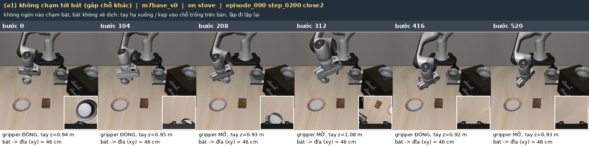
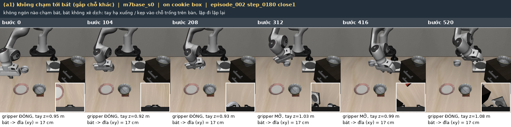

**(a2) chạm bát nhưng gắp trượt** — drawer ep036/180 close2: bát trong ngăn kéo, kẹp nhiều lần nhưng không lấy ra được;
cabinet ep037/180 open9: bát trên nóc tủ.
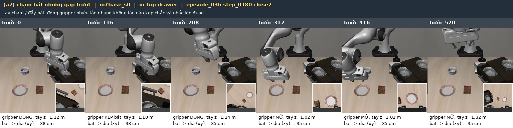
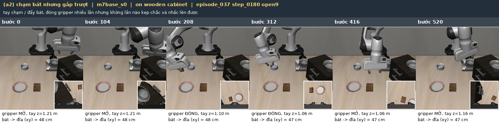

**(b) đánh rơi** — between ep029/180 open9: nhấc được ngắn rồi tuột.
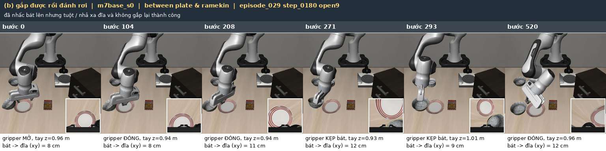

**(c) đặt lệch** — cabinet ep028/180 open6: lấy bát từ nóc tủ, mang tới, nhả cách tâm đĩa 4 cm (trên mép);
between ep039/200 close0: nhả cạnh đĩa (~9 cm).
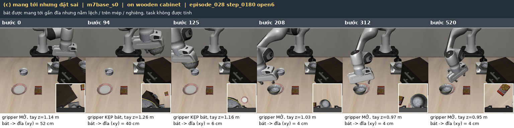
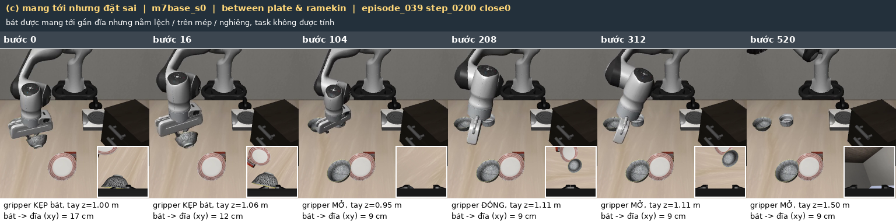

**(d) kẹt** — ramekin ep032/180 open6: tay ép xuống bàn bên cạnh bát với gripper đóng từ bước ~100 tới hết.
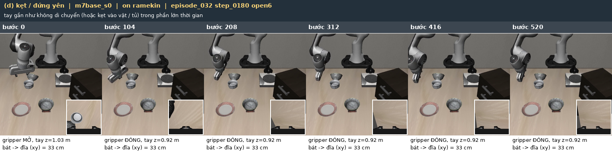

**(f) infeasible** — drawer ep040/200 close0 và next-to-cookie-box ep009/180 open5: bát đã rơi xuống sàn ngay từ đầu.
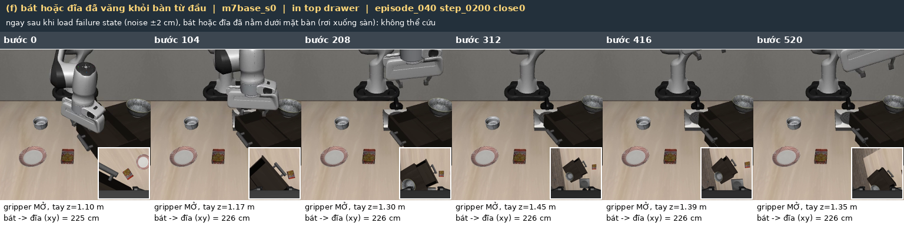
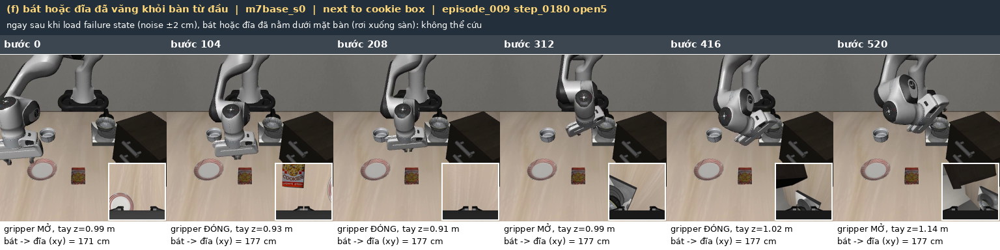

**Videos** (H.264, ~15 s, caption tiếng Việt; trái camera ngoài + wrist inset, phải wrist cam; thanh đỏ = thời gian / 520 bước):

| mode | video |
|---|---|
| (a1) không chạm tới bát (stove) | [failure_videos/a1_wrong_place.mp4](failure_videos/a1_wrong_place.mp4) |
| (a2) gắp trượt (bát trong ngăn kéo) | [failure_videos/a2_failed_grasp.mp4](failure_videos/a2_failed_grasp.mp4) |
| (b) đánh rơi (between plate & ramekin) | [failure_videos/b_drop.mp4](failure_videos/b_drop.mp4) |
| (c) đặt lệch (bát trên nóc tủ -> mép đĩa) | [failure_videos/c_misplace.mp4](failure_videos/c_misplace.mp4) |
| (d) kẹt (ramekin) | [failure_videos/d_stuck.mp4](failure_videos/d_stuck.mp4) |

Telemetry + raw video của cả 93 episodes: `runs/_analysis/failures/resim/<model>/<iid>.{npz,mp4}`; nhãn + features từng
episode: `runs/_analysis/failures/modes.json`.

## 6. Phía training data: thiếu data hay thiếu hành vi?

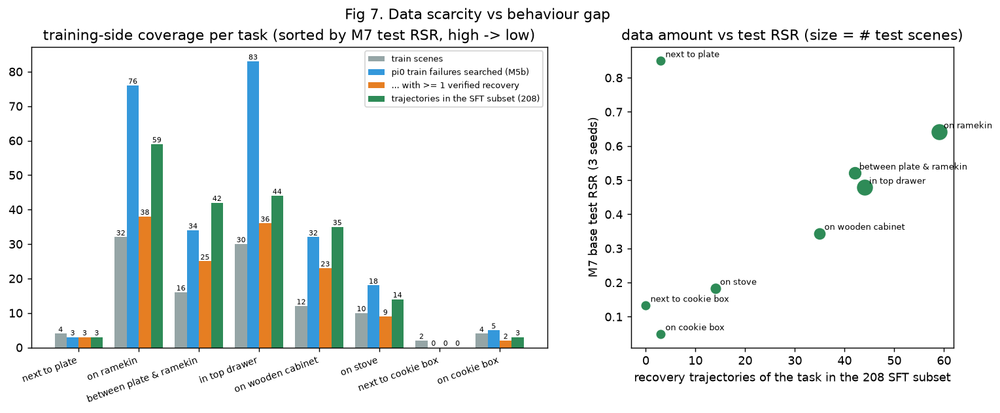

| task | train scenes | train failure states (scenes x 10) | pi0 failures searched (M5b) | solved (>= 1 verified) | pool traj | **SFT 208** | M7 test RSR |
|---|---|---|---|---|---|---|---|
| next to plate | 4 | 40 | 3 | 3 | 9 | 3 | 0.850 |
| on ramekin | 32 | 320 | 76 | 38 | 131 | **59** | 0.642 |
| between plate & ramekin | 16 | 160 | 34 | 25 | 77 | **42** | 0.521 |
| in top drawer | 30 | 300 | 83 | 36 | 69 | **44** | 0.479 |
| on wooden cabinet | 12 | 120 | 32 | 23 | 86 | **35** | 0.344 |
| on stove | 10 | 100 | 18 | 9 | 27 | **14** | 0.183 |
| next to cookie box | 2 | 20 | 0 | 0 | 0 | **0** | 0.133 |
| on cookie box | 4 | 40 | 5 | 2 | 8 | **3** | 0.050 |
| (next to ramekin, train only) | 2 | 20 | 5 | 4 | 16 | 8 | - |

(*searched* = số failure instance của pi0 trên train scenes mà M5b search đã chạy; *solved* = có >= 1 recovery verified;
*SFT 208* = số trajectory của task trong subset round-robin 208 mà pi1 / M7 base dùng, `recovery_episode_subsets(mode=roundrobin)`.)

- **Data scarcity rõ ràng ở 3 task yếu:** stove 14 / 208 (6.7%), cookie box 3 (1.4%), **next to cookie box 0** (2 train
  scenes, pi0 không fail ở các train trials đã search -> không có failure nào để search). Ngược lại ramekin 59, drawer 44,
  between 42. RSR theo task tăng gần đơn điệu với số trajectory (hình phải); ngoại lệ là *next to plate* (dễ, pi0 đã 0.75).
- Nguồn gốc là **ít train scenes** (cookie box 4, next-to-cookie-box 2, stove 10, so với ramekin 32, drawer 30) **và** search
  khó hơn trên các task đó (stove 9 / 18 solved, cookie box 2 / 5).
- **Nhưng thêm data cho task yếu không đủ (M7 / M8, `experiments/RESULTS.md`):**
  - *M7 weak* (+155 recovery stove / cookie box, search bằng best policy, robust >= 2 / 3 seeds): giải được trên **train**
    (search solved 0.59) nhưng test stove + cookie box chỉ **8 / 80 vs 7 / 80**; 3 seeds: 0.468 vs 0.482 (= M7 base).
  - *M8 aug* (thêm data ±5 cm augmentation cho task yếu): test weak tasks **16 / 80 vs 7 / 80** (x2; next-to-cookie-box 0.05 ->
    0.35) nhưng tổng RSR **0.457 vs 0.504** (-0.046, p = 0.03): 57% recovery data là task yếu, các task khác tụt.
  - Đọc: với 2-10 train scenes / task, policy **học thuộc failure state của train** (overfit theo scene), không tổng quát
    sang failure state mới; tăng đa dạng *vị trí* (aug ±5 cm) giúp transfer — tức là thiếu **scene diversity**, không chỉ thiếu
    số lượng trajectory. Và ở mức 208-800 trajectory, data task yếu cạnh tranh trực tiếp với các task khác.

## 7. Kết luận và bước tiếp theo

1. **Vì sao ~1/2 vẫn fail: hành vi còn thiếu là approach + grasp đầu tiên từ failure state lạ.** 77% failure (re-sim)
   không bao giờ nhấc được bát (30% không chạm tới bát, 42% chạm nhưng gắp trượt, 5% kẹt); place sai chỉ 12%, đánh rơi 1%,
   hết giờ 0%. Bridge 50 bước + SmolVLA chạy tiếp hiện học được kiểu "nhấc tay lên, mở gripper, làm lại", đủ cho ramekin /
   drawer khi bát vẫn ở vị trí "quen", nhưng không dạy được *đi tới bát ở vị trí lạ* (bếp, hộp cookie, nóc tủ) hay
   *đổi grasp pose* (bát trong ngăn kéo, sát ramekin / đĩa).
2. **Failure mang tính hệ thống theo failure state, không phải xui:** 73% failure của mỗi seed là episode 0/3 seeds, 26%
   episodes chưa run nào giải được; gripper init / capture step / noise trial không giải thích được. => thêm seed,
   best-of-N lúc test hay train lâu hơn chỉ ăn được phần stochastic (~27%; trần "oracle seed" 0.62). Có ~4% episodes
   infeasible (vật rơi khỏi bàn sau noise lúc load) -> nên lọc ra hoặc báo riêng (trần RSR ~0.96).
3. **Task yếu = thiếu data VÀ thiếu đa dạng:** stove / cookie box / next-to-cookie-box chỉ có 2-10 train scenes và 0-14 / 208
   trajectory. Thêm trajectory trên cùng các train scenes (M7 weak) không transfer; tăng đa dạng vị trí (M8 aug ±5 cm) x2
   test weak-task nhưng hại task khác khi chiếm 57% data. Bottleneck là **coverage của failure states**, không phải số lượng.
4. **Bước tiếp theo cụ thể:**
   - *Proposal / bridge cho approach + grasp:* primitives "re-localize -> approach bát -> grasp từ trên / nghiêng" và bridge
     dài hơn (100-150 bước) hoặc **multi-step bridges** (search lại sau mỗi chunk) cho (a1) / (a2); verify bằng contact
     2 ngón + nhấc lên (đã có telemetry trong `scripts/analyze_failures_resim.py`) làm reward phụ cho search.
   - *Thêm failure states:* dùng `data/assets/scenes_full` (state mỗi 20 bước), perturb vị trí bát trên bếp / hộp cookie /
     nóc tủ (augmentation có kiểm soát), rồi **task-balanced mixing có trần** (vd. <= 25% cho task yếu) để không lặp lại M8.
   - *Đo đúng:* loại 22 episodes infeasible (hoặc báo RSR trên 538 feasible), báo thêm "grasp success rate" (từ telemetry)
     cạnh RSR để thấy tiến bộ ở bước grasp trước khi nó thành RSR.
   - *Near-goal re-place:* 15 / 81 failures có bát đã sát đĩa nhưng chưa "On"; thêm recovery "nhấc lại và đặt giữa đĩa" vào
     proposal library (rẻ, dễ verify).
5. **Không nên** đầu tư vào kéo dài horizon (0% "hết giờ khi đang làm") hay chỉ thêm SFT steps (M7 -> thêm steps đã flatten,
   +0.023 n.s. ở RESULTS M7).

### Ghi chú vận hành

Re-sim chạy trên Determined shell `0097c39c` (GPU dùng chung với job của user, 8 sim workers, ~1 h cho 93 episodes; lần đầu
bị mất tmux sau 33 episodes, chạy lại với resume). Lệnh tái tạo:

```bash
python scripts/analyze_failures.py                                    # mục 1-4, 6 (CPU, ~10 s)
scripts/shells/launch_remote.sh 0097c39c 0 failres scripts.analyze_failures_resim --per_model 46 --workers 8   # mục 5 (GPU)
python scripts/classify_failures.py                                   # phân loại + fig5 + strips + videos (CPU)
```
