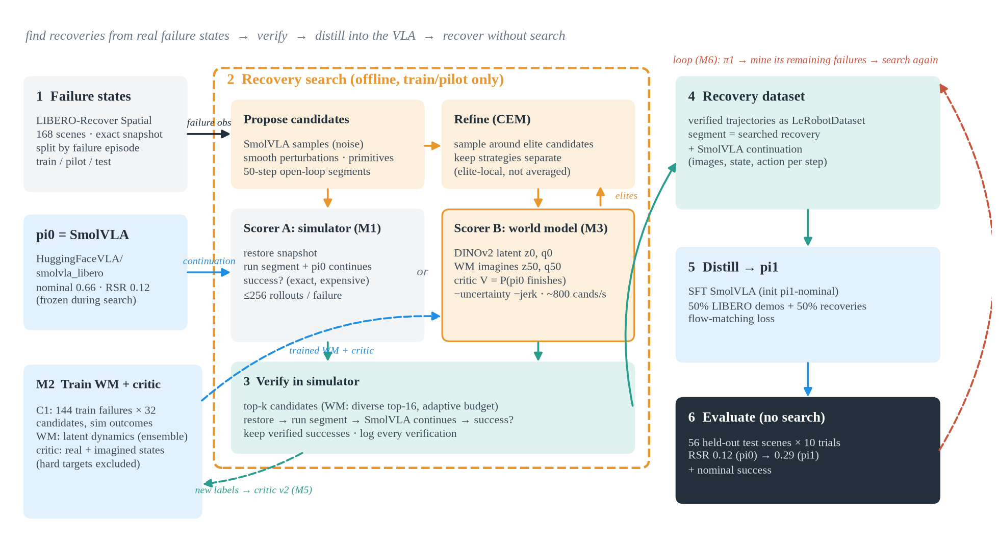
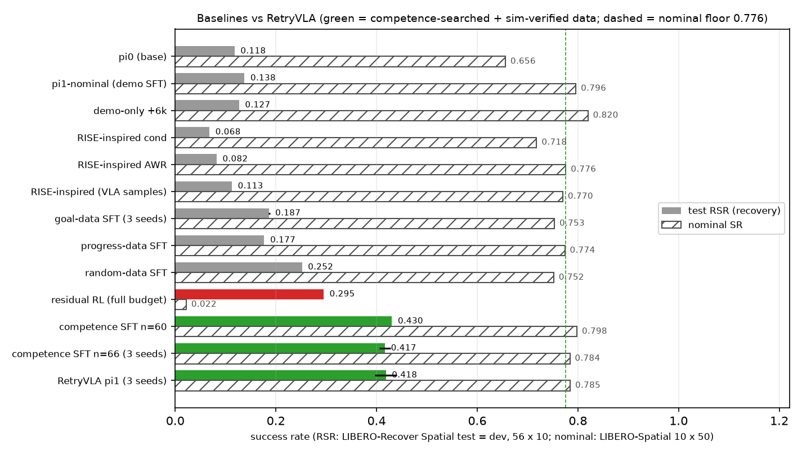
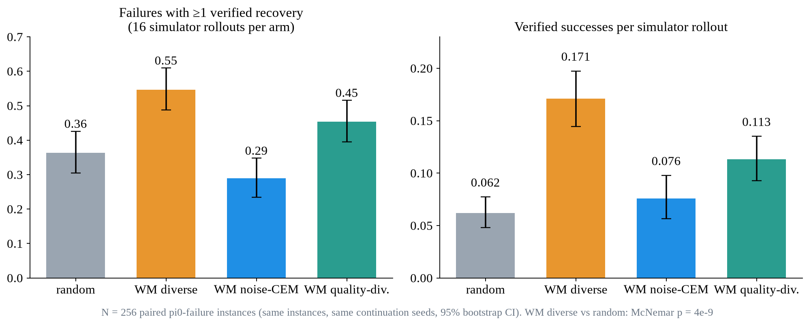
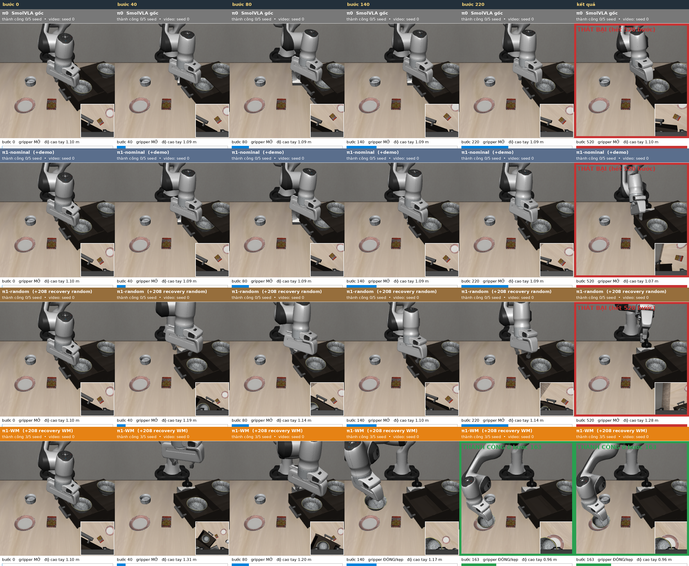
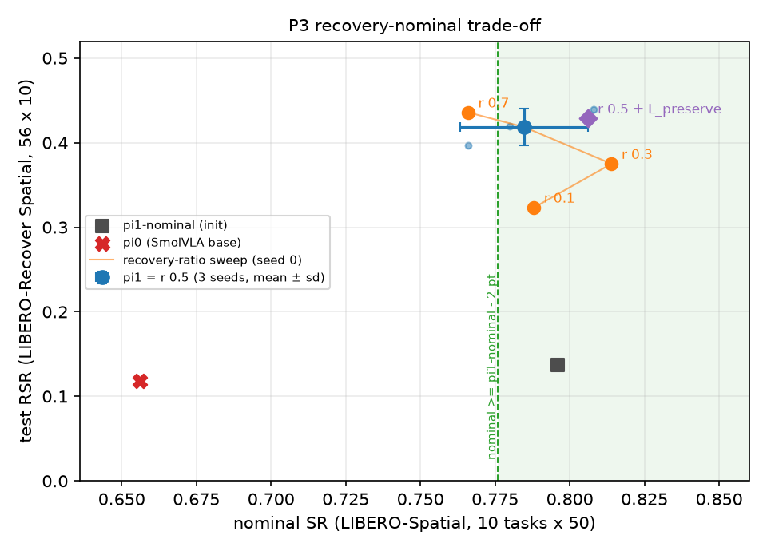

# RetryVLA: báo cáo tiến độ (bản cuối cho buổi review, cập nhật 2026-10-26)

> Bản tóm tắt cho người muốn nắm bức tranh lớn trong vài phút. Mọi con số lấy từ `experiments/RESULTS.md`,
> `experiments/NOTES.md`, `experiments/PLAN.md`, `runs/_analysis/*/summary.md` và lần chạy
> `scripts/analyze_baselines.py` ngày 2026-10-26, sau khi **toàn bộ job đã xong** (DAG b2p3 ALL DONE 2026-10-25 14:16 UTC):
> **không còn dòng nào "pending"**. Chi tiết thống kê (CI, p) xem các file đó.
>
> Thuật ngữ: **RSR** = recovery success rate (tỉ lệ robot hoàn thành task khi bắt đầu từ một trạng thái thất bại,
> 56 test scenes x 10 trials, LIBERO-Recover Spatial). **Nominal** = success rate trên LIBERO-Spatial bình thường
> (10 tasks x 50 inits). **pi0** = SmolVLA gốc, **pi1** = SmolVLA sau khi distill recovery của RetryVLA.
> **eps** = ràng buộc đăng ký trước: nominal(pi') >= nominal(pi1-nominal 0.796) - 2 pt, tức sàn **0.776**.
>
> Tổng quan related work (có hình phương pháp): [docs/related_work/RELATED_WORK.md](related_work/RELATED_WORK.md).

## 1. TL;DR

- **Cái chạy được:** tìm recovery bằng world model (WM) + competence critic C^pi, kiểm chứng (verify) trong sim,
  rồi distill vào VLA: RSR **0.118 -> 0.418 ± 0.021** (pi1, 3 seeds), nominal **0.785** (pass eps; pi1-nominal 0.796).
  Không cần thêm module nào lúc test.
- **"Competence" là yếu tố quyết định:** cùng pipeline, chỉ đổi mục tiêu search: competence SFT **0.417 vs goal 0.187**
  (3 seeds); progress-critic data **0.177 vs competence 0.430** (cùng n=60). Goal / progress / random SFT đều **fail**
  ngưỡng nominal; mọi SFT dùng data competence đều **pass**. Trên Object (held-out) competence >> goal trong search (66 / 8, p = 2e-12).
- **Distill là cần thiết:** demo-only cùng init + steps chỉ 0.127; online best-of-8 trên pi1 chỉ +0.027 (n.s.);
  học từ imagination không verify (RISE-inspired) tệ hơn pi0; residual RL cùng sim budget đạt 0.295 nhưng nominal **0.022**.
- **P3 + B2 đã xong:** ratio **0.5 là tốt nhất** trong ràng buộc (r 0.7: RSR 0.436 nhưng nominal 0.766 -> **fail** eps);
  **L_preserve không cần** (0.429 / 0.806, trong noise seed). Critic B4 tốt hơn ở *search* (+0.08 solved) nhưng
  SFT trên data của nó = pi1 (**0.427 / 0.796**): gain ở search **không chuyển thành** gain sau SFT.
- **Cái chưa chạy được:** WM chủ yếu là *bộ lọc / xếp hạng* trên proposal library; tự plan (M11) vẫn kém library
  (0.398 vs 0.458 solved). Trên Object, WM data **không** hơn random data cùng số trajectory (0.354 vs 0.362) ->
  claim là *acquisition efficiency*, không phải "data tốt hơn".

## 2. Pipeline trong một hình

1. Lấy các **trạng thái thất bại thật** của pi0 (LIBERO-Recover, khôi phục chính xác snapshot sim).
2. **Đề xuất** nhiều đoạn hành động 50 bước (SmolVLA samples, perturbation, primitives, latent CEM).
3. **WM + competence critic** tưởng tượng kết quả và chấm điểm: "từ trạng thái này, pi0 có tự làm tiếp xong không?"
4. Chỉ những ứng viên tốt nhất được **verify trong simulator** (16 sim / failure); chỉ giữ thành công thật.
5. **Distill** các recovery đã verify (+50% demo) vào SmolVLA -> pi1, test RSR **không search** lúc chạy.

## 3. Timeline (M0 -> M11 + baselines)

| milestone | câu hỏi | trả lời | một con số |
|---|---|---|---|
| M0 | pi0 recover được không? | gần như không | RSR 0.118, nominal 0.656 |
| M1 | recovery từ oracle sim search có distill được không? | có, ~x2 RSR | 0.286 (oracle-CEM), 0.279 (random) |
| M2 | train latent WM (DINOv2) + critic | dùng được, critic over-confident | critic AUC 0.71 real / 0.67 imagined |
| M3 | WM + critic có tìm recovery tốt hơn random (16 sim)? | có, trên 53 hard failures | solved 0.36 vs 0.17 |
| M4 | thêm 45 WM recovery có giúp VLA? | chưa đo được (liều quá nhỏ) | 0.298 vs 0.293 |
| M5 | WM data vs random data, cùng số lượng (241) | WM tốt hơn | 0.402 vs 0.286 (+0.116) |
| M5b/c | so sánh search arms (256 failures) + sửa bug chọn subset | WM diverse thắng; round-robin = **pi1** | solved 0.547 vs 0.363; pi1 0.439 (seed 0) |
| M6 | vòng lặp pi1 -> pi2 | không hơn train thêm | pi2 0.463 vs control 0.480 |
| M7 / M8 | task yếu (stove, cookie box) | search chạy trên train nhưng không transfer; augmentation transfer nhưng lệch data | M8 overall 0.457 vs 0.504 |
| M9 | cơ chế: vì sao competence, vì sao WM, vì sao distill; 3 seeds | competence >> goal; WM ≈ real-dynamics với ~1/3 transitions | pi1 0.418 ± 0.021; comp 0.417 vs goal 0.187 |
| M10 | LIBERO-Object held-out, recipe đóng băng | distill + competence replicate; "WM data > random" không replicate | comp 0.354 vs demo-only 0.173 |
| M11 | WM có tự plan được không cần library? | chưa: kém library | wm_plan_v2 0.398 vs wm_diverse 0.458 solved |
| B2/B3/B4 (P2) | gain đến từ policy-grounding hay "bất kỳ value nào"? | policy-grounding; progress critic < random | progress 0.213 vs C^pi 0.480 solved |
| B3.2 | học từ imagination (RISE-inspired), không verify? | tệ hơn pi0 | RSR 0.068 / 0.082 / 0.113 |
| B3.3 | residual RL, cùng sim budget 3.47M | học được recovery nhưng phá nominal | RSR 0.295, nominal 0.022 |
| P3 | Pareto recovery-nominal (ratio, L_preserve) | ratio 0.5 là tốt nhất trong ràng buộc eps; L_preserve không cần | r 0.7: RSR 0.436 nhưng nominal 0.766 (**fail** eps) |
| B2 success SFT | critic tốt hơn ở search có cho SFT tốt hơn? | không: = pi1 | RSR 0.427, nominal 0.796 |

## 4. Kết quả chính

Bảng baseline (Spatial test = **dev set** từ M7; 1 seed nếu không ghi khác). "Thêm lúc test?" = cần module thêm khi
deploy. Sim budget = số env transitions để tạo tín hiệu train.

| method | seeds | test RSR | nominal | nominal margin (sàn 0.776) | thêm lúc test? | sim budget |
|---|---|---|---|---|---|---|
| pi0 (SmolVLA base) | 1 | 0.118 | 0.656 | **FAIL** | không | 0 |
| pi1-nominal (demo SFT, init của mọi SFT) | 1 | 0.138 | 0.796 | (mốc) | không | 0 |
| demo-only (+6k steps) | 1 | 0.127 | 0.820 | pass | không | 0 |
| random-data SFT (208) | 1 | 0.252 | 0.752 | **FAIL** | không | 1.40M |
| goal-data SFT (66) | 3 | 0.187 ± 0.002 | 0.753 (0.744 / 0.762 / 0.754) | **FAIL** | không | 2.09M |
| progress-data SFT (60) | 1 | 0.177 | 0.774 | **FAIL** (sát) | không | 2.09M |
| competence SFT n=60 | 1 | 0.430 | 0.798 | pass | không | 2.90M |
| success-data SFT (66, critic B4) | 1 | 0.427 | 0.796 | pass | không | 2.90M + nhãn B4 |
| competence SFT n=66 | 3 | 0.417 ± 0.011 | 0.784 (0.822 / 0.780 / 0.750) | pass | không | 2.90M |
| **RetryVLA pi1 (208 verified WM recoveries)** | 3 | **0.418 ± 0.021** | **0.785** (0.808 / 0.766 / 0.780) | **pass** | **không** | 3.47M |
| online best-of-8 trên pi1 | 1 | 0.466 (+0.027, p 0.26) | not run | - | 8 VLA samples + 8 WM rollouts + critic / replan | 3.47M + 0 |
| online best-of-8 trên pi0 | 1 | 0.118 | not run | - | như trên | 2.21M |
| RISE-inspired cond (pool) | 1 | 0.068 | 0.718 | **FAIL** | không | 2.21M (0 verify) |
| RISE-inspired AWR (pool) | 1 | 0.082 | 0.776 | pass (đúng sàn) | không | 2.21M (0 verify) |
| RISE-inspired cond (VLA samples) | 1 | 0.113 | 0.770 | **FAIL** | không | 2.21M (0 verify) |
| residual RL p25 | 1 | 0.111 | 0.400 | **FAIL** | DINOv2-small + MLP | 0.87M |
| residual RL full | 1 | 0.295 | 0.022 | **FAIL** | DINOv2-small + MLP | 3.47M (= PoC) |

"Nominal margin" so điểm ước lượng với sàn 0.776; CI 10-task khoảng ±4 pt và hầu hết các dòng 1 seed, nên các dòng
"sát" (progress 0.774, RISE AWR 0.776) không nên đọc quá mạnh. Chi tiết CI / p: `experiments/RESULTS.md`.

Ý chính: trong các phương pháp **không cần thêm gì lúc test**, chỉ data được search bằng competence + verify trong sim
đạt mức RSR của pi1 mà vẫn giữ nominal trong eps.

**Search:** WM diverse tìm được recovery cho nhiều failure hơn random với cùng 16 sim, và ~2.8x thành công / sim (M5b):

**Ví dụ end-to-end** (test scene drawer, không search lúc chạy): pi0, pi1-nominal, pi1-random đều 0/5; pi1-WM 3/5
(nhấc ra khỏi drawer rồi grasp lại):

**P3 Pareto** (seed 0, đã xong cả 4 điểm). Đường cong ratio:

| điểm | test RSR | nominal | nominal margin |
|---|---|---|---|
| r 0.1 | 0.323 | 0.788 | pass |
| r 0.3 | 0.375 | 0.814 | pass |
| **r 0.5 (= pi1, 3 seeds)** | **0.418** | **0.785** | **pass** |
| r 0.7 | 0.436 | 0.766 | **FAIL** (-0.030 [-0.056, -0.004]) |
| r 0.5 + L_preserve | 0.429 | 0.806 | pass |

Kết luận P3: (1) tăng recovery ratio thì RSR tăng đều, nhưng r 0.1 / 0.3 thấp hơn pi1 có ý nghĩa (p < 1e-4 / 0.015) mà
không "mua" được nominal cần thiết (pi1 đã nằm trong ngưỡng). (2) **r 0.7 fail ngưỡng 2 pt đăng ký trước** (nominal
0.766, CI cũng loại 0) để đổi lấy chỉ +0.017 RSR (n.s.) -> **ratio 0.5 là tốt nhất**. (3) **L_preserve không cần**:
+0.010 RSR, +0.021 nominal so với pi1 đều nằm trong độ dao động seed của pi1 (RSR 0.396-0.439, nominal 0.766-0.808).
Lưu ý: P3 chỉ 1 seed; độ lệch seed của nominal (~2 pt) cỡ bằng chính eps.

**B2 success-data SFT:** distill 66 recovery tìm bằng critic B4 (critic thắng ở search, +0.08 solved so với C^pi v2)
cho RSR **0.427** / nominal **0.796** = pi1 (+0.008 [-0.042, +0.057], p 0.74) = competence n=60 / n=66. Tức là
**gain ở bước search không chuyển thành gain ở bước SFT** (ở quy mô ~66 trajectory). Phù hợp với kết luận B4 = cùng
mục tiêu competence, chỉ thêm nhãn pi0.

## 5. Ba câu hỏi nghiên cứu

| câu hỏi | trạng thái | bằng chứng chính |
|---|---|---|
| **Q1 Vì sao competence C^pi** (thay vì goal latent / progress / value chung)? | **proven** (Spatial, 3 seeds) + replicate search trên Object | search: competence vs goal 32/2 failures (p = 7e-8, Spatial), 66/8 (p = 2e-12, Object); SFT: 0.417 vs 0.187 (+0.230 [+0.161, +0.298]); progress critic < random trong search (0.213 vs 0.339), progress SFT 0.177 vs 0.430; B4 thắng nhờ nhãn pi0 (B4-noPi0 -0.12, p = 0.004); SFT trên data B4 = pi1 (0.427). Chỉ data competence pass ngưỡng nominal. Object SFT comp - goal +0.112, p = 0.08 (1 seed: directional) |
| **Q2 Vì sao cần WM**? | **partial** | WM = hiệu quả acquisition: 3.1x (Spatial) / 2.2x (Object) hits / sim so với random; WM ≈ real-dynamics prefix (+0.033 [-0.049, +0.115]) với ~1/3 transitions (5.0k vs 16.5k). Nhưng: WM chưa tự plan tốt (M11), và WM data không hơn random data ở cùng số lượng trên Object |
| **Q3 Vì sao distill** (thay vì search online / RL / học từ imagination)? | **proven** (RSR); ràng buộc nominal: **proven trên Spatial** (3 seeds), Object 1 seed | distill vs demo-only +0.292 (Spatial) / +0.181 (Object); best-of-8 online chỉ +0.027 n.s.; RISE-inspired < pi0 (nhãn tưởng tượng ~4/5 sai trên positives: V 0.81 vs real 0.185); residual RL 0.295 nhưng nominal 0.022. P3: ratio 0.5 tốt nhất trong eps, r 0.7 fail, L_preserve không cần |

## 6. Cái KHÔNG chạy được / hạn chế (thành thật)

- **WM chủ yếu là bộ lọc trên proposal library.** Bỏ primitives (wm_no_prim) giảm -0.175 solved; WM tự plan từ noise
  (wm_plan_v2) vẫn kém library -0.059 (n.s.) và -0.64 hits / instance (p = 0.02); successes của nó giật nhất, xa
  manifold SmolVLA nhất. Retrain WM + critic trên data hành động rộng chỉ giúp +0.025 (n.s.).
- **WM data ≠ tốt hơn random data ở cùng số lượng trên Object** (0.354 vs 0.362, p = 0.93). Claim phải đổi thành
  "acquisition efficiency" (nhiều recovery hơn mỗi sim), không phải "data chất lượng hơn".
- **Gain của critic tốt hơn không đi tới policy:** B4 / Cpi-pool tìm nhiều recovery hơn C^pi v2, nhưng SFT trên data
  B4 = pi1. Muốn chứng minh "critic tốt hơn -> policy tốt hơn" cần bank lớn hơn hoặc P4 (matched sim budget).
- **Nhiều baseline chỉ 1 seed** (random / progress / success / RISE / RL / best-of-8 / P3 / mọi số Object). Chênh < ~4 pt RSR là
  noise. Nominal trên Object (0.942 vs 0.944) cũng chỉ 1 seed, chưa có eps-test.
- **Spatial test là dev set** từ M7 (đã dùng test để chọn M7 / M8). Số "sạch" duy nhất là Object (held-out, recipe đóng băng).
- **Vòng lặp tự cải thiện (M6) không có gain** (critic cũ, data trùng task đã giỏi); task yếu (stove, cookie box) vẫn thấp.
- **Hạ tầng làm chậm:** ít nhất 6 lần /pfss EDQUOT (quota workspace dùng chung), mất tmux server nhiều lần, MuJoCo
  segfault trong sim worker, CUDA OOM trên GPU dùng chung, lỗi TMPDIR dài -> nhiều SFT phải train lại từ đầu. Code đã
  được vá (retry checkpoint, resume, respawn worker), chi tiết trong NOTES.

## 7. Bước tiếp theo

Mọi eval đã xong (không còn pending). Đề xuất tiếp theo (cần quyết ở buổi review, xem mục 9):

- **C^pi v3** = trainer / label pool kiểu Cpi-pool (chỉ nhãn continuation của policy sẽ chạy tiếp), sau một held-out check.
- **Thêm seeds:** 3 seeds cho các baseline 1-seed quan trọng (random, progress, success, P3 r 0.7 / L_preserve) và
  cho Object (eps-test nominal).
- **P4** matched-sim-budget distillation trên Object (dùng toàn bộ bank mỗi arm mua được với cùng budget) -> xem
  acquisition efficiency có thành policy tốt hơn không. **P5** cost accounting end-to-end (đang partial).
- **Generality của planner:** VLA backbone thứ hai và/hoặc WM thứ hai (claim "general" chỉ sau đó).
- **Suites:** LIBERO-Goal và LIBERO-10 với recipe đóng băng (r 0.5, không L_preserve); breakdown L1-L4 của LIBERO-Recover.
- Làm WM thực sự **plan** (giảm phụ thuộc library) hoặc chứng minh coverage bottleneck trước khi thêm proposal head.

## 8. Dung lượng (sau khi dọn, 2026-10-25)

Đã xoá checkpoints của **17 SFT run đã bị thay thế** (đã có đủ eval recover_test + nominal, không config / script /
doc nào dùng lại; mỗi run giữ summary / config / metrics / tb / eval dirs + file `DELETED_CHECKPOINTS.txt`; danh sách
trong `experiments/NOTES.md`, mục "Disk cleanup"). `runs/` giảm từ 85 GB xuống 63 GB.

| path | dung lượng |
|---|---|
| data/recovery | 93 GB (recovery datasets LeRobot, ảnh PNG) |
| data/wm | 55 GB (WM latents / data) |
| runs | 63 GB (trước: 85 GB) |
| data/rl | 0.7 GB |
| slides | 0.09 GB |
| **RetryVLA tổng** | **~212 GB** |

Phần lớn còn lại là recovery datasets dạng PNG -> nếu quota /pfss lại đầy, chuyển sang video (mp4) là chỗ tiết kiệm
lớn nhất (xem câu hỏi 5 bên dưới). Checkpoints còn giữ: các model chính, P3, B2, B32, M10 comp/goal/nominal, và vài
run dùng cho script visualization.

## 9. Câu hỏi cho buổi review

Các quyết định cần chốt hôm nay:

1. **Hướng real-world adaptation: chọn A / B / C / D?** (các phương án đã trình bày ngày 2026-10-24)
   - **A. Real-to-sim:** dựng lại scene thật trong simulation, chạy pipeline hiện có ở đó (search + sim verification),
     deploy VLA đã distill lên robot thật. Cần robot + scene tương ứng; rủi ro: sim-to-real gap.
   - **B. Dataset robot thật có sẵn, offline:** train WM + critic trên một dataset thật có cả episode success VÀ
     failure, search recovery trong WM, distill KHÔNG verify. Rủi ro: không có verification; critic phải được
     calibrate rất tốt (kết quả RISE-inspired của mình cho thấy nhãn chỉ từ imagination chỉ chính xác ~18%).
   - **C. Ít verification thật:** WM + critic chọn top-k, chỉ verify vài ứng viên trên robot thật (human-in-the-loop),
     rồi distill. Cần thời gian robot; khó reset về trạng thái thất bại.
   - **D. Bước đệm trong sim:** mô phỏng ràng buộc real-world ngay trong LIBERO (k verification rất nhỏ, không
     restore snapshot) để đo RetryVLA giảm bao nhiêu. Chạy được ngay trên GPU hiện tại.
2. **Dùng Cpi-pool làm C^pi v3?** Search: +0.064 solved so với C^pi v2 (p = 0.12) và = B4; nhưng SFT trên data B4 = pi1.
   Đề xuất: dùng cho search tương lai sau một held-out check, không claim gain ở policy.
3. **Suite tiếp theo: LIBERO-Goal và/hoặc LIBERO-10** với recipe đóng băng (r 0.5, không L_preserve)? Thứ tự và số seed?
4. **Framing paper theo `experiments/PLAN.md`** (2 module đánh giá độc lập: M-A planner, M-B distillation; claim
   "acquisition efficiency" thay vì "WM data tốt hơn"; không claim QD / generality / SOTA). Đồng ý giữ nguyên?
   Checklist bằng chứng: đầu mục "Evidence" trong PLAN.md.
5. **Chuyển recovery datasets PNG sang video** để tiết kiệm quota (data/recovery 93 GB)? Cần kiểm tra lại SFT
   (nén lossy có thể đổi kết quả) trước khi xoá bản PNG.
