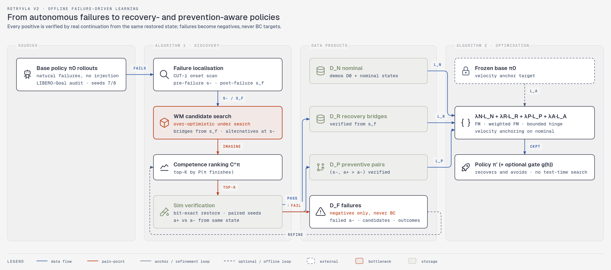

# RetryVLA v2: From Offline Recovery Data Generation to Recovery-Aware Policy Learning (2026-11-23)

> Trạng thái: **PLAN, chưa chạy thí nghiệm nào cho v2.** Viết 2026-11-23 theo hướng mới của user. Không có quy tắc
> pre-registration trong file này. Mỗi stage P2-x khi bắt đầu phải có intake riêng trong `experiments/PLAN.md`
> (campaign agent sở hữu phần đó), theo skill `retryvla-idea-loop`: decision rule viết trước khi có kết quả,
> oracle-first, paired, equal budget, train / val only, 3 seed, nominal guard, review đối kháng trước khi đóng / scale.
> Related work đã kiểm 2 nguồn: `docs/related_work/RELATED_WORK.md` mục P (CARF, RePO-VLA, RECAP, FAR, CrossVLA,
> Failure-to-Success Bridging). Kế hoạch cũ `PHASE_PLAN_2026-11.md` vẫn đúng cho Phase 1 (WM-agnostic engine); file này
> định nghĩa lại **bài toán và cấu trúc paper**.



*Hình 1. Algorithm 1 (discovery) sinh bốn data product; Algorithm 2 (optimisation) train một policy duy nhất. Nguồn
spec: `docs/plans/figs/retryvla-v2.yaml` (render bằng `.cursor/skills/flow-diagram`).*

## 0. TL;DR

- **Research question.** *How can autonomous VLA failures be transformed into offline supervision that teaches a policy
  not only to recover after mistakes, but also to avoid repeating them, without sacrificing nominal performance?*
- **Thay đổi so với v1.** v1 chỉ có một loại dữ liệu (verified bridge từ failure state, SFT). v2 thêm (i) **prevention**:
  tại checkpoint trước failure s^-, tìm một action thay thế a+ và **chứng minh** nó tốt hơn action gốc a- bằng
  continuation trials thật từ cùng state; (ii) **D_F**: mọi action / candidate thất bại được giữ làm negatives (critic,
  risk, preference), **không bao giờ là BC target**; (iii) objective bốn phần, có **velocity anchoring** về base đóng
  băng trên nominal state để chặn forgetting (vấn đề F0 / F1 trên LIBERO-Goal).
- **Benchmark chính**: LIBERO-Goal, protocol của arXiv 2610.05151 (π0 + LoRA, 100 val scene, 300 step, replan 5), so
  thẳng với paper đó (Original 78 → Recovery 88; Original của mình 79.3 trên 3 seed). LIBERO-Recover là benchmark phụ
  (RSR, L1-L4).
- **Stage quyết định: P2-3** (+ verified pre-failure positives). Nếu D_P không thêm gì so với chỉ D_R ở cùng lượng dữ
  liệu, claim "learns when to avoid errors" rơi, paper quay về "verified recovery + anchoring".
- **Novelty trung thực** (mục 8): không claim "đầu tiên học từ failure" hay "đầu tiên preference trên failure". Claim là
  **cặp preventive cùng state được verify bằng ground truth, lấy từ failure tự nhiên, cùng với recovery bridge đã
  verify từ chính các failure đó, hai loại supervision trong một objective có nominal anchoring**. "Offline" nghĩa là
  offline so với deployment (sinh và verify dữ liệu trong sim trước khi deploy), **không** phải offline RL trên một
  dataset cố định.

## 1. Bằng chứng đầu vào (từ `experiments/RESULTS.md`, `docs/research/*`)

| Kết quả hiện có | Số | Ý nghĩa cho v2 |
|---|---|---|
| Spatial 6-arm ablation, 3 seed | π1 (verified, action-grounded) RSR 0.418 ± 0.021 vs demo-only 0.136; nominal 0.785 vs π1-nominal 0.796 | D_R có tác dụng trên metric recovery; action-free / hybrid thì không |
| Spatial forgetting (DATA_FUNNEL) | π1 vs demo-only cùng số step: nominal −3.1 pt (113 / 159, p 0.006) | ngay cả v1 cũng có chi phí nominal nhỏ: động lực cho L_A |
| Goal G0 | M0 85, Original 79.3 (3 seed); paper 77 / 78 | protocol đã tái lập |
| Goal F0 (47 % recovery anchors) | 68.0 (wm) / 67.7 (random), −11.3 vs Original; 34 fixed / 68 broken | dữ liệu recovery hiện tại **phá** nominal trên Goal |
| Goal F1 interim (4 % bridge-only) | wm 58 / 69, random 49 | giảm share chưa cứu được; chưa xong 6 cell |
| CUT_POINT_STUDY | T/4 entry phần lớn là trước onset (M0 tự thành công lại 46 %); solved 0.77 / 0.66 / 0.34 theo T/4 / T/2 / 3T/4 | entry sớm thực ra là **pre-failure state**: nguyên liệu tự nhiên cho D_P, không phải D_R |
| RQ3 optimism | imagined C^π 0.73 vs true-state 0.27 vs SR 0.17 trên pick của search | không bao giờ dùng WM verdict làm nhãn; verify là bắt buộc |
| SMOOTH-V offline | bridge jerk 3.4-4.7x demo, distill vào π1 | rủi ro OOD action trong L_R |
| Back on Track / ForkCast arms, KIN-1, CRIT-V | đang chạy / pre-registered | thành hàng trong main table / ablation |

## 2. MAPPING: tài sản hiện có → cấu trúc v2

Ký hiệu đích: **A1** = Algorithm 1 (discovery), **A2** = Algorithm 2 (optimisation), **AN** = analysis section, **APX** =
appendix, **BL** = baseline row, **DROP** = bỏ khỏi paper (giữ trong RESULTS). "Mới" = việc phải làm thêm.

### 2.1 Claims và câu hỏi nghiên cứu

Ghi chú: trong repo, "C1-C6" là sáu cell của pipeline v1 (NOTES / slides M2-M3: C1 thu dữ liệu WM + critic, C2 train
WM, C3 train critic, C4 WM search, C5 SFT, C6 eval), chưa có danh sách claim "C1-C6" nào được viết ra (file
PAPER_FRAMING_2026-11.md chưa tồn tại). Bảng dưới map cả sáu cell đó và các claim trong bảng "Evidence so far" của
`experiments/PLAN.md`.

| Tài sản | Nội dung cũ | Đi đâu trong v2 | Việc mới |
|---|---|---|---|
| C1 (M2/M3 cell, WM + critic training data) | 4,608 candidate có nhãn continuation | A1: nguồn train C^π và WM | không |
| C2 (WM v1 train) | latent DINOv2 WM, 4-head ensemble | A1 bước 3 (candidate search) | WM card cho Goal |
| C3 (critic C^π) | AUC 0.71 real / 0.67 imagined | A1 bước 4 (ranking) | refit cho checkpoint s^- (C^π hiện train chủ yếu trên post-failure state) |
| C4 (WM search) | 2x hits / sim so với random | A1 bước 3-4; AN (acquisition efficiency) | thêm search ở s^- |
| C5 / C6 (SFT + eval π1) | RSR + nominal | A2 với chỉ L_N + L_R (= P2-1) | anchoring L_A |
| Claim "competence > goal / progress" (RQ1, Q1) | proven Spatial | A1 (lý do chọn C^π); AN | không |
| Claim "distillation ≫ demo-only, best-of-N, imagination-only, residual RL" (Q3) | proven Spatial | AN + BL (Spatial, LIBERO-Recover table) | không |
| M-B constraint (nominal ≤ 2 pt) | pass trên Spatial, fail trên Goal (F0) | A2: thành mục tiêu chính của L_A | đo trên Goal |
| RQ2 action-free L_future | negative (0.12-0.13) | APX (negative result: "imagination helps only when verified") | không |
| RQ3 optimism under search | defensible | AN ("why every label must be verified") | lặp lại trên Goal (đã có goal_verif) |
| "WM data > random data at equal count" | open / reframed | AN (acquisition efficiency), không phải claim chính | không |

### 2.2 Thí nghiệm, biến thể và baseline

| Tài sản | Kết quả | Đi đâu | Việc mới |
|---|---|---|---|
| 6-arm ablation (demo-only, action-grounded, action-free filtered / unfiltered, hybrid, backtrack-distill) | arm 2 thắng | APX (Spatial); arm 2 = tiền thân P2-1; arm 6 = BL "Backtrack-distill" | không |
| P3 recovery-nominal Pareto | r 0.5 tốt nhất, L_preserve không cần trên Spatial | A2: chọn λ_R; L_preserve được thay bằng L_A (velocity anchoring) | sweep lại trên Goal (Stage 4a của campaign) |
| RGR (recursive geometric recovery) | negative | APX (one paragraph) | không |
| ACR-N (act before you imagine, option library) | inconclusive / negative | A1: option library là một **proposal source**; kết quả vào APX | không |
| xwm (cross-WM agreement) | FP giảm, solved không đổi | AN (optimism) / APX | không |
| V-JEPA 2-AC drop-in | solved 0.413 vs 0.349 (p 0.45) | A1: WM-agnostic interface (APX) | không |
| T2Mem | closed, negative | DROP (một câu trong APX) | không |
| F0 (Goal, 47 % anchors) | −11.3 vs Original | **main table row** (v1 recipe on Goal) + AN (forgetting) | không |
| F1 (Goal, 4 % bridge-only) | đang chạy | main table row; quyết định share ban đầu cho P2-1 | chờ kết quả |
| CUT-1 (onset cut) | pre-registered; Stage 2 campaign | **A1 bước 2 (failure localisation)**: onset scan định nghĩa s^- (last recoverable checkpoint) và s^f; yêu cầu chỉ segment failure-critical được làm negative | dùng p_π(t) để gắn nhãn a- |
| SMOOTH-V | pre-registered; Stage 3 | A1 bước 6 (curation trước khi vào D_R / D_P) | bắt buộc re-verify |
| KIN-1 (Kintsugi, Δp) | pre-registered | BL "Kintsugi-style" + AN (selection signal) | không đổi |
| CRIT-V (critic variants) | pre-registered | A1 bước 4 (critic ablation) / APX | không |
| Critic variants cũ (B2 progress, B4 success, Cpi-pool, liveness) | C^π ≈ B4 > progress | A1 ablation; liveness = critic của Back on Track | không |
| Back on Track (2610.19579) arm | đang chạy | **BL test-time** trong main table | không |
| ForkCast-style (2610.18650) arm | đang chạy | **BL test-time** | không |
| Kintsugi-style row | pre-registered (KIN-1 K-T-full) | **BL** main table (Spatial) | Goal bản rút gọn nếu còn ngân sách |
| LRS (re-impl 2610.05151 LLM teacher) | pre-registered, chưa chạy | BL phụ (nếu chạy); main table dùng **số paper** | tuỳ chọn |
| Data funnel (DATA_FUNNEL_AND_FORGETTING) | Spatial / Object / Goal | AN: funnel figure cho cả D_N / D_R / D_P / D_F | thêm D_P, D_F vào script |
| Object held-out (M10) | RSR 0.200 → 0.354, 1 seed | LIBERO-Recover secondary table | 3 seed nếu còn GPU |
| Phase-plan levers L1-L6, students S2 / S3 | plan | L1 / L2 / L5 → **A1 data-engine refinement loop**; S2 = WM calibration; S3 (Diffusion Policy) → DROP khỏi paper này (future work) | không |

**Tóm tắt mapping**: v1 gần như nguyên vẹn trở thành **nửa recovery** của Algorithm 1 (D_R) và thành P2-1 trong
Algorithm 2. Phần mới thật sự là (a) search + verify tại **pre-failure checkpoint** để sinh D_P, (b) hai loss L_P, L_A,
(c) bộ metric "prevention" (failure incidence, first-attempt success, regression) với một failure-event detector dùng
chung, (d) gate g(h) tuỳ chọn. Các ý âm tính (RQ2, RGR, ACR-N, xwm, T2Mem) chuyển xuống appendix / analysis.

## 3. Algorithm 1: Verified Failure-to-Recovery Discovery

**Đầu vào**: base policy π0 (Goal: M0 = π0 + LoRA 4k; Spatial: π1-nominal), các train scene, simulator có restore
bit-exact, WM W + critic C^π (train trên continuation thật của π0), failure-event detector E (mục 6.1), ngân sách
verification B_R (recovery) và B_P (prevention) mỗi failure.
**Đầu ra**: D_N, D_R, D_P, D_F (mục 4), kèm metadata (task, scene, seed, t, nguồn candidate, outcome, điểm imagined,
true end latent).

```text
Algorithm 1  VerifiedFailureToRecoveryDiscovery(π0, scenes_train, W, C^π, E, B_R, B_P)
 1  D_N, D_R, D_P, D_F ← ∅
 2  for scene in scenes_train, audit seed σ in Σ_audit:                    # natural failures, no injection
 3      τ ← rollout(π0, scene, σ); log flat sim state every 5 steps, actions, frames
 4      if success(τ): D_N ← D_N ∪ nominal_states(τ); continue
 5      # ---- failure localisation (CUT-1 onset scan) ----
 6      for t on backward 20-step grid of τ:
 7          p_π(t) ← (1/K) Σ_k success(restore(τ, t) ; π0 continues, seed k)  # K = 8, early stop
 8      t_last ← last t with p_π(t) ≥ 2/8 ;  if none: mark τ "never recoverable" → D_F only; continue
 9      t_on  ← t_last + 20 ;  t_ev ← first event of E on τ after t_last (if any)
10      s⁻ ← state(τ, t_last) ;  s_f ← state(τ, max(t_on, t_ev) + Δ_settle)
11      a⁻ ← τ.actions[t_last : t_last + H_P]                                 # failure-critical segment only
12      require: E fires on replay(s⁻, a⁻) within the window, and p(a⁻) ≤ p_π(t_last) − δ_crit   # CUT-1 rule
13      # ---- recovery branch at s_f (= v1 engine) ----
14      P_R ← proposals(s_f): π0 chunk samples (noise 1.0 / 1.5), perturbations, primitives / option library
15      P_R ← CEM_in_W(P_R, J = C^π(Ŵ(s_f, b)_H) − μ·R(b)); take diverse top-K_R
16      for b in top-K_R (budget B_R):
17          y ← [success(restore(s_f); exec b; π0 continues, seed j)  for j in 1..n_R]   # paired seeds
18          if mean(y) ≥ 2/3: D_R ← D_R ∪ (s_f, b, continuation, w = mean(y)) else D_F ← D_F ∪ (s_f, b, y, Ĉ)
19      # ---- prevention branch at s⁻ ----
20      P_P ← proposals(s⁻): π0 samples at s⁻, perturbations of a⁻, primitives (same length H_P)
21      P_P ← rank by C^π(Ŵ(s⁻, a)_H) − μ·R(a); diverse top-K_P
22      y⁻ ← [success(restore(s⁻); exec a⁻; π0 continues, seed j) for j in 1..n_P]         # same seeds for all
23      for a in top-K_P (budget B_P):
24          y⁺ ← [success(restore(s⁻); exec a; π0 continues, seed j) for j in 1..n_P]
25          if mean(y⁺) − mean(y⁻) ≥ δ_P and E does not fire on the a-branch:
26              D_P ← D_P ∪ (s⁻, a⁺ = a, a⁻, Δ = mean(y⁺) − mean(y⁻), y⁺, y⁻)
27          else D_F ← D_F ∪ (s⁻, a, y⁺, Ĉ)
28      D_F ← D_F ∪ (s⁻, a⁻, y⁻)                                                # the original mistake
29  curate: SMOOTH-V filter / re-verify, dedupe (≤ 2 items per failure episode per product), cap share
30  return D_N, D_R, D_P, D_F
```

Giải thích từng bước:
- **Bước 2-4**: chỉ dùng failure **tự nhiên** của π0 trên train scene (đúng tinh thần LIBERO-Recover và 2610.05151).
  Perturbation injection chỉ là generator phụ, gắn nhãn `injected`, báo cáo riêng.
- **Bước 5-12 (CUT-1)**: p_π(t) là xác suất chính π0 làm tiếp được từ t. s^- là checkpoint **cuối cùng còn recoverable
  bởi chính π0** (≥ 2 / 8), s_f là state sau onset (đã hỏng). Segment a- = H_P action ngay sau s^- trong rollout thật.
  **Yêu cầu CUT-1**: chỉ segment *failure-critical* mới được làm negative, tức là (i) replay a- từ s^- làm detector E
  bật trong cửa sổ, và (ii) continuation sau a- có success thấp hơn p_π(t_last) ít nhất δ_crit (đo bằng cùng K seed).
  Prefix trước s^- (còn recoverable) **không** là negative; đuôi sau s_f (đã hỏng, hành vi mơ hồ) **không** là negative
  và cũng không là BC target. Đây là phiên bản "ground truth" của ý Progressive / Failure-Critical / Indeterminate của
  CARF, với nhãn từ branching thật thay vì scorer học được.
- **Bước 13-18 (D_R)**: chính là engine v1 (`wm_diverse`): proposal library + CEM trong WM, xếp theo C^π, verify bằng
  bridge + continuation của π0 từ snapshot. WM chỉ là filter: nhãn luôn đến từ sim.
- **Bước 19-28 (D_P)**: cùng engine nhưng ở **s^-**, với candidate cùng độ dài a-. Cặp chỉ được nhận khi a+ thắng a- có ý
  nghĩa trên **cùng continuation seed** (paired), và nhánh a+ không có failure event. Đây là "matched-state ground-truth
  comparison" thay cho critic (FAR dùng Q của IQL, RECAP dùng advantage từ value).
- **D_F** giữ tất cả: action gốc a-, candidate thua, outcome, điểm imagined, true end latent. Dùng cho critic hard
  negatives, risk head, vế thua của L_P; không bao giờ là BC target.

Tham số mặc định đề xuất (chốt trong intake): K = 8, grid 20 step, H_P = 20-50 step (chốt theo độ dài đoạn mà p_π tụt
thực tế trong onset scan), n_R = 3, n_P = 4 (paired), δ_P = 0.5 (ví dụ ≥ 3 / 4 vs ≤ 1 / 4), δ_crit = 0.25,
K_R = K_P = 16 verification / failure.

**Data-engine refinement loop (offline, sau mỗi round r)** (= levers L1 / L2 / L5 của PHASE_PLAN):
1. Critic: refit C^π với D_F làm hard negatives (đặc biệt các false positive của search: Ĉ cao, sim thua).
2. Proposal model q(a | s): một flow head nhỏ (hoặc LoRA recovery head) train trên D_R bridges và a+ của D_P (train
   split only), dùng để sample pool + warm-start CEM.
3. WM calibration: fine-tune WM trên transition đã verify (cả thành công lẫn thất bại), hoặc recalibrator g(Ĉ) trên
   cặp (imagined, outcome thật). Đo trên **round sau**: FP@top-K, gap C(a) − C(b), ECE, verified yield / 1k sim steps.
4. (Tuỳ chọn) chạy lại Algorithm 1 với π' (policy sau Algorithm 2) để thu failure mới; control "chỉ train thêm step".

## 4. Data products

| Product | Nội dung | Sinh ra ở | Dùng trong | Không bao giờ |
|---|---|---|---|---|
| **D_N** (nominal) | demo D0 của protocol + state của rollout thành công của π0 (cho L_A) | bước 4 + dataset | L_N (FM), L_A (state cho anchoring) | - |
| **D_R** (verified recovery) | (s_f, bridge b, w = tỉ lệ seed thành công; continuation của π0 lưu riêng) | bước 13-18 | L_R: **bridge segment only** mặc định, continuation chỉ là ablation (bài học F0: 60 % mẫu recovery là continuation tái bắt chước π0) | nhãn từ WM verdict |
| **D_P** (verified preventive pairs) | (s^-, a+, a-, Δ, y+, y-) cùng snapshot, cùng seed | bước 19-28 | L_P (hinge cặp); a+ có thể vào FM trong ablation P2-3s | cặp không verify, cặp mà a- không failure-critical |
| **D_F** (failures) | a- gốc, candidate thua ở s_f và s^-, outcome, Ĉ, true end latent | bước 18, 27, 28 | critic / risk refit, hard negatives, vế a- của L_P (chỉ khi là a- của một cặp đã verify), phân tích optimism | **BC target** |

Ghi chú:
- Đơn vị leakage = failure episode (task, init, audit seed); mọi item của cùng episode cùng split. E8 (failure của audit
  seed 8) giữ làm **held-out own-failure eval**, không vào bất kỳ bank nào (đã như vậy trong campaign).
- Share mặc định ban đầu theo kết quả campaign: Stage 4a share sweep 1 / 2 / 4 / 8 % cho D_R; D_P đếm theo **số cặp**,
  bắt đầu cùng số anchor với D_R để P2-3 so sánh công bằng.
- Funnel báo cáo cho mỗi product: failures → localised (có s^-) → candidates → verified → bank → distilled
  (mở rộng `scripts/analyze_data_funnel.py`).

## 5. Algorithm 2: Recovery-and-Prevention Policy Optimization

Ký hiệu: v_θ(x_t, t, o) là velocity của action expert flow matching; với action chunk a, noise ε, thời gian t, x_t là
nội suy tuyến tính giữa ε và a, u(a, ε) là velocity đích (π0 / SmolVLA trong LeRobot: x_t = t·ε + (1 − t)·a,
u = ε − a; quy ước nào cũng được miễn là dùng đúng như code train hiện tại).

l_FM(θ; o, a) = E_{t, ε} ‖ v_θ(x_t, t, o) − u(a, ε) ‖²

Objective:

L(θ) = λ_N·L_N + λ_R·L_R + λ_P·L_P + λ_A·L_A

- **L_N** = E_{(o,a)∈D0} l_FM(θ; o, a). Nominal flow matching như recipe của 2610.05151 (M0 + 2k update).
- **L_R** = E_{(o,a,w)∈D_R} w · m(a) ⊙ l_FM(θ; o, a), w = độ robust khi verify (tỉ lệ seed), chuẩn hoá về trung bình 1;
  m(a) = validity mask: action target vượt quá cuối bridge bị mask (Stage 4b của campaign). Bridge-only mặc định.
- **L_P** (bounded hinge ranking surrogate, cặp cùng state):
  L_P = E_{(o⁻, a⁺, a⁻)∈D_P} [ max(0, m + l̃_FM(θ; o⁻, a⁺) − l̃_FM(θ; o⁻, a⁻)) ] + γ·E[ l_FM(θ; o⁻, a⁺) ]
  trong đó l̃ dùng **cùng (t, ε)** cho hai vế (giảm phương sai, so sánh đúng cặp); m là margin (đơn vị loss FM, chốt
  theo phân phối l_FM của π0 trên D0, ví dụ trung vị); γ ≥ 0 là phần attraction (γ = 0 trong arm "pure ranking").
  **Không phải DPO**: không có reference model, không có log-sigmoid; hinge bằng 0 khi a- đã kém hơn a+ một margin, nên
  repulsion bị chặn (giống ý ReLU của CARF, nhưng theo cặp cùng state và nhãn ground truth). Hệ quả: L_P không thể
  giảm vô hạn bằng cách đẩy l_FM(a-) lên mãi.
- **L_A** (velocity anchoring trên nominal state): L_A = E_{o∈S_N} E_{t, x_t} ‖ v_θ(x_t, t, o) − v_{θ0}(x_t, t, o) ‖²,
  θ0 = base đóng băng (M0), S_N = state của D0 + state của rollout thành công của π0 (D_N), x_t lấy từ nội suy giữa ε
  và một action tham chiếu (action demo của D0, hoặc a_base ~ π_{θ0}(o); chốt trong intake). Ý nghĩa: ở chỗ base đã
  đúng, field của policy mới phải giống base; khác với L_preserve cũ (action-matching L2) và với KL trên action.
- **Gate g(h) (tuỳ chọn, P2-4)**: head nhỏ trên hidden state h của VLA, dự đoán z ∈ {nominal, pre-failure, recovery} từ
  **observation hiện tại** (không oracle lúc test). Nhãn train: state của D_N = nominal; s^- của D_P = pre-failure;
  s_f của D_R = recovery (nhãn từ detector E + CUT-1). Dùng theo một trong hai cách (chọn trong intake): (a) token
  conditioning (giống value token của RePO-VLA, nhưng **dự đoán** chứ không cố định v = 1); (b) trọng số per-sample:
  λ_A·(1 − g_rec(h)) để anchoring mạnh ở nominal, yếu ở recovery. Loss phụ: BCE / CE trên z.

```text
Algorithm 2  RecoveryAndPreventionPO(θ0, D_N, D_R, D_P, λ, m, γ, steps = 2000)
 1  θ ← θ0 ; freeze copy θ0
 2  for step in 1..steps:                                     # their recipe: warmup 200, cosine
 3      B_N ~ D_N (nominal batch) ; B_R ~ D_R ; B_P ~ D_P      # fixed shares per batch
 4      L_N ← mean l_FM(θ; B_N)
 5      L_R ← mean w · mask · l_FM(θ; B_R)
 6      sample shared (t, ε) per pair in B_P
 7      L_P ← mean max(0, m + l_FM(θ; o⁻, a⁺; t, ε) − l_FM(θ; o⁻, a⁻; t, ε)) + γ · mean l_FM(θ; o⁻, a⁺)
 8      x_t ← interpolate(a_base or a_demo, ε, t) on B_N states
 9      L_A ← mean ‖ v_θ(x_t, t, o) − stopgrad(v_θ0(x_t, t, o)) ‖²
10      (optional) L_g ← CE(g(h), z)
11      θ ← θ − η ∇(λ_N L_N + λ_R L_R + λ_P L_P + λ_A L_A + λ_g L_g)
12  return θ
```

Chi phí: một forward thêm của base θ0 cho L_A (cùng batch nominal) và hai lượt l_FM cho mỗi cặp; với π0 + LoRA trên A100
ước khoảng 1.3-1.5x thời gian của recipe Original (2.8 h / run hiện tại → ~3.5-4 h). Chọn λ trên **val split, chỉ
một lần mỗi stage** (giống chọn M0 trong paper), hoặc tốt hơn trên một held-out slice của train scene, sau đó đóng băng.

## 6. Metrics

### 6.1 Failure-event detector E (độc lập, dùng chung cho mọi arm)
- **Định nghĩa**: hàm thuần của **privileged sim state** theo thời gian, không đọc WM, C^π, policy hay nhãn CUT-1. Event
  (lấy từ PHASE_PLAN 3.2 bước 2): grasp lost (mất finger contact khi object đang nâng, z giảm > 3 cm); object displaced
  > 3 cm khỏi support / rơi khỏi bàn; tip (up-axis z < 0.8); non-target object bị đẩy > 3 cm; fixture state đảo (drawer
  đóng lại, stove tắt); sub-goal BDDL predicate bị hoàn tác; stall (eef speed < ngưỡng, contact không đổi trong 40 step).
  Mỗi event có thời điểm và loại.
- **"Recovery event"**: một event E tại t_e theo sau bởi việc khôi phục được điều kiện bị phá (object lại trong tay /
  lại trên support, predicate được bật lại) trước khi episode kết thúc.
- **Đóng băng trước mọi kết quả P2** (code + ngưỡng + version hash ghi trong intake), chạy offline trên log state của
  mọi eval episode (eval phải lưu flat state mỗi 5 step: hook opt-in, như rich_record).
- **Kiểm định**: 50 episode (25 thành công, 25 thất bại, trộn arm) gán nhãn tay mù arm; báo precision / recall theo
  loại event, Cohen's κ ≥ 0.6 mới dùng làm metric chính; nếu không đạt thì metric 6.2 (b)-(d) chỉ vào appendix.
- Vì sao độc lập: nếu dùng C^π hoặc p_π để đếm failure thì arm nào train trên tín hiệu đó sẽ được lợi khi chấm.

### 6.2 Định nghĩa (đo trên 100 val scene theo protocol 2610.05151, 3 seed SFT × policy seed cố định)
| Metric | Định nghĩa | Đọc thế nào |
|---|---|---|
| (a) Nominal SR | # success / 100, Wilson CI; Δ vs Original bằng scene × seed bootstrap | metric chính, so với paper |
| (b) Failure incidence | tỉ lệ episode có ≥ 1 event E (bất kể kết quả cuối) | prevention: phải **giảm** |
| (c) First-attempt success | tỉ lệ episode thành công **không có** event E nào trước khi thành công | "làm đúng ngay từ đầu" |
| (d) Recovery events / episode | số recovery event (6.1) / episode; kèm P(success \| ≥ 1 event) | recovery: phải tăng khi có lỗi |
| (e) Completion steps | số step tới success (episode thành công); median + mean, cap 300 | recovery đắt hơn prevention |
| (f) Success → failure regression | trong các scene mà Original (cùng seed) thành công, tỉ lệ nay thất bại (broken); kèm fixed; McNemar | forgetting; F0 là 68 broken / 34 fixed |
| (g) Own-failure RSR | RSR trên E8 (168 entry held-out của audit seed 8) + E8on (onset state) | recovery có transfer sang failure mới của chính π0 không |
| (h) Pre-failure avoidance | từ s^- held-out (audit seed 9): P(không event trong cửa sổ H_P + 50 và success) | prevention đo trực tiếp |
| (i) Cost | sim-hours offline (gồm onset scan, verification), GPU-h train, GPU-s / episode lúc test | so với test-time arms |

Thống kê: paired theo scene, scene × seed bootstrap 10k cho Δ, McNemar exact cho fixed / broken; MDE ở n = 100 và 3
seed ≈ 7 pt (từ campaign), nên dưới mức đó là "inconclusive at n = 100", không phải "no effect".

## 7. Staged experiments P2-0 … P2-5 (LIBERO-Goal, protocol 2610.05151; mỗi stage có intake riêng trong PLAN.md)

Chung: init M0 4k, M0 + 2k update, warmup 200, cosine; 3 seed (7, 8, 9); 100 val scene; test split chỉ ở P2-5.
Ngân sách dữ liệu bằng nhau theo số anchor recovery + preventive giữa các arm được so cặp.

| Stage | Arm (thêm vào stage trước) | Câu hỏi | Control trực tiếp | Kết quả đọc chính |
|---|---|---|---|---|
| **P2-0** | Infrastructure + D_P feasibility: onset scan (CUT-1) trên audit seed 7 / 8, detector E + kiểm định κ, prevention branch của Algorithm 1 chạy trên seed-7 failures (0 training) | Có đủ cặp verified không? Bao nhiêu failure có s^- với ít nhất một a+ thắng a- có ý nghĩa? | oracle: sim-only search ở s^- cùng ngân sách (không WM) | yield cặp / failure, Δ phân phối, κ của E. **Gate**: ≥ 30 failure episode có ≥ 1 cặp, nếu không D_P không đủ cho P2-3 |
| **P2-1** | L_N + L_R (verified recovery, bridge-only, share tốt nhất từ campaign Stage 4) | Recovery data từ failure tự nhiên có giúp **sau khi** sửa cut / share / mask không? | Original; F1 | Δ nominal, (g), (f) |
| **P2-2** | P2-1 + λ_A·L_A | Velocity anchoring có xoá chi phí nominal (F0 −11) mà giữ (g) không? | P2-1 | (a), (f) với (g) không giảm > 2 |
| **P2-3** (**quyết định**) | P2-2 + λ_P·L_P trên D_P (verified pre-failure pairs) | Dạy **tránh** lỗi có thêm gì so với chỉ dạy **sửa** lỗi, ở cùng tổng số anchor? | P2-2 với cùng số anchor (thêm D_R thay cho D_P) | (b), (c), (h), (a); P2-3 vs P2-2-matched là phép thử của toàn bộ claim prevention |
| P2-3 ablations | (s) a+ chỉ làm FM target (γ > 0, không hinge); (u) cặp **không verify** (a+ = top C^π / WM, a- = segment gốc: FAR-style); (n) chỉ repulsion a- không ghép cặp (CARF-style ReLU với loss tham chiếu D_N); (r) RECAP-style token tốt / xấu trên cùng dữ liệu | Lợi ích đến từ cặp, từ verification, hay chỉ từ thêm positive tại s^-? | P2-3 | (b), (c), (a) |
| **P2-4** | P2-3 + gate g(h) dự đoán từ observation | Mode "khi nào tránh / khi nào sửa" tường minh có giúp không? | P2-3 | (c), (d), (e) |
| **P2-5** | Một vòng refinement data engine (critic hard negatives từ D_F, proposal model trên D_R / D_P, WM calibration), chạy lại Algorithm 1 với cùng ngân sách sim → retrain best recipe; sau đó recipe đóng băng × 3 seed trên **100 test scene** (một lần) | Data engine có tự tốt lên không (yield / precision), và có chuyển thành policy gain không ngoài "train thêm"? | best stage + cùng số step trên bank cũ | yield / 1k sim, FP@top-K vòng sau; final test vs Original, vs paper 88 (cross-paper) |

Thứ tự phụ thuộc: P2-0 song song với campaign Stage 2-4 (dùng chung onset scan); P2-1 lấy best bank / share của Stage 4;
P2-3 chỉ chạy khi P2-0 qua gate. Mỗi stage: RESULTS entry + đọc theo rule trước khi đổi code của stage sau.

## 8. Main table design

### 8.1 LIBERO-Goal, protocol 2610.05151 (chính)
Cột: Nominal SR val (mean 3 seed, CI) · Δ vs Original (bootstrap) · fixed / broken vs Original · failure incidence ·
first-attempt success · recovery events / ep · completion steps · own-failure RSR (E8) · offline sim-h · test-time
GPU-s / ep. Test split: chỉ các hàng đánh dấu (T) ở P2-5.

| Hàng | Loại | Nguồn | Trạng thái |
|---|---|---|---|
| M0 (π0 + LoRA 4k, chọn trên val) | base | G0 | 85 (có) |
| Original (M0 + 2k trên D0) (T) | control | G0 / main | 79.3 (có) |
| 2610.05151 Recovery (paper) | cross-paper | số paper 78 → 88, 1 seed | chỉ tham chiếu, khác split / framework (D1-D3) |
| F0: RetryVLA v1 bank, 47 % anchors | v1 | main comparison | 68.0 (có) |
| F1: v1 bank, 4 % bridge-only | v1 | F1 | đang chạy |
| P2-1 recovery-only | ours | P2-1 | - |
| P2-2 + anchoring | ours | P2-2 | - |
| P2-3 + verified prevention pairs (T) | ours | P2-3 | - |
| P2-4 + gate g(h) | ours | P2-4 | - |
| M0 + Back on Track (C^π / liveness) | test-time | BoT arms | đang chạy |
| M0 + ForkCast-style (progress / C^π) | test-time | BoT arms | đang chạy |
| best ours + Back on Track | complementarity | BoT arm 6 | - |
| Kintsugi-style (expert-recoverability frontier) | selection baseline | KIN-1 (Spatial trước; Goal chỉ nếu replicate) | pre-registered |
| (tuỳ chọn) LRS re-impl (LLM teacher) | baseline | PLAN "LRS" | chưa chạy |

### 8.2 LIBERO-Recover (phụ)
Spatial test (dev) + Object test (held-out), SmolVLA: π0, π1-nominal, demo-only, π1 (v1 = P2-1 analogue), P2-3 port
(D_P từ failure của π1-nominal trên train scene), Backtrack / Backtrack-distill, Back on Track (Spatial secondary).
Cột: RSR overall + L1-L4, nominal Spatial (eps 2 pt), failure incidence trên nominal start, sim-h.

## 9. Novelty

### 9.1 Bảng so sánh (đã kiểm nguồn: RELATED_WORK mục P, K1, L1, L3, N, WM_RECOVERY_OVERLAP, NOVELTY_VS_KINTSUGI)
| | Failure source | Recovery positives | Prevention (pre-failure) | Negatives | Verification | Matched-state pairs | Nominal protection | Khi nào | Policy |
|---|---|---|---|---|---|---|---|---|---|
| **CARF** 2609.21982 | perturbed demos (sim), teleop failures (real) | progressive segments của failure (theo scorer) | không tường minh | failure-critical segments (theo scorer), unpaired ReLU | không (progress scorer) | không | L_suc trên demo | offline, fixed dataset | flow-matching visuomotor |
| **RePO-VLA** 2605.09410 (NeurIPS 2026) | injected errors + policy-induced | planner (sim) / teleop (real) corrective suffix | ngầm qua value conditioning | value thấp cho error segment | planner success | không | RAI giữ nominal; v = 1 token | offline fine-tune | π0.5 |
| **RECAP** 2511.14759 | autonomous rollouts | teleop interventions | ngầm (advantage) | action "Advantage: negative" vẫn được train có điều kiện | không (value function) | không | token + CFG | iterative on-robot | π*0.6 |
| **FAR** 2607.01111 (CoRL 2026) | own failures at deploy | successful retries (AWR) | **có**, a+ ≻ a- cùng state | a- theo ΔV của IQL | **không** (a+ theo Q) | **có** | không (10 bước TTA) | test-time + online | Diffusion Policy |
| **2610.05151** | own natural failures | LLM tool-teacher, nhận khi frozen student chạy tiếp được | không | không dùng | **có** (continuation của student) | không | uniform mix với D0 | offline rounds | π0 |
| **Back on Track** 2610.19579 | deployment | không lưu (plan lúc test) | không | không | không | không | không retrain | test-time | frozen π0.5 / DP |
| **SAILOR** 2506.05294 | learner rollouts | MPPI residual quanh base plan, distill | không | discriminator reward | không | không | - | test-time + ExIt | Diffusion Policy |
| **Kintsugi-VLA** 2609.31048 | base VLA + expert failures | privileged PPO expert continuations tại frontier depths | không | không | MC theo **expert** | không | - | offline | SmolVLA |
| **F2S Bridging** (WIP) | offline datasets | IDM bridge tới suffix demo, obs do WM sinh | không | không | không (cố ý không dùng sim) | không | confidence weights | offline | (chưa có) |
| **RetryVLA v2** | own **natural** failures, CUT-1 localised | WM + C^π search, **sim-verified** bridges từ s_f | **có**: a+ ≻ a- tại s^- | D_F: a- failure-critical + candidate thua (critic / ranking, không BC) | **có**: continuation thật, paired seeds, cả hai vế | **có** | L_A velocity anchoring + L_N | offline so với deployment, refinement rounds | π0 (Goal), SmolVLA (Recover) |

### 9.2 Cái gì thật sự mới (viết trung thực)
- **Đã bị chiếm, không claim**: học từ failure trajectory (CARF, RePO-VLA, RECAP); preference / contrastive trên cặp
  action cùng state từ failure (FAR, nhưng test-time và không verify); continuation acceptance (2610.05151); WM + value
  theo policy để tìm recovery (Back on Track, SAILOR); failure → bridge offline (2610.05151, F2S Bridging); FM-loss làm
  surrogate cho mục tiêu cặp (CrossVLA, FAR với denoising loss, Diffusion-DPO).
- **Claim được** (chưa thấy bài nào có đủ cùng lúc):
  1. **Matched-state, ground-truth-verified preventive pairs từ failure tự nhiên**: a- là đúng segment gây lỗi (CUT-1),
     a+ được chứng minh tốt hơn bằng continuation trials từ cùng snapshot, cùng seed.
  2. **Verified recovery bridges từ chính các failure đó** (D_R) → hai loại supervision (recover vs avoid) từ cùng một
     failure episode, trong một objective.
  3. **Nominal anchoring** (L_A) như một phần của bài toán, đo bằng regression metric (f), vì chính dữ liệu của mình đã
     chứng minh recovery data làm hỏng nominal trên Goal (F0).
  4. Bộ metric tách prevention khỏi recovery (failure incidence, first-attempt success, recovery events) với một
     detector độc lập.
- **Giới hạn phải nói rõ**: "offline" = offline so với deployment, cần simulator restore bit-exact để verify; không phải
  offline RL trên dataset cố định. Real-world chỉ là hướng mở (WM-verified, như F2S Bridging / Ctrl-World), không được
  gọi là "verified".
- **Claim chỉ đứng nếu P2-3 dương** (P2-3 > P2-2-matched trên (b) hoặc (c) và không mất (a)), và ablation (u) cho thấy
  verification quan trọng (P2-3 > P2-3u). Nếu P2-3 ≈ P2-2: paper là "verified recovery + anchoring", phần prevention
  thành analysis.

## 10. Risks

| Rủi ro | Dấu hiệu | Giảm thiểu |
|---|---|---|
| Không đủ cặp D_P (s^- hiếm có a+ thắng rõ) | P2-0 gate fail | nới δ_P, H_P dài hơn, thêm proposal từ option library / π0 sample ở noise cao; nếu vẫn fail: prevention thành analysis |
| Headroom nhỏ trên Goal (Original 79.3, chỉ ~20 failure / 100) | Δ < MDE 7 pt | báo (b), (c), (g), (h) có n lớn hơn; LIBERO-Recover làm benchmark phụ |
| L_P làm hỏng nominal (đẩy field ở state gần nominal) | (f) tăng | hinge bị chặn + L_A; giới hạn L_P vào s^- có g(h) = pre-failure |
| L_A quá mạnh làm mất recovery | (g) giảm | sweep λ_A trên slice train; λ_A theo g(h) |
| Detector E thiên vị / bỏ sót loại lỗi | κ < 0.6 | dùng (a), (f), (g) làm chính; E chỉ appendix |
| Onset scan đắt (K = 8 continuation × grid) | > 4 h / audit seed | early stop, grid thô → mịn quanh t_last; dùng chung với campaign Stage 2 |
| WM optimism ở s^- (state ít trong data WM) | yield thấp, FP cao | sim-only proposal ở s^- (ngân sách nhỏ, state gần nominal nên rẻ hơn), critic refit trên s^- |
| Leakage val (chọn λ trên val giống chọn M0) | - | chọn trên held-out slice của train scene; val chỉ đọc một lần mỗi stage; test một lần ở P2-5 |
| Cross-paper không công bằng | - | 88 chỉ là tham chiếu; chỉ claim so với Original của mình (paired) |
| Novelty bị chiếm thêm (10-11/2026 rất đông) | bài mới có verified matched pairs | re-sweep trước khi viết (skill `retryvla-idea-review`) |

## 11. Timeline (giả định 2 shell / 4 GPU như campaign hiện tại; chỉ bắt đầu sau khi campaign Stage 2-4 cho ra bank tốt nhất)

| Tuần | Việc | Ra |
|---|---|---|
| W0 (11-24 → 11-27) | detector E + kiểm định κ; eval hook lưu state; P2-0 prevention branch trên onset scan của campaign | yield D_P, gate P2-0 |
| W1 (11-28 → 12-04) | cài L_P, L_A (train script opt-in, unit test: hinge = 0 khi đã tách; L_A = 0 tại θ = θ0); P2-1, P2-2 × 3 seed | Δ nominal, regression |
| W2 (12-05 → 12-11) | P2-3 + ablation (s, u, n, r) | quyết định prevention |
| W3 (12-12 → 12-18) | P2-4 gate; LIBERO-Recover port (Spatial / Object) | bảng phụ |
| W4 (12-19 → 12-25) | P2-5 refinement round + final test × 3 seed; review đối kháng | main table cuối |
| W5 | viết; re-sweep related work | draft |

Tổng compute ước: P2-0 ~1 ngày CPU + ~6 GPU-h (continuation của π0 3B); P2-1 … P2-4 ~(4 + 4 ablation) arm × 3 seed × ~4
GPU-h ≈ 100 GPU-h + eval ~0.3 GPU-h / run; P2-5 ~40 GPU-h + 1 ngày sim.

## 12. Nguồn
- Related work v2 (2 nguồn mỗi bài): `docs/related_work/RELATED_WORK.md` mục P. Các bài khác: mục K1 (Back on Track),
  L1 (SAILOR), L3 (2610.05151), N + `docs/research/NOVELTY_VS_KINTSUGI.md` (Kintsugi-VLA), O (ForkCast).
- Số liệu của mình: `experiments/RESULTS.md` (6-arm, RQ3, G0, main comparison, F1 interim trong PLAN "Goal campaign"),
  `docs/research/DATA_FUNNEL_AND_FORGETTING.md`, `docs/research/CUT_POINT_STUDY.md`,
  `docs/reviews/AGENTIC_SMOOTHNESS_REVIEW.md`.
- Hình: `docs/plans/figs/retryvla-v2.{png,svg,yaml}`.
