# Related Work cho RetryVLA (kèm hình METHOD)

> Mục tiêu: đọc nhanh, nhìn hình là hiểu mỗi paper làm gì, và nó **khác gì RetryVLA**.
> Mỗi paper: tiêu đề + link + venue/năm, hình method (crop từ PDF arXiv), 3-5 ý ngắn.
> Tất cả paper dưới đây đã được **kiểm tra tồn tại** trên arXiv (tiêu đề/tác giả lấy từ arXiv API, venue kiểm tra qua proceedings/OpenReview khi có).
> PDF gốc nằm ở `docs/related_work/pdfs/` (không commit, bị `.gitignore`), hình ở `docs/related_work/figs/`.
> **Cập nhật 2026-11-01:** thêm mục F-J (11 bài cho hướng gộp action-grounded + action-free). Cả 11 bài đã kiểm tra trên arXiv API (tiêu đề, tác giả, ngày v1); venue kiểm tra qua CVF Open Access / ICML virtual khi có. Hình F-J lấy từ bản HTML arXiv (raster gốc) hoặc render vùng hình từ PDF (Recova, Backtrack, CureWM vì hình dạng vector / SVG).

**RetryVLA (để định vị):** VLA đóng băng (SmolVLA) + latent world model trên DINOv2 features + *competence critic* C^π(s,g) = P(chính policy π hoàn thành task nếu bắt đầu từ s), học từ rollout tiếp nối thật của π. Từ một failure state, search một "bridge" ngắn (50 step) sao cho trạng thái cuối tưởng tượng có C^π cao nhất → verify trong sim (cho π chạy tiếp) → distill bridge + continuation đã verify vào VLA (trộn 50% nominal demo) → lúc test VLA tự recover, **không cần search**, không mất nominal success. Benchmark: LIBERO-Recover (Spatial = dev, Object = held-out).

---

## 0. Tổng quan 1 màn hình

| Paper | Recovery? | Dùng WM? | Objective / value signal | Cập nhật policy | Cần verify sim/real? | Module thêm lúc test | Benchmark |
|---|---|---|---|---|---|---|---|
| **RetryVLA (ours)** | ✅ | ✅ latent DINOv2 WM (làm filter) | **Policy competence** C^π(s) = P(π thành công từ s) | **Verified SFT / distill** (+50% nominal replay) | ✅ sim verify (π chạy tiếp) | **Không** (search chỉ dùng lúc tạo data) | LIBERO-Recover |
| RePO-VLA | ✅ | ❌ | Progress-aware semantic value (PAS-VF) | Value-conditioned SFT (VCR) | Recovery từ planner/người | Không (value token cố định v=1) | FRBench (RoboTwin + real bimanual) |
| Dream2Fix | ✅ (dự đoán correction) | ✅ video WM (Ctrl-World) để *tạo failure* | Verifier lọc (VLM + IDM + joint) | SFT một VLM (failure type + correction) | Verifier học được, không sim | VLM chẩn đoán + correction | Real Franka |
| ReCoVLA | ✅ | ❌ | Reward do VLM chọn/compile (reward mask) | **RL** (PPO) residual policy, VLA đóng băng | ✅ train trong sim | VLM analyzer + residual policy | Fetch (sim + real) |
| RACER | ✅ | ❌ | Không có value; supervisor VLM sinh ngôn ngữ | SFT (data perturb + annotate) | Sim (RLBench) để sinh data | **VLM supervisor** mỗi bước | RLBench + real |
| Neuro-symbolic recovery | ✅ | ✅ scene-graph transition model | Discrepancy (discriminator) + heuristic distance tới goal | Không (re-plan symbolic) | Không | Detector + symbolic search | Sim block-stacking (Franka) |
| DINO-WM | ❌ | ✅ latent DINOv2 WM | **Khoảng cách tới goal image** (latent) | Không (MPC/CEM thuần) | Không | **Planning mỗi bước** | PushT, Maze, Wall, Rope… |
| TD-MPC2 | ❌ | ✅ implicit latent WM | Reward + TD value Q (của task) | RL (TD learning) | Online interaction | **MPPI planning** | DMControl, Meta-World, ManiSkill2, MyoSuite |
| RISE | ⚠️ gián tiếp (robust) | ✅ video WM + value model | **Progress value** (π0.5-based, Progress + TD) | RL trong tưởng tượng (advantage-conditioned) | Không (imagination-only) | Không | 3 task real |
| WMPO | ⚠️ self-correction emergent | ✅ pixel video WM | Reward model thành công/thất bại (binary) | **RL on-policy GRPO** trong WM | Ít (fine-tune WM trên rollout thật) | Không | MimicGen sim + real ALOHA |
| LIBERO-Recover | (benchmark) | – | RSR = recovery success rate | – | – | – | 1000+ scenario, 4 level |
| *MimicGen (thêm)* | ❌ | ❌ | Task success khi replay | SFT/BC trên data sinh ra | ✅ sim replay để lọc | Không | robosuite tasks |
| *DAgger (thêm)* | ✅ gián tiếp (state distribution) | ❌ | Nhãn expert ở state của learner | SFT lặp | Cần expert online | Không | – |
| **Backtrack** (F1) | ✅ | ❌ | Failure head P(fail) trên feature của VLA, học từ rollout có nhãn outcome của π đóng băng | **Không** (VLA đóng băng) | Không | Failure head + controller lùi theo motion đã đi | LIBERO 4 suite (SmolVLA, π0.5, π0-FAST), MetaWorld |
| **CoRe** (F2) | ✅ | ⚠️ "tưởng tượng" continuation bằng ảnh tổng hợp (edit ảnh + voxel + FK), không phải WM học | Rejoin continuation tưởng tượng của chính π + restoration tối thiểu | **Không** (training-free) | Không (nhưng cần sắp xếp lại scene thật) | OOD detector + virtual planning + motion planner | LIBERO-Long + perturbation, LangSwitch, real xArm6 |
| **Recova** (F3) | ✅ | ❌ (digital twin = sim dựng lại) | Agent chẩn đoán + code-as-policy, verify scene đã khôi phục | DAgger SFT, task policy và recovery policy **tách riêng** | ✅ twin sim + real | Agent monitor + recovery policy/skill | LIBERO-Pro, MolmoSpaces, 4 trạm robot thật |
| **FLARE** (F4) | ✅ (Retry / Reset) | ❌ | MLLM phân tích failure offline (ID / OOD) | SFT (perturb + bridging augmentation, reset skills) | Không (reset demo do người thu) | **MLLM monitor online** | Task contact-rich sim + real (π0.5) |
| **Hi-WM** (F5) | ✅ (corrective) | ✅ action-conditioned WM | Người can thiệp trực tiếp trong WM (rollback / branching) | SFT trên corrective trajectories | Không (người phán) | Không | 3 task real (DP, π0) |
| **CureWM** (G1) | (độ tin cậy WM) | ✅ Cosmos Policy, Ctrl-World | Optimism / success-failure gap trên failure counterfactual | Fine-tune **WM** (không phải policy) | ✅ execution trong sim / hardware | – | 484 LIBERO counterfactuals + real arm |
| **FOCA** (H1) | ❌ | ⚠️ video WM tuỳ chọn để co-train | Dự đoán future interaction embedding + align ngầm với future goal | SFT + loss future phụ, **action-free co-training** | Không | Không | LIBERO few-shot, RoboCasa, real |
| **ThinkWorld** (H2) | ❌ | ✅ imagination nội tại (future trong không gian DINO) | Độ khớp future dự đoán với hệ quả quan sát được | SFT + RL (consequence-grounded) | Không | CoD reasoning tokens | sim + real, human video |
| **PointWorld** (I1) | ❌ | ✅ 3D point-flow WM | Cost MPC | Không (MPC) | Không | MPC planning | real Franka zero-shot |
| **PointAction** (I2) | ❌ | ✅ video → 4D pointmap | – | Point-to-action decoder | Không | Sinh video + pointmap | RoboCasa365, real YAM / xArm7 |
| **Observing & Controlling Features** (J1) | ❌ | ❌ | Linear observer trên representation của VLA | Không (can thiệp lúc inference) | Không | Observer + controller (~1% overhead) | LIBERO (π0.5), DROID hardware |

### Định vị RetryVLA (ngắn)
- **Tín hiệu khác**: hầu hết paper dùng *goal/progress/reward của task* (DINO-WM: gần goal image; RISE/RePO: progress; ReCoVLA/WMPO: reward). RetryVLA dùng **competence của chính policy đóng băng** — "đưa robot về chỗ mà π biết làm tiếp", nên bridge ngắn là đủ, không cần giải cả task. Kết quả của mình: competence-guided search ≫ latent-goal (kiểu DINO-WM) và progress-value search.
- **Cách update khác**: không RL (ReCoVLA, WMPO, RISE, TD-MPC2) mà **SFT trên data đã verify trong sim** — giống tinh thần MimicGen/DAgger hơn. Đã thấy: distillation ≫ demo-only SFT; imagination-only (kiểu RISE) và residual RL cùng sim budget đều kém hơn.
- **Test-time rẻ**: không VLM supervisor (RACER, Dream2Fix, ReCoVLA), không planning mỗi bước (DINO-WM, TD-MPC2). Search + WM chỉ dùng **offline để tạo data**.
- **Vai trò WM thật sự**: trong RetryVLA, WM chủ yếu là **filter** trên một proposal library (không phải nguồn "tưởng tượng" duy nhất như RISE/WMPO/Dream2Fix) — verify thật trong sim mới là cái quyết định nhãn.
- **Hướng gộp (2026-11-01, xem `experiments/PLAN.md`)**: C^π vừa *chọn đích* sửa sai, vừa *định tuyến* mẫu khi train: mẫu đã verify → SFT có action; mẫu chưa verify nhưng C^π cao → chỉ loss phụ `L_future` (không có action). Các bài gần nhất cho từng phần: **Backtrack / CoRe** (frozen VLA, trả quyền điều khiển về π — nhưng là module lúc test), **CureWM** (WM lạc quan — RQ3), **FOCA / ThinkWorld** (future-latent làm tín hiệu action-free — RQ2). Trong các bài đã đọc, chưa thấy bài nào dùng một critic gắn với policy để quyết định mẫu WM nào được làm nhãn action và mẫu nào chỉ làm tín hiệu phụ.

---

## A. Recovery / failure correction

### A1. RePO-VLA: Recovery-Driven Policy Optimization for Vision-Language-Action Models
- Link: [arXiv 2605.09410](https://arxiv.org/abs/2605.09410) · Liufu, Guo, Chen, … Liang Lin, Xiaodan Liang · arXiv preprint, 05/2026

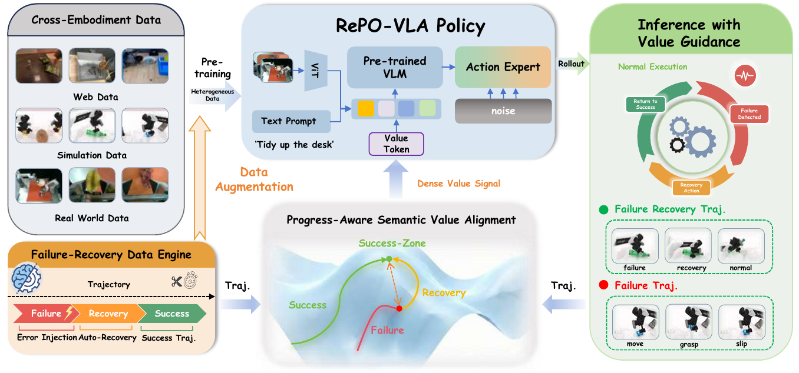
*Fig. 2 from RePO-VLA (Overview).*

- **Bài toán**: VLA chỉ imitate trajectory thành công nên không biết sửa khi bị lệch (execution drift); trajectory hỏng thường bị bỏ đi.
- **Phương pháp**: (i) *Recovery-Aware Initialization*: cắt riêng đoạn recovery và reset history để hành động sửa chỉ phụ thuộc state hiện tại; (ii) học *Progress-Aware Semantic Value Function* (PAS-VF) để gán nhãn value cho success / recovery / failure; (iii) *Value-Conditioned Refinement*: policy nhận value token, lúc test đặt v = 1.0 để kéo về "success manifold". Data recovery đến từ planner hoặc người thu.
- **Benchmark / kết quả**: đề xuất FRBench (error injection chuẩn hoá, RoboTwin sim + real bimanual); adversarial success 20% → 75% trung bình.
- **Khác RetryVLA**: value = *progress của task* (học từ ngữ nghĩa + reference), còn RetryVLA = *competence của chính π* học từ rollout tiếp nối thật. RePO cần recovery data từ planner/người; RetryVLA **tự tìm** bridge bằng search + sim verify. Giống nhau: cả hai đều SFT, không cần detector/search lúc test. Học được: trick reset history ở đầu đoạn recovery rất hợp với distillation của mình.

### A2. Dream2Fix — *Learning Actionable Manipulation Recovery via Counterfactual Failure Synthesis*
- Link: [arXiv 2603.13528](https://arxiv.org/abs/2603.13528) · [dream2fix.github.io](https://dream2fix.github.io) · Dayou Li, Jiuzhou Lei, …, Zhiwen Fan · arXiv preprint, 03/2026
- Lưu ý: tiêu đề chính thức trên arXiv **không** có chữ "Dream2Fix"; Dream2Fix là tên framework trong abstract.

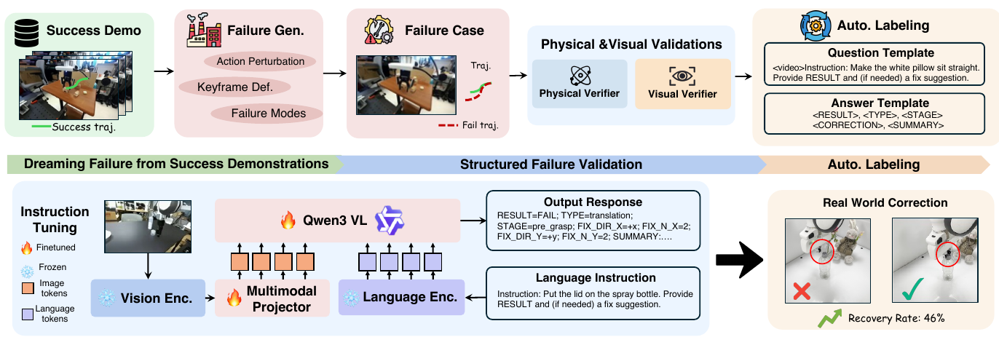
*Fig. 2 from Dream2Fix (Overview of Dream2Fix pipeline).*

- **Bài toán**: thiếu data failure + correction ở real world; các VLM analyzer chỉ nói "fail/không fail", chưa đưa ra correction thực thi được.
- **Phương pháp**: từ demo thành công thật, **nhiễu action quanh keyframe trong một video world model** (Ctrl-World) để "mơ" ra failure (force-open, translation, delay-close…), lọc bằng verifier (VLM + inverse dynamics + joint-limit), tự gán nhãn → fine-tune Qwen3-VL dự đoán *loại lỗi + hướng/độ lớn correction*.
- **Kết quả**: >120k cặp failure–correction; correction accuracy 19.7% → 81.3%; 46% zero-shot recovery trên robot thật (closed-loop).
- **Khác RetryVLA**: WM dùng để **sinh failure** (counterfactual), không phải để chấm recovery. Output là correction dạng text/tham số cho một VLM bên ngoài, không distill vào policy. Verify = verifier học được (có thể sai), RetryVLA verify bằng sim thật. Học được: ý tưởng sinh failure đa dạng từ demo có thể mở rộng tập failure train của mình.

### A3. ReCoVLA: VLM-Guided Reward Compilation for Failure Recovery in Vision-Language-Action Policies
- Link: [arXiv 2606.09630](https://arxiv.org/abs/2606.09630) · Haodi Hu, Chung-Ta Huang, …, Toshiaki Koike-Akino (MERL) · arXiv preprint, 06/2026

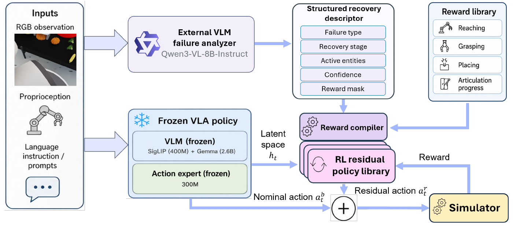
*Fig. 1 from ReCoVLA (Overview of failure-conditioned residual VLA recovery).*

- **Bài toán**: VLA (π0.5) dễ gãy ở off-nominal state; muốn thêm khả năng recover mà **giữ VLA đóng băng**.
- **Phương pháp**: VLM ngoài (Qwen3-VL) đọc ảnh → *recovery descriptor* (loại lỗi, stage, entity, reward mask) → *reward compiler* ghép reward từ thư viện (reach/grasp/place/articulation) → train **residual RL policy** (PPO) trong sim, cộng vào action của VLA; sim-to-real zero-shot.
- **Kết quả**: 3 task Fetch; sim 36.7% (π0.5 fine-tuned) → 66.7%; real 61.7%.
- **Khác RetryVLA**: cũng frozen VLA + chỉ học phần recovery, nhưng ReCoVLA cần **reward hand-designed + RL** và giữ VLM + residual lúc test. RetryVLA không cần reward: "thành công" = π tự hoàn thành sau bridge (verify trong sim), rồi distill vào chính VLA. Kết quả của mình: residual RL ở cùng sim budget kém distillation.

### A4. RACER: Rich Language-Guided Failure Recovery Policies for Imitation Learning
- Link: [arXiv 2409.14674](https://arxiv.org/abs/2409.14674) · [project](https://rich-language-failure-recovery.github.io) · [code](https://github.com/sled-group/RACER) · Yinpei Dai, Jayjun Lee, Nima Fazeli, Joyce Chai (UMich SLED) · **ICRA 2025** (đã xác minh qua IEEE Xplore)

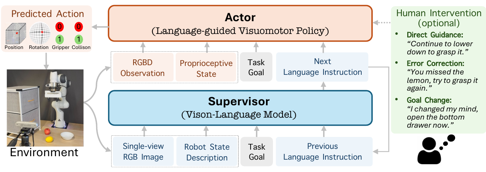
*Fig. 3 from RACER (supervisor–actor framework).*

- **Bài toán**: policy imitation (RVT) không tự hồi phục, và instruction đơn giản không đủ để hướng dẫn sửa lỗi.
- **Phương pháp**: pipeline tự động **perturb demo expert** để tạo failure + đoạn recovery về keyframe, LLM gán *rich language* cho mỗi bước; train VLM *supervisor* (LLaVA) sinh instruction chi tiết và *actor* (RVT) điều kiện trên instruction.
- **Kết quả**: 10,159 trajectory mới trên RLBench; 18 task RLBench 70.2% vs RVT 62.9%; tốt hơn khi goal đổi / task unseen / real.
- **Khác RetryVLA**: recovery data = perturb + quay về keyframe **của expert demo** (scripted), không quan tâm policy có làm tiếp được không; RetryVLA chọn bridge theo C^π của chính policy và verify bằng continuation. RACER cần VLM supervisor mỗi bước lúc test; mình không. Học được: perturb-then-recover là baseline data-gen tự nhiên để so.

### A5. Learning to Recover from Plan Execution Errors during Robot Manipulation: A Neuro-symbolic Approach
- Link: [arXiv 2405.18948](https://arxiv.org/abs/2405.18948) · Namasivayam Kalithasan, Arnav Tuli, Vishal Bindal, Himanshu Gaurav Singh, Parag Singla, Rohan Paul (IIT Delhi) · arXiv 05/2024 ("submitted to IEEE"; không tìm thấy venue chính thức)

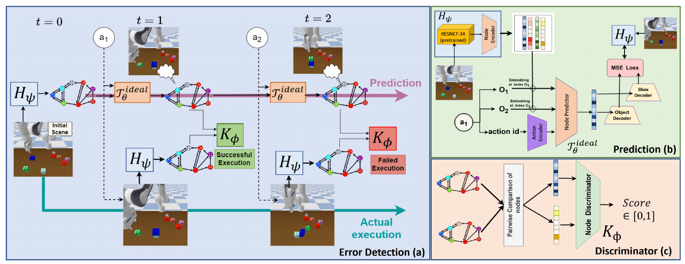
*Fig. 2 from the paper (Model overview: error detection, scene-graph predictor, discriminator).*

- **Bài toán**: robot chạy theo plan (học từ demo); khi một bước fail cần **phát hiện** và **lập lại plan** mà không có nhãn failure.
- **Phương pháp**: biểu diễn state bằng **scene graph**; học transition model "ideal" + discriminator so sánh state dự đoán vs thực tế để phát hiện/khoanh vùng lỗi; rồi symbolic search tìm recovery plan về một sub-goal của plan gốc (bản anytime: chọn sub-goal tối ưu theo budget).
- **Kết quả**: sim Franka (xếp khối), nhiều loại lỗi giả lập; tốt hơn baseline về accuracy + thời gian re-plan.
- **Khác RetryVLA**: cũng ý tưởng "**quay về một state mà plan gốc làm tiếp được**" — rất gần ý "bridge tới vùng π có competence". Nhưng họ dùng symbolic state + planner, không có VLA, và "plan làm tiếp được" là giả định (khoảng cách tới sub-goal) thay vì xác suất thành công đo được của π.

---

## B. World-model planning / value

### B1. DINO-WM: World Models on Pre-trained Visual Features enable Zero-shot Planning
- Link: [arXiv 2411.04983](https://arxiv.org/abs/2411.04983) · [project](https://dino-wm.github.io) · Gaoyue Zhou, Hengkai Pan, Yann LeCun, Lerrel Pinto (NYU/Meta) · **ICML 2025** (PMLR v267)

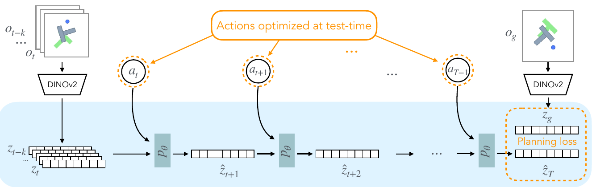
*Fig. 2 from DINO-WM (Architecture).*

- **Bài toán**: học world model task-agnostic từ data offline, dùng để plan lúc test không cần reward.
- **Phương pháp**: encode ảnh bằng DINOv2 patch features (đóng băng), ViT dự đoán patch feature tương lai theo action; planning = tối ưu chuỗi action (CEM/MPC) để latent cuối gần **latent của goal image**.
- **Kết quả**: zero-shot planning trên 6 môi trường (PointMaze, PushT, Wall, Rope, Granular…), tốt hơn DreamerV3/IRIS/TD-MPC2 khi offline.
- **Khác RetryVLA**: RetryVLA **dùng lại kiến trúc WM kiểu DINO-WM**, nhưng thay objective "gần goal image" bằng **C^π của end state**. Lý do: trong recovery không có goal image tốt, và state "giống goal" chưa chắc là state π làm tiếp được. Kết quả mình: competence-guided ≫ latent-goal. Ngoài ra DINO-WM plan mỗi bước lúc test; mình chỉ search offline.

### B2. TD-MPC2: Scalable, Robust World Models for Continuous Control
- Link: [arXiv 2310.16828](https://arxiv.org/abs/2310.16828) · [tdmpc2.com](https://www.tdmpc2.com) · Nicklas Hansen, Hao Su, Xiaolong Wang · **ICLR 2024**

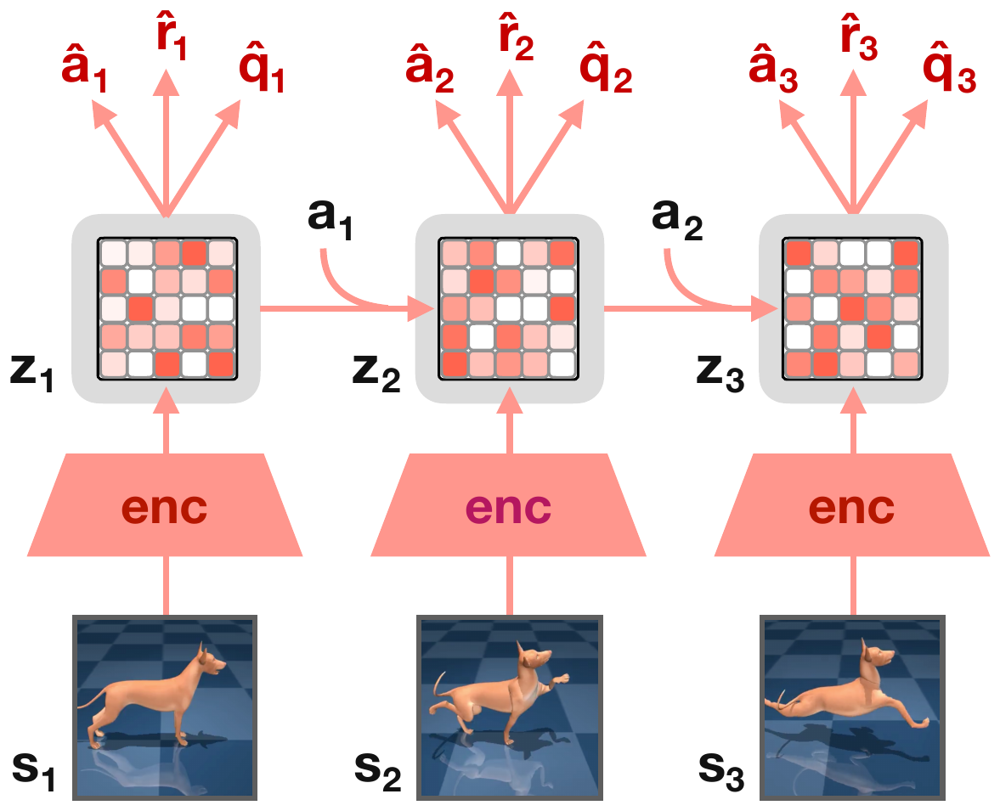
*Fig. 3 from TD-MPC2 (architecture).*

- **Bài toán**: model-based RL scale được cho nhiều task (104 task), 1 bộ hyperparameter.
- **Phương pháp**: *implicit* latent WM (không decode ảnh) học bằng joint-embedding + reward + **TD value Q**; lúc hành động dùng MPPI plan ngắn trong latent và bootstrap bằng Q ở cuối horizon; có policy prior.
- **Kết quả**: mạnh trên DMControl, Meta-World, ManiSkill2, MyoSuite; agent 317M param đa task.
- **Khác RetryVLA**: ý "**plan ngắn + value ở cuối horizon**" chính là cấu trúc của RetryVLA (bridge 50 step + C^π ở end state). Khác: value của TD-MPC2 là return của *policy đang học* (cần reward + online RL), còn C^π là P(success) của *một policy đóng băng* học từ rollout thật, không cần reward shaping. TD-MPC2 plan lúc test; mình distill để bỏ planning.

---

## C. WM-assisted VLA improvement

### C1. RISE: Self-Improving Robot Policy with Compositional World Model
- Link: [arXiv 2602.11075](https://arxiv.org/abs/2602.11075) · [project](https://opendrivelab.com/RISE/) · [code](https://github.com/OpenDriveLab/RISE) · Jiazhi Yang, Kunyang Lin, …, Ping Luo, Hongyang Li · **RSS 2026** (theo arXiv comment)

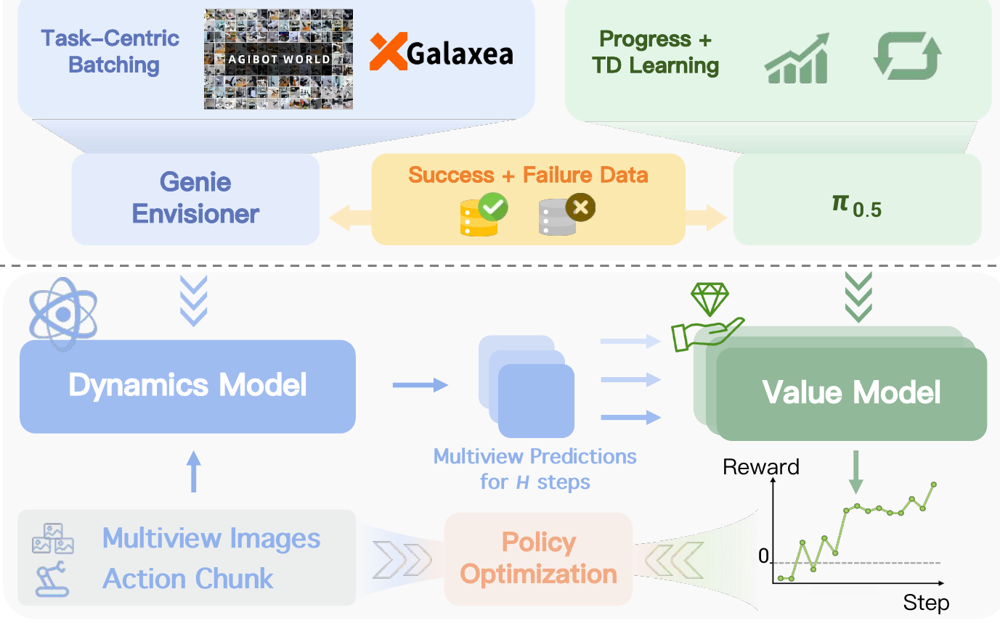
*Fig. 4 from RISE (Workflow of compositional world model).*

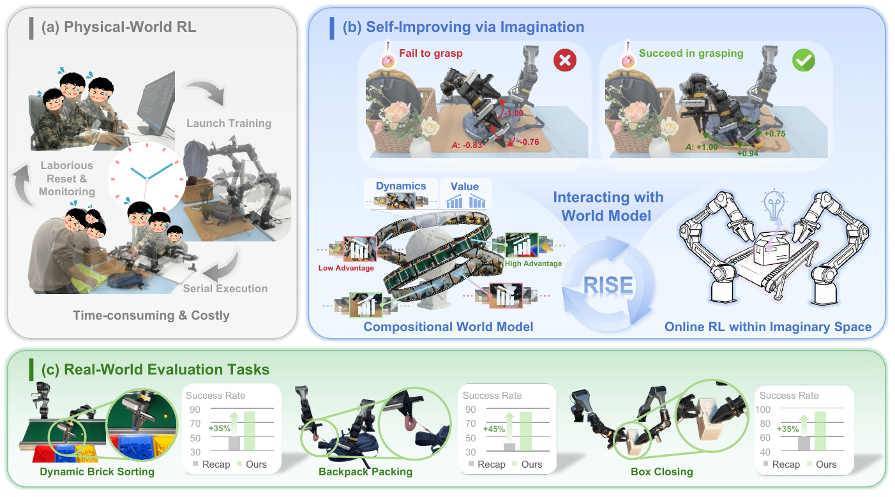
*Fig. 1 from RISE (overview: RL via imagination).*

- **Bài toán**: RL thật cho VLA tốn kém (reset, an toàn); muốn RL hoàn toàn trong tưởng tượng.
- **Phương pháp**: *Compositional World Model* = dynamics model (Genie Envisioner, video đa view, điều khiển theo action chunk) + **progress value model** (khởi tạo từ π0.5, học Progress + TD trên data success + failure) → tính advantage cho rollout tưởng tượng → cập nhật policy (advantage-conditioned) vòng lặp kín.
- **Kết quả**: 3 task real (dynamic brick sorting, backpack packing, box closing): +35%, +45%, +35% so với prior (RECAP).
- **Khác RetryVLA**: RISE học **chỉ trong imagination** với **progress value**; RetryVLA verify thật trong sim và dùng **competence của π**. Thí nghiệm của mình: imagination-only (RISE-inspired) kém hơn, vì WM sai nhiều ở state recovery → WM nên là *filter*, nhãn cuối phải từ verify thật. Học được: tách dynamics và value thành 2 model riêng (đúng như mình làm WM + critic).

### C2. WMPO: World Model-based Policy Optimization for Vision-Language-Action Models
- Link: [arXiv 2511.09515](https://arxiv.org/abs/2511.09515) · [wm-po.github.io](https://wm-po.github.io) · [code](https://github.com/WM-PO/WMPO) · Fangqi Zhu, Zhengyang Yan, Zicong Hong, Quanxin Shou, Xiao Ma, Song Guo (HKUST, ByteDance Seed) · **ICLR 2026** (poster, xác minh trên OpenReview/ICLR proceedings)

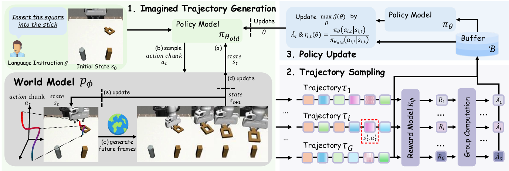
*Fig. 2 from WMPO (training procedure).*

- **Bài toán**: on-policy RL cho VLA mà không cần tương tác thật nhiều.
- **Phương pháp**: video WM ở **pixel space** (khớp với feature pretrained của VLA), fine-tune trên rollout của chính policy (*policy behavior alignment*) để mô phỏng cả failure; sample nhiều trajectory tưởng tượng, reward model chấm success (binary) → **GRPO**.
- **Kết quả**: MimicGen (Coffee, StackThree, ThreePieceAssembly, Square) với OpenVLA-OFT, tốt hơn GRPO thật / DPO cùng budget; real ALOHA "insert square": base 53% / DPO 60% / WMPO 70%; xuất hiện hành vi self-correction.
- **Khác RetryVLA**: WMPO tối ưu **cả task** bằng RL và reward success của task; RetryVLA nhắm **đoạn recovery ngắn**, objective là C^π, update bằng SFT trên data đã verify. Giống: WM được align với hành vi của chính policy (mình train critic trên continuation thật của π). Học được: "policy behavior alignment" là lý do WM cần thấy failure state — cũng đúng với WM của mình.

---

## D. Benchmark

### D1. LIBERO-Recover: Beyond Task Success Towards Failure Recovery in Robotic Manipulation Models
- Link: [arXiv 2609.05178](https://arxiv.org/abs/2609.05178) · [project](https://liulin815.github.io/LIBERO-Recovery/) · [code](https://github.com/liulin815/LIBERO-Recovery) · Lin Liu, Zhicheng Bao, Lu Zhang, …, Huchuan Lu · arXiv preprint, 09/2026

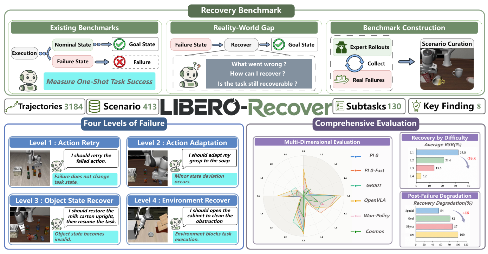
*Fig. 1 from LIBERO-Recover (Overview).*

- **Bài toán**: LIBERO gần bão hoà (~100%) nhưng chỉ đo từ initial state sạch; cần đo khả năng **recover sau khi fail**.
- **Cách xây**: chạy nhiều policy SOTA (π0, π0.5, OpenVLA, GR00T, Wan-Policy, Cosmos-Policy) làm "failure generator" → lấy failure state thật → 1000+ scenario chia 4 level (Action Retry, Action Adaptation, Object State Recovery, Environmental Recovery); 3,184 recovery trajectory do 4 người teleop.
- **Metric**: RSR (Recovery Success Rate) = tỉ lệ hoàn thành task khi bắt đầu từ failure state. Kết quả: VLA hiện tại RSR thấp, giảm mạnh theo level (L1 ~33% → L4 ~3% trung bình).
- **Với RetryVLA**: đây là benchmark chính (Spatial = dev, Object = held-out). Lưu ý: teleop recovery data của họ là baseline "demo-only SFT" tự nhiên; RetryVLA thay bằng bridge tự sinh + verify.

---

## E. (Thêm, do mình chọn — không có trong review gốc)

### E1. MimicGen: A Data Generation System for Scalable Robot Learning using Human Demonstrations *(thêm)*
- Link: [arXiv 2310.17596](https://arxiv.org/abs/2310.17596) · [project](https://mimicgen.github.io) · Ajay Mandlekar, Soroush Nasiriany, Bowen Wen, …, Dieter Fox · **CoRL 2023**

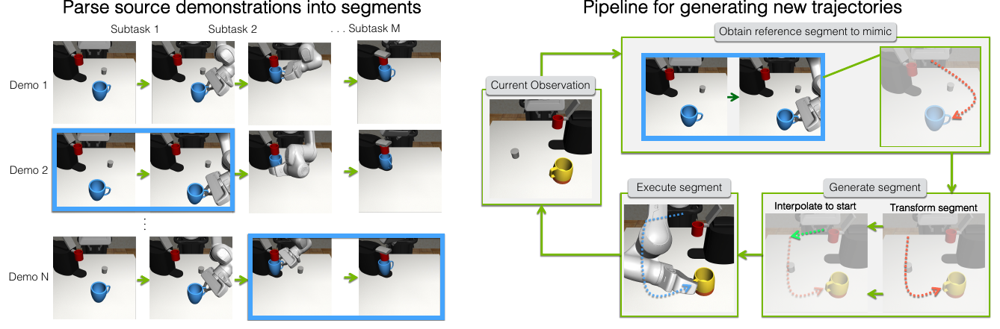
*Fig. 2 from MimicGen (System pipeline).*

- **Ý chính**: từ ~10 demo người, chia thành segment theo object, biến đổi segment theo pose object mới, **thực thi trong sim và chỉ giữ trajectory thành công** → hàng nghìn demo để BC.
- **Liên quan RetryVLA**: cùng công thức "**sinh ứng viên → verify bằng sim → SFT trên phần thành công**". Khác: MimicGen sinh demo nominal từ đầu; RetryVLA sinh *bridge* từ failure state và tiêu chí verify là "π tự làm tiếp được".

### E2. DAgger — *A Reduction of Imitation Learning and Structured Prediction to No-Regret Online Learning* *(thêm, không có hình)*
- Link: [arXiv 1011.0686](https://arxiv.org/abs/1011.0686) · Stéphane Ross, Geoffrey J. Gordon, J. Andrew Bagnell · **AISTATS 2011**
- **Ý chính**: BC bị *covariate shift* — policy đi lệch sang state chưa thấy trong demo; DAgger cho learner chạy, hỏi expert nhãn tại state learner gặp, gộp data và train lại.
- **Liên quan RetryVLA**: failure state chính là state "lệch phân phối" của π. RetryVLA giống một DAgger không cần expert: "nhãn" tại failure state là bridge do search + sim verify tìm ra, sau đó distill. (Không có method figure phù hợp nên bỏ hình.)

---

## F. Recovery cho VLA đóng băng / dữ liệu sửa sai (bổ sung 2026-11-01)

### F1. Backtrack: *If at First You Don't Succeed, Backtrack: Lightweight Recovery for Frozen VLAs*
- Link: [arXiv 2610.32941](https://arxiv.org/abs/2610.32941) · Thomas Landeg, Thierry Tambe · arXiv preprint, 23/10/2026

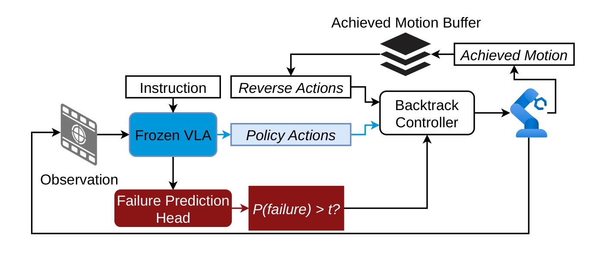
*Fig. 1 from Backtrack (overview: failure head + backtrack controller).*

- **Phương pháp**: một failure head nhỏ (0.48-0.88% số tham số) đọc feature sẵn có của VLA đóng băng, học chỉ từ rollout có nhãn outcome của chính policy (giống SAFE, NeurIPS 2025). Khi P(fail) vượt ngưỡng, controller dừng policy, **lùi lại motion vừa đi** (cố định số bước hoặc đến khi P(fail) giảm), rồi trả quyền điều khiển cho policy y nguyên để thử lại.
- **Kết quả**: SmolVLA, π0.5, π0-FAST trên LIBERO (4 suite, budget step gấp đôi) và MetaWorld; LIBERO-Long giảm failure rate 19-48% (tới +7.4 pt); 3 suite ngắn tác dụng nhỏ hơn. Chỉ có sim.
- **Khác RetryVLA**: failure head của họ gần với C^π (đều học từ outcome của policy đóng băng), nhưng chỉ dùng làm **trigger lúc test**; recovery là lùi tay máy cố định, không sửa được trạng thái object. RetryVLA dùng C^π để **chọn đích** của bridge, verify trong sim rồi distill, không thêm module lúc test. Họ đánh giá từ init state sạch của LIBERO, không phải LIBERO-Recover. Đây là baseline không dùng WM của Phần 2 (mình tự cài lại, kèm biến thể backtrack-distill).

### F2. CoRe: *Imagining Recovery: Inference-Time Counterfactual Realignment for Vision-Language-Action Models*
- Link: [arXiv 2608.14822](https://arxiv.org/abs/2608.14822) · Yanyan Zhang, Disheng Liu, Kai Ye, Chaoda Song, Xinpeng Li, Mohsen Hariri, Vikash Singh, Yu Yin, Vipin Chaudhary · arXiv preprint, 14/08/2026

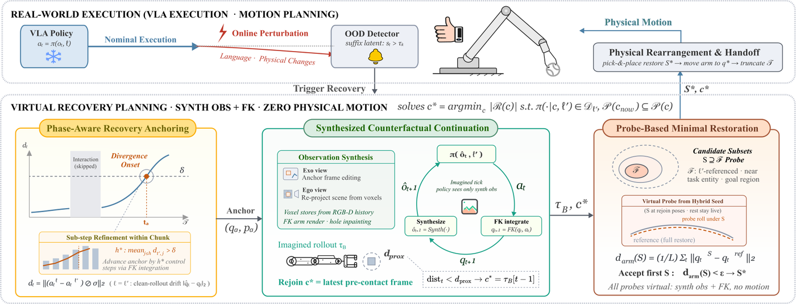
*Fig. 2 from CoRe (overview: OOD detector, recovery anchoring, synthesized counterfactual continuation, minimal restoration).*

- **Phương pháp**: training-free. Khi detector OOD báo lệch, CoRe chọn một trạng thái khả thi gần đây, **tưởng tượng policy đóng băng sẽ chạy tiếp thế nào** bằng quan sát tổng hợp (edit ảnh, chiếu lại voxel, render tay máy bằng FK), rồi sắp xếp lại robot và scene tối thiểu để "nhập lại" continuation đó, sau đó trả quyền cho policy.
- **Kết quả**: theo abstract, success tăng tới +85.0 pt và giảm 42.2% số lần khôi phục vật lý; LIBERO-Long có perturbation, LangSwitch, xArm6 thật, nhiều backbone VLA.
- **Khác RetryVLA**: cùng ý "đưa về trạng thái mà chính π làm tiếp được". Nhưng CoRe làm **lúc test**, không học WM hay critic, và cần motion planner để sắp xếp lại scene. RetryVLA học C^π từ continuation thật, search offline, distill vào VLA nên lúc test không cần detector hay planner.

### F3. Recova: *Agent-Guided Failure Recovery for Autonomous Robotic Manipulation*
- Link: [arXiv 2610.01178](https://arxiv.org/abs/2610.01178) · [project](https://www.liuisabella.com/Recova) · Isabella Liu, An-Chieh Cheng, Johan Bjorck, Zhiding Yu, Hongxu Yin, Jan Kautz, Linxi Fan, Yuke Zhu, Sifei Liu · arXiv preprint, 01/10/2026

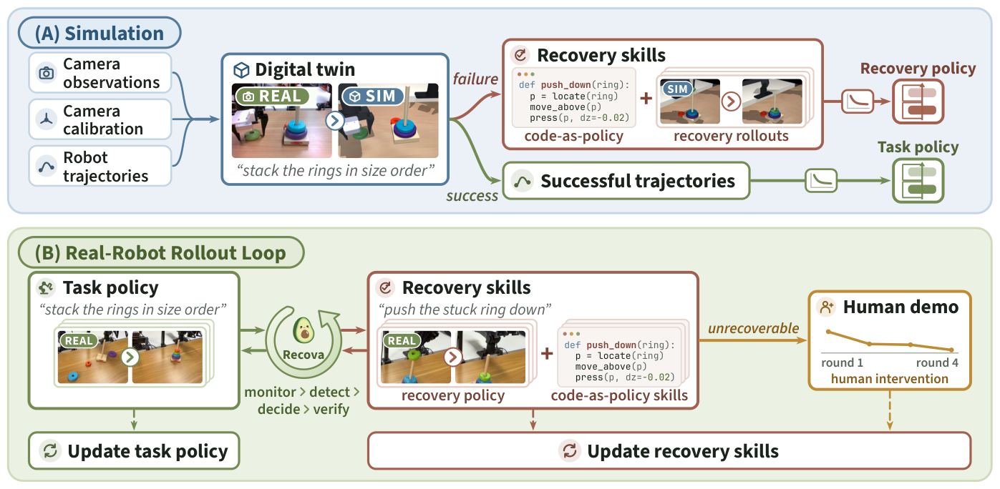
*Fig. 2 from Recova ((A) digital twin simulation, (B) real-robot rollout loop).*

- **Phương pháp**: dựng digital twin từ camera và trajectory. Trong twin, một agent chẩn đoán failure, thử các chương trình sửa (code-as-policy), thu rollout thành công cho **task policy và recovery policy riêng**. Lúc deploy, agent theo dõi tiến độ, gọi recovery, kiểm tra scene đã được khôi phục rồi chạy tiếp; ca không cứu được thì người demo, đưa vào DAgger.
- **Kết quả**: LIBERO-Pro 78.8% vs 71.7%, MolmoSpaces 64.9% vs 38.0%; real: DAgger 23.8% → 77.5%, thêm recovery skill → 87.5%; can thiệp của người 87.5% → 0% sau 4 vòng.
- **Khác RetryVLA**: twin đóng vai sim verifier (gần phương án A real-to-sim của mình), nhưng recovery là policy / skill riêng do agent điều phối. RetryVLA distill recovery vào **chính VLA** và chọn recovery theo C^π, không cần agent hay monitor lúc test.

### F4. FLARE: *A Failure-Aware Framework for Autonomous Correction and Recovery in Visual-Language Robotic Manipulation* (Retry / Reset)
- Link: [arXiv 2608.26645](https://arxiv.org/abs/2608.26645) · [CVF](https://openaccess.thecvf.com/content/CVPR2026/html/Zhao_FLARE_A_Failure-Aware_Framework_for_Autonomous_Correction_and_Recovery_in_CVPR_2026_paper.html) · Ganlong Zhao, Zijia Tang, Xingping Chen, Zhanghui Kuang, Ye Tian, Guanbin Li · **CVPR 2026** (pp. 22391-22401, đã xác minh trên CVF Open Access), arXiv 27/08/2026

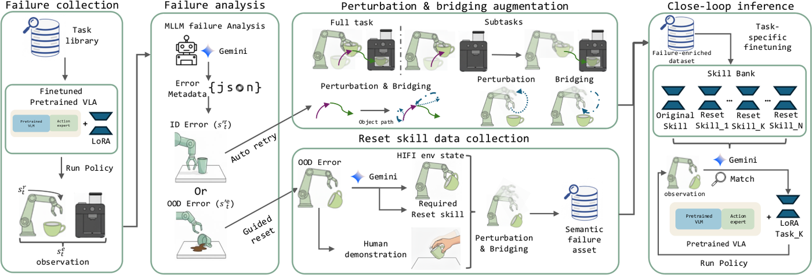
*Fig. 2 from FLARE (overall framework).*

- **Phương pháp**: chia lỗi thành ID (chỉ lệch pose) và OOD (scene hỏng, ví dụ cốc đổ). **Retry**: chèn nhiễu pose và đoạn bridging vào demo để policy làm đúng bước tiếp từ nhiều cấu hình. **Reset**: MLLM offline phân tích video lỗi, từ đó thu một thư viện nhỏ reset skill theo object; lúc chạy, một MLLM monitor chọn giữa chạy task và gọi reset.
- **Khác RetryVLA**: Retry ≈ augmentation perturb-then-bridge (giống RACER); Reset cần demo người và MLLM lúc test. RetryVLA tự tìm bridge bằng search + verify, chỉ một policy. Cách chia ID / OOD của họ gần với L1-L2 vs L3-L4 của LIBERO-Recover, hữu ích khi báo kết quả theo level.
- Lưu ý trùng tên: *FLARE: Robot Learning with Implicit World Modeling* ([arXiv 2505.15659](https://arxiv.org/abs/2505.15659), Zheng ... Yuke Zhu, Linxi Fan; NVIDIA GEAR; arXiv 05/2025, chưa xác minh venue) là bài **khác**: căn feature của policy với latent embedding của quan sát tương lai và co-train với video không có action. Bài này liên quan trực tiếp đến `L_future` (RQ2), xem mục H.

### F5. Hi-WM: *Human-in-the-World-Model for Scalable Robot Post-Training*
- Link: [arXiv 2604.21741](https://arxiv.org/abs/2604.21741) · [project](https://hi-wm.github.io/) · Yaxuan Li, Zhongyi Zhou, Yefei Chen, Yanjiang Guo, Jiaming Liu, Shanghang Zhang, Jianyu Chen, Yichen Zhu · arXiv preprint, 23/04/2026 (v2 05/05/2026)

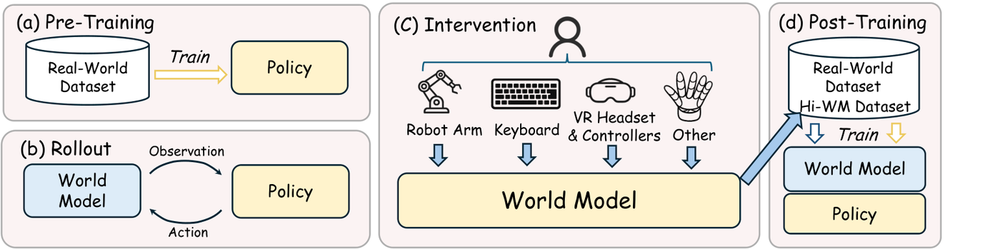
*Fig. 2 from Hi-WM (pipeline: pre-training, rollout in WM, human intervention, post-training).*

- **Phương pháp**: cho policy chạy closed-loop trong một action-conditioned WM; khi rollout có nguy cơ hỏng, **người can thiệp ngay trong WM** bằng các action sửa ngắn. WM lưu cache trạng thái, cho phép rollback và rẽ nhánh, nên một failure state cho ra nhiều nhánh sửa. Các trajectory sửa được thêm vào tập train.
- **Kết quả**: 3 task thật (Fold Towel, Push T, Route Rope) với DP và π0: trung bình +37.9 pt so với base và +19.0 so với baseline WM closed-loop; success trong WM tương quan với thật r = 0.953.
- **Khác RetryVLA**: cùng ý "một failure state, nhiều nhánh sửa" (mình làm bằng restore snapshot sim), nhưng nhãn là **người**. RetryVLA tự động: search + C^π + verify trong sim. Hi-WM là bằng chứng real-world rằng sửa sai trong WM rồi SFT có tác dụng.

---

## G. Độ tin cậy của WM verifier (RQ3)

### G1. CureWM: *World Models Dream of Success: Diagnosing and Repairing Failure Insensitivity in Robot World Models*
- Link: [arXiv 2610.09134](https://arxiv.org/abs/2610.09134) · [code](https://github.com/jiuyixu25/CureWM) · Jiuyi Xu, Xiao Hu, Meida Chen, Peng Gao, Yang Ye, Yangming Shi · arXiv preprint, 06/10/2026

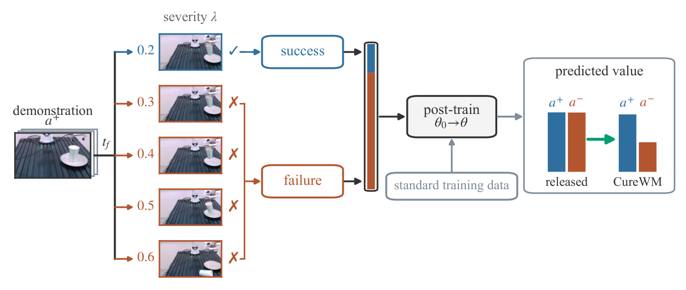
*Fig. 2 from CureWM (overview: perturb demos at several severities, verify by execution, post-train).*

- **Bài toán**: 4 checkpoint WM đã phát hành (Cosmos Policy, Ctrl-World) ít nhạy với thay đổi action và dự đoán "giống thành công" cho các failure đã kiểm chứng (over-optimism).
- **Phương pháp**: từ demo thành công, tạo action thay thế theo một lưới mức nhiễu, **thực thi trong sim / phần cứng để có outcome thật**, rồi fine-tune WM trên failure + success còn sống cùng demo nominal; không đổi kiến trúc hay objective.
- **Kết quả**: trên 484 LIBERO failure counterfactual held-out, optimism giảm từ 80% xuống 30-43% (trung bình 38%); robot thật: 90% → 33%. Cùng budget, failure counterfactual cho gap value success-failure 0.124, failure on-policy mới thu chỉ 0.014. Tác giả nhấn mạnh phải đo optimism **cùng với** khả năng phân biệt success / failure.
- **Khác RetryVLA**: họ đo optimism khi rollout **thụ động** và sửa WM. RQ3 của mình đo optimism khi **search khai thác** WM + critic (false positive, ECE, precision@k theo budget CEM 8 → 512) và giảm bằng trừ điểm U_ens thay vì retrain. Bài học áp dụng: báo cả false positive lẫn AUC / precision, không chỉ một con số optimism.

### G2. Ghi chú từ research notes (Ctrl-World, VLAW, MiraBench)
Tóm tắt từ `research_notes/World model sinh dữ liệu robot/wm_policy_evaluation.md`, `research_notes/World model sinh dữ liệu robot/wm_data_engines.md` và `reports/World model sinh dữ liệu robot.md` (2026-10). ID arXiv đã kiểm tra lại trong lượt này; các con số lấy từ notes, chưa đọc lại bài gốc.
- **Ctrl-World** ([arXiv 2510.10125](https://arxiv.org/abs/2510.10125), Guo, Shi, Chen, Finn; ICLR 2026 theo notes, arXiv không ghi venue): WM video đa view trên DROID; giữ được thứ hạng policy nhưng **đánh giá thấp** success low-level (bi quan); SFT trên imagined success do **người** gán nhãn: 38.7% → 83.4%.
- **VLAW** ([arXiv 2602.12063](https://arxiv.org/abs/2602.12063), Guo, Lee, Shi, Chen, Liang, Finn): WM chỉ train trên demo thì "overly optimistic"; fine-tune trên rollout có cả success và failure của policy "largely eliminates" bias này.
- **MiraBench** ([arXiv 2605.29360](https://arxiv.org/abs/2605.29360)): "visual fidelity is a poor proxy for action fidelity"; optimism bias phổ biến kể cả ở model chất lượng hình ảnh cao.
- Kết luận cho RetryVLA (theo report): dấu của bias phụ thuộc data; chưa thấy paper nào đo bias **như hàm của budget search**, đó là khoảng trống RQ3 nhắm tới.

---

## H. Tương lai làm tín hiệu action-free (RQ2)

### H1. FOCA: *Future-Oriented Conditioning for Data-Efficient Vision-Language-Action Adaptation*
- Link: [arXiv 2606.20867](https://arxiv.org/abs/2606.20867) · [project](https://focavla.github.io/) · Duc Minh Nguyen, Nghiem Tuong Diep, Binh Gia Nguyen, …, Doanh Le, …, Duy M. H. Nguyen, An Thai Le, Ngo Anh Vien (23 tác giả) · **ICML 2026** (đã xác minh qua trang poster ICML 2026 và arXiv comment "Accepted at ICML 2026"), arXiv 18/06/2026
- Venue PMLR: ICML 2026 = PMLR v306, nhưng không tìm thấy tên bài trên trang mục lục v306 lúc kiểm tra, nên **chưa xác minh** số trang PMLR. Bài có đồng tác giả Doanh Le; cần lưu ý khi trích dẫn ở chế độ double-blind.

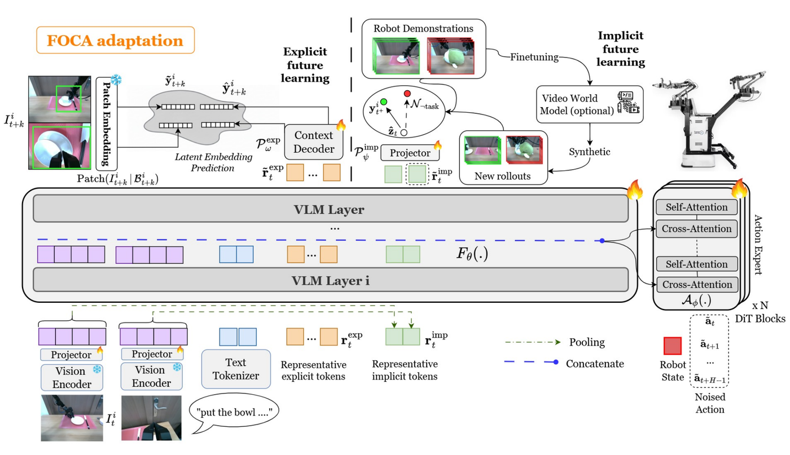
*Fig. 1 from FOCA (overview: explicit future learning + implicit future learning, optional video WM).*

- **Phương pháp**: thêm token "future" vào VLM của VLA: (i) *explicit*: dự đoán embedding tương tác ở bước t+k; (ii) *implicit*: align với quan sát goal tương lai, có thể xem như biểu diễn kiểu value. Suy luận trong latent, không dự đoán pixel; cho phép **co-train không cần action** với video tổng hợp từ video WM.
- **Kết quả**: LIBERO 95.7% với 20 demo; RoboCasa +7-12%; real tới +26 pt.
- **Khác RetryVLA**: FOCA là thiết kế gần nhất với `L_future` (loss future-latent phụ, data WM không có action). Khác: FOCA cho adaptation few-shot nominal, future lấy từ demo / video WM **không lọc**. RetryVLA dùng future tưởng tượng từ **failure state**, chọn theo C^π, và kiểm tra trực tiếp việc lọc có quan trọng không (arm 3 vs 4).

### H2. ThinkWorld: *World Imagination Reinforces Chain-of-Dynamics Reasoning*
- Link: [arXiv 2610.37666](https://arxiv.org/abs/2610.37666) · [project](https://thinkworld-project.github.io/) · Chaehyun Kim, Chi-Pin Huang, Jisoo Kim, Min-Hung Chen, Yu-Chiang Frank Wang, Seungryong Kim, Fu-En Yang · arXiv preprint, 27/10/2026

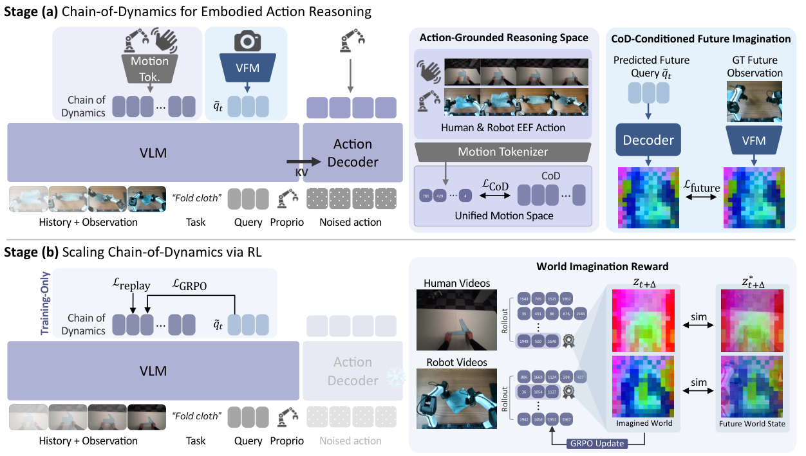
*Fig. 2 from ThinkWorld (architecture and training stages).*

- **Phương pháp**: mỗi "action thought" là một Chain-of-Dynamics (CoD), chuỗi motion token rời rạc dùng chung cho người và robot. Khởi tạo bằng SFT trên demo có action; rồi một decoder dự đoán tương lai **trong không gian feature DINO đóng băng** từ CoD, và RL thưởng cho CoD có tương lai dự đoán khớp với hệ quả quan sát được. Nhờ vậy video người không có action cũng cho tín hiệu.
- **Khác RetryVLA**: cùng không gian DINO cho future (WM của mình dùng DINOv2), ủng hộ việc đặt `L_future` trên latent DINOv2 pooled. Khác: tương lai đích của họ là **quan sát thật** (video), của mình là **tưởng tượng** từ WM được C^π lọc; họ nhắm generalization, không phải recovery; họ dùng RL, mình dùng loss phụ trong SFT.
- (Liên quan: FLARE 2505.15659, ghi ở F4, căn feature policy với latent tương lai, cùng họ phương pháp.)

---

## I. World model 3D / action dạng điểm (để sau, chỉ làm nếu RQ2 dương)

### I1. PointWorld: *Scaling 3D World Models for In-The-Wild Robotic Manipulation*
- Link: [arXiv 2601.03782](https://arxiv.org/abs/2601.03782) · [project](https://point-world.github.io/) · [code](https://github.com/NVlabs/PointWorld) · Wenlong Huang, Yu-Wei Chao, Arsalan Mousavian, Ming-Yu Liu, Dieter Fox, Kaichun Mo, Li Fei-Fei · **CVPR 2026 Highlight** (pp. 20765-20779, CVF Open Access), arXiv 07/01/2026

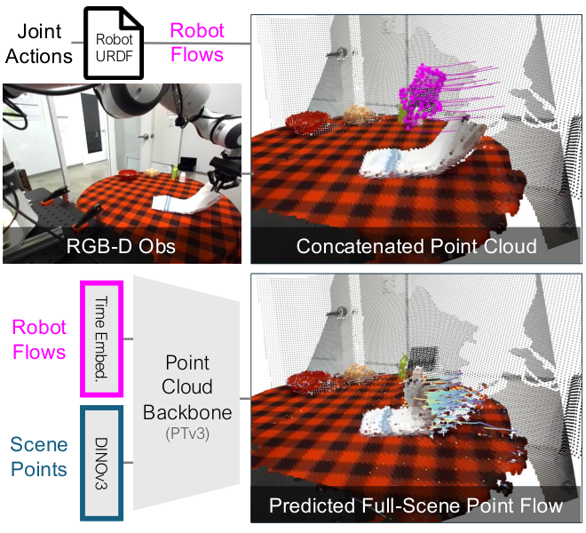
*Fig. 2 from PointWorld (overview).*

- **Phương pháp**: biểu diễn cả state và action là **3D point flow**; từ RGB-D + chuỗi action (đổi thành robot flow qua URDF) dự đoán dịch chuyển 3D của mọi điểm; train trên ~2M trajectory / 500 giờ (Franka + humanoid); 0.1 s / bước nên chạy được trong MPC; zero-shot trên Franka thật.
- **Khác RetryVLA**: WM 3D cho planning lúc test, không có critic gắn với policy, không distill. Là ứng viên WM thứ hai (claim generality) nếu cần độ chính xác tiếp xúc tốt hơn latent DINOv2.

### I2. PointAction: *3D Points as Universal Action Representations for Robot Control*
- Link: [arXiv 2606.03943](https://arxiv.org/abs/2606.03943) · [project](https://oriontmt.github.io/pointaction/) · Mutian Tong, Han Jiang, Qiao Feng, Lingjie Liu, Jiatao Gu · arXiv preprint, 02/06/2026 (không nhầm với PointACT, arXiv 2605.21414, RSS 2026)

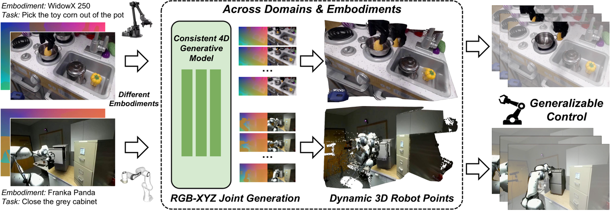
*Fig. 1 from PointAction (teaser: joint RGB + dynamic 3D pointmap generation, point-to-action decoding).*

- **Phương pháp**: fine-tune model sinh video để dự đoán đồng thời frame RGB và **pointmap 3D động**; một decoder diffusion biến point dynamics thành action. Điểm 3D là interface action không phụ thuộc embodiment.
- **Khác RetryVLA**: là video-action model (policy sinh tương lai), không bàn đến recovery. Ý tưởng "future dạng điểm 3D" có thể làm target cho `L_future` ở bản 3D sau này.

---

## J. Steering bên trong VLA (để sau)

### J1. *Observing and Controlling Features in Vision-Language-Action Models*
- Link: [arXiv 2603.05487](https://arxiv.org/abs/2603.05487) · Hugo Buurmeijer, Carmen Amo Alonso, Aiden Swann, Marco Pavone (Stanford, NVIDIA) · arXiv preprint, 05/03/2026 (v2 sau đó; không thấy venue)

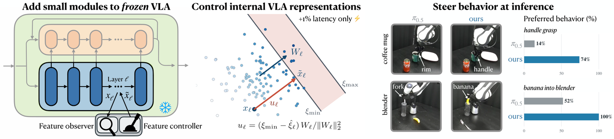
*Fig. 1 from the paper (feature-observability with a linear observer, feature-controllability with a minimal linear controller).*

- **Phương pháp**: linear *observer* đọc thông tin state / action từ representation trong của VLA (4 VLA, cả autoregressive lẫn transformer + flow-matching); một *controller* chỉnh representation tối thiểu để đưa dự đoán của observer vào khoảng mong muốn. Không fine-tune; π0.5 trên LIBERO và DROID thật; overhead ~1%.
- **Khác RetryVLA**: không phải recovery, không train. Liên quan theo hai cách: (i) phương pháp linear probe trên hidden state SmolVLA dùng được cho probe rủi ro của `L_future` (embedding có tách C^π cao / thấp không); (ii) hướng sau này: steer representation về phía C^π cao lúc test thay vì SFT.

---

## Ghi chú nguồn
- Tiêu đề, tác giả, ngày arXiv lấy từ arXiv API; venue: DINO-WM (PMLR v267), RACER (IEEE ICRA 2025), WMPO (ICLR 2026, OpenReview), RISE (arXiv comment "RSS 2026"), TD-MPC2 (arXiv comment "ICLR 2024"), MimicGen ("CoRL 2023"). Các paper 2026 còn lại (RePO-VLA, Dream2Fix, ReCoVLA, LIBERO-Recover) hiện là arXiv preprint.
- Số liệu kết quả trích từ abstract/thân bài của từng paper, không chạy lại.
- Bổ sung 2026-11-01 (F-J): tiêu đề, tác giả, ngày v1 lấy từ arXiv API cho cả 11 bài (Hi-WM 2604.21741, CoRe 2608.14822, Recova 2610.01178, Backtrack 2610.32941, CureWM 2610.09134, FOCA 2606.20867, ThinkWorld 2610.37666, PointWorld 2601.03782, PointAction 2606.03943, FLARE 2608.26645, Observing & Controlling 2603.05487); thêm FLARE-implicit-WM 2505.15659 và Ctrl-World / VLAW / MiraBench (chỉ kiểm tra ID). Venue: FLARE và PointWorld (CVF Open Access CVPR 2026), FOCA (trang poster ICML 2026; **số trang PMLR v306 chưa xác minh**). Các bài còn lại là arXiv preprint (không có venue trong comment hay trên trang project lúc kiểm tra). Ctrl-World "ICLR 2026" lấy từ research notes, chưa xác minh lại.

---

## K. Recursive / geometric recovery và recoverability dựa trên world model (kiểm tra 2026-11-08)
Bối cảnh: mở rộng *Recursive Policy-Conditioned Geometric Recovery* (B_0 = {s: C^π(s,g) ≥ τ}, B_{k+1} = B_k ∪ {s: ∃ bridge b, T̂(s,b) ∈ B_k và GeomValid(s,b)}; J(b) = C^π(s_H,g) − λ E_geom(b) − β U_WM(b); forward geometric correction). Tiêu đề, tác giả, ngày lấy từ trang arXiv abs (meta `citation_*`); nội dung đọc từ abstract + bản HTML arXiv.

### K1. Back on Track: *Deployment-time Policy Improvement via World Model Planning* (**gần nhất**)
- Link: [arXiv 2610.19579](https://arxiv.org/abs/2610.19579) · [project](https://policy-improvement-wm.pages.dev/) · Colton Crosby, Hao Wang, Mac Schwager, Somil Bansal (Stanford) · arXiv preprint, 14/10/2026 (không có venue trong comment)
- **Phương pháp**: state s = [ψ(o), q] với ψ là encoder ảnh đóng băng (SigLIP2). Học **policy-conditioned liveness value** V_{π_b} (Bellman có chiết khấu kiểu Hamilton-Jacobi liveness, từ [arXiv 2605.11479](https://arxiv.org/abs/2605.11479) cùng nhóm) trên một tập nhỏ rollout on-policy có nhãn outcome, dùng ensemble. WM latent nhỏ (ViT 4 lớp, 29.6M) train trên các rollout đó + play data, có curriculum độ dài rollout 1 → 16. Lúc deploy: V làm monitor; khi vượt ngưỡng η, CEM (proposal "data-informed" quanh action của π_b) tối ưu tổng V trung bình ensemble dọc quỹ đạo tưởng tượng ngắn, chạy h ≤ H action đầu rồi trả quyền cho π_b; monitor gọi lại nếu chưa hồi phục. Policy black-box, không retrain.
- **Kết quả**: LIBERO-Goal (init bị perturb vì π0.5 gốc đã 98%), π0.5: 72.6% → 81.5% (3000 trial ghép cặp), hơn baseline offline-RL và safety-filter; Franka thật với diffusion policy: 40% → 60%; chu kỳ plan 108 ms. Hạn chế tác giả tự nêu: monitor báo nhầm có thể phá trajectory đang thành công; planner **khai thác lỗi WM** (điểm cao trong tưởng tượng nhưng thất bại khi chạy thật).
- **Khác RetryVLA**: ý lõi trùng nhau (value có điều kiện theo policy đóng băng, học từ rollout thật, chấm điểm tương lai trong WM latent để đưa về vùng π làm tiếp được; V_{π_b} ≈ C^π, đều dùng CEM). Khác ở bốn điểm. (i) **Lúc test vs offline**: họ là monitor + planner chạy kèm khi deploy; RetryVLA search offline, **verify từng bridge trong MuJoCo** (bridge + continuation của π, snapshot bit-exact) và **distill** cái đã verify vào chính VLA, nên lúc test không cần WM, value hay monitor (nominal giữ trong 2 pt). Nhờ verify, lỗi khai thác WM mà họ nêu bị lọc trước khi thành dữ liệu train. (ii) **Một bước vs đệ quy**: họ tối ưu một đoạn ngắn hướng tới V cao (gọi lại tham lam nếu cần); RetryVLA mở rộng tập recoverable B_k theo kiểu backward reachability, nối nhiều bridge qua các trạng thái trung gian đã có C^π cao, cho phép thoát những failure state mà không bridge đơn nào với tới B_0. Lưu ý trung thực: vòng "chạy h action → monitor → plan lại" của họ đã là một dạng chuỗi sửa ngắn closed-loop và gần với forward correction của mình; điểm mới cần lập luận là B_k tường minh (đích trung gian đã thuộc B_k, verify được) và re-plan khi state quan sát lệch dự đoán WM, chứ không phải bản thân việc re-plan. (iii) **Hình học**: họ không có ràng buộc va chạm / xuyên vật / object rơi khỏi bàn / tiếp xúc; RetryVLA thêm E_geom (oracle từ state sim hoặc geometry head trên latent) và U_WM vào J(b). (iv) **Benchmark**: họ dùng init perturb của LIBERO-Goal; RetryVLA dùng failure state của LIBERO-Recover (L1-L4, có object bị đổ / lệch). Phải trích làm baseline chính; một biến thể "Back-on-Track-style test-time planner với C^π của mình" là ablation tự nhiên.

### K2. ORD-WM: *Learning Object-Centric Rigid Dynamics for 3D World Modeling in Robotic Manipulation*
- Link: [arXiv 2610.23156](https://arxiv.org/abs/2610.23156) · [project](https://hitsz-wyy.github.io/ORD-WM/) · Yueyang Weng, Xiaopeng Zhang, Yuxi Ou, Yongjin Mu, Chengzhi Zhao, Yanjie Li (HIT Shenzhen) · arXiv preprint, 16/10/2026
- **Phương pháp**: VAE vector-neuron giám sát bằng SDF mã hóa point cloud từng object thành latent hình học; dynamics có điều kiện action dự đoán **gia số SE(3) cho từng object** và áp phép biến đổi cứng lên latent, tách hình dạng (bất biến) khỏi pose. Train trên LIBERO (4 suite) + Franka thật; dùng cho MPC thời gian thực. Tác giả nói rõ: không ép ràng buộc tiếp xúc hay non-penetration.
- **Khác RetryVLA**: là kiến trúc WM giữ tính rigid-body theo cấu trúc, không có critic theo policy, không recovery hay distill. Liên quan đến thành phần "rigid-body consistency" của E_geom: họ đảm bảo bằng kiến trúc, mình phạt bằng energy (và vẫn cần thêm collision / penetration mà ORD-WM bỏ ngỏ).

### K3. GeoMoLa: *Geometry-Aware Motion Latents for Learning Robust Manipulation Policies*
- Link: [PMLR v306:159277-159295](https://proceedings.mlr.press/v306/zhang26gn.html) · [arXiv 2607.04714](https://arxiv.org/abs/2607.04714) · [OpenReview](https://openreview.net/forum?id=j2Ivokp7vs) · Yunchao Zhang, Yijia Weng, Ruizhe Liu, Ming Hu, Leonidas Guibas, Yanchao Yang · **ICML 2026** (đã xác minh trên mục lục PMLR v306)
- **Phương pháp**: học motion latent rời rạc bằng cách dự đoán **point cloud biến đổi theo thời gian** (mục tiêu 4D) từ RGB-D một view thay vì tái tạo ảnh; policy dùng các latent này. RLBench 10 task 84.7% trung bình, CALVIN ABC→D, ALOHA thật 53.3%; ablation: bỏ dự đoán pointmap tụt nhiều hơn bỏ RGB.
- **Khác RetryVLA**: là biểu diễn cho policy (nominal), không WM planning, không recovery. Chỉ là bằng chứng phụ rằng tín hiệu hình học 3D giúp latent bắt đúng chuyển động, ủng hộ việc thêm geometry head lên latent DINOv2.

### K4. DepthWorld: *3D World Model for Robot Manipulation*
- Link: [arXiv 2610.08780](https://arxiv.org/abs/2610.08780) · [project](https://www.jaibardhan.com/depthworld) · Jai Bardhan, Josef Sivic, Vladimir Petrik · **CoRL 2026** (theo arXiv comment, chưa thấy proceedings), arXiv 06/10/2026
- **Phương pháp**: pipeline calibrate (stereo depth học được + factor graph chung theo robot) biến DROID thành DROID-3D (depth metric, extrinsic đa view); WM dựa trên Stable Video Diffusion dự đoán đồng thời RGB đa view + depth bằng spatial latent tiling, giữ nguyên VAE. Giám sát depth còn tăng PSNR RGB +1.48 dB.
- **Khác RetryVLA**: video WM 3D quy mô lớn trên dữ liệu thật, không critic, không search recovery. Liên quan ở luận điểm "rollout nhìn đúng từng frame nhưng hình học không nhất quán" (đúng loại lỗi E_geom / forward correction nhắm tới) và là ứng viên WM có depth nếu chuyển sang real.

### K5. Recova (đã có ở F3) — kiểm tra lại
- [arXiv 2610.01178](https://arxiv.org/abs/2610.01178), Isabella Liu … Linxi Fan, Yuke Zhu, Sifei Liu (NVIDIA), 01/10/2026; tiêu đề/tác giả khớp lại. Recovery qua digital twin + agent code-as-policy, recovery policy riêng; không có WM latent, value theo policy hay ràng buộc hình học tường minh. Khác RetryVLA: như F3; thêm: không có chuỗi recovery đệ quy, twin chỉ dùng để thu dữ liệu.

### K6. FLARE (trùng tên) — kiểm tra lại
- (a) [arXiv 2608.26645](https://arxiv.org/abs/2608.26645), Zhao … Guanbin Li, **CVPR 2026** (F4): Retry / Reset cho failure, MLLM monitor + reset skill. Liên quan recovery nhất. (b) [arXiv 2505.15659](https://arxiv.org/abs/2505.15659), *Robot Learning with Implicit World Modeling*, Zheng … Yuke Zhu, Linxi Fan (NVIDIA GEAR), 05/2025: căn feature policy với latent quan sát tương lai (WM ngầm), không recovery. Lượt này chỉ kiểm tra lại hai ID trên (meta arXiv), không tìm kiếm rộng thêm các bài FLARE khác. Khác RetryVLA: (a) như F4, không search hay ràng buộc hình học; (b) như H, liên quan `L_future`, không phải recovery.

**Kết luận K**: chỉ Back on Track trùng ý lõi (value theo policy + WM latent để đưa về vùng π làm tiếp được). Các điểm chưa thấy bài nào làm: (1) mở rộng recoverable set đệ quy bằng chuỗi bridge, (2) energy hình học trong mục tiêu search recovery (ORD-WM / DepthWorld / GeoMoLa xử lý hình học ở mức biểu diễn WM hoặc policy, không ở mục tiêu recovery), (3) verify trong sim rồi distill vào VLA thay vì can thiệp lúc test.
