# Related Work cho RetryVLA (kèm hình METHOD)

> Mục tiêu: đọc nhanh, nhìn hình là hiểu mỗi paper làm gì, và nó **khác gì RetryVLA**.
> Mỗi paper: tiêu đề + link + venue/năm, hình method (crop từ PDF arXiv), 3-5 ý ngắn.
> Tất cả paper dưới đây đã được **kiểm tra tồn tại** trên arXiv (tiêu đề/tác giả lấy từ arXiv API, venue kiểm tra qua proceedings/OpenReview khi có).
> PDF gốc nằm ở `docs/related_work/pdfs/` (không commit, bị `.gitignore`), hình ở `docs/related_work/figs/`.

**RetryVLA (để định vị):** VLA đóng băng (SmolVLA) + latent world model trên DINOv2 features + *competence critic* C^π(s,g) = P(chính policy π hoàn thành task nếu bắt đầu từ s), học từ rollout tiếp nối thật của π. Từ một failure state, search một "bridge" ngắn (50 step) sao cho trạng thái cuối tưởng tượng có C^π cao nhất → verify trong sim (cho π chạy tiếp) → distill bridge + continuation đã verify vào VLA (trộn 50% nominal demo) → lúc test VLA tự recover, **không cần search**, không mất nominal success. Benchmark: LIBERO-Recover (Spatial = dev, Object = held-out).

---

## 0. Tổng quan 1 màn hình

| Paper | Recovery? | Dùng WM? | Objective / value signal | Cập nhật policy | Cần verify sim/real? | Module thêm lúc test | Benchmark |
|---|---|---|---|---|---|---|---|
| **RetryVLA (ours)** | ✅ | ✅ latent DINOv2 WM (làm filter) | **Policy competence** C^π(s) = P(π thành công từ s) | **Verified SFT / distill** (+50% nominal replay) | ✅ sim verify (π chạy tiếp) | **Không** (search chỉ dùng lúc tạo data) | LIBERO-Recover |
| RePO-VLA | ✅ | ❌ | Progress-aware semantic value (PAS-VF) | Value-conditioned SFT (VCR) | Recovery từ planner/người | Không (value token cố định v=1) | FRBench (RoboTwin + real bimanual) |
| Dream2Fix | ✅ (dự đoán correction) | ✅ video WM (Ctrl-World) để *tạo failure* | Verifier lọc (VLM + IDM + joint) | SFT một VLM (failure type + correction) | Verifier học được, không sim | VLM chẩn đoán + correction | Real Franka |
| ReCoVLA | ✅ | ❌ | Reward do VLM chọn/compile (reward mask) | **RL** (PPO) residual policy, VLA đóng băng | ✅ train trong sim | VLM analyzer + residual policy | Fetch (sim + real) |
| RACER | ✅ | ❌ | Không có value; supervisor VLM sinh ngôn ngữ | SFT (data perturb + annotate) | Sim (RLBench) để sinh data | **VLM supervisor** mỗi bước | RLBench + real |
| Neuro-symbolic recovery | ✅ | ✅ scene-graph transition model | Discrepancy (discriminator) + heuristic distance tới goal | Không (re-plan symbolic) | Không | Detector + symbolic search | Sim block-stacking (Franka) |
| DINO-WM | ❌ | ✅ latent DINOv2 WM | **Khoảng cách tới goal image** (latent) | Không (MPC/CEM thuần) | Không | **Planning mỗi bước** | PushT, Maze, Wall, Rope… |
| TD-MPC2 | ❌ | ✅ implicit latent WM | Reward + TD value Q (của task) | RL (TD learning) | Online interaction | **MPPI planning** | DMControl, Meta-World, ManiSkill2, MyoSuite |
| RISE | ⚠️ gián tiếp (robust) | ✅ video WM + value model | **Progress value** (π0.5-based, Progress + TD) | RL trong tưởng tượng (advantage-conditioned) | Không (imagination-only) | Không | 3 task real |
| WMPO | ⚠️ self-correction emergent | ✅ pixel video WM | Reward model thành công/thất bại (binary) | **RL on-policy GRPO** trong WM | Ít (fine-tune WM trên rollout thật) | Không | MimicGen sim + real ALOHA |
| LIBERO-Recover | (benchmark) | – | RSR = recovery success rate | – | – | – | 1000+ scenario, 4 level |
| *MimicGen (thêm)* | ❌ | ❌ | Task success khi replay | SFT/BC trên data sinh ra | ✅ sim replay để lọc | Không | robosuite tasks |
| *DAgger (thêm)* | ✅ gián tiếp (state distribution) | ❌ | Nhãn expert ở state của learner | SFT lặp | Cần expert online | Không | – |

### Định vị RetryVLA (ngắn)
- **Tín hiệu khác**: hầu hết paper dùng *goal/progress/reward của task* (DINO-WM: gần goal image; RISE/RePO: progress; ReCoVLA/WMPO: reward). RetryVLA dùng **competence của chính policy đóng băng** — "đưa robot về chỗ mà π biết làm tiếp", nên bridge ngắn là đủ, không cần giải cả task. Kết quả của mình: competence-guided search ≫ latent-goal (kiểu DINO-WM) và progress-value search.
- **Cách update khác**: không RL (ReCoVLA, WMPO, RISE, TD-MPC2) mà **SFT trên data đã verify trong sim** — giống tinh thần MimicGen/DAgger hơn. Đã thấy: distillation ≫ demo-only SFT; imagination-only (kiểu RISE) và residual RL cùng sim budget đều kém hơn.
- **Test-time rẻ**: không VLM supervisor (RACER, Dream2Fix, ReCoVLA), không planning mỗi bước (DINO-WM, TD-MPC2). Search + WM chỉ dùng **offline để tạo data**.
- **Vai trò WM thật sự**: trong RetryVLA, WM chủ yếu là **filter** trên một proposal library (không phải nguồn "tưởng tượng" duy nhất như RISE/WMPO/Dream2Fix) — verify thật trong sim mới là cái quyết định nhãn.

---

## A. Recovery / failure correction

### A1. RePO-VLA: Recovery-Driven Policy Optimization for Vision-Language-Action Models
- Link: [arXiv 2605.09410](https://arxiv.org/abs/2605.09410) · Liufu, Guo, Chen, … Liang Lin, Xiaodan Liang · arXiv preprint, 05/2026

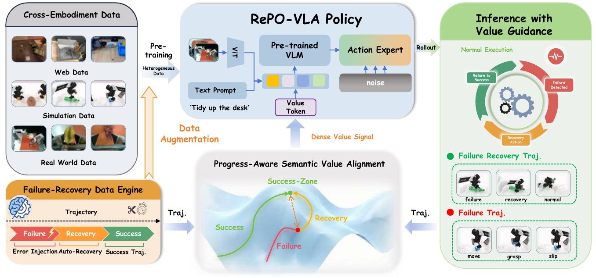
*Fig. 2 from RePO-VLA (Overview).*

- **Bài toán**: VLA chỉ imitate trajectory thành công nên không biết sửa khi bị lệch (execution drift); trajectory hỏng thường bị bỏ đi.
- **Phương pháp**: (i) *Recovery-Aware Initialization*: cắt riêng đoạn recovery và reset history để hành động sửa chỉ phụ thuộc state hiện tại; (ii) học *Progress-Aware Semantic Value Function* (PAS-VF) để gán nhãn value cho success / recovery / failure; (iii) *Value-Conditioned Refinement*: policy nhận value token, lúc test đặt v = 1.0 để kéo về "success manifold". Data recovery đến từ planner hoặc người thu.
- **Benchmark / kết quả**: đề xuất FRBench (error injection chuẩn hoá, RoboTwin sim + real bimanual); adversarial success 20% → 75% trung bình.
- **Khác RetryVLA**: value = *progress của task* (học từ ngữ nghĩa + reference), còn RetryVLA = *competence của chính π* học từ rollout tiếp nối thật. RePO cần recovery data từ planner/người; RetryVLA **tự tìm** bridge bằng search + sim verify. Giống nhau: cả hai đều SFT, không cần detector/search lúc test. Học được: trick reset history ở đầu đoạn recovery rất hợp với distillation của mình.

### A2. Dream2Fix — *Learning Actionable Manipulation Recovery via Counterfactual Failure Synthesis*
- Link: [arXiv 2603.13528](https://arxiv.org/abs/2603.13528) · [dream2fix.github.io](https://dream2fix.github.io) · Dayou Li, Jiuzhou Lei, …, Zhiwen Fan · arXiv preprint, 03/2026
- Lưu ý: tiêu đề chính thức trên arXiv **không** có chữ "Dream2Fix"; Dream2Fix là tên framework trong abstract.

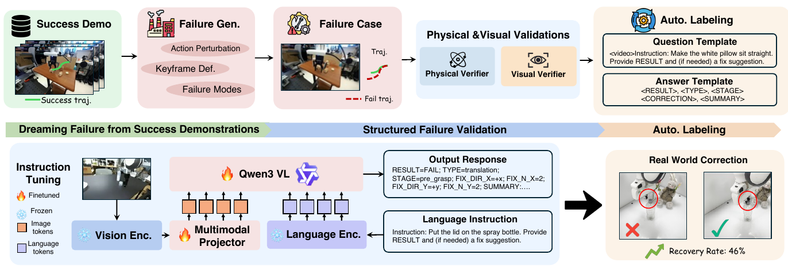
*Fig. 2 from Dream2Fix (Overview of Dream2Fix pipeline).*

- **Bài toán**: thiếu data failure + correction ở real world; các VLM analyzer chỉ nói "fail/không fail", chưa đưa ra correction thực thi được.
- **Phương pháp**: từ demo thành công thật, **nhiễu action quanh keyframe trong một video world model** (Ctrl-World) để "mơ" ra failure (force-open, translation, delay-close…), lọc bằng verifier (VLM + inverse dynamics + joint-limit), tự gán nhãn → fine-tune Qwen3-VL dự đoán *loại lỗi + hướng/độ lớn correction*.
- **Kết quả**: >120k cặp failure–correction; correction accuracy 19.7% → 81.3%; 46% zero-shot recovery trên robot thật (closed-loop).
- **Khác RetryVLA**: WM dùng để **sinh failure** (counterfactual), không phải để chấm recovery. Output là correction dạng text/tham số cho một VLM bên ngoài, không distill vào policy. Verify = verifier học được (có thể sai), RetryVLA verify bằng sim thật. Học được: ý tưởng sinh failure đa dạng từ demo có thể mở rộng tập failure train của mình.

### A3. ReCoVLA: VLM-Guided Reward Compilation for Failure Recovery in Vision-Language-Action Policies
- Link: [arXiv 2606.09630](https://arxiv.org/abs/2606.09630) · Haodi Hu, Chung-Ta Huang, …, Toshiaki Koike-Akino (MERL) · arXiv preprint, 06/2026

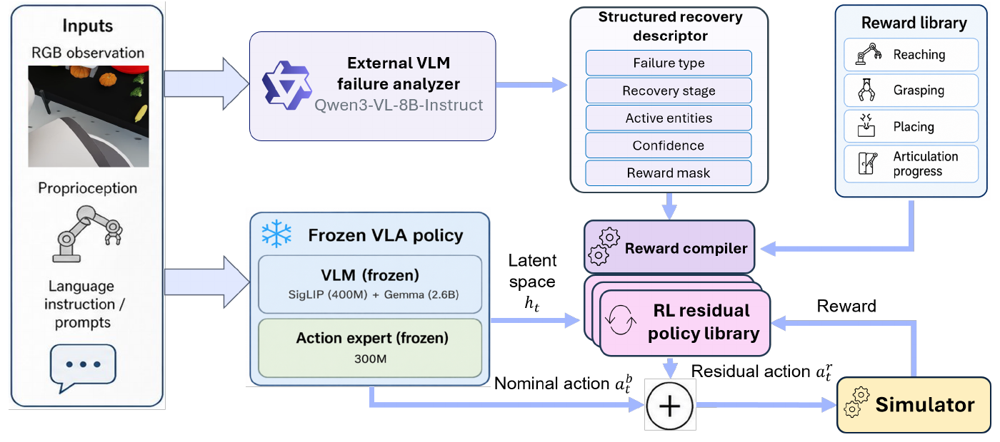
*Fig. 1 from ReCoVLA (Overview of failure-conditioned residual VLA recovery).*

- **Bài toán**: VLA (π0.5) dễ gãy ở off-nominal state; muốn thêm khả năng recover mà **giữ VLA đóng băng**.
- **Phương pháp**: VLM ngoài (Qwen3-VL) đọc ảnh → *recovery descriptor* (loại lỗi, stage, entity, reward mask) → *reward compiler* ghép reward từ thư viện (reach/grasp/place/articulation) → train **residual RL policy** (PPO) trong sim, cộng vào action của VLA; sim-to-real zero-shot.
- **Kết quả**: 3 task Fetch; sim 36.7% (π0.5 fine-tuned) → 66.7%; real 61.7%.
- **Khác RetryVLA**: cũng frozen VLA + chỉ học phần recovery, nhưng ReCoVLA cần **reward hand-designed + RL** và giữ VLM + residual lúc test. RetryVLA không cần reward: "thành công" = π tự hoàn thành sau bridge (verify trong sim), rồi distill vào chính VLA. Kết quả của mình: residual RL ở cùng sim budget kém distillation.

### A4. RACER: Rich Language-Guided Failure Recovery Policies for Imitation Learning
- Link: [arXiv 2409.14674](https://arxiv.org/abs/2409.14674) · [project](https://rich-language-failure-recovery.github.io) · [code](https://github.com/sled-group/RACER) · Yinpei Dai, Jayjun Lee, Nima Fazeli, Joyce Chai (UMich SLED) · **ICRA 2025** (đã xác minh qua IEEE Xplore)

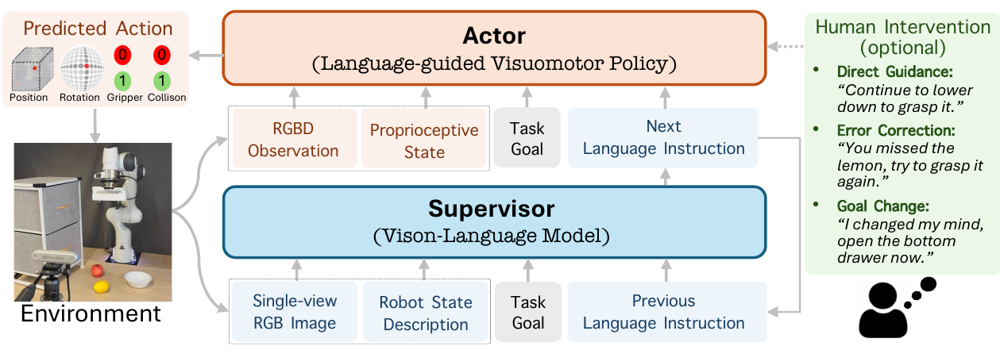
*Fig. 3 from RACER (supervisor–actor framework).*

- **Bài toán**: policy imitation (RVT) không tự hồi phục, và instruction đơn giản không đủ để hướng dẫn sửa lỗi.
- **Phương pháp**: pipeline tự động **perturb demo expert** để tạo failure + đoạn recovery về keyframe, LLM gán *rich language* cho mỗi bước; train VLM *supervisor* (LLaVA) sinh instruction chi tiết và *actor* (RVT) điều kiện trên instruction.
- **Kết quả**: 10,159 trajectory mới trên RLBench; 18 task RLBench 70.2% vs RVT 62.9%; tốt hơn khi goal đổi / task unseen / real.
- **Khác RetryVLA**: recovery data = perturb + quay về keyframe **của expert demo** (scripted), không quan tâm policy có làm tiếp được không; RetryVLA chọn bridge theo C^π của chính policy và verify bằng continuation. RACER cần VLM supervisor mỗi bước lúc test; mình không. Học được: perturb-then-recover là baseline data-gen tự nhiên để so.

### A5. Learning to Recover from Plan Execution Errors during Robot Manipulation: A Neuro-symbolic Approach
- Link: [arXiv 2405.18948](https://arxiv.org/abs/2405.18948) · Namasivayam Kalithasan, Arnav Tuli, Vishal Bindal, Himanshu Gaurav Singh, Parag Singla, Rohan Paul (IIT Delhi) · arXiv 05/2024 ("submitted to IEEE"; không tìm thấy venue chính thức)

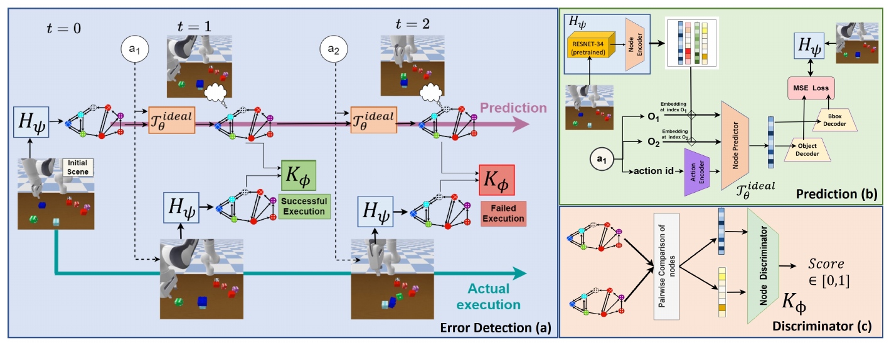
*Fig. 2 from the paper (Model overview: error detection, scene-graph predictor, discriminator).*

- **Bài toán**: robot chạy theo plan (học từ demo); khi một bước fail cần **phát hiện** và **lập lại plan** mà không có nhãn failure.
- **Phương pháp**: biểu diễn state bằng **scene graph**; học transition model "ideal" + discriminator so sánh state dự đoán vs thực tế để phát hiện/khoanh vùng lỗi; rồi symbolic search tìm recovery plan về một sub-goal của plan gốc (bản anytime: chọn sub-goal tối ưu theo budget).
- **Kết quả**: sim Franka (xếp khối), nhiều loại lỗi giả lập; tốt hơn baseline về accuracy + thời gian re-plan.
- **Khác RetryVLA**: cũng ý tưởng "**quay về một state mà plan gốc làm tiếp được**" — rất gần ý "bridge tới vùng π có competence". Nhưng họ dùng symbolic state + planner, không có VLA, và "plan làm tiếp được" là giả định (khoảng cách tới sub-goal) thay vì xác suất thành công đo được của π.

---

## B. World-model planning / value

### B1. DINO-WM: World Models on Pre-trained Visual Features enable Zero-shot Planning
- Link: [arXiv 2411.04983](https://arxiv.org/abs/2411.04983) · [project](https://dino-wm.github.io) · Gaoyue Zhou, Hengkai Pan, Yann LeCun, Lerrel Pinto (NYU/Meta) · **ICML 2025** (PMLR v267)

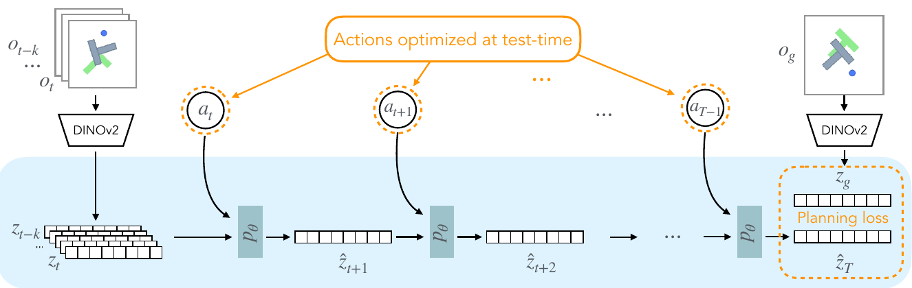
*Fig. 2 from DINO-WM (Architecture).*

- **Bài toán**: học world model task-agnostic từ data offline, dùng để plan lúc test không cần reward.
- **Phương pháp**: encode ảnh bằng DINOv2 patch features (đóng băng), ViT dự đoán patch feature tương lai theo action; planning = tối ưu chuỗi action (CEM/MPC) để latent cuối gần **latent của goal image**.
- **Kết quả**: zero-shot planning trên 6 môi trường (PointMaze, PushT, Wall, Rope, Granular…), tốt hơn DreamerV3/IRIS/TD-MPC2 khi offline.
- **Khác RetryVLA**: RetryVLA **dùng lại kiến trúc WM kiểu DINO-WM**, nhưng thay objective "gần goal image" bằng **C^π của end state**. Lý do: trong recovery không có goal image tốt, và state "giống goal" chưa chắc là state π làm tiếp được. Kết quả mình: competence-guided ≫ latent-goal. Ngoài ra DINO-WM plan mỗi bước lúc test; mình chỉ search offline.

### B2. TD-MPC2: Scalable, Robust World Models for Continuous Control
- Link: [arXiv 2310.16828](https://arxiv.org/abs/2310.16828) · [tdmpc2.com](https://www.tdmpc2.com) · Nicklas Hansen, Hao Su, Xiaolong Wang · **ICLR 2024**

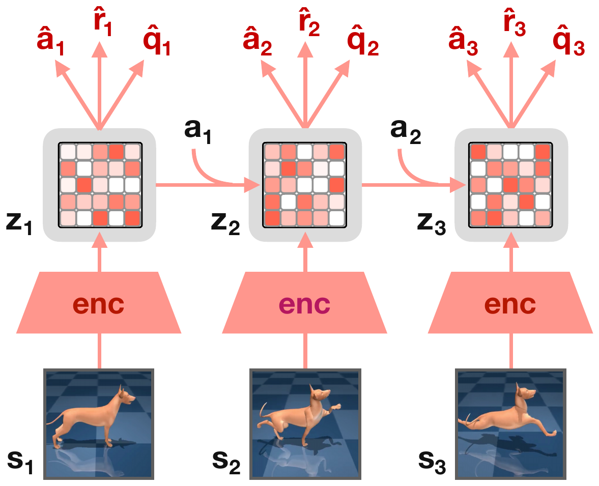
*Fig. 3 from TD-MPC2 (architecture).*

- **Bài toán**: model-based RL scale được cho nhiều task (104 task), 1 bộ hyperparameter.
- **Phương pháp**: *implicit* latent WM (không decode ảnh) học bằng joint-embedding + reward + **TD value Q**; lúc hành động dùng MPPI plan ngắn trong latent và bootstrap bằng Q ở cuối horizon; có policy prior.
- **Kết quả**: mạnh trên DMControl, Meta-World, ManiSkill2, MyoSuite; agent 317M param đa task.
- **Khác RetryVLA**: ý "**plan ngắn + value ở cuối horizon**" chính là cấu trúc của RetryVLA (bridge 50 step + C^π ở end state). Khác: value của TD-MPC2 là return của *policy đang học* (cần reward + online RL), còn C^π là P(success) của *một policy đóng băng* học từ rollout thật, không cần reward shaping. TD-MPC2 plan lúc test; mình distill để bỏ planning.

---

## C. WM-assisted VLA improvement

### C1. RISE: Self-Improving Robot Policy with Compositional World Model
- Link: [arXiv 2602.11075](https://arxiv.org/abs/2602.11075) · [project](https://opendrivelab.com/RISE/) · [code](https://github.com/OpenDriveLab/RISE) · Jiazhi Yang, Kunyang Lin, …, Ping Luo, Hongyang Li · **RSS 2026** (theo arXiv comment)

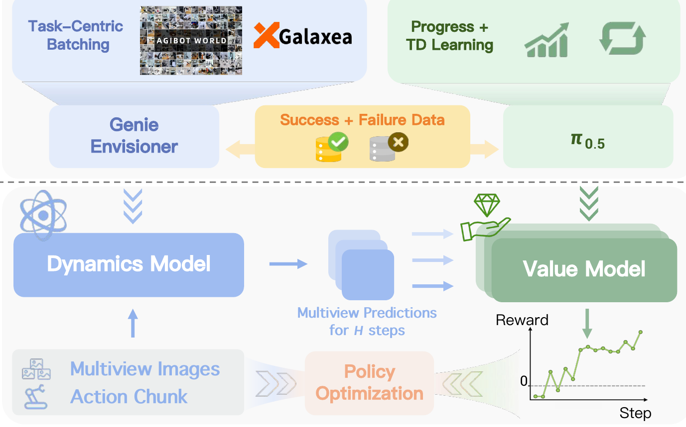
*Fig. 4 from RISE (Workflow of compositional world model).*

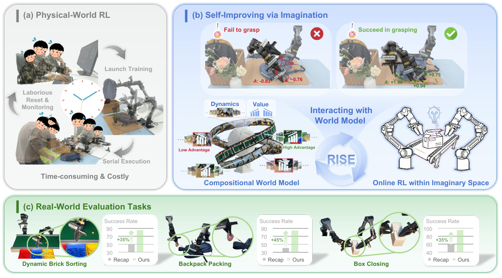
*Fig. 1 from RISE (overview: RL via imagination).*

- **Bài toán**: RL thật cho VLA tốn kém (reset, an toàn); muốn RL hoàn toàn trong tưởng tượng.
- **Phương pháp**: *Compositional World Model* = dynamics model (Genie Envisioner, video đa view, điều khiển theo action chunk) + **progress value model** (khởi tạo từ π0.5, học Progress + TD trên data success + failure) → tính advantage cho rollout tưởng tượng → cập nhật policy (advantage-conditioned) vòng lặp kín.
- **Kết quả**: 3 task real (dynamic brick sorting, backpack packing, box closing): +35%, +45%, +35% so với prior (RECAP).
- **Khác RetryVLA**: RISE học **chỉ trong imagination** với **progress value**; RetryVLA verify thật trong sim và dùng **competence của π**. Thí nghiệm của mình: imagination-only (RISE-inspired) kém hơn, vì WM sai nhiều ở state recovery → WM nên là *filter*, nhãn cuối phải từ verify thật. Học được: tách dynamics và value thành 2 model riêng (đúng như mình làm WM + critic).

### C2. WMPO: World Model-based Policy Optimization for Vision-Language-Action Models
- Link: [arXiv 2511.09515](https://arxiv.org/abs/2511.09515) · [wm-po.github.io](https://wm-po.github.io) · [code](https://github.com/WM-PO/WMPO) · Fangqi Zhu, Zhengyang Yan, Zicong Hong, Quanxin Shou, Xiao Ma, Song Guo (HKUST, ByteDance Seed) · **ICLR 2026** (poster, xác minh trên OpenReview/ICLR proceedings)

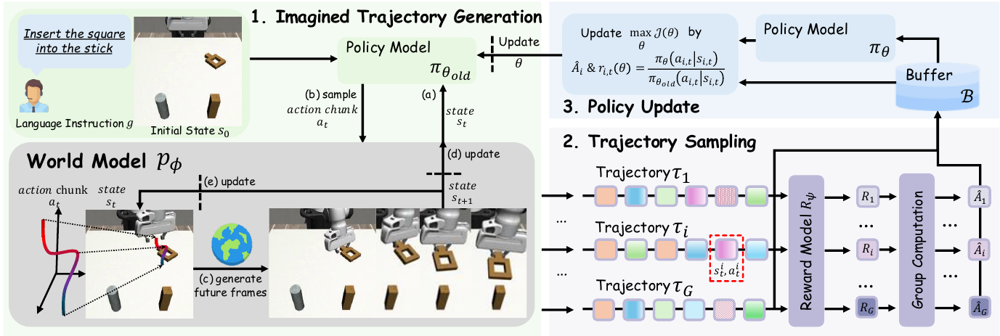
*Fig. 2 from WMPO (training procedure).*

- **Bài toán**: on-policy RL cho VLA mà không cần tương tác thật nhiều.
- **Phương pháp**: video WM ở **pixel space** (khớp với feature pretrained của VLA), fine-tune trên rollout của chính policy (*policy behavior alignment*) để mô phỏng cả failure; sample nhiều trajectory tưởng tượng, reward model chấm success (binary) → **GRPO**.
- **Kết quả**: MimicGen (Coffee, StackThree, ThreePieceAssembly, Square) với OpenVLA-OFT, tốt hơn GRPO thật / DPO cùng budget; real ALOHA "insert square": base 53% / DPO 60% / WMPO 70%; xuất hiện hành vi self-correction.
- **Khác RetryVLA**: WMPO tối ưu **cả task** bằng RL và reward success của task; RetryVLA nhắm **đoạn recovery ngắn**, objective là C^π, update bằng SFT trên data đã verify. Giống: WM được align với hành vi của chính policy (mình train critic trên continuation thật của π). Học được: "policy behavior alignment" là lý do WM cần thấy failure state — cũng đúng với WM của mình.

---

## D. Benchmark

### D1. LIBERO-Recover: Beyond Task Success Towards Failure Recovery in Robotic Manipulation Models
- Link: [arXiv 2609.05178](https://arxiv.org/abs/2609.05178) · [project](https://liulin815.github.io/LIBERO-Recovery/) · [code](https://github.com/liulin815/LIBERO-Recovery) · Lin Liu, Zhicheng Bao, Lu Zhang, …, Huchuan Lu · arXiv preprint, 09/2026

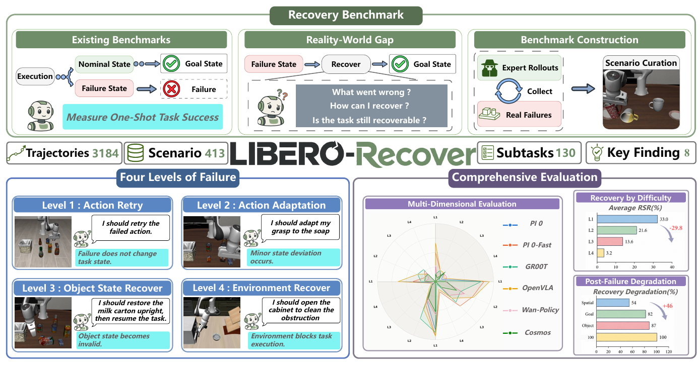
*Fig. 1 from LIBERO-Recover (Overview).*

- **Bài toán**: LIBERO gần bão hoà (~100%) nhưng chỉ đo từ initial state sạch; cần đo khả năng **recover sau khi fail**.
- **Cách xây**: chạy nhiều policy SOTA (π0, π0.5, OpenVLA, GR00T, Wan-Policy, Cosmos-Policy) làm "failure generator" → lấy failure state thật → 1000+ scenario chia 4 level (Action Retry, Action Adaptation, Object State Recovery, Environmental Recovery); 3,184 recovery trajectory do 4 người teleop.
- **Metric**: RSR (Recovery Success Rate) = tỉ lệ hoàn thành task khi bắt đầu từ failure state. Kết quả: VLA hiện tại RSR thấp, giảm mạnh theo level (L1 ~33% → L4 ~3% trung bình).
- **Với RetryVLA**: đây là benchmark chính (Spatial = dev, Object = held-out). Lưu ý: teleop recovery data của họ là baseline "demo-only SFT" tự nhiên; RetryVLA thay bằng bridge tự sinh + verify.

---

## E. (Thêm, do mình chọn — không có trong review gốc)

### E1. MimicGen: A Data Generation System for Scalable Robot Learning using Human Demonstrations *(thêm)*
- Link: [arXiv 2310.17596](https://arxiv.org/abs/2310.17596) · [project](https://mimicgen.github.io) · Ajay Mandlekar, Soroush Nasiriany, Bowen Wen, …, Dieter Fox · **CoRL 2023**

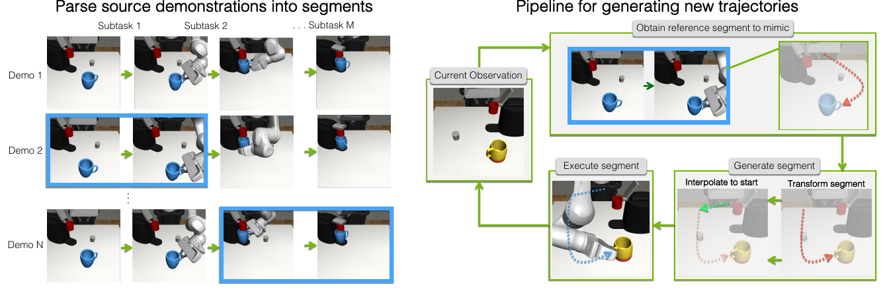
*Fig. 2 from MimicGen (System pipeline).*

- **Ý chính**: từ ~10 demo người, chia thành segment theo object, biến đổi segment theo pose object mới, **thực thi trong sim và chỉ giữ trajectory thành công** → hàng nghìn demo để BC.
- **Liên quan RetryVLA**: cùng công thức "**sinh ứng viên → verify bằng sim → SFT trên phần thành công**". Khác: MimicGen sinh demo nominal từ đầu; RetryVLA sinh *bridge* từ failure state và tiêu chí verify là "π tự làm tiếp được".

### E2. DAgger — *A Reduction of Imitation Learning and Structured Prediction to No-Regret Online Learning* *(thêm, không có hình)*
- Link: [arXiv 1011.0686](https://arxiv.org/abs/1011.0686) · Stéphane Ross, Geoffrey J. Gordon, J. Andrew Bagnell · **AISTATS 2011**
- **Ý chính**: BC bị *covariate shift* — policy đi lệch sang state chưa thấy trong demo; DAgger cho learner chạy, hỏi expert nhãn tại state learner gặp, gộp data và train lại.
- **Liên quan RetryVLA**: failure state chính là state "lệch phân phối" của π. RetryVLA giống một DAgger không cần expert: "nhãn" tại failure state là bridge do search + sim verify tìm ra, sau đó distill. (Không có method figure phù hợp nên bỏ hình.)

---

## Ghi chú nguồn
- Tiêu đề, tác giả, ngày arXiv lấy từ arXiv API; venue: DINO-WM (PMLR v267), RACER (IEEE ICRA 2025), WMPO (ICLR 2026, OpenReview), RISE (arXiv comment "RSS 2026"), TD-MPC2 (arXiv comment "ICLR 2024"), MimicGen ("CoRL 2023"). Các paper 2026 còn lại (RePO-VLA, Dream2Fix, ReCoVLA, LIBERO-Recover) hiện là arXiv preprint.
- Số liệu kết quả trích từ abstract/thân bài của từng paper, không chạy lại.
