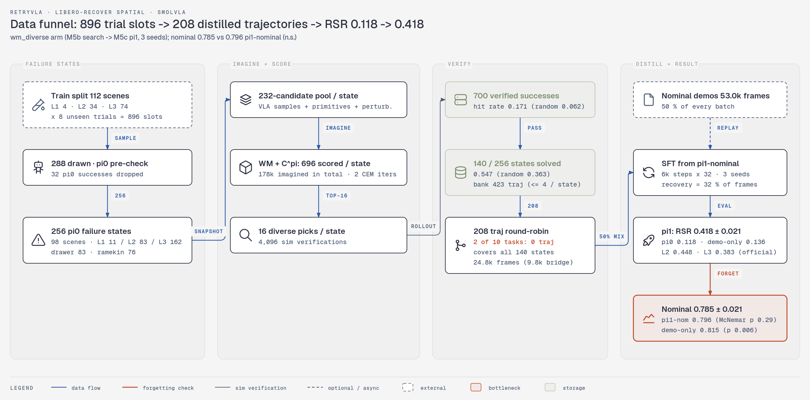
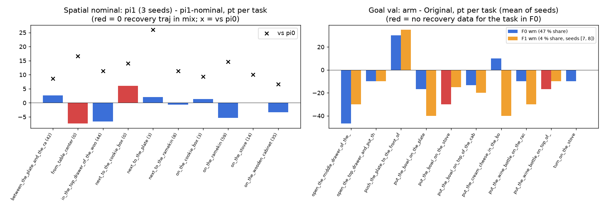
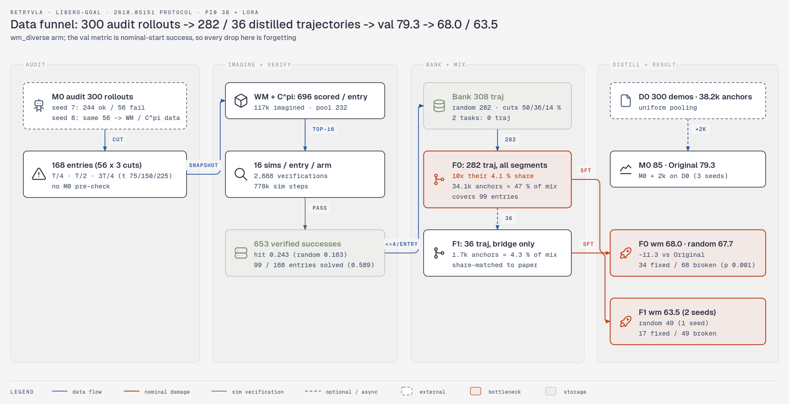

# Data funnel and catastrophic forgetting (Spatial / Object / LIBERO-Goal)

Written 2026-11-23 (user request: "how much data at the start -> how much gets distilled -> how much the model
improves; after training, does it forget the old data?"). Offline only: CPU, existing artefacts, 0 new rollouts, no
training. Script: `python scripts/analyze_data_funnel.py` -> `runs/_analysis/funnel/funnel.json` (all numbers below)
+ `funnel_spatial.png`, `funnel_goal.png`, `forgetting_per_task.png`. Diagrams: `.cursor/skills/flow-diagram` specs
`runs/_analysis/diagrams/funnel-{spatial,goal}.yaml`. Committed copies of all PNGs: `docs/research/figs/funnel/`.
F1 jobs on 953bb534 were not touched. F1 is partial at writing time (3 of 6 cells: wm s7 / s8, random s7).

## TL;DR

- **Spatial (SmolVLA).** The funnel runs 896 unseen train trial slots -> 256 pi0 failure states -> 178k imagined
  candidates -> 4,096 sim verifications -> 700 verified successes -> 140 states with >= 1 recovery -> 423 bank
  trajectories -> **208 distilled trajectories covering all 140 solved states**. That is 24.8k frames, 32 % of the SFT
  frames and 50 % of every batch.
  - RSR rises 0.118 (pi0) / 0.138 (pi1-nominal) / 0.136 (demo-only, 3 seeds) -> **0.418 ± 0.021** (pi1, 3 seeds).
    The gain is the same size on L2 (0.09 -> 0.45) and L3 (0.10 -> 0.38).
  - **Nominal: no forgetting vs the SFT init.** pi1 scores 0.785 vs pi1-nominal 0.796 (−1.1 pt). Per task it is
    5 drops and 4 gains. Paired McNemar: 106 fixed / 123 broken, p 0.29.
  - **There is a small, real cost vs the step-matched demo-only control.** pi1 scores 0.785 vs demo-only 0.815,
    i.e. −3.1 pt (113 / 159, p 0.006). It drops on 6 of 10 tasks.
- **Object (held out, 1 seed).** 247 failures -> 114 solved -> 123 distilled trajectories (27 % of frames). RSR
  0.200 -> 0.354. Nominal 0.942 vs 0.944, McNemar 19 / 20, p 1.0: no forgetting.
- **LIBERO-Goal (2610.05151 protocol, pi0 3B).** The funnel runs 300 audit rollouts -> 56 failures -> 168 entries
  -> 117k imagined -> 2,688 verifications -> 653 verified successes -> 99 entries solved -> bank 308 -> distilled
  **282** (F0, 47 % of anchors) or **36** (F1, bridge only, 4.3 %).
  - The val metric is nominal-start success, so it is itself a forgetting test.
  - **Forgetting is clear.** Original scores 79.3. F0 wm scores 68.0: 34 fixed / 68 broken, p 0.001. It drops on
    7 of the 8 tasks M0 already solved.
  - **F1 so far is worse, not better**, even at the paper's 4 % share: wm 58 / 69 = 63.5 (17 / 49, p 1e-4) and
    random 49 (1 seed).
  - The paper reports 78 -> 88.
- **Do degradations concentrate on tasks without recovery data?** Not in either setting.
  - Spatial: the 2 no-data tasks went −7.3 and +6.0. Mean −0.7 pt, vs −1.2 pt on tasks with data.
  - Goal F0: the 2 no-data tasks (bowl_on_stove −3.0, wine_cabinet −1.7) lost −4.7 successes in total, vs −6.7 on
    the 8 tasks with data. The damage is global, as CUT_POINT_STUDY found.
  - Goal F1 concentrates its losses on tasks WITH data (−13.5 vs −2.5). Example: cream_cheese, the task with the
    most bridges, fell 6.5 -> 2.5 / 10 on the same seeds.
- **Held-out nominal flow-matching loss is not logged** in any SFT run. Spatial `metrics.jsonl` has train loss only;
  Goal `f1_*/metrics.jsonl` has `loss` / `gn` on the mixed batch only. So there is no loss-based forgetting proxy.
  This would need a new eval pass over held-out demos.
- **Verdict.**
  - Spatial / Object, with 50 % nominal replay: **no catastrophic forgetting.** Nominal stays within the 2 pt margin
    of the init on 3 seeds. A ~3 pt nominal cost vs demo-only is the price of +28 pt RSR.
  - Goal (their recipe, no replay ratio, uniform pooling): **forgetting, −11 to −16 pt.** It is not explained by mix
    volume alone, since F1 at 4 % is no better. The leading suspect is now the bridge labels themselves: open-loop
    primitives / perturbations, rough actions, and T/4 near-nominal states.

## A. LIBERO-Recover Spatial (SmolVLA): M5b search -> M5c pi1

(`runs/_analysis/diagrams/funnel-spatial.png`; bar version: `figs/funnel/funnel_spatial.png`)

### A.1 Funnel (train split only; test never searched)

| stage | random | **wm_diverse (= pi1 data)** | wm_noise | wm_qd |
|---|---|---|---|---|
| train scenes (split `spatial_v1`) | 112 | 112 | 112 | 112 |
| trial slots unseen by the WM (trials 2-9) | 896 | 896 | 896 | 896 |
| drawn for the pi0 pre-check (`n_select`) | 288 | 288 | 288 | 288 |
| **pi0 failure states** (32 pi0 successes dropped) | **256** | **256** | 256 | 256 |
| candidate pool per state | 232 | 232 | (noise CEM) | 232 |
| WM-imagined + critic-scored per state | 0 (no WM) | 696 (pool + 2 CEM iters) | 768 | 744 |
| ... total imagined | 0 | **178,176** | 196,608 | 190,464 |
| sim verifications (16 / state) | 4,096 | 4,096 | 4,096 | 4,096 |
| **verified successes** (hit rate) | 254 (0.062) | **700 (0.171)** | 310 (0.076) | 464 (0.113) |
| **states with >= 1 verified recovery** | 93 (0.363) | **140 (0.547)** | 74 (0.289) | 116 (0.453) |
| bank trajectories (<= 4 / state) | 208 | 423 | 208 | 336 |
| **distilled (round-robin, count-matched)** | 208 | **208** | 208 | 208 |
| unique states in the SFT mix | 93 | **140** | 74 | 116 |
| distilled frames (bridge / continuation) | 19,489 (8.0k / 11.5k) | **24,754 (9.8k / 15.0k)** | 18,289 | 22,781 |

By level (all labels, i.e. official + inherited; train split 112 scenes = L1 4 / L2 34 / L3 74):

| level | failure states | solved (wm_diverse) | solved / failures | distilled traj (wm_diverse) | solved (random) |
|---|---|---|---|---|---|
| L1 | 11 | 1 | 0.09 | 1 | 3 |
| L2 | 83 | 45 | 0.54 | 68 | 27 |
| L3 | 162 | 94 | 0.58 | 139 | 63 |

Official-only labels exist for 129 of the 256 states (L1 5 / L2 42 / L3 82). No L4 scene is in our split.
The 256 states come from 98 scenes of 8 task folders. The drawer task (83) and the ramekin task (76) dominate.
LIBERO-Spatial nominal tasks `from_table_center` and `next_to_the_cookie_box` have **no** recovery scenes, so they get
0 trajectories.

**SFT mix (pi1 = M5c wm_diverse round-robin)**:
- Init pi1-nominal, 6k steps x bs 32 = 192k samples.
- `recovery_ratio` 0.5, so every batch is half recovery.
- 24,754 recovery frames vs 52,970 nominal LIBERO-Spatial demo frames, i.e. **31.8 % of frames, 50 % of samples**.
- So each recovery frame is seen ~2.1x more often than each nominal frame.

Recovery trajectories per nominal task (wm_diverse, 208):

| task | traj |
|---|---|
| between_plate_ramekin | 42 |
| from_table_center | 0 |
| top_drawer | 44 |
| next_to_cookie_box | 0 |
| next_to_plate | 3 |
| next_to_ramekin | 8 |
| on_cookie_box | 3 |
| on_ramekin | 59 |
| on_stove | 14 |
| on_wooden_cabinet | 35 |

### A.2 Improvement (test RSR, 56 scenes x 10; Spatial test = dev split from M7 on)

| policy | seeds | RSR | per seed | official L1 (1) / L2 (11) / L3 (16) | all-label L1 / L2 / L3 | nominal |
|---|---|---|---|---|---|---|
| pi0 | 1 | 0.118 | - | 0.80 / 0.109 / 0.100 | 0.75 / 0.095 / 0.094 | 0.656 |
| pi1-nominal (SFT init) | 1 | 0.138 | - | 0.70 / 0.091 / 0.119 | 0.75 / 0.123 / 0.109 | 0.796 |
| 1 demo-only (+6k steps) | 3 | 0.136 ± 0.015 | 0.127 / 0.127 / 0.154 | 0.73 / 0.106 / 0.106 | 0.80 / 0.118 / 0.106 | 0.815 ± 0.012 |
| **2 pi1 (208 verified WM recoveries)** | 3 | **0.418 ± 0.021** | 0.439 / 0.396 / 0.420 | 0.83 / **0.448** / **0.383** | 0.88 / 0.412 / 0.394 | 0.785 ± 0.021 |
| 3 action-free, C^pi-filtered | 3 | 0.125 ± 0.002 | 0.123 / 0.125 / 0.127 | 0.67 / 0.094 / 0.115 | 0.75 / 0.103 / 0.101 | 0.801 ± 0.023 |
| 4 action-free, unfiltered | 3 | 0.120 ± 0.014 | 0.114 / 0.136 / 0.109 | 0.67 / 0.094 / 0.108 | 0.68 / 0.100 / 0.098 | 0.804 ± 0.007 |
| 5 hybrid (2 + 3) | 3 | 0.370 ± 0.006 | 0.362 / 0.371 / 0.375 | 0.77 / 0.352 / 0.348 | 0.85 / 0.335 / 0.364 | 0.780 ± 0.022 |
| 6 Backtrack-distill | 3 | 0.166 ± 0.015 | 0.182 / 0.164 / 0.152 | 0.67 / 0.133 / 0.158 | 0.72 / 0.144 / 0.147 | 0.798 ± 0.014 |

- pi1 vs pi0 is +30 pt and pi1 vs demo-only is +28 pt. The scene x seed bootstrap is −0.283 [−0.373, −0.195] for
  demo-only vs pi1 (RESULTS 6-arm table).
- Data efficiency: 208 trajectories (24.8k frames) buy +28 pt RSR. That is **~1.4 pt RSR per 10 distilled
  trajectories**, or ~0.7 pt per 100 sim verifications of the wm_diverse arm (4,096 in total).
- Funnel yield: 700 verified hits of 178k imagined candidates = 0.39 %. 208 of 700 hits are distilled (30 %).

### A.3 Forgetting: nominal LIBERO-Spatial (10 tasks x 50 fixed inits, eval seed 7)

Per-task nominal SR, %. pi1 and demo-only are means over 3 seeds. Columns 5 and 6 are pi1 minus pi1-nominal and pi1
minus demo-only. "traj" = recovery trajectories in the mix for that task.

| task | traj | pi0 | pi1-nominal | demo-only | **pi1** | pi1 − pi1-nom | pi1 − demo-only |
|---|---|---|---|---|---|---|---|
| between_plate_ramekin | 42 | 76 | 82 | 95.3 | 84.7 | +2.7 | −10.7 |
| **from_table_center** | **0** | 74 | 98 | 90.7 | 90.7 | −7.3 | 0.0 |
| top_drawer | 44 | 66 | 84 | 74.7 | 77.3 | −6.7 | +2.7 |
| **next_to_cookie_box** | **0** | 68 | 76 | 84.7 | 82.0 | +6.0 | −2.7 |
| next_to_plate | 3 | 58 | 82 | 89.3 | 84.0 | +2.0 | −5.3 |
| next_to_ramekin | 8 | 78 | 90 | 86.0 | 89.3 | −0.7 | +3.3 |
| on_cookie_box | 3 | 62 | 70 | 80.0 | 71.3 | +1.3 | −8.7 |
| on_ramekin | 59 | 44 | 64 | 67.3 | 58.7 | −5.3 | −8.7 |
| on_stove | 14 | 74 | 84 | 83.3 | 84.0 | 0.0 | +0.7 |
| on_wooden_cabinet | 35 | 56 | 66 | 64.0 | 62.7 | −3.3 | −1.3 |
| **all** | 208 | 65.6 | 79.6 | 81.5 | **78.5** | **−1.1** | **−3.1** |

Paired McNemar on the same (task, init) episodes, pooled over seeds ("fixed" = new ok / ref failed):

| comparison | dNSR | tasks down / up (>= 5 pt down) | fixed / broken | p | mean Δ, tasks with / without data |
|---|---|---|---|---|---|
| **pi1 vs pi1-nominal (init)** | −1.1 pt | 5 / 4 (3) | 106 / 123 | **0.29** | −1.2 / −0.7 pt |
| pi1 vs pi0 | +12.9 pt | 0 / 10 | 304 / 111 | 8e-22 | +12.2 / +15.3 pt |
| **pi1 vs demo-only (same init, same 6k steps)** | **−3.1 pt** | 6 / 3 (4) | 113 / 159 | **0.006** | −3.5 / −1.3 pt |
| demo-only vs pi1-nominal | +1.9 pt | 5 / 5 (2) | 132 / 103 | 0.07 | +2.3 / +0.7 pt |
| hybrid (arm 5) vs pi1-nominal | −1.6 pt | 6 / 3 (3) | 125 / 149 | 0.16 | −2.3 / +1.0 pt |
| action-free C^pi (arm 3) vs pi1-nominal | +0.5 pt | 6 / 4 (1) | 118 / 111 | 0.69 | |
| action-free unfiltered (arm 4) vs pi1-nominal | +0.8 pt | 5 / 5 (2) | 119 / 107 | 0.46 | |
| Backtrack-distill (arm 6) vs pi1-nominal | +0.2 pt | 6 / 3 (1) | 117 / 114 | 0.90 | |

Reading:
- (i) Relative to its own init, pi1 forgets nothing measurable. −1.1 pt is within the seed spread of pi1
  (0.766-0.808) and within the pre-registered 2 pt margin. McNemar p is 0.29.
- (ii) The honest control is demo-only: same init, same 6k steps, same 50 % nominal batches. Against it pi1 pays
  **−3.1 pt, and this is significant** (p 0.006, episode-level; the 10-task bootstrap is wider). The losses sit on
  tasks WITH recovery data: between_plate_ramekin −10.7, on_ramekin −8.7, on_cookie_box −8.7. These are the
  heavy-data tasks plus one 3-trajectory task. The no-data tasks moved 0.0 / −2.7.
  So the cost is interference on the tasks being taught recovery, not loss of untouched skills.
- (iii) The no-data tasks are not where it breaks. vs pi1-nominal, from_table_center −7.3 is mostly
  pi1-nominal's own 98 % (demo-only also 90.7). next_to_cookie_box +6.0.
- (iv) The P3 ratio sweep in RESULTS shows the dose-response: r 0.7 fails the margin (0.766), and
  r 0.5 + L_preserve gives 0.806. So forgetting appears only when recovery dominates the batch.

### A.4 Object held-out (M10, recipe frozen; 1 SFT seed; test 26 scenes x 10)

Funnel:
- Split: 51 train scenes (L1 11 / L2 35 / L3 5).
- 306 trial slots drawn (trials 4-9); 59 pi0 successes; **247 failure states** (49 scenes).
- Pool 232; wm arms imagine 696 / state = 172k total; 3,952 sim verifications / arm (1.30M sim steps for wm_diverse).

| arm | verified successes (hit rate) | states solved | bank | distilled (round-robin) | unique states | frames (bridge / cont.) |
|---|---|---|---|---|---|---|
| random | 239 (0.060) | 100 (0.405) | 215 | 123 | 100 | 24,705 (6.0k / 18.7k) |
| **wm_diverse (competence)** | **529 (0.134)** | **114 (0.462)** | 340 | **123** | **114** | 25,359 (6.1k / 19.3k) |
| wm_goal | 151 (0.038) | 56 (0.227) | 123 | 123 | 56 | 20,438 |

SFT mix: 25,359 recovery vs 66,984 nominal frames (27.5 % of frames, 50 % of samples), init Object pi1-nominal.

| policy | test RSR | official L1 (4) / L2 (15) | nominal | vs pi1-nominal: fixed / broken, p | tasks down / up |
|---|---|---|---|---|---|
| pi0 | 0.219 | 0.225 / 0.187 | 0.886 | - | - |
| pi1-nominal | 0.200 | 0.250 / 0.140 | 0.944 | (ref) | - |
| demo-only | 0.173 | 0.225 / 0.113 | 0.932 | 15 / 21, 0.41 | 4 / 5 |
| random SFT | **0.362** | 0.325 / 0.320 | 0.946 | 20 / 19, 1.0 | 4 / 4 |
| **competence SFT (Object pi1)** | **0.354** | 0.400 / 0.280 | **0.942** | **19 / 20, 1.0** | 2 / 3 |
| goal SFT | 0.242 | 0.225 / 0.187 | 0.906 | 14 / 33, **0.008** | 5 / 3 |

- Object: `cream_cheese` is the only task with 0 recovery trajectories. Comp SFT stays at 100 % there.
- The only Object arm that forgets is goal-latent SFT (−3.8 pt, p 0.008, 4 tasks >= 5 pt down). Its losses are on
  tasks with data (orange_juice 88 -> 76, ketchup 98 -> 88). This is again interference from bad labels, not
  missing coverage.

## B. LIBERO-Goal, 2610.05151 protocol (pi0 3B + LoRA; val 100 scenes = 10 / task, 1 trial each)

(`runs/_analysis/diagrams/funnel-goal.png`; bar version: `figs/funnel/funnel_goal.png`)

### B.1 Funnel

| stage | random | **wm_diverse** |
|---|---|---|
| M0 audit rollouts (train split), seed 7 / seed 8 | 300 / 300 | 300 / 300 |
| failed rollouts (all 300-step time-outs) | 56 / 56 | 56 / 56 |
| entries = failures x 3 cuts (T/4, T/2, 3T/4) | 168 / 168 | 168 / 168 |
| seed-8 entries -> WM / C^pi training data (32 candidates each) | 5,376 sim rollouts | (shared) |
| seed-7 entries searched | 168 | 168 |
| candidate pool / WM-imagined per entry | 232 / 0 | 232 / **696** (116,928 total) |
| sim verifications (16 / entry) / sim steps | 2,688 / 837k | 2,688 / 778k |
| **verified successes** (hit rate) | 439 (0.163) | **653 (0.243)** |
| **entries with >= 1 verified recovery** | 96 (0.571) | **99 (0.589)** |
| ... by cut T/4 / T/2 / 3T/4 (of 56) | 44 / 34 / 18 | 43 / 37 / 19 |
| bank trajectories (<= 4 / entry) | 282 | 308 |
| **F0 distilled** (all segments, round-robin, count-matched) | 282 traj, 96 entries | **282 traj, 99 entries** |
| ... recovery anchors vs D0 anchors (300 demos) | 34,554 vs 38,240 = **47.5 %** | 33.4-34.2k vs 38,240 = **46.6-47.2 %** |
| ... cut mix T/4 / T/2 / 3T/4 (traj) | 140 / 96 / 46 | 139 / 104 / 39 |
| **F1 distilled** (bridge segment only, 36 traj) | 1,650 anchors = **4.1 %** (s7) | 1,672-1,718 = **4.2-4.3 %** (s7, s8) |
| paper (LLM teacher) | - | 1,639 windows = 4.1 % of anchors |

- Audit failures per task (seed 7): cream_cheese 18, wine_rack 14, 5 each for middle_drawer / push_plate /
  bowl_on_plate / wine_cabinet, top_drawer 2, 1 each for bowl_cabinet / stove, bowl_on_stove 0.
- Tasks with 0 trajectories in the bank:
  - **bowl_on_stove**: 0 failures.
  - **wine_on_top_of_cabinet**: 5 failures, 0 hits at every cut.
- F0 wm trajectories per task:

| task | F0 wm traj |
|---|---|
| cream_cheese | 78 |
| wine_rack | 72 |
| push_plate | 41 |
| middle_drawer | 36 |
| bowl_on_plate | 24 |
| top_drawer | 14 |
| turn_on_stove | 11 |
| bowl_cabinet | 6 |

### B.2 Results (val successes / 100; the val metric starts from nominal states, so it is the forgetting test)

| arm | s7 / s8 / s9 | mean | vs Original: fixed / broken (pooled), McNemar p | vs M0: fixed / broken, p |
|---|---|---|---|---|
| M0 (4k, selected on val) | 85 | 85 | - | - |
| Original (M0 + 2k on D0) | 82 / 77 / 79 | **79.3** | (ref) | - |
| F0 `wm_diverse` (47 %) | 65 / 76 / 63 | **68.0** (Δ −11.3 [−23.7, +2.0]) | 34 / 68, **p 0.001** | 22 / 73, p 1e-7 |
| F0 `random` (47 %) | 67 / 67 / 69 | 67.7 (Δ −11.7 [−21.0, −3.0]) | 31 / 66, p 5e-4 | 20 / 72, p 5e-8 |
| **F1 `wm_diverse` (4.3 %, bridge only)** | 58 / 69 / running | **63.5** (Δ −16.0 vs Original s7/s8 79.5) | 17 / 49, **p 1e-4** | 16 / 59, p 6e-7 |
| F1 `random` (4.1 %, bridge only) | 49 / running / queued | 49.0 (Δ −33 vs 82) | 3 / 36, p 4e-8 | 2 / 38, p 1e-9 |
| paper: Original -> Recovery | 78 -> **88** | +10 (1 seed, p 0.076) | 8 / 18 | - |

- `Original s7` re-saved in bf16 (`diag_orig_s7_bf16`) scores 83 vs 82 in fp32. So F1's bf16 final checkpoint
  (quota fix) does not explain the drop.
- One F1-only deviation remains untested: lanes were resumed from compact bf16 AdamW resume files after EDQUOT
  deaths.
- F1 pre-registered rules cannot be applied yet (3 / 6 cells done). The direction is already against "mix volume
  caused the drop": F1 wm − F0 wm on the same seeds is 63.5 − 70.5 = −7.

Per task (successes / 10, mean of seeds; Original over the same seeds as the arm for the Δ columns):

| task | audit fails (s7) | F0 traj | M0 | Original (3 s) | F0 wm | F0 rand | F1 wm (s7, s8) | F1 rand (s7) | Δ F0 wm | Δ F1 wm |
|---|---|---|---|---|---|---|---|---|---|---|
| open_middle_drawer | 5 | 36 | 10 | 9.7 | 5.0 | 6.3 | 7.0 | 4 | −4.7 | −3.0 |
| open_top_drawer_bowl | 2 | 14 | 9 | 8.0 | 7.0 | 9.0 | 7.0 | 7 | −1.0 | −1.0 |
| push_plate_to_stove | 5 | 41 | 5 | 4.0 | 7.0 | 6.0 | 7.5 | 1 | **+3.0** | **+3.5** |
| bowl_on_plate | 5 | 24 | 10 | 8.7 | 7.0 | 5.3 | 4.0 | 4 | −1.7 | −4.0 |
| **bowl_on_stove** | 0 | **0** | 9 | 9.7 | 6.7 | 8.3 | 8.5 | 8 | −3.0 | −1.5 |
| bowl_on_cabinet | 1 | 6 | 9 | 9.0 | 7.7 | 7.0 | 7.0 | 7 | −1.3 | −2.0 |
| cream_cheese_in_bowl | 18 | 78 | 9 | 7.0 | 8.0 | 9.0 | 2.5 | 1 | +1.0 | **−4.0** |
| wine_on_rack | 14 | 72 | 5 | 4.0 | 3.0 | 0.7 | 1.5 | 0 | −1.0 | −3.0 |
| **wine_on_top_of_cabinet** | 5 | **0** | 9 | 9.3 | 7.7 | 6.3 | 8.5 | 7 | −1.7 | −1.0 |
| turn_on_stove | 1 | 11 | 10 | 10.0 | 9.0 | 9.7 | 10.0 | 10 | −1.0 | 0.0 |
| **sum** | 56 | 282 | 85 | 79.3 | 68.0 | 67.7 | 63.5 | 49 | −11.3 | −16.0 |

Forgetting summary (Goal):

| arm vs Original | tasks down / up | M0-solved tasks (8 with M0 >= 9 / 10): down, Δ sum | Δ on 2 no-data tasks | Δ on 8 tasks with data |
|---|---|---|---|---|
| F0 wm | 8 / 2 | 7 of 8, −13.3 | −4.7 | −6.7 |
| F0 random | 7 / 3 | 6 of 8, −10.3 | −4.3 | −7.3 |
| F1 wm (2 seeds) | 8 / 1 | 7 of 8, −16.5 | −2.5 | −13.5 |
| F1 random (1 seed) | 9 / 0 | 7 of 8, −23.0 | −5.0 | −28.0 |

Reading:
- (i) **Recovery data on this protocol causes forgetting of nominal skills.** In F0, 7 of the 8 tasks M0 already
  solved drop. Pooled 34 fixed / 68 broken.
- (ii) **The no-data tasks drop too**, which confirms CUT_POINT_STUDY. In F0, bowl_on_stove −3.0 and
  wine_cabinet −1.7: ~40 % of the loss sits on 20 % of the tasks that saw no recovery data. Part of the damage is
  global, a shift of the shared LoRA.
- (iii) **F1 removes the volume argument.** At the paper's 4 % share, the no-data tasks recover (−2.5 total). But
  the tasks WITH bridges lose more: cream_cheese −4.0, bowl_on_plate −4.0, wine_rack −3.0.
  - So per anchor, bridge-only labels are more harmful than the F0 mix, which is dominated by M0 continuations.
  - This points at label quality: bridges are open-loop primitives / perturbations, 2.2-5.7x rougher than the
    demos (CUT_POINT_STUDY 4.2).
  - It does not point at mix volume.
- (iv) The only consistent gain is push_plate (+3.0 / +3.5): the weakest M0 task, with many bridges.

## C. Side-by-side and caveats

| | Spatial (SmolVLA, pi1) | Object (SmolVLA, held out) | Goal F0 (pi0 3B) | Goal F1 (pi0 3B) |
|---|---|---|---|---|
| failure states searched | 256 | 247 | 168 entries (56 rollouts) | same |
| verified successes / sims | 700 / 4,096 | 529 / 3,952 | 653 / 2,688 | same |
| states with >= 1 recovery | 140 (55 %) | 114 (46 %) | 99 (59 %) | same |
| distilled traj (unique states) | 208 (140) | 123 (114) | 282 (99) | 36 (36) |
| recovery share of samples | 50 % (ratio-controlled) | 50 % | 47 % (uniform pool) | 4.3 % |
| target metric gain | RSR +28 pt vs demo-only | RSR +18 pt vs demo-only | (RSR not measured) | (not measured) |
| nominal vs init / Original | −1.1 pt, p 0.29 | −0.2 pt, p 1.0 | **−11.3 pt, p 0.001** | **−16 pt, p 1e-4** |
| nominal vs step-matched demo-only | −3.1 pt, p 0.006 | +1.0 pt | (Original = demo-only) | (Original) |
| forgetting on no-data tasks | no (−0.7 pt mean) | no | yes (−4.7 / 2 tasks) | small (−2.5) |

Why the two settings differ (hypotheses, not tested here):
- Spatial keeps a fixed 50 % nominal batch from a strong demo set, and the init (pi1-nominal) was fine-tuned on the
  same demos.
- Goal uses the paper's uniform pooling, with no ratio control, and a LoRA on a 3B model. Its val metric measures
  only nominal starts, where recovery data can at best help indirectly.
- Spatial RSR is measured on failure states, i.e. the distribution the data targets. On Goal no failure-state
  metric exists, so the benefit side of the trade is invisible.

Caveats:
- Spatial test is a dev split from M7 on. Object is the frozen held-out (1 seed).
- Nominal McNemar pairs episodes by (task, init index). Policy noise differs between runs, so the pairing controls
  the init only. Pooled seed pairs are not independent of the task clusters, so read p as episode-level. The 10-task
  bootstrap in RESULTS is wider, about ±4 pt.
- Spatial levels: all-label view includes inherited labels (weak). Official-only covers 129 / 256 states.
- Goal F1 is partial. Re-run `python scripts/analyze_data_funnel.py` after `f1_rand_s8`, `f1_wm_s9`,
  `f1_rand_s9` finish. Then also run `scripts/analyze_goal_f1.py` for the pre-registered rules.
- **Held-out flow-matching loss on nominal demos: not available.** No SFT run logs a validation loss. Spatial
  `metrics.jsonl` has `train/loss`, `train/recovery_frac`. Goal has `loss`, `gn` on the mixed batch.
  - Cheapest proxy: a GPU-light pass computing the flow-matching loss of each checkpoint on held-out nominal demo
    windows. Spatial would need a demo hold-out, since pi1-nominal trained on all demos. Goal can use the val demos.
  - That pass is not run here (offline-only request).

Reproduce: `source env/activate.sh && python scripts/analyze_data_funnel.py` (~10 s CPU). It reads M5b / M10 /
GOAL search `per_instance.jsonl`, `precheck.csv`, bank `trajectories.jsonl`, SFT `summary.json` / Goal ckpt
`meta.json`, eval `episodes.jsonl`. Round-robin selections are recomputed with the training code's own functions
(`recovery_episode_subsets`, a replica of `pi0_sft.Pool`). The Spatial bank recomputation reproduces the logged
24,754 frames exactly.
