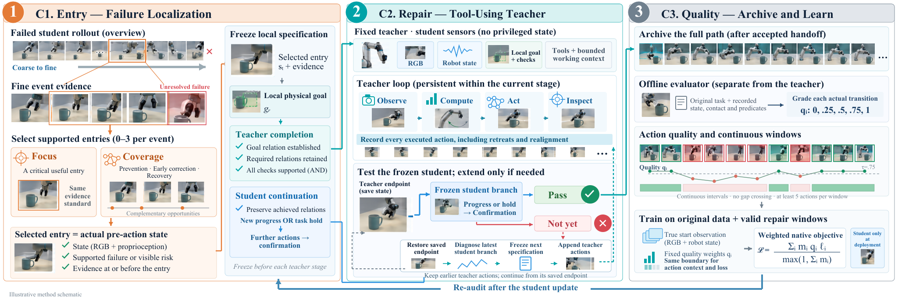
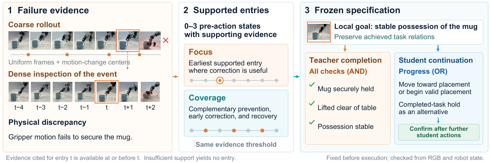
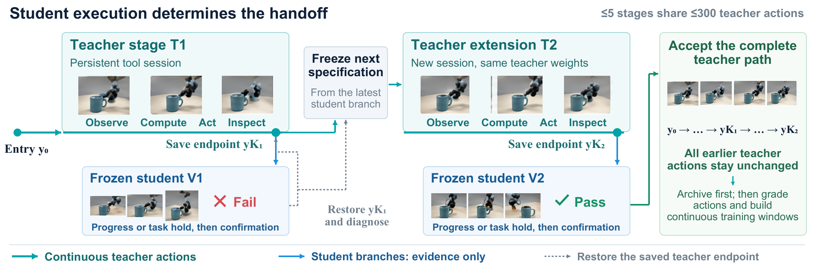
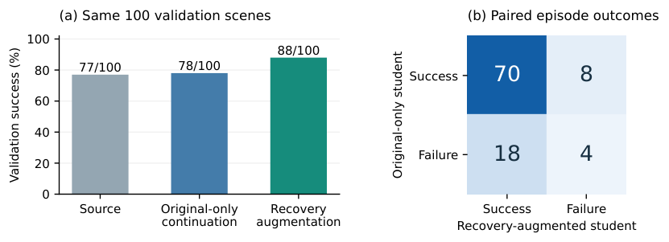
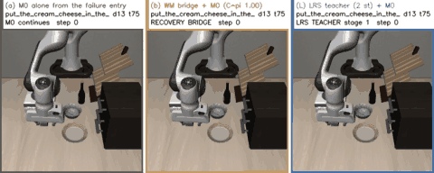
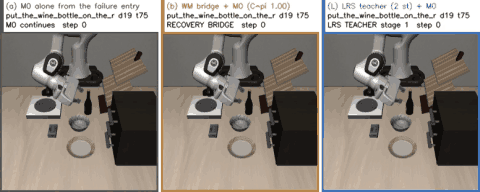
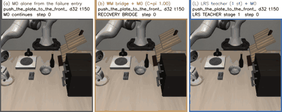
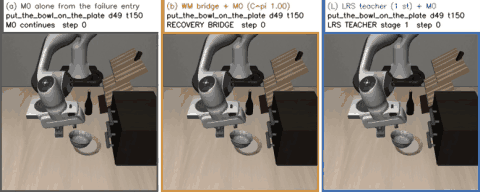
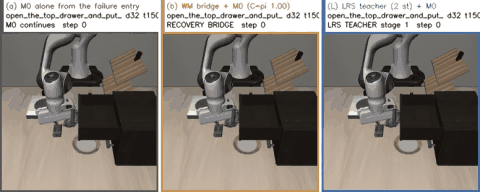
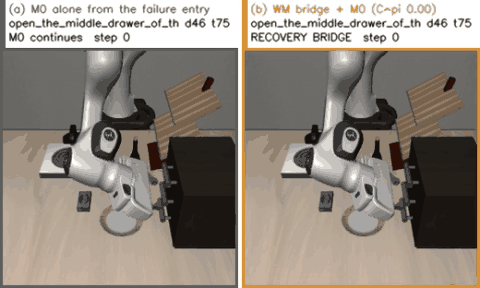

# Recovery demos trên LIBERO-Goal: M0, WM bridge (RetryVLA) và LRS teacher (2610.05151, chạy lại)

Viết 2026-11-25. Tất cả video được dựng lại bằng **replay mô phỏng xác định** từ các action đã log (không chạy lại
policy), trừ panel (c) (cần chạy lại M0 trên GPU, xem ghi chú). Code: `scripts/demos/render_goal_demos.py`,
`scripts/demos/goal_fp_rollout.py`, `scripts/demos/goal_demo_common.py`. Kiểm tra replay: `runs/_analysis/demos/goal/checks.json`.

## 1. Demo của chính bài báo (2610.05151)

Kiểm tra lại ngày 2026-11-25: arXiv chỉ có **v1**, không có code, dữ liệu, checkpoint, trang dự án hay video. Đã tìm
trên GitHub, Hugging Face (`/api/papers/2610.05151`: "Paper not found") và web / X. Bài báo có 4 hình, cả 4 đã được tải
từ bản HTML về `docs/related_work/figs/2610.05151/`:

| hình | file | ghi chú |
|---|---|---|
| Fig. 1 tổng quan vòng lặp |  | "Robot thumbnails are synthetic method illustrations" |
| Fig. 2 auditor + spec |  | minh hoạ tổng hợp, không phải frame thật |
| Fig. 3 branch / restore / extend |  | minh hoạ tổng hợp |
| Fig. 4 kết quả pi0 (77 / 78 / 88) |  | biểu đồ cột |

Bài báo **không có demo recovery thật nào**: mọi hình robot đều là minh hoạ. Vì vậy demo "của họ" dưới đây là pipeline
của họ do chúng tôi chạy lại (LRS-G, `retryvla/baselines/lrs_goal.py`). Teacher là Qwen3-VL-8B thay cho gpt-6.1-sol;
các sai khác D-L1..D-L9 ghi trong `experiments/PLAN.md` "LRS-G".

## 2. Demo song song, cùng entry, cùng snapshot

Mỗi GIF có 3 panel, bắt đầu từ cùng một trạng thái entry (M0 audit seed 7, lấy tại t = 75 / 150 / 225 của một rollout
thất bại):
- **(a) M0 alone**: M0 tự chạy tiếp từ entry, dùng đúng các action đã log trong audit. Luôn FAIL (vì entry được lấy từ
  rollout thất bại).
- **(b) WM bridge + M0** (RetryVLA): bridge 50 bước do WM + C^pi chọn (nhãn cam `RECOVERY BRIDGE`), sau đó M0 chạy tiếp
  (`M0 continues`). Replay **bit-exact**: sai lệch tối đa của state 8 chiều so với log là 0.0 và success rơi đúng
  bước đã log, ở cả 6 / 6 entry.
- **(L) LRS teacher + M0** (2610.05151, bản v1 servo): teacher LLM điều khiển qua tool (`LRS TEACHER stage k`), sau đó
  là hand-off test 60 + 10 action do LLM judge chấm (`HANDOFF TEST`), rồi M0 chạy tiếp tới 300 bước. Banner cuối
  panel ghi verdict của judge và kết quả sim thật.

| entry | GIF (nhỏ) | (a) M0 | (b) WM bridge: C^pi / sim | (L) LRS: judge / sim |
|---|---|---|---|---|
| put_the_cream_cheese_in_the_bowl d13 t75 |  | FAIL | 1.00 / SUCCESS @203 | ACCEPT / FAIL |
| put_the_wine_bottle_on_the_rack d19 t75 |  | FAIL | 1.00 / SUCCESS @89 | ACCEPT / FAIL |
| push_the_plate_to_the_front_of_the_stove d32 t150 |  | FAIL | 1.00 / SUCCESS @155 | ACCEPT / FAIL |
| put_the_bowl_on_the_plate d49 t150 |  | FAIL | 1.00 / SUCCESS @141 | ACCEPT / SUCCESS (teacher tự đặt bát lên đĩa ở bước 38) |
| open_the_top_drawer_and_put_the_bowl_inside d32 t150 |  | FAIL | 1.00 / SUCCESS @142 | ACCEPT / FAIL |
| open_the_middle_drawer_of_the_cabinet d46 t75 |  | FAIL | 0.0004 / SUCCESS @300 | không có hand-off (teacher hết 12 lượt mà chưa thực thi action nào) |

MP4 đầy đủ (256 px / panel, từng panel riêng và side-by-side) nằm ở
`runs/_analysis/demos/goal/<entry>/{A_m0_alone,B_wm_bridge,C_wm_false_positive,L_lrs_teacher,side_by_side}.mp4`.

**Lưu ý về độ giật (2026-11-25):** các GIF trong bảng trên chỉ lấy khoảng 1 / 6 frame, mỗi frame 400 ms, 48 màu, tức
phát ở ~2.5 fps thay vì 20 Hz. Cảm giác "giật giật" khi xem GIF phần lớn do cách render. Muốn đánh giá độ mượt thì xem
MP4 full frame rate (mọi bước sim, 20 Hz, H.264), có kèm clip tham chiếu human demo và M0 nominal của cùng task, và
số jerk ghi trong caption: `../related_work/figs/demos/fullfps/` (`<task>__quad.mp4` gồm 4 panel
[human | M0 nominal | LRS v2 + handoff | WM bridge + M0], bảng `jerk_table.csv`). Code: `scripts/demos/render_fullfps.py`.

**Panel (c), WM false positive** (`C_wm_false_positive.mp4`): candidate `wm_diverse` có C^pi cao nhất (1.00) nhưng
verification trong sim FAIL. Bridge được lấy từ log. Phần M0 chạy tiếp được chạy lại trên GPU với đúng policy seed đã
log, và kết quả FAIL khớp với log ở 6 / 6 entry. Phép chạy lại closed-loop này **không bit-exact** so với lần search gốc
(lần đó batch nhiều worker, bf16). Kiểm tra trên các success đã log: chỉ 3 / 6 lần chạy lại tái tạo đúng chuỗi action
(`runs/_analysis/demos/goal/fp/rerun_report.json`). Vì vậy panel (b) dùng action đã log, còn panel (c) chỉ để minh hoạ.

## 3. Đọc demo

- WM bridge thường ngắn và mượt (action dạng pi0, có thành phần xoay). Sau bridge, M0 tự làm nốt task.
- LRS teacher (v1) đi đường vòng, lên xuống nhiều lần, đóng gripper vào chỗ không có vật, và gripper đổi trạng thái
  tới 9 lần trong một window (sheet ở `docs/research/figs/lrs_goal/`). Dù vậy, LLM judge vẫn ACCEPT vì "gripper đã gần
  tay nắm / ngăn kéo hơi mở". Trên toàn bộ 168 entry, precision của judge so với sim thật chỉ là 0.11.
- Action của teacher v1 có 42 % bị bão hoà ở ±1 và thành phần xoay luôn bằng 0. Đây chính là nguyên nhân làm SFT sụp
  (xem `docs/research/REVIEW_2026-11-25_LRS.md`). Bản v2 dùng servo khớp với phân phối demo và đang được chạy lại.
