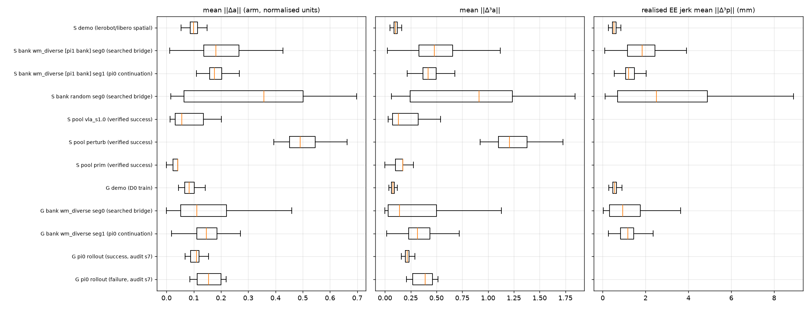
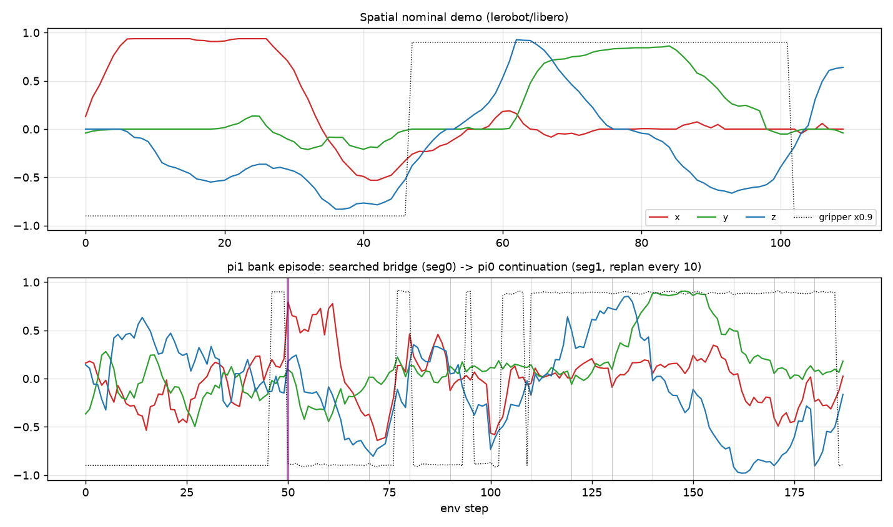

# Agentic recovery data vs search + verify, and the jerkiness of searched recoveries (review, 2026-11-20)

Status: intake + offline analysis (CPU only, no GPU training, no new sim rollouts). Not a verdict on any idea.
Follows `.cursor/skills/retryvla-idea-loop` (step 1 intake) and the `retryvla-idea-review` style (verified IDs,
steelman / strawman, decisive cheap follow-ups). A separate fresh-context adversarial review is still required after
the PoC below (idea-loop step 4) before anything is closed or scaled.

Code: `scripts/analyze_smoothness.py`, `scripts/smoothness_policy_proxy.py`.
Outputs: `runs/_analysis/smoothness/` (`summary.md`, `summary.csv`, `segments.csv`, `smoothing_whatif.md`,
`policy_proxy.md`, `fig_smoothness_box.png`, `fig_example_traces.png`).

## 0. TL;DR

- Jerk là có thật và đo được: searched bridge trong bank của pi1 (M5b `wm_diverse`) có mean ||Δ³a|| = 0.49, gấp
  **4.7x** demo Spatial (0.10); realised EE jerk gấp 3.4x. Bank `random` còn tệ hơn (7.5x). Trên LIBERO-Goal:
  bridge 3.4x demo.
- Nhưng **nửa còn lại của jerk không đến từ search**: phần continuation của chính pi0 trong cùng episode cũng gấp
  4.2x demo (Spatial) / 4.3x (Goal), có seam ở mỗi lần replan (|Δa| tại biên chunk gấp 2.9-4.4x trong chunk), và gripper
  chatter 5.8 lần / 100 step (demo 1.8). Rollout thành công của pi0 trên Goal (không có search) đã gấp 2.9x demo.
  Bridge -> pi0 handoff là một bước nhảy ||Δa|| 0.73-0.90, khoảng 5x một step bình thường.
- Nguồn jerk trong bridge là proposal family: perturbation (verified d3 1.24) và VLA noise 1.5 (0.81) rất giật;
  primitive (0.16) và VLA noise 1.0 (0.19) mượt. Trong cùng family, **jerk không liên quan đến success** (paired
  d3 success − failure ≈ 0). 81 % instance giải được có ít nhất một lời giải mượt (primitive / VLA s1.0) trong pool:
  ưu tiên lời giải mượt hầu như không mất yield.
- Làm mượt hậu kỳ (Savitzky-Golay 11/3) hạ bridge d3 0.49 -> 0.055 (dưới demo), nhưng làm lệch đường open-loop tối
  đa ~4 mm (median; p90 6.6 mm): đủ để đổi kết quả contact -> **phải re-verify trong sim**, không phải sửa mỹ thuật.
- **pi1 thừa hưởng jerk** (proxy offline, cùng observation + cùng noise): action chunk của pi1 giật hơn pi1-nominal
  +0.41 d3 [+0.31, +0.51] ở failure state (~2.4x) và +0.32 [+0.29, +0.36] ở state continuation (~2.2x); pi1-nominal ≈
  pi0. Nghĩa là jerk đi vào policy qua distillation, dù RSR vẫn +29 pt và nominal vẫn trong eps.
- Agentic: "LLM / coding agent sinh dữ liệu recovery + verify + distill" **đã có người làm** (2610.05151 LRS,
  Agentic-Teacher 2611.17394, Recova 2610.01178, SimPT 2610.29161). Agentic-Teacher còn có sẵn khâu "làm dữ liệu học
  được" (correlated noise, bỏ idle frame, lọc theo flow-matching loss của base policy) và ablation của họ cho thấy dữ
  liệu code-policy **quá mượt** cho 0 % success: smoothness không phải mục tiêu, coverage mới là.
- Trả lời reviewer: search + verify và agentic là hai **proposal generator** khác nhau; phần đóng góp còn đứng được
  của mình là selector / verifier (C^pi học từ continuation thật, verify full-task bằng ground truth, đo
  over-optimism, so sánh cùng ngân sách) và nó **agnostic với generator**. Agent là thêm một proposal source.
- Đề xuất thí nghiệm kế tiếp (rẻ nhất, trả lời thẳng câu hỏi jerk): **SMOOTH-V**: chọn lời giải mượt + làm mượt
  bridge, seam và handoff, re-verify trong sim, distill với cùng recipe pi1, 3 seed, có decision rule ở mục 5.
  Merge agentic (iv) "C^pi chọn trong các proposal của agent" **đã được pre-register** trong PLAN "LRS" (arm
  `lrs3_cpi`), không cần design mới.

## 1. Smoothness numbers (our data, CPU, 2026-11-20)

Định nghĩa (arm dims 0:6 của action 7-d normalised delta-EE; action là lệnh kiểu vận tốc nên Δa ~ gia tốc, Δ²a ~
jerk, Δ³a là đại lượng được yêu cầu; realised EE position p = state[:3]):
`d1` = mean ||a_{t+1} − a_t||, `d3` = mean ||Δ³a||, `grip` = số lần đổi dấu gripper / 100 step, `bnd` = mean ||Δa|| tại
step replan / mean ||Δa|| trong chunk (1 = không seam; demo cho 0.97-0.99, tức null đúng), `hand` = ||a_start(seg1) −
a_end(seg0)||, `EE jerk` = mean ||Δ³p|| (mm), `path` = path length / chord của p (median, chord ≥ 1 cm).
Sources: demo = `lerobot/libero` các task libero_spatial (data SFT nominal) và `data/goal_rsi/d0_train`; bank = M5b
(`data/recovery/m5b/s*/p*/<arm>`, `wm_diverse` là bank của pi1 m5c_rr) và Goal (`data/recovery/goal_search/s*/p0/<arm>`),
seg0 = searched 50-step open-loop bridge, seg1 = continuation của pi0 (Spatial SmolVLA replan 10; Goal pi0 3B replan 5);
pool = `data/wm/collect_v1` (32 candidate x 144 instance, 1 continuation seed / candidate, tách theo proposal family); Goal pi0 rollout = audit M0 seed 7 (300 full rollouts). Tất cả train / pilot, không có test-scene demo.

**Spatial (LIBERO-Recover M5b, train scenes)**

| source | n | T | d1 | d3 | grip / 100 | bnd | hand | EE jerk (mm) | d3 / demo |
|---|---|---|---|---|---|---|---|---|---|
| demo (lerobot/libero spatial) | 400 | 123 | 0.101 | 0.104 | 1.78 | 0.97 | - | 0.54 | 1.0x |
| pi1 bank `wm_diverse` seg0 (bridge) | 423 | 46 | 0.189 | 0.492 | 2.71 | - | - | 1.83 | 4.7x |
| pi1 bank `wm_diverse` seg1 (pi0 cont.) | 313 | 93 | 0.186 | 0.440 | 5.81 | 2.92 | 0.898 | 1.33 | 4.2x |
| pi1 bank `wm_diverse` full episode | 318 | 142 | 0.186 | 0.473 | 4.26 | - | - | 1.49 | 4.5x |
| bank `random` seg0 | 208 | 39 | 0.303 | 0.784 | 8.07 | - | - | 2.91 | 7.5x |
| bank `wm_noise` seg0 (on-manifold noise search) | 208 | 42 | 0.176 | 0.446 | 10.21 | - | - | 1.18 | 4.3x |
| bank `wm_qd` seg0 | 336 | 43 | 0.244 | 0.630 | 5.34 | - | - | 2.41 | 6.1x |
| pool `vla_s1.0`, verified success | 105 | 50 | 0.081 | 0.190 | 4.04 | - | - | - | 1.8x |
| pool `vla_s1.5`, verified success | 118 | 50 | 0.295 | 0.814 | 13.3 | - | - | - | 7.8x |
| pool `perturb`, verified success | 316 | 50 | 0.498 | 1.241 | 8.73 | - | - | - | 11.9x |
| pool `prim` (primitives), verified success | 198 | 50 | 0.040 | 0.162 | 0.41 | - | - | - | 1.6x |

**LIBERO-Goal (2610.05151 protocol banks, train entries)**

| source | n | T | d1 | d3 | grip / 100 | bnd | hand | EE jerk (mm) | d3 / demo |
|---|---|---|---|---|---|---|---|---|---|
| demo (D0 train) | 300 | 127 | 0.085 | 0.077 | 1.40 | 0.99 | - | 0.56 | 1.0x |
| bank `wm_diverse` seg0 (bridge) | 308 | 46 | 0.133 | 0.264 | 1.82 | - | - | 1.15 | 3.4x |
| bank `wm_diverse` seg1 (pi0 cont.) | 243 | 92 | 0.148 | 0.333 | 4.20 | 4.41 | 0.725 | 1.17 | 4.3x |
| bank `random` seg0 | 282 | 44 | 0.152 | 0.273 | 2.20 | - | - | 1.28 | 3.5x |
| pi0 (M0) rollout, success (audit s7) | 244 | 121 | 0.107 | 0.221 | 1.33 | 3.86 | - | - | 2.9x |
| pi0 (M0) rollout, failure (audit s7) | 56 | 300 | 0.158 | 0.376 | 4.64 | 4.67 | - | - | 4.9x |

Full table (d2, saturation, path ratio, all arms): `runs/_analysis/smoothness/summary.md`.

Hình 2: trên là demo Spatial, dưới là một episode của bank pi1 (vạch tím = handoff bridge -> pi0, vạch xám = replan
mỗi 10 step). Bridge có dao động tần số cao; continuation của pi0 có bước nhảy ở biên chunk và gripper chatter.

**Đọc kết quả.**
1. *Jerk của bridge là thật.* d3 4.7x demo (Spatial), 3.4x (Goal); realised EE jerk 3.4x / 2.1x (controller OSC lọc
   bớt). `wm_diverse` mượt hơn `random` (0.49 vs 0.78) vì objective đã có roughness penalty (`mu R`), nhưng penalty đó
   không đủ mạnh để về mức demo.
2. *Một nửa jerk là của chính pi0.* Continuation (2/3 số frame của bank) gấp 4.2-4.3x demo, seam ratio 2.9-4.4, gripper
   chatter 3x. Rollout thành công của pi0 trên Goal (không search gì) đã 2.9x demo, rollout thất bại 4.9x: jerk là
   triệu chứng của state off-distribution và của replan, không chỉ của search. Hệ quả: chỉ làm mượt bridge sẽ không làm
   mượt bank; seam của continuation và handoff jump (0.73-0.90, ~5x một step) cũng phải xử lý.
3. *Nguồn jerk trong bridge = proposal family.* Perturbation (smooth_noise kernel 5, std lớn) và VLA noise 1.5 giật
   7.8-11.9x; primitive và VLA noise 1.0 chỉ 1.6-1.8x. Search "on-manifold" (`wm_noise`, CEM trên noise của SmolVLA)
   **không** mượt hơn (0.446) và chatter gripper nhiều nhất (10.2 / 100): nằm trên action manifold của policy không đồng
   nghĩa với mượt.
4. *Jerk không mua được success.* Trong pool `collect_v1` (144 instance x 32 candidate, 1 continuation seed): paired
   d3(success) − d3(failure) trong cùng instance = −0.001 (perturb, n 63), +0.016 (vla_s1.0, n 28), −0.012 (vla_s1.5,
   n 33). Success theo tercile d3 không đơn điệu. 62.5 % instance có ≥ 1 success; 50.7 % có success từ family mượt
   (prim / vla_s1.0); chỉ 11.8 % chỉ giải được bằng family giật. => quy tắc "ưu tiên lời giải mượt" giữ ~81 % instance
   đã giải mà không tốn thêm sim, và vẫn giữ được 19 % còn lại bằng lời giải giật.
5. *Macro path không lãng phí.* Path ratio bridge 1.5-2.2 (đoạn ngắn) so với episode demo 2.5-2.8: jerk là dao động tần
   số cao quanh một đường đi hợp lý, không phải đi vòng.
6. *Smoothing không miễn phí.* `smoothing_whatif.md`: Savitzky-Golay (11, bậc 3) đưa bridge d3 0.491 -> 0.055, moving
   average 5 -> 0.092; lệch open-loop tích luỹ (quy đổi bằng gain thực nghiệm 10.3 mm / action unit, r 0.89) có
   median max 4.3-4.8 mm, p90 6.6-7.1 mm, cuối đoạn 0.3-0.8 mm. Vài mm là đủ để đổi một grasp, nên mọi bridge đã làm
   mượt phải re-verify (replay bit-exact snapshot + continuation).
7. *pi1 có thừa hưởng jerk không?* Rollout của pi1 **không được log action** (episodes.jsonl chỉ có success), nên không
   có số closed-loop. Proxy offline (CPU, cùng observation, cùng flow-matching noise) cho câu trả lời **có**: xem 1.1.

Caveats: action là normalised delta-EE, so sánh trong cùng suite (Spatial bank ghi fps 10, Goal 20; metric tính theo env
step); pool chỉ 1 continuation seed / candidate (success nhiễu); nhãn "verified success" ở pool không phải bank robust
filter; proxy 1.1 là open-loop chunk, không đo seam closed-loop.

### 1.1 Offline proxy: pi1 vs pi1-nominal vs pi0 trên cùng observation

Rollout của pi1 không log action, nên đây là proxy open-loop (CPU, `scripts/smoothness_policy_proxy.py` ->
`runs/_analysis/smoothness/policy_proxy.md`): 40 episode ngẫu nhiên của bank pi1 (train scenes), 2 observation / episode
((a) failure state = frame đầu seg0; (b) state giữa continuation của pi0), 2 flow-matching noise seed dùng chung cho cả
3 policy. pi1-nominal = cùng init / số step với pi1 nhưng không có recovery data (control công bằng).

| state | policy | d1 (first 12) | d3 (first 12) | d1 (50) | d3 (50) | gripper toggles / chunk | L1 to bank bridge |
|---|---|---|---|---|---|---|---|
| failure | pi0 | 0.164 | 0.350 | 0.132 | 0.291 | 3.69 | 0.220 |
| failure | pi1-nominal | 0.177 | 0.396 | 0.146 | 0.338 | 3.23 | 0.225 |
| failure | **pi1** | 0.281 | **0.808** | 0.279 | **0.799** | 2.81 | **0.163** |
| continuation | pi0 | 0.150 | 0.313 | 0.112 | 0.238 | 2.23 | - |
| continuation | pi1-nominal | 0.153 | 0.334 | 0.130 | 0.296 | 2.58 | - |
| continuation | **pi1** | 0.239 | **0.658** | 0.236 | **0.665** | 4.89 | - |

Paired Δ pi1 − pi1-nominal (per observation, 95 % bootstrap CI, n 40): failure d3 (first 12 = phần thực thi) **+0.41
[+0.31, +0.51]**, d3 (50) +0.46 [+0.40, +0.52]; continuation d3 (first 12) +0.32 [+0.29, +0.36], d3 (50) +0.37
[+0.33, +0.41]; L1 tới bridge −0.062 [−0.077, −0.048] (pi1 bắt chước bridge).

**Đọc:** pi1 **có thừa hưởng jerk**: chunk dự đoán giật gấp ~2.4x pi1-nominal ở failure state và ~2.2x ở state
continuation, CI xa 0. Sự khác biệt đến từ recovery data (pi1-nominal ≈ pi0). pi1 còn giật hơn chính bridge nó học
(0.80 vs 0.49); một cách giải thích là flow head trộn nhiều mode của các bridge khác nhau tại cùng loại state, nhưng
chưa kiểm. Caveat: observation lấy từ bank mà pi1 đã train (in-sample), open-loop chunk (closed-loop chỉ thực thi 10
action đầu rồi replan, và controller OSC lọc bớt), chưa đo ở nominal state. Như vậy câu hỏi "jerk có lan vào policy
không" đã có câu trả lời là **có** (proxy), còn "jerk có hại RSR / nominal không" thì chưa: pi1 vẫn +29 pt RSR và giữ
nominal trong eps. SMOOTH-V (mục 5) là thí nghiệm trả lời câu thứ hai.

## 2. Literature (2024-2026; mỗi ID mở trang arxiv.org/abs + 1 nguồn thứ hai, 2026-11-20)

### 2a. Agentic / LLM-VLM teachers cho recovery data

| work | ID (2nd source) | what it does | overlap with RetryVLA |
|---|---|---|---|
| Recursive Self-Improvement via Local Recovery Supervision (LRS) | [2610.05151](https://arxiv.org/abs/2610.05151) (COMPARE doc, full HTML) | LLM tool-teacher từ entry do LLM auditor chọn; nhận khi student đóng băng qua handoff 60 + 10 action do LLM observer chấm; LLM grade từng action, giữ q ≥ 0.75; pi0 LIBERO-Goal 78 -> 88 (1 seed, p 0.076) | generator khác (LLM vs pool + WM / C^pi), acceptance yếu hơn (proxy vs full-task GT); đã chạy reverse-direction: bank của mình −11.3 trên protocol của họ (47 % anchors vs 4 %) |
| **Agentic-Teacher** (Tsinghua / AGIBot) | [2611.17394](https://arxiv.org/abs/2611.17394) (v1 abs page + search index, 2026-11) | coding agent (GPT-5.6 Sol) chẩn đoán failure của pi0, viết closed-loop code policy, validate trong sim, sinh continuation từ failure state; **trajectory adaptation**: correlated action noise, bỏ idle frame, **lọc theo flow-matching loss của base model đóng băng**; LIBERO-10 79.4 -> 87.8, MetaWorld-10 80.4 -> 90.6. Ablation: raw code-policy data 0 %, + noise 81 %, + idle removal 89 %, + FM filter 95 % | gần nhất với cả agentic và "làm dữ liệu học được". FM-loss filter = "policy-compatibility" filter, chính là merge (ii-c) của mình. Họ không có learned competence critic, không có search pool, không đo recovery trên failure state held-out |
| Recova | [2610.01178](https://arxiv.org/abs/2610.01178) (RELATED_WORK K, project page) | agent chẩn đoán + thử corrective program trong digital twin, verify scene restoration bằng query, DAgger thật | generator = agent + twin; verify bằng VLM-style restoration query |
| SimPT | [2610.29161](https://arxiv.org/abs/2610.29161) (abs v1 + search) | Agent-Compiled Progress Graph (privileged sim state) chọn snapshot; CuRobo expert recover; so RECAP / HG-DAgger / DPO+SFT / FlowPRO | intervention-based post-training trong sim, expert là planner |
| Agent as Policy | [2609.12541](https://arxiv.org/abs/2609.12541) (RELATED_WORK, verified 2026-11-17) | LLM agent điều khiển trực tiếp qua tool client | client teacher của LRS |
| RoboFAC | [2505.12224](https://arxiv.org/abs/2505.12224) (GitHub MINT-SJTU, HF model card) | Qwen2.5-VL-7B fine-tune trên 9,440 failure trajectory / 78k QA; đề xuất high-level (subtask) và low-level (hướng EE) correction; external critic cho VLA thật +29.1 % | VLM là critic / advisor lúc test, không distill recovery action |
| AHA | [2410.00371](https://arxiv.org/abs/2410.00371) (ICLR 2025 proceedings, NVlabs GitHub) | VLM phát hiện + giải thích failure (FailGen perturb demo RLBench) | failure detection / judge, không sinh action |
| REFLECT | [2306.15724](https://arxiv.org/abs/2306.15724) (CoRL 2023 PMLR) | LLM giải thích failure từ hierarchical summary, language planner sửa | high-level correction plan |
| FailSafe | [2510.01642](https://arxiv.org/abs/2510.01642) (project page, GitHub) | sinh failure (translation / rotation / no-op) + recovery action có thể thực thi, verify đến task success, fine-tune VLM ra 7-DoF correction; +22.6 % cho OpenVLA trên ManiSkill | "failure-action pairs verified in sim" giống ý tưởng verify; generator là motion planner; chỉ motion-level, không object-level |
| Agentic Robot | [2505.23450](https://arxiv.org/abs/2505.23450) (OpenReview, GitHub) | planner LRM + VLA executor + VLM temporal verifier, verifier kích hoạt recovery (nhấc gripper, retry); LIBERO 79.6 % | VLM verifier = agent làm handoff / progress judge (merge iii) |
| Code as Policies / VoxPoser | [2209.07753](https://arxiv.org/abs/2209.07753), [2307.05973](https://arxiv.org/abs/2307.05973) (project pages, GitHub) | LLM viết policy code / value map cho planner | nền của mọi code-policy teacher |
| ManipGen | [2410.22332](https://arxiv.org/abs/2410.22332) (abs v2 + HTML) | VLM plan + motion planning + local policies học trong sim | agent ở tầng plan, policy local ở tầng contact |
| MimicGen / SkillMimicGen / DexMimicGen | [2310.17596](https://arxiv.org/abs/2310.17596), [2410.18907](https://arxiv.org/abs/2410.18907), [2410.24185](https://arxiv.org/abs/2410.24185) (CoRL 2024 / ICRA 2025, GitHub) | biến đổi + nối segment demo, rejection bằng sim success | sinh dữ liệu từ demo, không phải từ failure của policy |
| RoboGen / GenSim2 | [2311.01455](https://arxiv.org/abs/2311.01455), [2410.03645](https://arxiv.org/abs/2410.03645) (ICML 2024 PMLR, CoRL 2024 GitHub) | LLM sinh task / scene / supervision, solver RL / planner | generative simulation, không recovery-specific |

### 2b. Smoothing / refining / curating searched or generated trajectories

| work | ID (2nd source) | relevant finding |
|---|---|---|
| Should We Learn Contact-Rich Manipulation Policies from Sampling-Based Planners? | [2412.09743](https://arxiv.org/abs/2412.09743) (RA-L DOI 10.1109/lra.2025.3564701) | demo từ RRT có action entropy cao, BC kém (44 % vs 99 % với 100 demo); ưu tiên **consistency** nhưng giữ coverage. Ngoài ra short horizon -> chuyển động giật |
| Agentic-Teacher trajectory adaptation | [2611.17394](https://arxiv.org/abs/2611.17394) | ngược chiều: code-policy quá mượt / lặp -> 0 %; cần correlated noise để mở rộng coverage; FM-loss filter của base model chọn dữ liệu "tương thích policy" |
| Real-Time Chunking (RTC) | [2506.07339](https://arxiv.org/abs/2506.07339) (NeurIPS 2025) | seam ở biên chunk là OOD jerk; inpainting với prefix đóng băng + soft mask làm liền chunk, inference-time, không retrain |
| LiPo | [2506.05165](https://arxiv.org/abs/2506.05165) (abs + search) | post-optimisation cho chunk: blend overlap + jerk-minimising trajectory optimisation trong perturbation bị chặn |
| DMDR (restoring noisy demonstrations) | [2510.14467](https://arxiv.org/abs/2510.14467) (abs + HTML) | filter-and-restore: lọc mẫu sạch rồi conditional diffusion khôi phục action nhiễu trước IL |
| Ambient Diffusion Policy | [2606.12365](https://arxiv.org/abs/2606.12365) (abs + HTML) | dữ liệu suboptimal chỉ đóng góp ở diffusion time cao / thấp; một cách "dùng nhưng không tin" dữ liệu giật |
| DemInf | [2502.08623](https://arxiv.org/abs/2502.08623) (GitHub jhejna, project page) | chất lượng demo = đóng góp vào MI(state; action chunk): giữ demo vừa đa dạng vừa dự đoán được |
| CUPID | [2506.19121](https://arxiv.org/abs/2506.19121) (CoRL 2025 PMLR) | influence function lên closed-loop return để lọc / chọn demo; < 33 % dữ liệu đủ |
| SCIZOR | [2505.22626](https://arxiv.org/abs/2505.22626) (ICRA 2026 project page, GitHub) | lọc transition không tạo progress + dedup; +15.4 % |
| RaC | [2509.07953](https://arxiv.org/abs/2509.07953) (project page, HF papers) | recovery + correction do người can thiệp (rewind rồi correct), termination sau intervention; dữ liệu recovery có cấu trúc > nhiều demo |

Kết luận novelty: (1) "agent / LLM sinh corrective data từ failure của chính VLA, verify trong sim, distill" là **đã có**
(2610.05151, 2611.17394, Recova, SimPT, FailSafe). (2) "lọc / làm sạch dữ liệu sinh ra trước khi distill" cũng đã có
nhiều dạng (FM-loss filter, DMDR, CUPID, SCIZOR, DemInf). (3) Chưa thấy: một **learned policy-competence critic
(C^pi, học từ continuation thật của chính pi)** dùng làm selector / acceptance cho proposal của agent, và một so sánh
có kiểm soát giữa LLM-judged handoff, C^pi và ground-truth full-task verification trên cùng instance.

## 3. Reviewer Q&A (trả lời trung thực)

**Q1. "Tại sao không dùng agentic approach (LLM / VLM agent) để sinh / chỉnh recovery data?"**
- Hai cách là hai *proposal generator*; phần cần so là generator nào cho nhiều recovery **verified** hơn trên mỗi đơn vị
  chi phí, và selector / verifier nào chính xác hơn. Đóng góp của mình nằm ở selector / verifier (C^pi học từ
  continuation thật, full-task GT verification, đo over-optimism) và chúng không phụ thuộc vào generator.
- Bằng chứng hiện có, nói thẳng:
  - Trên protocol của 2610.05151, bank của mình **thua** Original 11.3 pt (3 seed, CI [−23.7, +2.0]), trong khi LLM
    teacher của họ báo +10 (1 seed, p 0.076). Chẩn đoán đầu tiên là volume mix (47 % anchors vs 4 %), F1 share-matched
    đã pre-register nhưng chưa chạy. Chưa có so sánh cùng protocol + cùng volume, nên **không** được nói "search tốt hơn
    agent".
  - ACR-N F2: regrasp primitive viết tay (`grasp_slow`, pose từ observation) giải 0.233 instance khó (U) vs `single` WM
    search 0.164 (McNemar 11/6, p 0.33; với GT pose 0.274, p 0.039). Trên failure khó, *option có cấu trúc* (đúng loại
    thứ một agent sẽ viết) hơn WM search. Đây là luận điểm **ủng hộ** việc thêm agent làm proposal source, không phải
    phản bác.
  - M11: WM tự plan không có library thua library (0.398 vs 0.458). Library (VLA samples + primitives) là nơi hành vi
    tốt đến từ, agent có thể mở rộng library.
- Chi phí: LRS tới 2 h LLM wall-clock / attempt, 27 path được nhận; Agentic-Teacher dùng GPT-5.6 Sol high reasoning và
  không báo chi phí matched. Pipeline của mình: ~2.8k env steps / instance (8 x (50 + 300)), không cần API, chạy song
  song hàng trăm instance. Không có LLM API trong môi trường (local Qwen3-VL-8B là thay thế duy nhất, PLAN "LRS").
- Coverage / priors: agent mạnh ở failure semantic / plan-level (sai object, sai thứ tự, cần mở ngăn kéo) nhờ prior của
  LLM, yếu ở contact recovery mức thấp (agent ra lệnh qua EE helper, không thấy contact; RoboFAC / FailSafe đều tách
  high-level vs low-level correction và FailSafe giới hạn ở motion-level). LIBERO-Recover chủ yếu là failure mức contact
  (bowl trượt, grasp hụt), nơi sampling + sim verification phủ tốt hơn.
- Verification: 2610.05151 nhận path theo handoff ngắn do LLM chấm (họ tự nói "short-term handoff usability, not a
  guarantee of eventual full-task success"); grader của họ dùng privileged sim records. Mình chỉ gọi là "verified" khi
  frozen pi chạy tới BDDL success trong sim.

**Q2. "Recovery data của các bạn giật; distill nó có dạy policy giật không?"**
- Số liệu mục 1: bridge 4.7x demo, nhưng continuation của chính pi0 cũng 4.2x và có seam replan 2.9x; rollout thành công
  của pi0 trên Goal đã 2.9x demo. Jerk là đặc điểm chung của SmolVLA / pi0 ngoài phân phối demo, không riêng search.
- Dù giật, bank Spatial cho +29 pt RSR so với demo-only và giữ nominal trong 2 pt (pi1 0.785 vs 0.796, 3 seed).
  Nhưng phải thừa nhận: proxy 1.1 cho thấy pi1 **có** học jerk (chunk d3 ~2.4x pi1-nominal ở failure state). Câu trả lời
  trung thực là "jerk có lan vào policy; nó chưa làm hại RSR / nominal đo được; SMOOTH-V kiểm tra liệu loại bỏ nó có
  miễn phí không".
- Jerk không tương quan với success trong pool, và 81 % instance giải được có lời giải mượt: có thể chọn mượt gần như
  miễn phí (thí nghiệm SMOOTH-V, mục 5). Proxy offline pi1 vs pi1-nominal: mục 1.1.
- Agentic-Teacher cho thấy chiều ngược lại cũng nguy hiểm: dữ liệu quá mượt / lặp cho 0 % success, họ phải thêm
  correlated noise. Mục tiêu đúng là "consistency + coverage" (2412.09743), không phải độ mượt tối đa.

**Q3. "Sao không làm mượt hậu kỳ?"** Có thể và nên làm, nhưng làm mượt đổi đường open-loop ~4 mm (median max, p90
6.6 mm): phải re-verify. Đó là arm `smooth_reverify` của SMOOTH-V.

**Q4. "Agentic data engine (2610.05151, 2611.17394, Recova, SimPT) đã làm việc này; novelty còn gì?"** Cái đã bị lấy:
failure-driven data engine + sim verify + distill; lọc dữ liệu theo độ tương thích với base policy (FM-loss filter).
Cái còn lại (phải chứng minh bằng thí nghiệm, không phải tuyên bố): C^pi như selector / acceptance cho *bất kỳ*
generator (ít sim hơn / precision cao hơn so với LLM handoff judge), full-task GT verification so với proxy handoff,
recovery đo trực tiếp trên failure state held-out (LIBERO-Recover) với nominal constraint, và đo over-optimism khi
search. Positioning nên đổi thành "policy-competence-guided selection and verification of recovery proposals (from
samplers, primitives or agents)".

**Q5. "Sao không dùng VLM làm judge cho handoff thay vì C^pi?"** Câu hỏi thực nghiệm, rẻ để trả lời offline (merge iii).
Giả thuyết: VLM judge đọc được progress hình học nhưng không biết *pi cụ thể này* có làm tiếp được không; C^pi học đúng
điều đó. LRS arm R3 đã pre-register "short-horizon handoff over-accepts" (precision < 0.6).

**Q6 (strawman của chính mình). "Jerk chỉ là cosmetic trong sim; vì sao phải quan tâm?"** Trong sim RSR không phạt jerk.
Trên robot thật, jerk tăng mài mòn, va chạm, và seam là OOD (RTC 2506.07339). Real-world extension (PLAN 2026-11-02)
sẽ gặp câu này; đo và kiểm soát jerk bây giờ rẻ hơn.

## 4. Merge designs (agentic x search + verify), xếp theo novelty x feasibility x expected gain

Điểm 1-3 mỗi trục (3 = tốt nhất); tổng = tích.

| # | design | closest / taken by | novelty | feasibility (no API, our infra) | expected gain | score | cheap pre-registerable test |
|---|---|---|---|---|---|---|---|
| (ii) | **SMOOTH-V**: smooth-first selection + post-hoc smoothing (bridge, seam, handoff blend) + sim re-verify (+ optional FM-loss / pi-likelihood filter) trước distill | Agentic-Teacher FM filter + idle removal (2611.17394), DMDR (2510.14467), LiPo (2506.05165), RTC (2506.07339), 2412.09743 | 1 (từng mảnh đã có; mới chỉ ở chỗ ghép với C^pi-verified bridges và đo trên recovery) | 3 (0 LLM; re-verify ~208-282 episodes replay, ~1 GPU-h; SFT pi1 recipe x 3 seed) | 2 (RSR có thể ±; jerk của pi1 giảm rõ; trả lời reviewer trực tiếp) | **6** | mục 5 |
| (iv) | agent proposals + C^pi selector / acceptance | **đã pre-register**: PLAN "LRS" arm `lrs3_cpi` (R4); 2610.05151 / 2611.17394 không có selector | 2 (chưa thấy trong literature) | 2 (local Qwen3-VL-8B, chậm; LRS pilot chưa chạy) | 2 (R4: ≥ 20 % ít sim / accepted path) | 8 | chạy LRS pilot như đã pre-register; không thiết kế lại |
| (i) | agent viết **option library** (primitive / code-policy có tham số theo failure type) một lần, offline; WM + C^pi xếp hạng theo instance; sim verify | Agentic-Teacher (code policy theo nhóm failure, không ranking), ManipGen, CaP, RoboFAC low-level correction | 2 (agent-as-library-author + competence ranking) | 2 (agent offline, 1 lần cho ~6 failure type; không cần LLM trong vòng search) | 3 (ACR-N F2: option có cấu trúc +6.9 pt trên U; coverage hiện 0.53) | **12** | U của ACR-N (73 instance): library hiện tại vs library + 8 option do Qwen3-VL-8B viết từ failure summary, cùng 2,800 sim step; McNemar vs fresh `single`; rule: +8 pt, p < 0.10 -> distill pilot |
| (iii) | VLM agent làm failure-cause / handoff judge, so với C^pi và GT | 2610.05151 LLM observer, Agentic Robot verifier, AHA, RoboFAC, REFLECT | 1 (judge-by-VLM đã nhiều) nhưng *phép so sánh* C^pi vs VLM vs GT là mới-ish | 3 (offline trên label sẵn có: Goal / Spatial continuation outcomes) | 1 (phân tích, không tăng RSR) | 3 | AUC / precision@accept của Qwen3-VL-8B judge vs C^pi trên 300 endpoint đã có GT; rule: C^pi AUC − VLM AUC ≥ 0.05 (bootstrap CI > 0) -> claim "learned competence > VLM judge" |
| (v) | **pi-relabel / re-track**: đi lại bridge đã verify, ở mỗi state lấy action của pi gần bridge nhất (projection lên action manifold, DAgger-style relabel bởi chính policy) rồi re-verify | Agentic-Teacher FM filter (chọn, không relabel), `wm_noise` arm (on-manifold search, nhưng **không** mượt hơn: d3 0.446, gripper 10.2 / 100) | 2 | 2 (cần policy sampling theo state, ~GPU-h) | 1 (`wm_noise` cho thấy on-manifold ≠ mượt) | 4 | để sau SMOOTH-V; chỉ làm nếu `smooth_reverify` mất > 30 % yield |

Xếp hạng: (i) 12 > (iv) 8 > (ii) 6 > (v) 4 > (iii) 3. **Nhưng thứ tự chạy khác thứ tự điểm**: (ii) là rẻ nhất, không
cần LLM, và trả lời thẳng câu hỏi của user / reviewer về jerk; (iv) đã có pre-registration (chỉ cần chạy LRS pilot);
(i) là hướng có expected gain cao nhất nhưng phụ thuộc chất lượng của local 8B VLM, nên chạy sau khi LRS pilot cho biết
teacher 8B viết được gì.

## 5. Recommended next experiment: SMOOTH-V (pre-registration draft, written BEFORE any result)

- Research question: dữ liệu recovery mượt hơn (cùng instance, cùng số trajectory, vẫn GT-verified) có làm pi1 tốt hơn
  hoặc mượt hơn mà không mất RSR không?
- Hypothesis: jerk là nhiễu tần số cao không mang thông tin (paired d3 success − failure ≈ 0). Làm mượt bridge + seam +
  handoff giảm closed-loop jerk của pi1 ≥ 25 % và giữ RSR (|ΔRSR| ≤ 2 pt); có thể tăng nominal (ít OOD jerk trong mix).
  Hướng ngược (Agentic-Teacher): mượt quá làm hẹp coverage -> RSR giảm.
- Falsified if: `smooth_reverify` RSR < pi1 − 3 pt (CI upper < 0), hoặc closed-loop jerk của pi1-smooth không giảm
  ≥ 10 % (khi đó jerk của pi1 đến từ chính policy / replan, không từ dữ liệu).
- Arms (Spatial, pi1 recipe: init pi1-nominal, 6k step, bs 32, r 0.5, round-robin, 208 trajectory):
  - `control`: pi1 (m5c `wm_diverse_rr`, 3 seed đã có).
  - `smooth_select` (0 sim mới): trong mỗi instance, chọn trajectory verified có d3 thấp nhất trước (cùng count).
  - `smooth_reverify`: Savitzky-Golay (11, 3) trên seg0, seg1 được làm mượt quanh seam (cùng filter) và 5-step linear
    blend ở handoff; replay bit-exact từ snapshot với action đã làm mượt (open-loop cho cả episode), giữ episode nào
    vẫn đạt BDDL success, re-render ảnh từ replay; nếu yield < 100 %, bù bằng trajectory verified khác của cùng instance
    (rồi mới tới instance khác), cùng count.
  - Oracle / upper bound: không có oracle tự nhiên cho "độ mượt đúng"; dùng demo-level smoothness làm reference
    (d3 0.10) và báo jerk của pi1-nominal (policy chưa thấy recovery data) làm floor.
  - Cheap ablation: `smooth_bridge_only` (chỉ seg0) để tách phần đóng góp của seam / continuation.
- Gate G0 (CPU / sim, trước mọi SFT): yield re-verify của `smooth_reverify` ≥ 70 % episode. Nếu < 70 %: smoothing
  phá contact -> không SFT, báo cáo và thử filter nhẹ hơn (movavg 3) **một** lần, ghi deviation.
- Instrumentation bắt buộc: thêm log action vào eval recover / nominal (episodes jsonl hoặc npz) để đo closed-loop
  d1 / d3 / seam / gripper chatter của pi1 vs pi1-smooth vs pi1-nominal trên cùng scene x trial (paired).
- Secondary rẻ (CPU, trước eval): chạy lại `scripts/smoothness_policy_proxy.py` với pi1-smooth; kỳ vọng Δd3 so với
  pi1-nominal giảm ≥ 50 % (từ +0.41). Nếu không giảm: jerk của pi1 không đến từ độ giật của bridge mà từ trộn mode,
  khi đó smoothing không phải fix đúng (ghi vào diagnosis).
- Split: bank train; eval Spatial test (DEV set theo Claims policy) 56 scene x 10 trial + nominal 500, 3 SFT seed / arm.
- Primary metric + test: ΔRSR vs `control`, scene x seed bootstrap 95 % CI + sign-flip; secondary: Δ closed-loop d3
  (paired bootstrap), nominal (eps 2 pt vs pi1-nominal), per-level L1-L4.
- Decision rules:
  - "smoothness helps": ΔRSR ≥ +3 pt (CI > 0) hoặc nominal ≥ +2 pt với RSR non-inferior (−2 pt margin) -> SMOOTH
    thành default của bank, chạy lại trên Goal F1.
  - "smoothness is free": |ΔRSR| < 3, nominal trong eps, closed-loop d3 giảm ≥ 25 % -> default cho bank + câu trả lời
    reviewer "data mượt không tốn RSR".
  - "smoothness hurts (coverage)": ΔRSR ≤ −3 (CI < 0) -> giữ dữ liệu cũ, thử correlated-noise augmentation kiểu
    Agentic-Teacher như follow-up.
  - Inconclusive nếu power < 80 %.
- MDE: seed sd của pi1 RSR ~2 pt (0.439 / 0.396 / 0.420), 560 episode / seed, 3 seed: MDE ≈ 4-5 pt ở alpha 0.10,
  power 0.8. Hiệu ứng nhỏ hơn sẽ được báo "inconclusive", không phải "no effect".
- Budget: re-verify ~208-280 episode x ≤ 520 step (≈ 0.15 M env step, ~1 GPU-h với renderer); SFT 2 arm x 3 seed
  (+ ablation 1 seed) ≈ pi1 cost; eval như pi1.
- Không chạm chain 2610.05151 đang chạy / GPU của nó; xếp hàng qua `retryvla-multi-gpu-shells` khi có GPU rảnh.

## 6. Steelman / strawman và câu hỏi mở

- Steelman (cho search + verify): agent và search khác ở generator; C^pi + GT verification là lớp chung, đo được, và
  cho số (WM 3.1x hits / sim Spatial, +49 % hits / verification Goal). Jerk có nguồn gốc rõ (perturb proposals, seam),
  tách được và sửa được không tốn yield.
- Strawman (chống lại mình): trên protocol mà agentic teacher báo +10, bank của mình −11; "WM ≈ random" về solved trên
  Goal; trên failure khó, option viết tay thắng WM search. Đọc giảm phát nhất: giá trị nằm ở *option library + sim
  verification*, không ở WM; agent viết option tốt hơn thì WM thừa.
- Câu hỏi mở cần số: (a) pi1 closed-loop có giật hơn pi1-nominal không (proxy open-loop 1.1 nói có, ~2.4x chunk d3;
  cần action logging để xác nhận closed-loop và ở nominal state);
  (b) jerk của bank có góp phần vào −11 pt trên Goal không (F1 share-matched + một arm smooth sẽ tách được); (c) local
  8B VLM viết option có tốt hơn library hiện tại trên U không (merge i).

