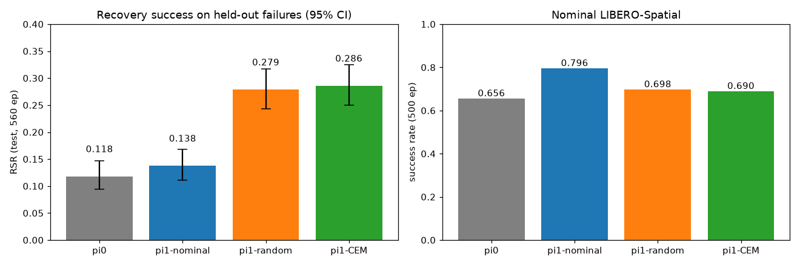

# M1: Oracle (simulator) recovery search + distillation

## Hypothesis
If a recovery segment found by search in the true simulator (scored by whether frozen pi0 then completes
the task) is distilled into SmolVLA, pi1 recovers more often on held-out failure scenes than pi0, and more often
than pi1 trained on the same number of random-search recoveries. If this fails, fix the action representation, loss or
policy interface before investing in a world model (M2).

## Setup
- Search on `pilot` failure instances only (scene x {close, open}, fixed protocol seed). Skip instances
  where pi0 succeeds in both pre-check rollouts.
- Proposals: 24 SmolVLA chunk samples (noise 1.0/1.5) + 24 smooth perturbations + 16 primitives.
- CEM: 64 samples, 8 elites, 4 iterations, H=50, momentum 0.7. Oracle scorer: segment + pi0 continuation (300 steps).
- Baseline: `method=random` (fresh proposals every iteration, same budget).
- Data: verified successes only, up to 4 per instance; segments tagged recovery(0) / continuation(1).
- SFT: from smolvla_libero, 6k steps, bs 32, lr 5e-5 cosine, 50% recovery / 50% original Spatial demos.
- Equal trajectory count across arms via `train.match_trajectory_count_of`.

## Results

### Search (pilot, interim: CEM shard s0b at 35/42)

| | CEM | random |
|---|---|---|
| instances searched | 100 | 108 |
| instances solved (>=1 verified recovery) | 72 (0.72) | 74 (0.69) |
| verified trajectories | 268 | 241 |
| sim episodes spent | 15,232 | 6,912 |
| branch success, iteration 0 (shared proposal pool) | 0.11 | 0.11 |
| branch success, CEM refit iterations 1-3 | 0.009 | - |

Findings (`experiments/figs/m1_search_overview.png`, `scripts/analyze_m1.py`):
1. **The CEM refit does not work as implemented.** Success drops from 11% to about 1% after the first refit. The elites mix
   different strategies (primitives, perturbed SmolVLA chunks, gripper-flip variants), so a per-timestep Gaussian
   fitted to them averages different modes into actions that do nothing useful. All CEM gains come from iteration 0, which equals random.
   Fix before claiming anything about search: refit around single elites (local perturbation of each elite / iCEM-style
   elite carry-over), or a per-source mixture.
2. **The random arm got the same solve rate with less than half the simulator budget** (its config runs only the proposal pool, so the budgets
   are not matched. Match budgets in the next run).
3. **Many "recoveries" are trivial.** About a third of the instances are solved by a segment of 15 steps or fewer, often 2-14 steps of a
   perturbed chunk that just opens the gripper while the bowl is already held over the plate (e.g. `on_the_stove ep020 s0200 close0`).
   Half of the verified trajectories have no SmolVLA continuation at all (the prefix alone reaches the goal).
4. Proposal sources: primitives 0.14, perturbed 0.11, SmolVLA samples 0.08-0.09 branch success.
5. Hard tasks stay hard: drawer (about 0.4 solved) and next-to-cookie-box (0-0.25).

### Policies (test split, 56 scenes x 10 trials = 560 episodes, official protocol)

| Policy | test RSR | 95% CI | close | open | nominal SR (500 ep) |
|---|---|---|---|---|---|
| pi0 (smolvla_libero) | 0.118 | [0.094, 0.147] | 0.121 | 0.114 | 0.656 |
| pi1-nominal (SFT, Spatial demos only) | 0.138 | [0.111, 0.169] | 0.107 | 0.168 | 0.796 |
| pi1-random (SFT, demos + 241 random-search recoveries) | 0.279 | [0.243, 0.317] | 0.246 | 0.311 | 0.698 |
| pi1-CEM (SFT, demos + 241 CEM recoveries) | 0.286 | [0.250, 0.324] | 0.261 | 0.311 | 0.690 |

Per task (test successes / episodes): ramekin 12 -> 63/59 of 160, drawer 5 -> 18/16 of 160, between 25 -> 45/42 of 80,
wooden cabinet 2 -> 7/12 of 60, stove 2 -> 6/10 of 40, cookie box (on) 0 in every arm.

## Decision

1. **Distilling simulator-verified recoveries works:** test RSR 0.118 -> 0.28 (2.4x), and +14 points over the nominal-only SFT
   control (CIs do not overlap). This holds on held-out failure episodes never seen in search or SFT. Hypothesis 2 is confirmed.
2. **Search method does not matter yet:** CEM 0.286 vs random 0.279 (identical within noise), consistent with the broken CEM refit
   (all useful CEM trajectories come from iteration 0 = the random proposal pool).
3. **Cost: nominal SR.** Recovery SFT lands at 0.69-0.70 vs 0.80 for nominal-only SFT (still >= pi0's 0.656). Recovery data at a 50%
   mix dilutes nominal competence. Next: lower recovery_ratio (0.2-0.3), use recovery segments only, or train longer.
4. **GO for M2/M3,** with two fixes first: (a) a CEM that actually improves on its proposals (per-elite local refinement) with
   matched budgets, so search quality can matter; (b) filter trivial "already succeeded in <=15 steps" recoveries.
