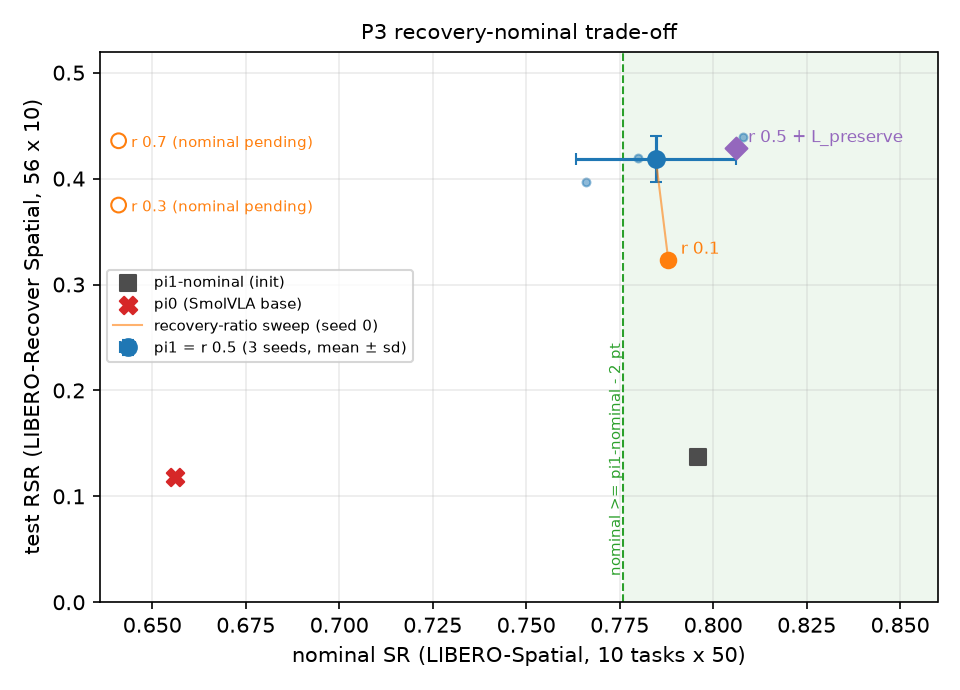

# RetryVLA results (LIBERO-Recover Spatial)

Eval protocol: test RSR = 56 held-out test scenes x 10 trials (5 close + 5 open gripper init, ±2 cm object noise),
520 steps, no search at test time. Drawer = the 16 drawer test scenes (160 episodes). Nominal = LIBERO-Spatial
10 tasks x 50 inits. One training seed per row unless noted. Updated 2026-10-19; baseline summary, P3 and B2 sections
FINAL as of 2026-10-26 (all queued jobs done).

**Protocol caveat (test-set adaptation):** from M7 on, stove / cookie-box test results were used to choose what to
run next (M7, M8). The 56-scene Spatial test split is therefore a DEVELOPMENT set from M7 onward. Final claims will be
made on a held-out evaluation that is frozen before looking at it (plan: LIBERO-Object scenes with the method frozen),
or reported explicitly as exploratory. M8-balanced (chosen by looking at test) is not run.

## Policies (distillation)

| # | policy | init | recovery data | test RSR | drawer | nominal |
|---|---|---|---|---|---|---|
| 0 | pi0 SmolVLA base (`HuggingFaceVLA/smolvla_libero`) | - | - | 0.118 | 0.03 | 0.656 |
| 1 | pi1-nominal (demo-only SFT) | pi0 | - | 0.138 | 0.04 | 0.796 |
| 2 | M1 oracle-CEM | pi0 | 241 oracle-CEM | 0.286 | 0.10 | 0.690 |
| 3 | M1 random | pi0 | 241 random | 0.279 | 0.11 | 0.698 |
| 4 | M4 A | pi1-nom | 241 random | 0.293 | 0.15 | 0.756 |
| 5 | M4 B | pi1-nom | 241 random + 45 WM | 0.298 | 0.18 | 0.748 |
| 6 | M5 random (matched) | pi1-nom | 241 random | 0.286 | 0.15 | 0.762 |
| 7 | **M5 WM round 1** | pi1-nom | 241 WM | **0.402** | 0.36 | 0.780 |
| 8 | M5b random | pi1-nom | 208 random | 0.252 | 0.06 | 0.752 |
| 9 | M5b WM diverse (top-score subset: drawer dropped) | pi1-nom | 208 WM | 0.298 | 0.11 | 0.778 |
| 10 | M5b WM noise-CEM | pi1-nom | 208 WM | 0.270 | 0.03 | 0.770 |
| 11 | M5b WM QD (top-score subset) | pi1-nom | 208 WM | 0.289 | 0.04 | 0.772 |
| 12 | **M5c WM diverse, round-robin** (= current pi1) | pi1-nom | 208 WM | **0.439** | **0.44** | **0.808** |
| 13 | M5c WM QD, round-robin | pi1-nom | 208 WM | 0.354 | 0.21 | 0.754 |
| 14 | M5c WM diverse, all | pi1-nom | 423 WM | 0.389 | 0.33 | 0.788 |
| 15 | M6 pi2 | #12 | 600 round-robin of r1 (423) + r2 robust (275) | 0.463 | 0.44 | **0.828** |
| 16 | M6 control: #12 + same 6k steps, r1 only | #12 | 208 r1 | 0.480 | 0.45 | 0.804 |
| 17 | **M7 base**: #16 + 6k steps, r1 only | #16 | 208 r1 | **0.504** | 0.49 | 0.810 |
| 18 | M7 weak: #16 + r1 + weak-task recoveries | #16 | 500 = 345 r1 + 155 stove/cookie | 0.495 | 0.49 | 0.810 |
| 19 | M8 aug: #16 + r1 + weak + +-5 cm augmented weak | #16 | 800 = 343 other + 457 stove/cookie | 0.457 | 0.42 | 0.796 |

Paired tests (same 560 test episodes): #7 vs #6 +0.116, scene-bootstrap 95% CI [+0.045, +0.191], McNemar p = 4e-7.
#12 vs #8 +0.187.
M6: #16 vs #12 +0.041 [+0.004, +0.077], p = 0.04 (extra steps help). #15 vs #16 -0.018 [-0.055, +0.021], p = 0.42:
round-2 data gives NO gain beyond extra training.
M7: #18 vs #17 -0.009 [-0.050, +0.034], p = 0.72; on stove + cookie-box test episodes (80) 8/80 vs 7/80.
#17 vs #16 +0.023 (p = 0.21): returns from extra training are flattening.
M8: #19 test weak tasks 16/80 vs 7/80 (#17, p = 0.05) and 8/80 (#18, p = 0.10), next_to_cookie_box 0.05 -> 0.35;
but overall -0.046 vs #17 (p = 0.03): 57% of its recovery data are weak-task trajectories, other tasks lose.

## Search (recovery finding)

| experiment | N failures | sims / failure | arm | solved (>=1 verified) | verified hits / sim |
|---|---|---|---|---|---|
| M1 oracle search (pilot) | 108 | <=256 | oracle CEM / random | ~0.70 / ~0.65 | - |
| M3 hard, WM-unseen | 53 | 16 | WM / random | 0.36 / 0.17 | 0.067 / 0.015 |
| M5 round 1 (pilot, adaptive budget) | 108 | 8-32 | WM diverse | 0.70 | 0.14 |
| M5 round 2 critic v1 / v2 (held-out) | 50 | 16 | WM diverse | 0.60 / 0.62 | 0.161 / 0.186 |
| **M5b paired, fresh trials** | **256** | 16 | random | 0.363 | 0.062 |
| | | | **WM diverse** | **0.547** | **0.171** |
| | | | WM noise-CEM | 0.289 | 0.076 |
| | | | WM QD | 0.453 | 0.113 |

M5b: WM diverse vs random McNemar p = 4e-9. Drawer (83 failures): 0.07 / 0.43 / 0.02 / 0.16.
Analysis: `python scripts/analyze_m5b.py` -> `runs/_analysis/m5b/summary.md`.
| M6 round 2: pi1's own train failures (pi1 SR 0.45 on 400 trials) | 219 | 16 + robust 2 | WM diverse, pi1 continues | 0.584 (robust 0.452) | 0.188 |
| M7 weak tasks (stove, cookie box), best policy continues (SR 0.36 on 160 trials) | 102 | 24 / arm + robust 2 | WM diverse / QD / two-stage | 0.59 / 0.61 / 0.61 (robust 0.47 / 0.50 / 0.50) | 0.145 / 0.138 / 0.138 |
| M8 augmented weak tasks (+-5 cm, 30 trials/scene), best policy SR 0.29 | 340 | 24 + robust 2 | WM QD | 0.36 robust | 0.086 |

## M9: mechanism, baselines, seeds (2026-10-20). Spatial test = dev set.

**3 SFT seeds** (test RSR mean ± sd): pi1 0.418 ± 0.021; M7 base 0.482 ± 0.019; M7 weak 0.468 ± 0.024.
M7 base - pi1 +0.063 [+0.035, +0.090]; M7 weak - M7 base -0.013 [-0.036, +0.011]. Nominal 0.77-0.81.

**Search ablation** (122 paired M5b instances, 16 verifications / arm; transitions per instance incl. extra sims):

| arm | WM | critic | diversity | objective | solved | hits / sim | sim transitions |
|---|---|---|---|---|---|---|---|
| random | - | - | - | - | 0.311 | 0.050 | ~5.0k |
| random_diverse | - | - | yes | - | 0.369 | 0.068 | 5.3k |
| wm_goal | yes | - | yes | goal latent (DINO-WM) | 0.230 | 0.038 | 5.4k |
| wm_goal_comp | yes | yes | yes | goal + competence | 0.451 | 0.121 | 5.1k |
| wm_top | yes | yes | - | competence | 0.475 | 0.157 | 5.0k |
| **wm_diverse** | yes | yes | yes | competence | **0.475** | 0.153 | ~5.0k |
| sim_prefix_critic | REAL | yes | yes | competence | 0.443 | 0.115 | **16.5k** |

wm_diverse vs wm_goal 32/2, p = 7e-8; vs random_diverse p = 0.015; vs sim_prefix_critic n.s. at 3.3x fewer transitions;
vs wm_top identical. Budget 32 (61 instances): wm_diverse 0.541 vs random 0.393.

**Downstream / baselines** (test RSR, 1 seed):
- SFT on competence vs goal-objective recoveries (66 each): **0.427 vs 0.189**, paired 163 / 30, p = 3e-23.
- demo-only SFT, same init + steps: 0.127 (nominal 0.82) vs pi1 0.439 (p = 1e-37).
- online best-of-8 (WM + critic every replanning step): pi0 0.118 (= pi0), pi1 0.466 (+0.027 vs pi1, p = 0.23).
- data selection on the same bank (208): top-score 0.298, random 0.427, round-robin 0.439, task-balanced 0.404.

### Re-done statistics (unit = test scene / failure instance), 2026-10-20 -> runs/_analysis/stats/summary.md
Replaces the earlier episode-level McNemar p-values (which treated the 10 trials of a scene as independent).
- comp vs goal SFT +0.237 [+0.164, +0.311] (1 seed each; seeds 1-2 running); pi1 vs demo-only +0.292 [+0.206, +0.383];
  pi1 vs random SFT +0.167 [+0.103, +0.236]; M5 WM vs random +0.116 [+0.045, +0.191] p = 0.003 (scene level).
- pi1 + best-of-8 vs pi1 +0.027 [-0.016, +0.070]; pi0 + best-of-8 vs pi0 +0.000 [-0.021, +0.021].
- M7 base vs pi1 +0.063 [+0.021, +0.105] (3 vs 3 seeds); M7 weak vs base -0.013 [-0.053, +0.029].
- WM vs sim-prefix (search, 122 failures): +0.033 [-0.049, +0.115]; one-sided 95% lower bound -0.033.
- Selection: top-score keeps only 72 unique failures (vs 105-140) and 4 drawer trajectories (vs 37-44);
  random / round-robin / task-balanced are within noise of each other -> lesson = failure-level coverage.
- **3 seeds, competence vs goal SFT (66 traj each)**: comp 0.417 ± 0.011, goal 0.187 ± 0.002; diff +0.230
  [+0.161, +0.298] (scene x seed bootstrap), sign-flip p < 1e-4; comp > goal on 47 / 56 test scenes, < on 7.

## M10: LIBERO-Object, Setting A (recipe frozen before any Object test number), 2026-10-22
Split object_v1: 77 scenes, train 51 / test 26 (frozen). WM + critic retrained on Object train data (M2 recipe).
Search on train trials 4-9 (247 pi0 failures, 16 verifications / arm), SFT init = Object pi1-nominal, 123 traj each
(= size of the smallest bank, wm_goal), round-robin. Test evaluated ONCE (26 scenes x 10), 1 training seed.

| policy | test RSR | nominal | nominal margin (>= pi1-nom 0.944 - 2 pt; 1 seed, point estimate) |
|---|---|---|---|
| pi0 | 0.219 | 0.886 | **FAIL** |
| pi1-nominal (Object demos) | 0.200 | 0.944 | (reference) |
| demo-only (+6k steps) | 0.173 | 0.932 | pass |
| + 123 random-search recoveries | **0.362** | 0.946 | pass |
| + 123 WM competence recoveries | **0.354** | 0.942 | pass |
| + 123 WM goal recoveries | 0.242 | 0.906 | **FAIL** |

Scene-level paired (26 scenes): comp - demo-only +0.181 [+0.092, +0.277] p = 0.001; comp - random -0.008
[-0.104, +0.088] p = 0.93; comp - goal +0.112 [-0.004, +0.227] p = 0.08; random - demo-only +0.188 p < 1e-4.
Search: WM competence solved 0.462 vs random 0.405 (30/16, p = 0.054) vs WM goal 0.227 (66/8, p = 2e-12);
hits / sim 0.134 / 0.060 / 0.038. Goal bank covers only 56 unique failures (comp 114, random 100).

## M11: WM as planner without the proposal library (COMPLETE, 2026-10-23: shards 0-3, arm A 124 + arm B 127 instances)
Same pi0 failures as M5b / M9 (shards 0-3 of 8), 16 verified sims / arm, paired continuation seeds.
Arm A (old WM + critic v2): wm_no_prim = WM+critic ranking of VLA samples only (no primitives / perturbations);
wm_plan = 5-round elite CEM in imagination from broad noise. Arm B: wm_plan_v2 = the SAME planner with WM v2 + critic
v3 trained with the broad-action collect_wide data. `scripts/analyze_m11.py --s3_total 34 --v2_total 127` ->
runs/_analysis/m11/summary.md (+ per_arm_v2.csv, paired_tests_v2.csv, only_sets_v2.json).

Arm A, 120 paired instances:

| arm | solved [95% CI] | hits/sim | succ jerk | succ manifold dist | succ cells |
|---|---|---|---|---|---|
| random (M5b) | 0.300 [0.225, 0.383] | 0.048 | 0.135 | 0.519 | 2.25 |
| wm_diverse (M5b, library) | **0.467** [0.383, 0.558] | 0.152 | 0.104 | 0.610 | 2.20 |
| wm_top (M9, library) | **0.467** [0.375, 0.558] | 0.152 | 0.094 | 0.584 | 1.79 |
| sim_prefix_critic (M9) | 0.433 [0.350, 0.525] | 0.111 | 0.082 | 0.510 | 3.12 |
| wm_noise (M5b) | 0.242 [0.167, 0.325] | 0.065 | 0.089 | 0.374 | 2.10 |
| wm_no_prim (M11) | 0.292 [0.208, 0.375] | 0.084 | 0.126 | 0.424 | 3.00 |
| wm_plan (M11) | 0.383 [0.300, 0.467] | 0.090 | 0.228 | 0.948 | 2.30 |

Paired (unit = failure instance, exact McNemar, bootstrap CI): wm_plan - random +0.083 [-0.008, +0.175] (20/10,
p = 0.099; hits +0.66/inst, sign-flip p < 1e-4); wm_plan - wm_diverse -0.083 [-0.158, -0.008] (7/17, p = 0.064;
hits -0.99/inst, p < 1e-4); wm_no_prim - wm_diverse -0.175 [-0.258, -0.092] (6/27, p = 3e-4); wm_no_prim - random
-0.008 (p = 1). Library arms jointly solve 77/120; only 2 failures are solved by wm_plan and no library arm (+3 by
wm_no_prim) -> union 82/120; 33 library-solved failures are missed by wm_plan.

Arm B, 118 paired instances (wm_plan_v2 searched all 127; 9 lack some earlier arm because pi0's precheck differs
between runs). Sim steps = mean verify steps / instance (16 sims); M5b arms did not log steps.

| arm | solved [95% CI] | hits/sim | sim steps | hits / 10k steps | succ jerk | succ manifold dist | succ cells |
|---|---|---|---|---|---|---|---|
| random (M5b) | 0.288 [0.212, 0.365] | 0.041 | - | - | 0.132 | 0.517 | 2.06 |
| wm_diverse (M5b, library) | **0.458** [0.364, 0.551] | 0.145 | - | - | 0.105 | 0.618 | 2.17 |
| wm_plan (old WM + critic v2) | 0.373 [0.288, 0.458] | 0.084 | 5257 | 2.56 | 0.229 | 0.950 | 2.23 |
| wm_plan_v2 (WM v2 + critic v3) | 0.398 [0.305, 0.483] | 0.105 | 5159 | 3.25 | 0.222 | 0.941 | 2.55 |

wm_plan_v2 - wm_plan +0.025 [-0.051, +0.102] (12/9, p = 0.66; hits +0.33/inst, sign-flip p = 0.19);
wm_plan_v2 - wm_diverse -0.059 [-0.144, +0.025] (8/15, p = 0.21; hits -0.64/inst, p = 0.020);
wm_plan_v2 - random +0.110 [+0.042, +0.186] (17/4, p = 0.0072; hits +1.02/inst, p < 1e-4).
Outside the library: library arms jointly solve 75/118, + wm_plan_v2 77/118 (+ every arm 81/118); solved by
wm_plan_v2 and no library arm: 2 (and no other arm at all: 1); library-solved but missed by wm_plan_v2: 30;
83% of wm_plan_v2's success strategy cells are unseen by library arms on the same instance (47 solved instances).

Reading: without the library the WM+critic do NOT match library search. Planning from noise beats ranking VLA
samples (+0.09) and finds new strategy cells, but its successes are the jerkiest and farthest from SmolVLA's
manifold. Retraining WM + critic on broad-action data helps the planner only directionally (+0.025 solved, +25%
hits/sim, +27% hits per 10k sim steps, all n.s.): the solve gap to wm_diverse shrinks from -0.085 to -0.059
(still -0.64 hits / instance, p = 0.02), the union with the library gains just 2 failures, and the jerk /
manifold distance of its successes is unchanged. Broad-action WM data does NOT close the gap; the proposal library
still carries most of the recovery-finding, and the remaining planner deficit is not mainly WM coverage of
off-manifold actions.

## B3.2 RISE-inspired imagination-only baseline (COMPLETE 2026-10-24: pool arms + VLA-sample arm)
Same WM v1 + critic v2 + 256 pi0 failures + 696 imagined 50-step chunks / failure as the PoC, but the VLA learns
directly from IMAGINED advantage A = S(chunk) - V(s_0) (no per-sample sim verification; 0 candidate sim transitions).
Matched recipe: init pi1-nominal, 6k steps, eff. batch 32, lr 5e-5, 50% demo replay, 1 training seed.
`scripts/analyze_b32.py` -> runs/_analysis/b32/summary.md. Unit = test scene (56 x 10), scene (x seed) bootstrap,
paired sign-flip p. pi0 = test part of M0_recover_bddl.

| policy | test RSR | nominal | dRSR vs pi1-nominal | vs pi1 (3 seeds) | vs pi0 | dNSR vs pi1-nominal (eps 2 pt) |
|---|---|---|---|---|---|---|
| pi0 | 0.118 | 0.656 | | | | -0.140 |
| pi1-nominal (init) | 0.138 | 0.796 | | | | |
| pi1 (PoC, 3 seeds) | 0.418 ± 0.021 | 0.785 | +0.280 | | | -0.011 (ok) |
| B3.2 cond, pool | 0.068 | 0.718 | -0.070 [-0.109, -0.037] p<1e-4 | -0.351 [-0.435, -0.270] p<1e-4 | -0.050 [-0.079, -0.023] p=9e-4 | -0.078 [-0.124, -0.036] **FAIL** |
| B3.2 AWR, pool | 0.082 | 0.776 | -0.055 [-0.095, -0.021] p=0.004 | -0.336 [-0.418, -0.252] p<1e-4 | -0.036 [-0.061, -0.012] p=0.008 | -0.020 [-0.060, +0.016] at the margin |
| B3.2 cond, VLA samples | 0.113 (63/560; close 0.114, open 0.111) | 0.770 | -0.025 [-0.052, +0.000] p=0.10 | -0.306 [-0.386, -0.227] p<1e-4 | -0.005 [-0.021, +0.011] p=0.67 | -0.026 [-0.068, +0.018] (point < -eps, CI covers it) |

Scenes worse / better / tied vs pi1-nominal: cond 18 / 0 / 38, AWR 18 / 5 / 33. VLA-sample cond: 13 / 6 / 37 vs pi1-nominal, 7 / 5 / 44 vs pi0;
it beats the pool cond arm (+0.045 [+0.021, +0.073], p = 6e-4) and AWR pool (+0.030, p = 0.035): restricting the
imagined-advantage data to pi0's own samples removes most of the off-manifold damage, but it still only matches pi0
(no recovery learned, -0.31 vs pi1) and does not beat pi1-nominal. Nominal CI = 10-task bootstrap.
Diagnosis (critic labels vs the real outcomes of the same chunks that M5b executed in sim, 8740 chunks, 0 new sim):
positive-labelled chunks have imagined V(s_hat_50) 0.81 but real success 0.185 (precision; PoC distils only verified
successes, precision 1.0); argmax-A chunk per state: imagined V 0.94, real 0.205; AUC(A -> real) 0.67. Only 18% of
chunks have A > 0; 85% of cond positives and 90% of AWR mass are latent-CEM chunks (off SmolVLA's manifold: 40%
higher jerk than pi0 samples 0.090 vs 0.065, 1.9 vs 6.0 gripper flips / chunk), pi0's own samples get 3%.
Reading: imagination-only learning is WORSE than not training on recoveries at all (below pi1-nominal and even
pi0); the imagined labels are ~4 / 5 wrong on the positives and push the policy towards off-manifold chunks, which
also costs nominal SR (cond -7.8 pt). Sim verification is what makes the WM data useful.

## B3.3 residual recovery RL baseline, full budget (2026-10-24; COMPLETE incl. nominal + diagnosis)
Frozen pi0 + residual bridge controller (first 50 steps; DINOv2-small + MLP, PPO, sparse task-success reward) trained
on the same 256 M5b train failure states with the PoC's full sim budget (3.47M env transitions; ckpt
`data/rl/b33_rl_sparse/ckpt_m3469021.pt`). Setup / budget accounting: NOTES "B3.3". `python scripts/analyze_b33.py
--tag B33_b33_rl_sparse_full --rl_dir data/rl/b33_rl_sparse` -> runs/_analysis/b33/summary_B33_b33_rl_sparse_full.md.
Unit = test scene (56 x 10 trials), scene (x seed) bootstrap 95% CI, paired sign-flip p (10k flips; 0 -> < 1e-4).
pi0 = test part of M0_recover_bddl.

| system | test RSR (560 ep) | RL - system [95% CI], p | scenes RL worse / better / tied | nominal Spatial SR (500) |
|---|---|---|---|---|
| pi0 (M0) | 0.118 | +0.177 [+0.102, +0.259], p < 1e-4 | 4 / 20 / 32 | 0.656 |
| pi1-nominal (M1, pi1's init) | 0.138 | +0.157 [+0.075, +0.245], p = 4e-4 | 8 / 21 / 27 | 0.796 |
| pi1 (PoC, 3 seeds: M5c + M8 s1 / s2) | 0.418 ± 0.021 | -0.124 [-0.196, -0.053], p = 7e-4 | 28 / 11 / 17 (vs seed 0) | 0.785 |
| RL residual p25 (867k transitions) | 0.111 | | | 0.400 |
| **RL residual full (3.47M)** | **0.295** (165/560; close 0.289, open 0.300) | | | **0.022** (11/500) |

Learning curve (128 train instances, held-out pi0 seeds, deterministic): 0.039 @0 -> 0.094 @1.06M -> 0.133 @2.1M ->
0.172 @2.45M -> 0.227 @3.48M (still rising at the matched budget). Reading: with the full matched sim budget the
residual RL controller learns real recovery (+0.18 over pi0, +0.16 over pi1-nominal) but stays clearly below
verified-search distillation (-0.12 vs pi1, 3 seeds), needs an extra controller + DINOv2 at test time, and (p25)
hurt nominal badly; the full-budget nominal (below) shows it is a recovery-vs-nominal trade-off, and a steep one.

**Nominal (confirmed).** `runs/20261024-032423_B33_b33_rl_sparse_full_nominal`: 11/500 = 0.022; per task 0/50 on 7 of
10 tasks, 3/50 (task 1), 1/50 (task 3), 7/50 (task 8); 489 of 489 failures run the full 280 steps (no crash / early
stop), the 11 successes are slow (97-280 steps vs pi0's ~60-80). Task-bootstrap deltas: vs pi0 -0.634
[-0.700, -0.560], vs pi1-nominal -0.774 [-0.840, -0.712], vs pi1 (3 seeds) -0.763 [-0.825, -0.693]. p25 controller:
0.400 -> the nominal damage GROWS with RL training while RSR rises (0.111 -> 0.295).

**Why nominal collapses (diagnostic evals, first 10 inits / task = 100 episodes, same seeds as the full eval;
`residual.no_grip` / `residual.cont_mult` ablations + `residual_stats`; runs `*_B33_b33diag_nom_*`, `*_b33diag_rec_full_test12`).**
The bridge is active in nominal too (first 50 policy steps = 5 decisions, by design: a deployed system does not know
it starts in a failure state).

| variant (nominal, 100 ep) | SR | gripper decisions follow / open / close | gripper override that flips pi0 | mean L2 arm delta / step (dec 0 / 1-4) |
|---|---|---|---|---|
| full controller | 0.02 (full-run first 10 inits: 0.04) | 345 / 0 / 155 | 144 / 500 (dec 0: 95%) | 0.74 / 0.29-0.51 |
| arm residual only (no_grip) | 0.03 | 500 / 0 / 0 | 0 | 0.74 / 0.34-0.38 |
| gripper head only (cont_mult 0) | 0.07 | 387 / 0 / 113 | 111 (dec 0: 95%) | 0 |
| neither (wrapper no-op control) | 0.73 (pi0 first 10 inits: 0.68) | - | 0 | 0 |
| (ref) full controller on 12 TEST failure scenes, 120 ep | RSR 0.383 (= the full test run on the same 120 ep 0.375, 1 disagreement; pi0 0.208) | 256 / 0 / 174 | 149 / 430 (dec 0: 39%) | 0.81 / 0.56-0.65 |

Reading: two independent causes, each sufficient on its own: (1) the gripper head forces CLOSE on the very first
decision in 95% of nominal episodes (gripper still open, nothing grasped yet -> pi0 then rarely re-opens and
re-grasps in time); (2) the arm residual adds a large offset (L2 0.74 per step on the first decision, ~0.35 after,
actions are in [-1, 1]) that drives the arm away before pi0 takes over. On failure states the same controller acts
differently (close only 39% at decision 0, larger arm deltas), so it is state-dependent, but it never saw a nominal
initial state in training (all 256 PPO starts are failure states) and its first-decision behaviour on such states is
an off-distribution "recovery manoeuvre". The wrapper itself is harmless (no-op control = pi0). Consequence: as a
deployed system it needs a failure detector / gate (extra component, not budgeted) or training on nominal starts too;
as-is it trades -0.63 nominal for +0.18 RSR, while pi1 keeps nominal (-0.011 vs pi1-nominal) and has +0.12 more RSR.

## B2 / P2 value-critic search, FINAL on all paired instances (2026-10-24): B4 question answered
Same pi0 failures, pool, WM v1, 16 verified sims / instance, continuation seeds; only the critic that ranks the
WM-imagined candidates changes. `python scripts/analyze_b2x.py` -> runs/_analysis/b2x. Unit = failure instance,
exact McNemar on solved (>= 1 of 16 verified), instance-bootstrap 95% CI, sign-flip p on hits. Each pair uses the
instances done by BOTH arms (pair n 122-127; arms have 125-129 instances because shard parts were resumed / salvaged
after the EDQUOT windows; all-arm intersection 119 gives the same conclusions). Critic supervision: NOTES "P2 controls".

| arm (critic) | supervision | n | solved | hits / sim | mean C^pi pred of picks |
|---|---|---|---|---|---|
| random (M5b) | - | 127 | 0.339 | 0.061 | - |
| goal (M9) | goal latent, no critic | 125 | 0.240 | 0.046 | - |
| B3 progress | demos + failure 0 + prefix 1 | 127 | 0.213 | 0.038 | 0.038 |
| **C^pi v2** (PoC, M5b wm_diverse) | pi0 continuation | 127 | 0.480 | 0.156 | 0.724 (own) |
| B4 success | pi0 + pi1 + pi1more + demo (1/4 each) | 127 | 0.559 | 0.182 | 0.262 |
| B4-noPi0 | pi1 + pi1more + demo (no pi0 labels) | 129 | 0.450 | 0.093 | 0.102 |
| Cpi-pool | B4's pi0 labels only (7,160), B4's trainer | 129 | 0.550 | 0.156 | 0.316 |

| paired comparison | pair n | solved A vs B | only A / only B | McNemar p | d hits / instance (sign-flip p) |
|---|---|---|---|---|---|
| B4 - C^pi v2 | 123 | 0.545 vs 0.463, +0.081 [+0.016, +0.146] | 14 / 4 | 0.031 | +0.46 (0.038) |
| B4-noPi0 - C^pi v2 | 125 | 0.440 vs 0.472, -0.032 [-0.112, +0.048] | 12 / 16 | 0.57 | -1.05 (1e-4) |
| Cpi-pool - C^pi v2 | 125 | 0.536 vs 0.472, +0.064 [+0.000, +0.136] | 14 / 6 | 0.12 | -0.12 (0.54) |
| B4 - Cpi-pool | 126 | 0.556 vs 0.540, +0.016 [-0.056, +0.087] | 11 / 9 | 0.82 | +0.46 (0.038) |
| **B4 - B4-noPi0** | 126 | 0.556 vs 0.437, **+0.119 [+0.048, +0.198]** | 20 / 5 | **0.004** | +1.46 (< 1e-4) |
| B3 progress - C^pi v2 | 123 | 0.187 vs 0.463, -0.276 [-0.358, -0.195] | 1 / 35 | < 1e-4 | -1.83 (< 1e-4) |
| B3 progress - random | 123 | 0.187 vs 0.317, -0.130 [-0.195, -0.065] | 2 / 18 | 4e-4 | -0.36 (0.004) |
| B4-noPi0 - random | 125 | 0.440 vs 0.328, +0.112 [+0.040, +0.184] | 18 / 4 | 0.004 | +0.48 (0.012) |
| Cpi-pool - random | 125 | 0.536 vs 0.328, +0.208 [+0.120, +0.296] | 32 / 6 | < 1e-4 | +1.41 (< 1e-4) |

**Conclusion on the B4 question ("does B4 win because it is policy-agnostic, or because of more / re-filtered pi0
continuation labels?"): the latter.** Removing the pi0 labels from B4 (B4-noPi0) costs -0.12 solved (20 / 5,
p = 0.004) and halves the hit rate (0.093 vs 0.182 hits / sim), landing back at (not above) C^pi v2; keeping ONLY
B4's pi0 labels with B4's trainer (Cpi-pool) recovers essentially all of B4 (0.540 vs 0.556, 9 / 11, p = 0.82) and is
+0.064 over C^pi v2 (borderline, p = 0.12; same hit rate 0.156). So the value of the B4 critic comes from the
continuation labels OF THE POLICY THAT WILL CONTINUE (pi0) -- i.e. it is a competence critic with more / differently
weighted pi0 labels and a value-baseline trainer -- not from policy-agnostic success / progress supervision: the
labels from other policies (pi1, pi1more) and demos add nothing on top of pi0's labels, and on their own are only
random+0.11. Task-progress supervision (B3) is worse than random. The +0.08 of B4 over C^pi v2 is a better
trainer / label pool for the same competence objective (worth adopting as "C^pi v3" for future search, after a
held-out check), not evidence against the competence formulation.

## B2 SFT: progress-data vs count-matched competence-data SFT (2026-10-24)
Same recipe as M9 comp (init pi1-nominal, 6k steps, round-robin, 1 seed); the progress bank (B3-progress search,
127 failures) has only 60 verified trajectories, so the competence control is count-matched (n = 60 from the M5b
wm_diverse pool, `B2_sft_comp_n60`). `python scripts/analyze_baselines.py` -> runs/_analysis/baselines/summary.md.
Unit = test scene (56 x 10), scene (x seed) bootstrap, paired sign-flip p.

| comparison | test RSR A vs B | diff [95% CI], p | scenes A worse / better / tied |
|---|---|---|---|
| **progress SFT - competence n=60** | 0.177 vs 0.430 | **-0.254 [-0.334, -0.173], p < 1e-4** | 35 / 9 / 12 |
| progress SFT - competence n=66 (M9, 3 seeds) | 0.177 vs 0.417 | -0.240 [-0.316, -0.165], p < 1e-4 | 44 / 10 / 2 |
| progress SFT - pi1-nominal | 0.177 vs 0.138 | +0.039 [+0.004, +0.077], p = 0.052 | 5 / 18 / 33 |
| progress SFT - goal SFT (M9, 3 seeds) | 0.177 vs 0.187 | -0.010 [-0.062, +0.041], p = 0.72 | 23 / 18 / 15 |
| progress SFT - pi0 | 0.177 vs 0.118 | +0.059 [+0.029, +0.095], p = 7e-4 | 3 / 20 / 33 |
| competence n=60 - pi1-nominal | 0.430 vs 0.138 | +0.293 [+0.214, +0.371], p < 1e-4 | 7 / 38 / 11 |
| competence n=60 - competence n=66 (3 seeds) | 0.430 vs 0.417 | +0.014 [-0.018, +0.046], p = 0.35 | 30 / 22 / 4 |
| competence n=60 - goal SFT (3 seeds) | 0.430 vs 0.187 | +0.243 [+0.177, +0.312], p < 1e-4 | 11 / 40 / 5 |

Reading: at equal trajectory count, recoveries found with the competence critic teach the VLA ~0.25 more RSR than
recoveries found with the progress critic; progress data is barely better than not training on recoveries
(+0.04 vs pi1-nominal, p = 0.05) and equal to goal-objective data. Count matching does not change the M9 result
(n = 60 is within noise of n = 66 and of pi1). Both the search (B3 below random) and the distillation step agree.
Nominal for these two SFTs (DAG nom_fill, 2026-10-24): progress 0.774, competence n=60 0.798 (pi1-nominal 0.796).

## Baseline summary (Spatial test = dev split; FINAL, regenerated 2026-10-26 after DAG b2p3 ALL DONE 2026-10-25 14:16 UTC)
`python scripts/analyze_baselines.py` -> runs/_analysis/baselines/summary.md (+ p3_pareto.png; it never reports a partial
eval). RSR: 56 test scenes x 10 trials; dRSR vs pi1 = scene (x seed) bootstrap 95% CI, paired sign-flip p, pi1 = 3 seeds.
Nominal: LIBERO-Spatial 10 tasks x 50 inits; dNSR = 10-task bootstrap vs pi1-nominal (0.796); pre-registered constraint
eps = 2 pt -> **nominal margin** column: pass iff the point estimate dNSR >= -0.020 (**FAIL** = violates it; this is a
point-estimate check, the 10-task CI is ~±4 pt, and most rows are 1 seed). Sim budget = env transitions spent to produce
the training signal (PoC accounting, runs/_analysis/b33/budget.json). No pending rows. Per-seed nominal: goal SFT
0.744 / 0.762 / 0.754, competence n=66 0.822 / 0.780 / 0.750, pi1 0.808 / 0.766 / 0.780 (each 500 episodes).

| method | seeds | test RSR | nominal | dRSR vs pi1 (3 seeds) [95% CI], p | dNSR vs pi1-nominal [95% CI] (eps 2 pt) | nominal margin (>= pi1-nom - 2 pt) | extra test-time cost | sim budget (transitions) |
|---|---|---|---|---|---| --- |---|---|
| pi0 (SmolVLA base) | 1 | 0.118 | 0.656 | -0.301 [-0.382, -0.218], p < 1e-4 | -0.140 [-0.182, -0.100] **< -eps** | **FAIL** | none | 0 |
| pi1-nominal (demo SFT, = init of all SFT rows) | 1 | 0.138 | 0.796 | -0.281 [-0.371, -0.196], p < 1e-4 | (reference) | (reference) | none | 0 |
| demo-only (+6k steps, same init / steps as pi1) | 1 | 0.127 | 0.820 | -0.292 [-0.380, -0.207], p < 1e-4 | +0.024 [-0.028, +0.074] | pass | none | 0 |
| random-data SFT (208 random-search recoveries) | 1 | 0.252 | 0.752 | -0.167 [-0.236, -0.104], p < 1e-4 | -0.044 [-0.082, -0.002] **< -eps** | **FAIL** | none | 1.40M (256 failures: verify 1.26M + precheck 0.13M) |
| goal-data SFT (66 WM latent-goal recoveries, 3 seeds) | 3 | 0.187 ± 0.002 | 0.753 | -0.232 [-0.306, -0.161], p < 1e-4 | -0.043 [-0.095, +0.011] **< -eps** | **FAIL** | none | 2.09M (WM data 1.39M + ~0.70M verify / precheck, 127 failures; no critic) |
| progress-data SFT (60 WM + B3-progress recoveries) | 1 | 0.177 | 0.774 | -0.242 [-0.325, -0.161], p < 1e-4 | -0.022 [-0.064, +0.024] **< -eps** | **FAIL** | none | 2.09M (WM data 1.39M + ~0.70M verify / precheck, 127 failures; critic: demos, 0 sim) |
| competence SFT, count-matched n=60 (M9 comp recipe) | 1 | 0.430 | 0.798 | +0.012 [-0.038, +0.062], p 0.62 | +0.002 [-0.046, +0.050] | pass | none | 2.90M (WM 1.39M + critic 0.82M + ~0.70M verify / precheck, 127 failures) |
| success-data SFT (66 WM + B4-success recoveries) | 1 | 0.427 | 0.796 | +0.008 [-0.042, +0.057], p 0.74 | +0.000 [-0.038, +0.040] | pass | none | 2.90M + B4 critic labels (pi0 / pi1 / pi1more continuations, already in the PoC data) |
| competence SFT n=66 (M9 comp, 3 seeds) | 3 | 0.417 ± 0.011 | 0.784 | -0.002 [-0.049, +0.049], p 0.95 | -0.012 [-0.069, +0.039] | pass | none | 2.90M (WM 1.39M + critic 0.82M + ~0.70M verify / precheck, 127 failures) |
| **RetryVLA pi1 (208 verified WM recoveries, 3 seeds)** | 3 | 0.418 ± 0.021 | 0.785 | (reference) | -0.011 [-0.046, +0.024] | pass | none | 3.47M (PoC: WM 1.39M + critic 0.82M + verify 1.26M + precheck 0.13M, 256 failures) |
| online best-of-8 on pi1 (WM + critic every replan) | 1 | 0.466 | not run | +0.027 [-0.016, +0.071], p 0.26 (vs pi1 seed 0, its base) | - | - | 8 VLA samples + 8 WM rollouts + critic per replan | 3.47M (pi1) + 0 (reuses WM / critic) |
| online best-of-8 on pi0 | 1 | 0.118 | not run | -0.301 [-0.383, -0.223], p < 1e-4 | - | - | 8 VLA samples + 8 WM rollouts + critic per replan | 2.21M (WM / critic data) |
| RISE-inspired cond (imagined advantage, pool) | 1 | 0.068 | 0.718 | -0.351 [-0.435, -0.270], p < 1e-4 | -0.078 [-0.124, -0.034] **< -eps** | **FAIL** | none (instruction suffix) | 2.21M (WM / critic data, 0 verify) |
| RISE-inspired AWR (imagined advantage, pool) | 1 | 0.082 | 0.776 | -0.336 [-0.423, -0.257], p < 1e-4 | -0.020 [-0.060, +0.016] | pass (at margin) | none | 2.21M (WM / critic data, 0 verify) |
| RISE-inspired cond (imagined advantage, VLA samples) | 1 | 0.113 | 0.770 | -0.306 [-0.389, -0.227], p < 1e-4 | -0.026 [-0.068, +0.018] **< -eps** | **FAIL** | none (instruction suffix) | 2.21M (WM / critic data, 0 verify) |
| residual RL p25 (PPO bridge on frozen pi0) | 1 | 0.111 | 0.400 | -0.308 [-0.389, -0.229], p < 1e-4 | -0.396 [-0.534, -0.266] **< -eps** | **FAIL** | DINOv2-small + MLP, first 50 steps | 0.87M (25% of PoC) |
| residual RL full (PPO bridge on frozen pi0) | 1 | 0.295 | 0.022 | -0.124 [-0.200, -0.055], p 0.0008 | -0.774 [-0.838, -0.712] **< -eps** | **FAIL** | DINOv2-small + MLP, first 50 steps | 3.47M (= PoC) |

Budget detail: random SFT 1.40M = verify 1.26M + precheck 0.13M (256 failures); goal / progress 2.09M = WM data 1.39M +
~0.70M verify / precheck (127 failures; no critic sims); competence 2.90M = + critic 0.82M; PoC 3.47M = WM 1.39M +
critic 0.82M + verify 1.26M + precheck 0.13M (256 failures). Reading: among methods with no extra test-time
component, only competence-searched, sim-verified data (pi1, competence n=60 / n=66, and the B4-critic success-data
SFT) reaches pi1's RSR while keeping nominal within eps (goal / progress / random SFT 0.753 / 0.774 / 0.752 fail it);
imagination-only (RISE-inspired) is below pi0; the only baseline that learns real recovery at the same budget
(residual RL, +0.18 vs pi0) is still -0.12 below pi1 and destroys nominal (0.022) because its controller fires on
every episode start (B3.3 diagnosis).

## P3 recovery-nominal Pareto (FINAL 2026-10-26; seed 0; all 4 points complete)
Points: recovery ratio r of the SFT mix = 0.1 / 0.3 / 0.7 and an L_preserve variant (r 0.5 + distillation to the frozen
init on nominal samples, beta 1); pi1 = r 0.5 (3 seeds: RSR 0.439 / 0.396 / 0.420, nominal 0.808 / 0.766 / 0.780).
Table + figure: `scripts/analyze_baselines.py` (P3 section, `p3_plot`). Nominal margin = pre-registered eps 2 pt vs
pi1-nominal 0.796 (point estimate).

| point | test RSR | dRSR vs pi1 (3 seeds) [95% CI], p | nominal | dNSR vs pi1-nominal [95% CI] (eps 2 pt) | nominal margin (>= pi1-nom - 2 pt) |
|---|---|---|---|---| --- |
| r 0.1 | 0.323 | -0.095 [-0.138, -0.055], p < 1e-4 | 0.788 | -0.008 [-0.052, +0.036] | pass |
| r 0.3 | 0.375 | -0.043 [-0.084, -0.004], p 0.015 | 0.814 | +0.018 [-0.012, +0.050] | pass |
| r 0.5 (= pi1, 3 seeds) | 0.418 | (reference) | 0.785 | -0.011 [-0.046, +0.024] | pass |
| r 0.7 | 0.436 | +0.017 [-0.018, +0.054], p 0.26 | 0.766 | -0.030 [-0.056, -0.004] **< -eps** | **FAIL** |
| r 0.5 + L_preserve (beta 1, nominal samples) | 0.429 | +0.010 [-0.018, +0.043], p 0.33 | 0.806 | +0.010 [-0.020, +0.038] | pass |

`experiments/figs/p3_pareto.png` (= runs/_analysis/baselines/p3_pareto.png): y = test RSR, x = nominal SR; green =
nominal within eps (2 pt) of pi1-nominal.

**Conclusion (P3).** (1) RSR rises monotonically with the recovery ratio (0.323 / 0.375 / 0.418 / 0.436 for
r 0.1 / 0.3 / 0.5 / 0.7); r 0.1 and r 0.3 are significantly below pi1 (p < 1e-4 / 0.015) and buy no needed nominal
(0.788 / 0.814; pi1 is already inside the band). (2) **r 0.7 fails the pre-registered margin**: nominal 0.766,
dNSR -0.030 [-0.056, -0.004] vs pi1-nominal (CI also excludes 0), for an RSR gain of only +0.017 (p 0.26, n.s.). So
**r 0.5 (= pi1) is the best ratio that satisfies the constraint**; a higher ratio is not a free RSR gain. (3)
L_preserve (RSR 0.429, nominal 0.806) is inside the band but both gains vs pi1 (+0.010 RSR, p 0.33; +0.021 nominal)
are within pi1's own seed spread (RSR 0.396-0.439, nominal 0.766-0.808) -> **L_preserve is not needed** at r 0.5 in this
setting (1 seed; revisit if a later suite / ratio makes the constraint bind). Caveat: all P3 points are 1 seed and the
seed-to-seed nominal sd of pi1 is ~2 pt, i.e. as large as eps itself.

## B2 success-data SFT (FINAL 2026-10-26)
66 verified recoveries found with the B4 success critic (which won the search comparison, +0.08 solved vs C^pi v2),
same SFT recipe as M9 comp (init pi1-nominal, 6k steps, round-robin, 1 seed). Test RSR **0.427** (239/560), nominal
**0.796**: dRSR vs pi1 +0.008 [-0.042, +0.057], p 0.74; dNSR vs pi1-nominal +0.000 [-0.038, +0.040] (pass). Reading:
= pi1 and = competence SFT n=60 / n=66 (0.430 / 0.417); **the search-level gain of the better critic does not transfer
to an SFT gain** at this data scale (66 trajectories). Consistent with B4 being "the same competence objective with
more pi0 labels": its banks are as useful for distillation as C^pi v2's, not more.

## Per-level RSR, L1-L4 (Part 1, 2026-11-01; recomputed from existing episodes.jsonl, 0 new rollouts)
**Label source: OFFICIAL.** LIBERO-Recovery v1.0.0 (github 832d54d, 2026-10-22) released per-scene VLM levels
(Qwen3-VL-27B, "minimum intervention": L1 action retry, L2 action adaptation, L3 object-state recovery, L4 remove an
unrelated obstruction) in ModelScope `ataier/LIBERO_Recovery_FailureScenes/annotations/scenes`. Our curated scenes are
the same dumps (sim_state bit-identical on 4 checked scenes). Coverage: Spatial 84 / 168 (every `step_0180`; `step_0200`
not annotated), Object 50 / 77 (`step_0240`; `step_0260` not). No L4 among our scenes (upstream L4 are mostly
constructed). Unannotated scenes inherit the label of the same failure episode 20 steps earlier (`src: inherited`);
weak, because upstream labels of one episode change between annotated steps 60 apart in 45 % (Spatial) / 28 % (Object)
of episodes. Primary view = official only (Spatial test: 28 scenes = 1 L1 / 11 L2 / 16 L3; Object test: 17 = 4 L1 /
13 L2). Maps: `configs/env/levels_{spatial,object}.yaml` (`scripts/build_levels.py`); table: `scripts/analyze_levels.py`
-> runs/_analysis/levels/levels.md (copy: experiments/levels/levels_existing.md, incl. the official+inherited view).
Multi-seed rows pool episodes; ± = sd of the per-seed rate. Wilson CIs on pooled episodes are optimistic (scene clusters).

| model (Spatial test, official-label scenes) | seeds | all 28 scenes | L1 (1 scene) | L2 (11) | L3 (16) |
|---|---|---|---|---|---|
| pi0 | 1 | 0.129 | 0.800 | 0.109 | 0.100 |
| pi1-nominal | 1 | 0.129 | 0.700 | 0.091 | 0.119 |
| demo-only | 1 | 0.118 | 0.700 | 0.109 | 0.087 |
| goal-data SFT | 3 | 0.190 | 0.733 | 0.182 ± 0.024 | 0.163 ± 0.025 |
| progress-data SFT | 1 | 0.200 | 0.800 | 0.173 | 0.181 |
| competence SFT n=66 | 3 | 0.402 | 0.800 | 0.373 ± 0.031 | 0.398 ± 0.036 |
| **pi1 RetryVLA** | 3 | **0.425** | 0.833 | **0.448 ± 0.019** | 0.383 ± 0.025 |
| M7 base | 3 | 0.476 | 0.800 | 0.445 ± 0.027 | 0.477 ± 0.025 |

| model (Object test, official-label scenes) | all 17 scenes | L1 (4) | L2 (13) |
|---|---|---|---|
| pi0 | 0.195 | 0.225 | 0.187 |
| pi1-nominal | 0.163 | 0.250 | 0.140 |
| demo-only | 0.137 | 0.225 | 0.113 |
| random SFT | 0.321 | 0.325 | 0.320 |
| goal SFT | 0.195 | 0.225 | 0.187 |
| competence SFT (Object pi1) | 0.305 | 0.400 | 0.280 |

Reading: L1 is near-solved by every policy (Spatial: 1 scene, n = 10 per seed, not informative). The recovery-data gain
is the same on L2 and L3 (pi1 vs pi0: +0.34 L2, +0.28 L3; goal / progress data gain only ~+0.07 on both), i.e. C^pi-selected
data helps also on object-state recovery (L3: bowl dropped / off the plate), not only on action adaptation. Object has no
official L3 test scene, so the held-out split cannot test L3. L4 cannot be evaluated on our scenes at all.
New evals record official levels in `summary.json` (`by_level_official`) and the inherited map in `by_level`.

## RQ2 action-free imagined futures (Part 4, 2026-11-01; seed 0; IN PROGRESS)
Code: `wm_datagen` futures mode, `FutureDataset` / `MixDataset(future_ratio)`, `sft` L_future (`train.future_beta`,
default 0 = OFF). Configs `configs/train/af_*.yaml`; chain `scripts/af_chain.sh`; table `python scripts/analyze_af.py`
-> runs/_analysis/af/summary.md; probe `scripts/af_probe.py` -> runs/_analysis/af_probe_s0/.
- Futures dataset `data/futures/af_m5b/futures.pt`: the 256 M5b TRAIN failure states (where pi1's 208 grounded
  trajectories come from), WM v1 + C^pi v2 (as M5b), K = 4 imagined end states per state and variant: `filtered`
  (wm_diverse C^pi objective), `goal` (goal-latent distance), `random` (pool uniform). Target = per-camera pooled
  normalized DINOv2 latent of z_H (768-d). Sim-check flags on every 4th state (64) for filtered + random only
  (statistics, never action labels). Running estimate at 220/256: sim success of the checked futures filtered 0.16 vs
  random 0.055; mean C^pi filtered 0.86 / goal 0.07 / random 0.03.
- Arms (same init pi1-nominal, 6k steps, bs 32, lr 5e-5): 3 = 50 % nominal + 50 % futures (208 filtered futures,
  round-robin over states, L_future only); 4 = same with 208 random futures; 5 = 50 % nominal + 25 % pi1's 208 grounded
  trajectories + 25 % the 208 filtered futures. beta_f = 0.5, cosine on mean-centred targets (untuned). Note: arm 5
  sees half of pi1's grounded samples per batch (50 % nominal replay kept fixed).
- Default path check: pi1's exact SFT recipe 20 steps with c6d3f8c (pre-Part-4) vs new code: per-step loss
  identical (max |diff| 0.0); `tests/test_af_default.py` (old vs new MixDataset streams identical; masking).
- Results (arm 3 / arm 5 seed 0, test RSR + nominal vs pi1 0.439 / 0.808, 3-seed 0.418): pending, see summary.md.

## 6-arm ablation x 3 seeds (plan todo `ablation`; DONE 2026-11-03 09:37 UTC, all 18 cells)
Arms (same init pi1-nominal, 6k steps, bs 32, 50 % nominal replay, same eval seeds / protocol; only the recovery /
future mix and `train.seed` differ): 1 demo-only (`exp/m9_sft_demo_only`), 2 action-grounded pi1 (M5c + M8 seeds),
3 action-free C^pi-filtered, 4 action-free unfiltered (random futures), 5 hybrid (`train/af_arm{3,4,5}_*`),
6 Backtrack-distill (`exp/bt_sft_distill`). Missing cells are queued by `scripts/abl_chain.py` (arm 4 s0-2, arms 3 / 5 / 6
s1-2, arm 1 s1-2: the M9 demo-only baseline had ONE seed, not 3); seed-0 cells of arms 3 / 5 come from `af_chain`
(Part 4), arm 6 s0 from `bt_chain` (Part 2). Table: `python scripts/analyze_ablation.py` ->
runs/_analysis/ablation/ablation.md (re-run by the chain after every finished cell). RQ3 lambda-distill seeds NOT
queued: the online lambda sweep (runs/_analysis/verifier E2) shows no clear gain (wm_unc_l1 vs l0 solved 0.388 vs 0.306,
McNemar p 0.29; hits / sim 0.115 vs 0.122), so the plan's distill condition is not met and no lambda was chosen.

**Final (3 / 3 seeds every arm; `abl_chain` ALL DONE 2026-11-03 09:37 UTC, last cell arm 4 s2 relaunched on
c37611dd after dedc84ce died).** Spatial test = 56 scenes x 10 episodes; ± = sd over SFT seeds; vs pi1 = scene x seed
bootstrap CI + sign-flip p; McNemar pooled over seed pairs; nominal margin = mean >= pi1-nominal 0.796 - 2 pt.
Copy: runs/_analysis/ablation/ablation.md (+ per-level table).

| arm | test RSR | per seed | dRSR vs pi1 [95% CI], p | McNemar n01/n10, p | nominal | margin | official L2 (11) / L3 (16) |
|---|---|---|---|---|---|---|---|
| 1 demo-only | 0.136 ± 0.015 | 0.127 / 0.127 / 0.154 | -0.283 [-0.373, -0.195], p < 1e-4 | 55/530, 1.6e-98 | 0.815 ± 0.012 | pass | 0.106 / 0.106 |
| 2 action-grounded (pi1) | **0.418 ± 0.021** | 0.439 / 0.396 / 0.420 | (ref) | (ref) | 0.785 ± 0.021 | pass | 0.448 / 0.383 |
| 3 action-free, C^pi-filtered | 0.125 ± 0.002 | 0.123 / 0.125 / 0.127 | -0.293 [-0.380, -0.210], p < 1e-4 | 57/550, 3e-102 | 0.801 ± 0.023 | pass | 0.094 / 0.115 |
| 4 action-free, unfiltered | 0.120 ± 0.014 | 0.114 / 0.136 / 0.109 | -0.299 [-0.386, -0.215], p < 1e-4 | 45/547, 1.1e-110 | 0.804 ± 0.007 | pass | 0.094 / 0.108 |
| 5 hybrid (2 + 3) | 0.370 ± 0.006 | 0.362 / 0.371 / 0.375 | -0.049 [-0.088, -0.008], p 0.0015 | 139/221, 1.8e-05 | 0.780 ± 0.022 | pass | 0.352 / 0.348 |
| 6 Backtrack-distill | 0.166 ± 0.015 | 0.182 / 0.164 / 0.152 | -0.252 [-0.342, -0.167], p < 1e-4 | 79/503, 1.7e-76 | 0.798 ± 0.014 | pass | 0.133 / 0.158 |

Reading: action-grounded recovery data is the whole effect. Action-free futures (filtered or not) are no better than
demo-only (arm 3 vs 4: 0.125 vs 0.120, C^pi filtering adds nothing); mixing them in (arm 5, which sees half of pi1's
grounded samples per batch) costs ~5 pt RSR vs pi1 (significant). Backtrack-distill is +3 pt over demo-only, far below pi1. Every
arm keeps nominal within the 2 pt margin.

Superseded status 2026-11-02 09:15 UTC (finished cells only at the time):

| arm | seeds RSR / nom | test RSR | dRSR vs pi1 [95% CI], p | McNemar vs pi1 n01/n10, p | nominal | margin | L2 (11) / L3 (16) official |
|---|---|---|---|---|---|---|---|
| 1 demo-only | 1 / 1 | 0.127 | -0.292 [-0.379, -0.206], p < 1e-4 | 19/194, p 1e-37 | 0.820 | pass | 0.109 / 0.087 |
| 2 action-grounded (pi1) | 3 / 3 | 0.418 ± 0.021 | (ref) | (ref) | 0.785 ± 0.021 | pass | 0.448 ± 0.019 / 0.383 ± 0.025 |
| 3 action-free, C^pi-filtered | 0 / 1 | pending (s0 RSR running) | | | s0 done (see table) | | |
| 4 action-free, unfiltered | 0 / 0 | pending (s0 SFT running) | | | | | |
| 5 hybrid (2 + 3) | 0 / 0 | pending (s0 SFT done, evals queued by af_chain) | | | | | |
| 6 Backtrack-distill | 1 / 1 | 0.182 | -0.236 [-0.320, -0.149], p < 1e-4 | 30/174, p 7e-26 | 0.806 | pass | 0.173 / 0.150 |

## RQ3 follow-up: is the WM too weak? WM-vs-critic diagnosis + V-JEPA 2-AC as drop-in WM (2026-11-02/03; train split only)
Full tables: runs/_analysis/wm_vs_true/summary.md (offline) and online_vj.md (online). Scripts: scripts/diag_wm_true.py,
analyze_wm_true.py, vj_rescore.py, analyze_vj_online.py.

**Step 1 (0 new sim for verif_m5b: true end latents were stored at verification time).** Same 16,384 sim-verified bridges
(256 train instances x 64). (a) = C^pi v2 on the WM v1-imagined end latent, (b) = C^pi v2 on the TRUE end latent.

| arm (imagined behind pick) | n | real SR | mean C(a) | mean C(b) | gap WM (a-b) | gap critic (b-SR) | FP(a) | FP(b) | AUC(a) | AUC(b) | ECE(a) | ECE(b) |
|---|---|---|---|---|---|---|---|---|---|---|---|---|
| random (1, no selection) | 4096 | 0.062 | 0.054 | 0.057 | -0.003 | -0.005 | 0.553 | 0.488 | 0.831 | 0.849 | 0.061 | 0.055 |
| wm_diverse (768) | 4096 | 0.171 | 0.727 | 0.265 | +0.462 | +0.094 | 0.789 | 0.611 | 0.647 | 0.777 | 0.578 | 0.210 |
| wm_noise (768) | 4096 | 0.076 | 0.491 | 0.183 | +0.309 | +0.107 | 0.879 | 0.747 | 0.707 | 0.831 | 0.441 | 0.152 |
| wm_qd (768) | 4096 | 0.113 | 0.441 | 0.161 | +0.280 | +0.048 | 0.799 | 0.623 | 0.751 | 0.831 | 0.367 | 0.138 |

- Unselected (random) candidates: WM imagination is as good as the truth for the critic (a ~ b ~ SR, AUC 0.83 vs 0.85).
- Search-selected candidates: ~80-85 % of the over-optimism is the WM (a - b = +0.28..+0.46); the critic on the TRUE
  state of the same picks is still optimistic (+0.05..+0.11, FP 0.61-0.75). Critic(true tokens, imagined state) == C(b)
  and critic(imagined tokens, true state) == C(a): the error is entirely in the imagined image tokens, not proprio.
- The WM's average latent error is NOT larger on selected picks (h10 normalized MSE 0.32 wm_diverse vs 0.34 random; ratio
  to copy-frame ~0.40 for all arms): search finds bridges whose (normal-sized) error points the way C^pi rewards.
  Among WM-predicted positives, larger end-latent error -> more FP (AUC(-mse_end -> success) 0.65).
- Critic self-exploitation control (M9 `sim_prefix_critic`, picks chosen by C^pi on the REAL end state): mean C 0.267 vs
  real SR 0.115, FP 0.644 -> the critic is also exploitable, but by ~0.15 vs 0.46-0.75 for WM imagination.
- **Verdict: both, WM-dominated.** Ranking by the true end state would lift p@4 0.193 -> 0.237 (all candidates).
- High-budget breakdown on the RQ3-sweep picks (63 train instances, 1920 picks re-simulated on CPU / Mesa,
  `data/wm/true_end_rq3`; summary.md section true_end_rq3, folded in 2026-11-08). The WM share of the over-optimism grows
  with the imagination budget: wm_bud_l0 gap WM (a-b) -0.01 / +0.09 / +0.22 / +0.33 at N = 8 / 32 / 128 / 512, gap
  critic (b-SR) +0.05 / +0.09 / +0.12 / +0.18 (critic share also grows); AUC(b) stays 0.85-0.91 while AUC(a) drops
  0.88 -> 0.65. lambda > 0 (wm_unc_l0.5..l2, 17 inst.) shrinks the WM gap +0.44 -> +0.31..0.39 but not FP(a) (0.73-0.76).
  Pooled: FP(a) 0.81 vs FP(b) 0.61, p@4 0.163 by (a) vs 0.198 by (b). Same verdict: WM-dominated, critic second.

**Step 2: V-JEPA 2-AC (Meta, MIT; ViT-g 1.01B frozen + AC predictor 305M, DROID).** Adapter retryvla/wm/vjepa2_ac.py:
agent view, 16x16 tokens -> 2x2 pool -> 64 x 1408; 1 model step = 5 env steps (20 Hz -> 4 Hz = DROID rate); chunk action
encoder Linear(35->1024) initialised = AC action encoder o physical map (OSC 0.05 m / 0.5 rad), proprio via q_head.
Data = SAME bridges as WM v1 (collect_v1, re-simulated on CPU shells -> JPEG -> pooled latents), same val split; critic =
C^pi v2 recipe (collect_v1 + verif_r1) on V-JEPA latents.

| | open-loop ratio (MSE / copy-frame) h1 / h4 / h10 | critic val AUC real / imagined | ECE imagined |
|---|---|---|---|
| WM v1 (DINOv2, both cams) | 0.629 / 0.396 / 0.356 | 0.817 / 0.798 | 0.134 |
| V-JEPA 2-AC zero-shot | 2.00 / 2.15 / 2.24 | - | - |
| V-JEPA 2-AC fine-tuned (3000 steps) | 0.659 / 0.547 / 0.557 | 0.783 / 0.792 | 0.129 |
(ratios are in each model's own latent space; zero-shot is worse than copying the frame: DROID -> LIBERO gap.)

Offline, same candidates (verif_m5b; random = unbiased, wm_diverse = picked by WM v1):

| set | SR | mean C(a) WM v1 / VJ | FP(a) WM v1 / VJ | AUC(a) WM v1 / VJ | ECE(a) WM v1 / VJ | p@1 by (a) WM v1 / VJ |
|---|---|---|---|---|---|---|
| random | 0.062 | 0.054 / 0.061 | 0.553 / 0.570 | 0.831 / 0.863 | 0.061 / 0.063 | 0.203 / 0.227 |
| wm_diverse (WM v1 picks) | 0.171 | 0.727 / 0.276 | 0.789 / 0.655 | 0.647 / 0.761 | 0.578 / 0.218 | 0.180 / 0.254 |

Online paired search (new sims; 63 train instances = M5b shards 0-1, same pools / continuation seeds, verifier swapped):

| arm | verifier | solved | hits / sim | mean C^pi picks | FP | ECE |
|---|---|---|---|---|---|---|
| wm_unc_l0 (wm_diverse pipeline, 8 verified) | WM v1 | 0.349 | 0.137 | 0.800 | 0.829 | 0.663 |
| | V-JEPA | 0.413 | 0.155 | 0.870 | 0.828 | 0.718 |
| wm_bud_l0 (4 budgets x top-4) | WM v1 | 0.381 | 0.083 | 0.399 | 0.813 | 0.326 |
| | V-JEPA | 0.413 | 0.110 | 0.471 | 0.797 | 0.377 |

wm_unc_l0 V-JEPA vs WM v1: only-VJ 10 / only-WM 6, McNemar p 0.45, d hits +0.14 (p 0.56); wm_bud_l0: 7 / 5, p 0.77,
d hits +0.43 (sign-flip p 0.07). Exploitation curve, N = 8 / 32 / 128 / 512: mean C^pi of top-4 WM v1 0.08 / 0.31 /
0.49 / 0.72 vs V-JEPA 0.12 / 0.36 / 0.61 / 0.79; real p@4 0.036 / 0.103 / 0.087 / 0.107 vs 0.063 / 0.119 / 0.119 / 0.139;
FP 0.72 / 0.71 / 0.83 / 0.85 vs 0.71 / 0.70 / 0.83 / 0.84.
**Decision: not clearly better.** The foundation WM is better calibrated on candidates it did not select (offline) and
gives a small, non-significant online gain, but its own search exploits it just as hard (FP ~0.83, gap ~0.65 at N=512).
A stronger WM alone does not remove verifier exploitation -> no V-JEPA recovery dataset / distill (plan gate). Next lever:
real ensemble disagreement across DIFFERENT WMs (WM v1 x V-JEPA), or verify more picks per instance.
