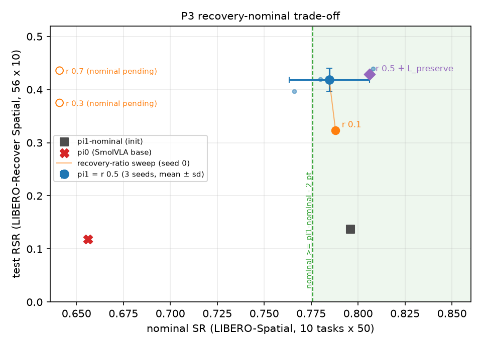

# RetryVLA results (LIBERO-Recover Spatial)

Eval protocol: test RSR = 56 held-out test scenes x 10 trials (5 close + 5 open gripper init, ±2 cm object noise),
520 steps, no search at test time. Drawer = the 16 drawer test scenes (160 episodes). Nominal = LIBERO-Spatial
10 tasks x 50 inits. One training seed per row unless noted. Updated 2026-10-19; baseline summary, P3 and B2 sections
FINAL as of 2026-10-26 (all queued jobs done).

**Protocol caveat (test-set adaptation):** from M7 on, stove / cookie-box test results were used to choose what to
run next (M7, M8). The 56-scene Spatial test split is therefore a DEVELOPMENT set from M7 onward. Final claims will be
made on a held-out evaluation that is frozen before looking at it (plan: LIBERO-Object scenes with the method frozen),
or reported explicitly as exploratory. M8-balanced (chosen by looking at test) is not run.

## Policies (distillation)

| # | policy | init | recovery data | test RSR | drawer | nominal |
|---|---|---|---|---|---|---|
| 0 | pi0 SmolVLA base (`HuggingFaceVLA/smolvla_libero`) | - | - | 0.118 | 0.03 | 0.656 |
| 1 | pi1-nominal (demo-only SFT) | pi0 | - | 0.138 | 0.04 | 0.796 |
| 2 | M1 oracle-CEM | pi0 | 241 oracle-CEM | 0.286 | 0.10 | 0.690 |
| 3 | M1 random | pi0 | 241 random | 0.279 | 0.11 | 0.698 |
| 4 | M4 A | pi1-nom | 241 random | 0.293 | 0.15 | 0.756 |
| 5 | M4 B | pi1-nom | 241 random + 45 WM | 0.298 | 0.18 | 0.748 |
| 6 | M5 random (matched) | pi1-nom | 241 random | 0.286 | 0.15 | 0.762 |
| 7 | **M5 WM round 1** | pi1-nom | 241 WM | **0.402** | 0.36 | 0.780 |
| 8 | M5b random | pi1-nom | 208 random | 0.252 | 0.06 | 0.752 |
| 9 | M5b WM diverse (top-score subset: drawer dropped) | pi1-nom | 208 WM | 0.298 | 0.11 | 0.778 |
| 10 | M5b WM noise-CEM | pi1-nom | 208 WM | 0.270 | 0.03 | 0.770 |
| 11 | M5b WM QD (top-score subset) | pi1-nom | 208 WM | 0.289 | 0.04 | 0.772 |
| 12 | **M5c WM diverse, round-robin** (= current pi1) | pi1-nom | 208 WM | **0.439** | **0.44** | **0.808** |
| 13 | M5c WM QD, round-robin | pi1-nom | 208 WM | 0.354 | 0.21 | 0.754 |
| 14 | M5c WM diverse, all | pi1-nom | 423 WM | 0.389 | 0.33 | 0.788 |
| 15 | M6 pi2 | #12 | 600 round-robin of r1 (423) + r2 robust (275) | 0.463 | 0.44 | **0.828** |
| 16 | M6 control: #12 + same 6k steps, r1 only | #12 | 208 r1 | 0.480 | 0.45 | 0.804 |
| 17 | **M7 base**: #16 + 6k steps, r1 only | #16 | 208 r1 | **0.504** | 0.49 | 0.810 |
| 18 | M7 weak: #16 + r1 + weak-task recoveries | #16 | 500 = 345 r1 + 155 stove/cookie | 0.495 | 0.49 | 0.810 |
| 19 | M8 aug: #16 + r1 + weak + +-5 cm augmented weak | #16 | 800 = 343 other + 457 stove/cookie | 0.457 | 0.42 | 0.796 |

Paired tests (same 560 test episodes): #7 vs #6 +0.116, scene-bootstrap 95% CI [+0.045, +0.191], McNemar p = 4e-7.
#12 vs #8 +0.187.
M6: #16 vs #12 +0.041 [+0.004, +0.077], p = 0.04 (extra steps help). #15 vs #16 -0.018 [-0.055, +0.021], p = 0.42:
round-2 data gives NO gain beyond extra training.
M7: #18 vs #17 -0.009 [-0.050, +0.034], p = 0.72; on stove + cookie-box test episodes (80) 8/80 vs 7/80.
#17 vs #16 +0.023 (p = 0.21): returns from extra training are flattening.
M8: #19 test weak tasks 16/80 vs 7/80 (#17, p = 0.05) and 8/80 (#18, p = 0.10), next_to_cookie_box 0.05 -> 0.35;
but overall -0.046 vs #17 (p = 0.03): 57% of its recovery data are weak-task trajectories, other tasks lose.

## Search (recovery finding)

| experiment | N failures | sims / failure | arm | solved (>=1 verified) | verified hits / sim |
|---|---|---|---|---|---|
| M1 oracle search (pilot) | 108 | <=256 | oracle CEM / random | ~0.70 / ~0.65 | - |
| M3 hard, WM-unseen | 53 | 16 | WM / random | 0.36 / 0.17 | 0.067 / 0.015 |
| M5 round 1 (pilot, adaptive budget) | 108 | 8-32 | WM diverse | 0.70 | 0.14 |
| M5 round 2 critic v1 / v2 (held-out) | 50 | 16 | WM diverse | 0.60 / 0.62 | 0.161 / 0.186 |
| **M5b paired, fresh trials** | **256** | 16 | random | 0.363 | 0.062 |
| | | | **WM diverse** | **0.547** | **0.171** |
| | | | WM noise-CEM | 0.289 | 0.076 |
| | | | WM QD | 0.453 | 0.113 |

M5b: WM diverse vs random McNemar p = 4e-9. Drawer (83 failures): 0.07 / 0.43 / 0.02 / 0.16.
Analysis: `python scripts/analyze_m5b.py` -> `runs/_analysis/m5b/summary.md`.
| M6 round 2: pi1's own train failures (pi1 SR 0.45 on 400 trials) | 219 | 16 + robust 2 | WM diverse, pi1 continues | 0.584 (robust 0.452) | 0.188 |
| M7 weak tasks (stove, cookie box), best policy continues (SR 0.36 on 160 trials) | 102 | 24 / arm + robust 2 | WM diverse / QD / two-stage | 0.59 / 0.61 / 0.61 (robust 0.47 / 0.50 / 0.50) | 0.145 / 0.138 / 0.138 |
| M8 augmented weak tasks (+-5 cm, 30 trials/scene), best policy SR 0.29 | 340 | 24 + robust 2 | WM QD | 0.36 robust | 0.086 |

## M9: mechanism, baselines, seeds (2026-10-20). Spatial test = dev set.

**3 SFT seeds** (test RSR mean ± sd): pi1 0.418 ± 0.021; M7 base 0.482 ± 0.019; M7 weak 0.468 ± 0.024.
M7 base - pi1 +0.063 [+0.035, +0.090]; M7 weak - M7 base -0.013 [-0.036, +0.011]. Nominal 0.77-0.81.

**Search ablation** (122 paired M5b instances, 16 verifications / arm; transitions per instance incl. extra sims):

| arm | WM | critic | diversity | objective | solved | hits / sim | sim transitions |
|---|---|---|---|---|---|---|---|
| random | - | - | - | - | 0.311 | 0.050 | ~5.0k |
| random_diverse | - | - | yes | - | 0.369 | 0.068 | 5.3k |
| wm_goal | yes | - | yes | goal latent (DINO-WM) | 0.230 | 0.038 | 5.4k |
| wm_goal_comp | yes | yes | yes | goal + competence | 0.451 | 0.121 | 5.1k |
| wm_top | yes | yes | - | competence | 0.475 | 0.157 | 5.0k |
| **wm_diverse** | yes | yes | yes | competence | **0.475** | 0.153 | ~5.0k |
| sim_prefix_critic | REAL | yes | yes | competence | 0.443 | 0.115 | **16.5k** |

wm_diverse vs wm_goal 32/2, p = 7e-8; vs random_diverse p = 0.015; vs sim_prefix_critic n.s. at 3.3x fewer transitions;
vs wm_top identical. Budget 32 (61 instances): wm_diverse 0.541 vs random 0.393.

**Downstream / baselines** (test RSR, 1 seed):
- SFT on competence vs goal-objective recoveries (66 each): **0.427 vs 0.189**, paired 163 / 30, p = 3e-23.
- demo-only SFT, same init + steps: 0.127 (nominal 0.82) vs pi1 0.439 (p = 1e-37).
- online best-of-8 (WM + critic every replanning step): pi0 0.118 (= pi0), pi1 0.466 (+0.027 vs pi1, p = 0.23).
- data selection on the same bank (208): top-score 0.298, random 0.427, round-robin 0.439, task-balanced 0.404.

### Re-done statistics (unit = test scene / failure instance), 2026-10-20 -> runs/_analysis/stats/summary.md
Replaces the earlier episode-level McNemar p-values (which treated the 10 trials of a scene as independent).
- comp vs goal SFT +0.237 [+0.164, +0.311] (1 seed each; seeds 1-2 running); pi1 vs demo-only +0.292 [+0.206, +0.383];
  pi1 vs random SFT +0.167 [+0.103, +0.236]; M5 WM vs random +0.116 [+0.045, +0.191] p = 0.003 (scene level).
- pi1 + best-of-8 vs pi1 +0.027 [-0.016, +0.070]; pi0 + best-of-8 vs pi0 +0.000 [-0.021, +0.021].
- M7 base vs pi1 +0.063 [+0.021, +0.105] (3 vs 3 seeds); M7 weak vs base -0.013 [-0.053, +0.029].
- WM vs sim-prefix (search, 122 failures): +0.033 [-0.049, +0.115]; one-sided 95% lower bound -0.033.
- Selection: top-score keeps only 72 unique failures (vs 105-140) and 4 drawer trajectories (vs 37-44);
  random / round-robin / task-balanced are within noise of each other -> lesson = failure-level coverage.
- **3 seeds, competence vs goal SFT (66 traj each)**: comp 0.417 ± 0.011, goal 0.187 ± 0.002; diff +0.230
  [+0.161, +0.298] (scene x seed bootstrap), sign-flip p < 1e-4; comp > goal on 47 / 56 test scenes, < on 7.

## M10: LIBERO-Object, Setting A (recipe frozen before any Object test number), 2026-10-22
Split object_v1: 77 scenes, train 51 / test 26 (frozen). WM + critic retrained on Object train data (M2 recipe).
Search on train trials 4-9 (247 pi0 failures, 16 verifications / arm), SFT init = Object pi1-nominal, 123 traj each
(= size of the smallest bank, wm_goal), round-robin. Test evaluated ONCE (26 scenes x 10), 1 training seed.

| policy | test RSR | nominal | nominal margin (>= pi1-nom 0.944 - 2 pt; 1 seed, point estimate) |
|---|---|---|---|
| pi0 | 0.219 | 0.886 | **FAIL** |
| pi1-nominal (Object demos) | 0.200 | 0.944 | (reference) |
| demo-only (+6k steps) | 0.173 | 0.932 | pass |
| + 123 random-search recoveries | **0.362** | 0.946 | pass |
| + 123 WM competence recoveries | **0.354** | 0.942 | pass |
| + 123 WM goal recoveries | 0.242 | 0.906 | **FAIL** |

Scene-level paired (26 scenes): comp - demo-only +0.181 [+0.092, +0.277] p = 0.001; comp - random -0.008
[-0.104, +0.088] p = 0.93; comp - goal +0.112 [-0.004, +0.227] p = 0.08; random - demo-only +0.188 p < 1e-4.
Search: WM competence solved 0.462 vs random 0.405 (30/16, p = 0.054) vs WM goal 0.227 (66/8, p = 2e-12);
hits / sim 0.134 / 0.060 / 0.038. Goal bank covers only 56 unique failures (comp 114, random 100).

## M11: WM as planner without the proposal library (COMPLETE, 2026-10-23: shards 0-3, arm A 124 + arm B 127 instances)
Same pi0 failures as M5b / M9 (shards 0-3 of 8), 16 verified sims / arm, paired continuation seeds.
Arm A (old WM + critic v2): wm_no_prim = WM+critic ranking of VLA samples only (no primitives / perturbations);
wm_plan = 5-round elite CEM in imagination from broad noise. Arm B: wm_plan_v2 = the SAME planner with WM v2 + critic
v3 trained with the broad-action collect_wide data. `scripts/analyze_m11.py --s3_total 34 --v2_total 127` ->
runs/_analysis/m11/summary.md (+ per_arm_v2.csv, paired_tests_v2.csv, only_sets_v2.json).

Arm A, 120 paired instances:

| arm | solved [95% CI] | hits/sim | succ jerk | succ manifold dist | succ cells |
|---|---|---|---|---|---|
| random (M5b) | 0.300 [0.225, 0.383] | 0.048 | 0.135 | 0.519 | 2.25 |
| wm_diverse (M5b, library) | **0.467** [0.383, 0.558] | 0.152 | 0.104 | 0.610 | 2.20 |
| wm_top (M9, library) | **0.467** [0.375, 0.558] | 0.152 | 0.094 | 0.584 | 1.79 |
| sim_prefix_critic (M9) | 0.433 [0.350, 0.525] | 0.111 | 0.082 | 0.510 | 3.12 |
| wm_noise (M5b) | 0.242 [0.167, 0.325] | 0.065 | 0.089 | 0.374 | 2.10 |
| wm_no_prim (M11) | 0.292 [0.208, 0.375] | 0.084 | 0.126 | 0.424 | 3.00 |
| wm_plan (M11) | 0.383 [0.300, 0.467] | 0.090 | 0.228 | 0.948 | 2.30 |

Paired (unit = failure instance, exact McNemar, bootstrap CI): wm_plan - random +0.083 [-0.008, +0.175] (20/10,
p = 0.099; hits +0.66/inst, sign-flip p < 1e-4); wm_plan - wm_diverse -0.083 [-0.158, -0.008] (7/17, p = 0.064;
hits -0.99/inst, p < 1e-4); wm_no_prim - wm_diverse -0.175 [-0.258, -0.092] (6/27, p = 3e-4); wm_no_prim - random
-0.008 (p = 1). Library arms jointly solve 77/120; only 2 failures are solved by wm_plan and no library arm (+3 by
wm_no_prim) -> union 82/120; 33 library-solved failures are missed by wm_plan.

Arm B, 118 paired instances (wm_plan_v2 searched all 127; 9 lack some earlier arm because pi0's precheck differs
between runs). Sim steps = mean verify steps / instance (16 sims); M5b arms did not log steps.

| arm | solved [95% CI] | hits/sim | sim steps | hits / 10k steps | succ jerk | succ manifold dist | succ cells |
|---|---|---|---|---|---|---|---|
| random (M5b) | 0.288 [0.212, 0.365] | 0.041 | - | - | 0.132 | 0.517 | 2.06 |
| wm_diverse (M5b, library) | **0.458** [0.364, 0.551] | 0.145 | - | - | 0.105 | 0.618 | 2.17 |
| wm_plan (old WM + critic v2) | 0.373 [0.288, 0.458] | 0.084 | 5257 | 2.56 | 0.229 | 0.950 | 2.23 |
| wm_plan_v2 (WM v2 + critic v3) | 0.398 [0.305, 0.483] | 0.105 | 5159 | 3.25 | 0.222 | 0.941 | 2.55 |

wm_plan_v2 - wm_plan +0.025 [-0.051, +0.102] (12/9, p = 0.66; hits +0.33/inst, sign-flip p = 0.19);
wm_plan_v2 - wm_diverse -0.059 [-0.144, +0.025] (8/15, p = 0.21; hits -0.64/inst, p = 0.020);
wm_plan_v2 - random +0.110 [+0.042, +0.186] (17/4, p = 0.0072; hits +1.02/inst, p < 1e-4).
Outside the library: library arms jointly solve 75/118, + wm_plan_v2 77/118 (+ every arm 81/118); solved by
wm_plan_v2 and no library arm: 2 (and no other arm at all: 1); library-solved but missed by wm_plan_v2: 30;
83% of wm_plan_v2's success strategy cells are unseen by library arms on the same instance (47 solved instances).

Reading: without the library the WM+critic do NOT match library search. Planning from noise beats ranking VLA
samples (+0.09) and finds new strategy cells, but its successes are the jerkiest and farthest from SmolVLA's
manifold. Retraining WM + critic on broad-action data helps the planner only directionally (+0.025 solved, +25%
hits/sim, +27% hits per 10k sim steps, all n.s.): the solve gap to wm_diverse shrinks from -0.085 to -0.059
(still -0.64 hits / instance, p = 0.02), the union with the library gains just 2 failures, and the jerk /
manifold distance of its successes is unchanged. Broad-action WM data does NOT close the gap; the proposal library
still carries most of the recovery-finding, and the remaining planner deficit is not mainly WM coverage of
off-manifold actions.

## B3.2 RISE-inspired imagination-only baseline (COMPLETE 2026-10-24: pool arms + VLA-sample arm)
Same WM v1 + critic v2 + 256 pi0 failures + 696 imagined 50-step chunks / failure as the PoC, but the VLA learns
directly from IMAGINED advantage A = S(chunk) - V(s_0) (no per-sample sim verification; 0 candidate sim transitions).
Matched recipe: init pi1-nominal, 6k steps, eff. batch 32, lr 5e-5, 50% demo replay, 1 training seed.
`scripts/analyze_b32.py` -> runs/_analysis/b32/summary.md. Unit = test scene (56 x 10), scene (x seed) bootstrap,
paired sign-flip p. pi0 = test part of M0_recover_bddl.

| policy | test RSR | nominal | dRSR vs pi1-nominal | vs pi1 (3 seeds) | vs pi0 | dNSR vs pi1-nominal (eps 2 pt) |
|---|---|---|---|---|---|---|
| pi0 | 0.118 | 0.656 | | | | -0.140 |
| pi1-nominal (init) | 0.138 | 0.796 | | | | |
| pi1 (PoC, 3 seeds) | 0.418 ± 0.021 | 0.785 | +0.280 | | | -0.011 (ok) |
| B3.2 cond, pool | 0.068 | 0.718 | -0.070 [-0.109, -0.037] p<1e-4 | -0.351 [-0.435, -0.270] p<1e-4 | -0.050 [-0.079, -0.023] p=9e-4 | -0.078 [-0.124, -0.036] **FAIL** |
| B3.2 AWR, pool | 0.082 | 0.776 | -0.055 [-0.095, -0.021] p=0.004 | -0.336 [-0.418, -0.252] p<1e-4 | -0.036 [-0.061, -0.012] p=0.008 | -0.020 [-0.060, +0.016] at the margin |
| B3.2 cond, VLA samples | 0.113 (63/560; close 0.114, open 0.111) | 0.770 | -0.025 [-0.052, +0.000] p=0.10 | -0.306 [-0.386, -0.227] p<1e-4 | -0.005 [-0.021, +0.011] p=0.67 | -0.026 [-0.068, +0.018] (point < -eps, CI covers it) |

Scenes worse / better / tied vs pi1-nominal: cond 18 / 0 / 38, AWR 18 / 5 / 33. VLA-sample cond: 13 / 6 / 37 vs pi1-nominal, 7 / 5 / 44 vs pi0;
it beats the pool cond arm (+0.045 [+0.021, +0.073], p = 6e-4) and AWR pool (+0.030, p = 0.035): restricting the
imagined-advantage data to pi0's own samples removes most of the off-manifold damage, but it still only matches pi0
(no recovery learned, -0.31 vs pi1) and does not beat pi1-nominal. Nominal CI = 10-task bootstrap.
Diagnosis (critic labels vs the real outcomes of the same chunks that M5b executed in sim, 8740 chunks, 0 new sim):
positive-labelled chunks have imagined V(s_hat_50) 0.81 but real success 0.185 (precision; PoC distils only verified
successes, precision 1.0); argmax-A chunk per state: imagined V 0.94, real 0.205; AUC(A -> real) 0.67. Only 18% of
chunks have A > 0; 85% of cond positives and 90% of AWR mass are latent-CEM chunks (off SmolVLA's manifold: 40%
higher jerk than pi0 samples 0.090 vs 0.065, 1.9 vs 6.0 gripper flips / chunk), pi0's own samples get 3%.
Reading: imagination-only learning is WORSE than not training on recoveries at all (below pi1-nominal and even
pi0); the imagined labels are ~4 / 5 wrong on the positives and push the policy towards off-manifold chunks, which
also costs nominal SR (cond -7.8 pt). Sim verification is what makes the WM data useful.

## B3.3 residual recovery RL baseline, full budget (2026-10-24; COMPLETE incl. nominal + diagnosis)
Frozen pi0 + residual bridge controller (first 50 steps; DINOv2-small + MLP, PPO, sparse task-success reward) trained
on the same 256 M5b train failure states with the PoC's full sim budget (3.47M env transitions; ckpt
`data/rl/b33_rl_sparse/ckpt_m3469021.pt`). Setup / budget accounting: NOTES "B3.3". `python scripts/analyze_b33.py
--tag B33_b33_rl_sparse_full --rl_dir data/rl/b33_rl_sparse` -> runs/_analysis/b33/summary_B33_b33_rl_sparse_full.md.
Unit = test scene (56 x 10 trials), scene (x seed) bootstrap 95% CI, paired sign-flip p (10k flips; 0 -> < 1e-4).
pi0 = test part of M0_recover_bddl.

| system | test RSR (560 ep) | RL - system [95% CI], p | scenes RL worse / better / tied | nominal Spatial SR (500) |
|---|---|---|---|---|
| pi0 (M0) | 0.118 | +0.177 [+0.102, +0.259], p < 1e-4 | 4 / 20 / 32 | 0.656 |
| pi1-nominal (M1, pi1's init) | 0.138 | +0.157 [+0.075, +0.245], p = 4e-4 | 8 / 21 / 27 | 0.796 |
| pi1 (PoC, 3 seeds: M5c + M8 s1 / s2) | 0.418 ± 0.021 | -0.124 [-0.196, -0.053], p = 7e-4 | 28 / 11 / 17 (vs seed 0) | 0.785 |
| RL residual p25 (867k transitions) | 0.111 | | | 0.400 |
| **RL residual full (3.47M)** | **0.295** (165/560; close 0.289, open 0.300) | | | **0.022** (11/500) |

Learning curve (128 train instances, held-out pi0 seeds, deterministic): 0.039 @0 -> 0.094 @1.06M -> 0.133 @2.1M ->
0.172 @2.45M -> 0.227 @3.48M (still rising at the matched budget). Reading: with the full matched sim budget the
residual RL controller learns real recovery (+0.18 over pi0, +0.16 over pi1-nominal) but stays clearly below
verified-search distillation (-0.12 vs pi1, 3 seeds), needs an extra controller + DINOv2 at test time, and (p25)
hurt nominal badly; the full-budget nominal (below) shows it is a recovery-vs-nominal trade-off, and a steep one.

**Nominal (confirmed).** `runs/20261024-032423_B33_b33_rl_sparse_full_nominal`: 11/500 = 0.022; per task 0/50 on 7 of
10 tasks, 3/50 (task 1), 1/50 (task 3), 7/50 (task 8); 489 of 489 failures run the full 280 steps (no crash / early
stop), the 11 successes are slow (97-280 steps vs pi0's ~60-80). Task-bootstrap deltas: vs pi0 -0.634
[-0.700, -0.560], vs pi1-nominal -0.774 [-0.840, -0.712], vs pi1 (3 seeds) -0.763 [-0.825, -0.693]. p25 controller:
0.400 -> the nominal damage GROWS with RL training while RSR rises (0.111 -> 0.295).

**Why nominal collapses (diagnostic evals, first 10 inits / task = 100 episodes, same seeds as the full eval;
`residual.no_grip` / `residual.cont_mult` ablations + `residual_stats`; runs `*_B33_b33diag_nom_*`, `*_b33diag_rec_full_test12`).**
The bridge is active in nominal too (first 50 policy steps = 5 decisions, by design: a deployed system does not know
it starts in a failure state).

| variant (nominal, 100 ep) | SR | gripper decisions follow / open / close | gripper override that flips pi0 | mean L2 arm delta / step (dec 0 / 1-4) |
|---|---|---|---|---|
| full controller | 0.02 (full-run first 10 inits: 0.04) | 345 / 0 / 155 | 144 / 500 (dec 0: 95%) | 0.74 / 0.29-0.51 |
| arm residual only (no_grip) | 0.03 | 500 / 0 / 0 | 0 | 0.74 / 0.34-0.38 |
| gripper head only (cont_mult 0) | 0.07 | 387 / 0 / 113 | 111 (dec 0: 95%) | 0 |
| neither (wrapper no-op control) | 0.73 (pi0 first 10 inits: 0.68) | - | 0 | 0 |
| (ref) full controller on 12 TEST failure scenes, 120 ep | RSR 0.383 (= the full test run on the same 120 ep 0.375, 1 disagreement; pi0 0.208) | 256 / 0 / 174 | 149 / 430 (dec 0: 39%) | 0.81 / 0.56-0.65 |

Reading: two independent causes, each sufficient on its own: (1) the gripper head forces CLOSE on the very first
decision in 95% of nominal episodes (gripper still open, nothing grasped yet -> pi0 then rarely re-opens and
re-grasps in time); (2) the arm residual adds a large offset (L2 0.74 per step on the first decision, ~0.35 after,
actions are in [-1, 1]) that drives the arm away before pi0 takes over. On failure states the same controller acts
differently (close only 39% at decision 0, larger arm deltas), so it is state-dependent, but it never saw a nominal
initial state in training (all 256 PPO starts are failure states) and its first-decision behaviour on such states is
an off-distribution "recovery manoeuvre". The wrapper itself is harmless (no-op control = pi0). Consequence: as a
deployed system it needs a failure detector / gate (extra component, not budgeted) or training on nominal starts too;
as-is it trades -0.63 nominal for +0.18 RSR, while pi1 keeps nominal (-0.011 vs pi1-nominal) and has +0.12 more RSR.

## B2 / P2 value-critic search, FINAL on all paired instances (2026-10-24): B4 question answered
Same pi0 failures, pool, WM v1, 16 verified sims / instance, continuation seeds; only the critic that ranks the
WM-imagined candidates changes. `python scripts/analyze_b2x.py` -> runs/_analysis/b2x. Unit = failure instance,
exact McNemar on solved (>= 1 of 16 verified), instance-bootstrap 95% CI, sign-flip p on hits. Each pair uses the
instances done by BOTH arms (pair n 122-127; arms have 125-129 instances because shard parts were resumed / salvaged
after the EDQUOT windows; all-arm intersection 119 gives the same conclusions). Critic supervision: NOTES "P2 controls".

| arm (critic) | supervision | n | solved | hits / sim | mean C^pi pred of picks |
|---|---|---|---|---|---|
| random (M5b) | - | 127 | 0.339 | 0.061 | - |
| goal (M9) | goal latent, no critic | 125 | 0.240 | 0.046 | - |
| B3 progress | demos + failure 0 + prefix 1 | 127 | 0.213 | 0.038 | 0.038 |
| **C^pi v2** (PoC, M5b wm_diverse) | pi0 continuation | 127 | 0.480 | 0.156 | 0.724 (own) |
| B4 success | pi0 + pi1 + pi1more + demo (1/4 each) | 127 | 0.559 | 0.182 | 0.262 |
| B4-noPi0 | pi1 + pi1more + demo (no pi0 labels) | 129 | 0.450 | 0.093 | 0.102 |
| Cpi-pool | B4's pi0 labels only (7,160), B4's trainer | 129 | 0.550 | 0.156 | 0.316 |

| paired comparison | pair n | solved A vs B | only A / only B | McNemar p | d hits / instance (sign-flip p) |
|---|---|---|---|---|---|
| B4 - C^pi v2 | 123 | 0.545 vs 0.463, +0.081 [+0.016, +0.146] | 14 / 4 | 0.031 | +0.46 (0.038) |
| B4-noPi0 - C^pi v2 | 125 | 0.440 vs 0.472, -0.032 [-0.112, +0.048] | 12 / 16 | 0.57 | -1.05 (1e-4) |
| Cpi-pool - C^pi v2 | 125 | 0.536 vs 0.472, +0.064 [+0.000, +0.136] | 14 / 6 | 0.12 | -0.12 (0.54) |
| B4 - Cpi-pool | 126 | 0.556 vs 0.540, +0.016 [-0.056, +0.087] | 11 / 9 | 0.82 | +0.46 (0.038) |
| **B4 - B4-noPi0** | 126 | 0.556 vs 0.437, **+0.119 [+0.048, +0.198]** | 20 / 5 | **0.004** | +1.46 (< 1e-4) |
| B3 progress - C^pi v2 | 123 | 0.187 vs 0.463, -0.276 [-0.358, -0.195] | 1 / 35 | < 1e-4 | -1.83 (< 1e-4) |
| B3 progress - random | 123 | 0.187 vs 0.317, -0.130 [-0.195, -0.065] | 2 / 18 | 4e-4 | -0.36 (0.004) |
| B4-noPi0 - random | 125 | 0.440 vs 0.328, +0.112 [+0.040, +0.184] | 18 / 4 | 0.004 | +0.48 (0.012) |
| Cpi-pool - random | 125 | 0.536 vs 0.328, +0.208 [+0.120, +0.296] | 32 / 6 | < 1e-4 | +1.41 (< 1e-4) |

**Conclusion on the B4 question ("does B4 win because it is policy-agnostic, or because of more / re-filtered pi0
continuation labels?"): the latter.** Removing the pi0 labels from B4 (B4-noPi0) costs -0.12 solved (20 / 5,
p = 0.004) and halves the hit rate (0.093 vs 0.182 hits / sim), landing back at (not above) C^pi v2; keeping ONLY
B4's pi0 labels with B4's trainer (Cpi-pool) recovers essentially all of B4 (0.540 vs 0.556, 9 / 11, p = 0.82) and is
+0.064 over C^pi v2 (borderline, p = 0.12; same hit rate 0.156). So the value of the B4 critic comes from the
continuation labels OF THE POLICY THAT WILL CONTINUE (pi0) -- i.e. it is a competence critic with more / differently
weighted pi0 labels and a value-baseline trainer -- not from policy-agnostic success / progress supervision: the
labels from other policies (pi1, pi1more) and demos add nothing on top of pi0's labels, and on their own are only
random+0.11. Task-progress supervision (B3) is worse than random. The +0.08 of B4 over C^pi v2 is a better
trainer / label pool for the same competence objective (worth adopting as "C^pi v3" for future search, after a
held-out check), not evidence against the competence formulation.

## B2 SFT: progress-data vs count-matched competence-data SFT (2026-10-24)
Same recipe as M9 comp (init pi1-nominal, 6k steps, round-robin, 1 seed); the progress bank (B3-progress search,
127 failures) has only 60 verified trajectories, so the competence control is count-matched (n = 60 from the M5b
wm_diverse pool, `B2_sft_comp_n60`). `python scripts/analyze_baselines.py` -> runs/_analysis/baselines/summary.md.
Unit = test scene (56 x 10), scene (x seed) bootstrap, paired sign-flip p.

| comparison | test RSR A vs B | diff [95% CI], p | scenes A worse / better / tied |
|---|---|---|---|
| **progress SFT - competence n=60** | 0.177 vs 0.430 | **-0.254 [-0.334, -0.173], p < 1e-4** | 35 / 9 / 12 |
| progress SFT - competence n=66 (M9, 3 seeds) | 0.177 vs 0.417 | -0.240 [-0.316, -0.165], p < 1e-4 | 44 / 10 / 2 |
| progress SFT - pi1-nominal | 0.177 vs 0.138 | +0.039 [+0.004, +0.077], p = 0.052 | 5 / 18 / 33 |
| progress SFT - goal SFT (M9, 3 seeds) | 0.177 vs 0.187 | -0.010 [-0.062, +0.041], p = 0.72 | 23 / 18 / 15 |
| progress SFT - pi0 | 0.177 vs 0.118 | +0.059 [+0.029, +0.095], p = 7e-4 | 3 / 20 / 33 |
| competence n=60 - pi1-nominal | 0.430 vs 0.138 | +0.293 [+0.214, +0.371], p < 1e-4 | 7 / 38 / 11 |
| competence n=60 - competence n=66 (3 seeds) | 0.430 vs 0.417 | +0.014 [-0.018, +0.046], p = 0.35 | 30 / 22 / 4 |
| competence n=60 - goal SFT (3 seeds) | 0.430 vs 0.187 | +0.243 [+0.177, +0.312], p < 1e-4 | 11 / 40 / 5 |

Reading: at equal trajectory count, recoveries found with the competence critic teach the VLA ~0.25 more RSR than
recoveries found with the progress critic; progress data is barely better than not training on recoveries
(+0.04 vs pi1-nominal, p = 0.05) and equal to goal-objective data. Count matching does not change the M9 result
(n = 60 is within noise of n = 66 and of pi1). Both the search (B3 below random) and the distillation step agree.
Nominal for these two SFTs (DAG nom_fill, 2026-10-24): progress 0.774, competence n=60 0.798 (pi1-nominal 0.796).

## Baseline summary (Spatial test = dev split; FINAL, regenerated 2026-10-26 after DAG b2p3 ALL DONE 2026-10-25 14:16 UTC)
`python scripts/analyze_baselines.py` -> runs/_analysis/baselines/summary.md (+ p3_pareto.png; it never reports a partial
eval). RSR: 56 test scenes x 10 trials; dRSR vs pi1 = scene (x seed) bootstrap 95% CI, paired sign-flip p, pi1 = 3 seeds.
Nominal: LIBERO-Spatial 10 tasks x 50 inits; dNSR = 10-task bootstrap vs pi1-nominal (0.796); pre-registered constraint
eps = 2 pt -> **nominal margin** column: pass iff the point estimate dNSR >= -0.020 (**FAIL** = violates it; this is a
point-estimate check, the 10-task CI is ~±4 pt, and most rows are 1 seed). Sim budget = env transitions spent to produce
the training signal (PoC accounting, runs/_analysis/b33/budget.json). No pending rows. Per-seed nominal: goal SFT
0.744 / 0.762 / 0.754, competence n=66 0.822 / 0.780 / 0.750, pi1 0.808 / 0.766 / 0.780 (each 500 episodes).

| method | seeds | test RSR | nominal | dRSR vs pi1 (3 seeds) [95% CI], p | dNSR vs pi1-nominal [95% CI] (eps 2 pt) | nominal margin (>= pi1-nom - 2 pt) | extra test-time cost | sim budget (transitions) |
|---|---|---|---|---|---| --- |---|---|
| pi0 (SmolVLA base) | 1 | 0.118 | 0.656 | -0.301 [-0.382, -0.218], p < 1e-4 | -0.140 [-0.182, -0.100] **< -eps** | **FAIL** | none | 0 |
| pi1-nominal (demo SFT, = init of all SFT rows) | 1 | 0.138 | 0.796 | -0.281 [-0.371, -0.196], p < 1e-4 | (reference) | (reference) | none | 0 |
| demo-only (+6k steps, same init / steps as pi1) | 1 | 0.127 | 0.820 | -0.292 [-0.380, -0.207], p < 1e-4 | +0.024 [-0.028, +0.074] | pass | none | 0 |
| random-data SFT (208 random-search recoveries) | 1 | 0.252 | 0.752 | -0.167 [-0.236, -0.104], p < 1e-4 | -0.044 [-0.082, -0.002] **< -eps** | **FAIL** | none | 1.40M (256 failures: verify 1.26M + precheck 0.13M) |
| goal-data SFT (66 WM latent-goal recoveries, 3 seeds) | 3 | 0.187 ± 0.002 | 0.753 | -0.232 [-0.306, -0.161], p < 1e-4 | -0.043 [-0.095, +0.011] **< -eps** | **FAIL** | none | 2.09M (WM data 1.39M + ~0.70M verify / precheck, 127 failures; no critic) |
| progress-data SFT (60 WM + B3-progress recoveries) | 1 | 0.177 | 0.774 | -0.242 [-0.325, -0.161], p < 1e-4 | -0.022 [-0.064, +0.024] **< -eps** | **FAIL** | none | 2.09M (WM data 1.39M + ~0.70M verify / precheck, 127 failures; critic: demos, 0 sim) |
| competence SFT, count-matched n=60 (M9 comp recipe) | 1 | 0.430 | 0.798 | +0.012 [-0.038, +0.062], p 0.62 | +0.002 [-0.046, +0.050] | pass | none | 2.90M (WM 1.39M + critic 0.82M + ~0.70M verify / precheck, 127 failures) |
| success-data SFT (66 WM + B4-success recoveries) | 1 | 0.427 | 0.796 | +0.008 [-0.042, +0.057], p 0.74 | +0.000 [-0.038, +0.040] | pass | none | 2.90M + B4 critic labels (pi0 / pi1 / pi1more continuations, already in the PoC data) |
| competence SFT n=66 (M9 comp, 3 seeds) | 3 | 0.417 ± 0.011 | 0.784 | -0.002 [-0.049, +0.049], p 0.95 | -0.012 [-0.069, +0.039] | pass | none | 2.90M (WM 1.39M + critic 0.82M + ~0.70M verify / precheck, 127 failures) |
| **RetryVLA pi1 (208 verified WM recoveries, 3 seeds)** | 3 | 0.418 ± 0.021 | 0.785 | (reference) | -0.011 [-0.046, +0.024] | pass | none | 3.47M (PoC: WM 1.39M + critic 0.82M + verify 1.26M + precheck 0.13M, 256 failures) |
| online best-of-8 on pi1 (WM + critic every replan) | 1 | 0.466 | not run | +0.027 [-0.016, +0.071], p 0.26 (vs pi1 seed 0, its base) | - | - | 8 VLA samples + 8 WM rollouts + critic per replan | 3.47M (pi1) + 0 (reuses WM / critic) |
| online best-of-8 on pi0 | 1 | 0.118 | not run | -0.301 [-0.383, -0.223], p < 1e-4 | - | - | 8 VLA samples + 8 WM rollouts + critic per replan | 2.21M (WM / critic data) |
| RISE-inspired cond (imagined advantage, pool) | 1 | 0.068 | 0.718 | -0.351 [-0.435, -0.270], p < 1e-4 | -0.078 [-0.124, -0.034] **< -eps** | **FAIL** | none (instruction suffix) | 2.21M (WM / critic data, 0 verify) |
| RISE-inspired AWR (imagined advantage, pool) | 1 | 0.082 | 0.776 | -0.336 [-0.423, -0.257], p < 1e-4 | -0.020 [-0.060, +0.016] | pass (at margin) | none | 2.21M (WM / critic data, 0 verify) |
| RISE-inspired cond (imagined advantage, VLA samples) | 1 | 0.113 | 0.770 | -0.306 [-0.389, -0.227], p < 1e-4 | -0.026 [-0.068, +0.018] **< -eps** | **FAIL** | none (instruction suffix) | 2.21M (WM / critic data, 0 verify) |
| residual RL p25 (PPO bridge on frozen pi0) | 1 | 0.111 | 0.400 | -0.308 [-0.389, -0.229], p < 1e-4 | -0.396 [-0.534, -0.266] **< -eps** | **FAIL** | DINOv2-small + MLP, first 50 steps | 0.87M (25% of PoC) |
| residual RL full (PPO bridge on frozen pi0) | 1 | 0.295 | 0.022 | -0.124 [-0.200, -0.055], p 0.0008 | -0.774 [-0.838, -0.712] **< -eps** | **FAIL** | DINOv2-small + MLP, first 50 steps | 3.47M (= PoC) |

Budget detail: random SFT 1.40M = verify 1.26M + precheck 0.13M (256 failures); goal / progress 2.09M = WM data 1.39M +
~0.70M verify / precheck (127 failures; no critic sims); competence 2.90M = + critic 0.82M; PoC 3.47M = WM 1.39M +
critic 0.82M + verify 1.26M + precheck 0.13M (256 failures). Reading: among methods with no extra test-time
component, only competence-searched, sim-verified data (pi1, competence n=60 / n=66, and the B4-critic success-data
SFT) reaches pi1's RSR while keeping nominal within eps (goal / progress / random SFT 0.753 / 0.774 / 0.752 fail it);
imagination-only (RISE-inspired) is below pi0; the only baseline that learns real recovery at the same budget
(residual RL, +0.18 vs pi0) is still -0.12 below pi1 and destroys nominal (0.022) because its controller fires on
every episode start (B3.3 diagnosis).

## P3 recovery-nominal Pareto (FINAL 2026-10-26; seed 0; all 4 points complete)
Points: recovery ratio r of the SFT mix = 0.1 / 0.3 / 0.7 and an L_preserve variant (r 0.5 + distillation to the frozen
init on nominal samples, beta 1); pi1 = r 0.5 (3 seeds: RSR 0.439 / 0.396 / 0.420, nominal 0.808 / 0.766 / 0.780).
Table + figure: `scripts/analyze_baselines.py` (P3 section, `p3_plot`). Nominal margin = pre-registered eps 2 pt vs
pi1-nominal 0.796 (point estimate).

| point | test RSR | dRSR vs pi1 (3 seeds) [95% CI], p | nominal | dNSR vs pi1-nominal [95% CI] (eps 2 pt) | nominal margin (>= pi1-nom - 2 pt) |
|---|---|---|---|---| --- |
| r 0.1 | 0.323 | -0.095 [-0.138, -0.055], p < 1e-4 | 0.788 | -0.008 [-0.052, +0.036] | pass |
| r 0.3 | 0.375 | -0.043 [-0.084, -0.004], p 0.015 | 0.814 | +0.018 [-0.012, +0.050] | pass |
| r 0.5 (= pi1, 3 seeds) | 0.418 | (reference) | 0.785 | -0.011 [-0.046, +0.024] | pass |
| r 0.7 | 0.436 | +0.017 [-0.018, +0.054], p 0.26 | 0.766 | -0.030 [-0.056, -0.004] **< -eps** | **FAIL** |
| r 0.5 + L_preserve (beta 1, nominal samples) | 0.429 | +0.010 [-0.018, +0.043], p 0.33 | 0.806 | +0.010 [-0.020, +0.038] | pass |

`experiments/figs/p3_pareto.png` (= runs/_analysis/baselines/p3_pareto.png): y = test RSR, x = nominal SR; green =
nominal within eps (2 pt) of pi1-nominal.

**Conclusion (P3).** (1) RSR rises monotonically with the recovery ratio (0.323 / 0.375 / 0.418 / 0.436 for
r 0.1 / 0.3 / 0.5 / 0.7); r 0.1 and r 0.3 are significantly below pi1 (p < 1e-4 / 0.015) and buy no needed nominal
(0.788 / 0.814; pi1 is already inside the band). (2) **r 0.7 fails the pre-registered margin**: nominal 0.766,
dNSR -0.030 [-0.056, -0.004] vs pi1-nominal (CI also excludes 0), for an RSR gain of only +0.017 (p 0.26, n.s.). So
**r 0.5 (= pi1) is the best ratio that satisfies the constraint**; a higher ratio is not a free RSR gain. (3)
L_preserve (RSR 0.429, nominal 0.806) is inside the band but both gains vs pi1 (+0.010 RSR, p 0.33; +0.021 nominal)
are within pi1's own seed spread (RSR 0.396-0.439, nominal 0.766-0.808) -> **L_preserve is not needed** at r 0.5 in this
setting (1 seed; revisit if a later suite / ratio makes the constraint bind). Caveat: all P3 points are 1 seed and the
seed-to-seed nominal sd of pi1 is ~2 pt, i.e. as large as eps itself.

## B2 success-data SFT (FINAL 2026-10-26)
66 verified recoveries found with the B4 success critic (which won the search comparison, +0.08 solved vs C^pi v2),
same SFT recipe as M9 comp (init pi1-nominal, 6k steps, round-robin, 1 seed). Test RSR **0.427** (239/560), nominal
**0.796**: dRSR vs pi1 +0.008 [-0.042, +0.057], p 0.74; dNSR vs pi1-nominal +0.000 [-0.038, +0.040] (pass). Reading:
= pi1 and = competence SFT n=60 / n=66 (0.430 / 0.417); **the search-level gain of the better critic does not transfer
to an SFT gain** at this data scale (66 trajectories). Consistent with B4 being "the same competence objective with
more pi0 labels": its banks are as useful for distillation as C^pi v2's, not more.

## Per-level RSR, L1-L4 (Part 1, 2026-11-01; recomputed from existing episodes.jsonl, 0 new rollouts)
**Label source: OFFICIAL.** LIBERO-Recovery v1.0.0 (github 832d54d, 2026-10-22) released per-scene VLM levels
(Qwen3-VL-27B, "minimum intervention": L1 action retry, L2 action adaptation, L3 object-state recovery, L4 remove an
unrelated obstruction) in ModelScope `ataier/LIBERO_Recovery_FailureScenes/annotations/scenes`. Our curated scenes are
the same dumps (sim_state bit-identical on 4 checked scenes). Coverage: Spatial 84 / 168 (every `step_0180`; `step_0200`
not annotated), Object 50 / 77 (`step_0240`; `step_0260` not). No L4 among our scenes (upstream L4 are mostly
constructed). Unannotated scenes inherit the label of the same failure episode 20 steps earlier (`src: inherited`);
weak, because upstream labels of one episode change between annotated steps 60 apart in 45 % (Spatial) / 28 % (Object)
of episodes. Primary view = official only (Spatial test: 28 scenes = 1 L1 / 11 L2 / 16 L3; Object test: 19 = 4 L1 /
15 L2). Maps: `configs/env/levels_{spatial,object}.yaml` (`scripts/build_levels.py`); table: `scripts/analyze_levels.py`
-> runs/_analysis/levels/levels.md (copy: experiments/levels/levels_existing.md, incl. the official+inherited view).
Multi-seed rows pool episodes; ± = sd of the per-seed rate. Wilson CIs on pooled episodes are optimistic (scene clusters).

| model (Spatial test, official-label scenes) | seeds | all 28 scenes | L1 (1 scene) | L2 (11) | L3 (16) |
|---|---|---|---|---|---|
| pi0 | 1 | 0.129 | 0.800 | 0.109 | 0.100 |
| pi1-nominal | 1 | 0.129 | 0.700 | 0.091 | 0.119 |
| demo-only | 1 | 0.118 | 0.700 | 0.109 | 0.087 |
| goal-data SFT | 3 | 0.190 | 0.733 | 0.182 ± 0.024 | 0.163 ± 0.025 |
| progress-data SFT | 1 | 0.200 | 0.800 | 0.173 | 0.181 |
| competence SFT n=66 | 3 | 0.402 | 0.800 | 0.373 ± 0.031 | 0.398 ± 0.036 |
| **pi1 RetryVLA** | 3 | **0.425** | 0.833 | **0.448 ± 0.019** | 0.383 ± 0.025 |
| M7 base | 3 | 0.476 | 0.800 | 0.445 ± 0.027 | 0.477 ± 0.025 |

| model (Object test, official-label scenes) | all 19 scenes | L1 (4) | L2 (15) |
|---|---|---|---|
| pi0 | 0.195 | 0.225 | 0.187 |
| pi1-nominal | 0.163 | 0.250 | 0.140 |
| demo-only | 0.137 | 0.225 | 0.113 |
| random SFT | 0.321 | 0.325 | 0.320 |
| goal SFT | 0.195 | 0.225 | 0.187 |
| competence SFT (Object pi1) | 0.305 | 0.400 | 0.280 |

Reading: L1 is near-solved by every policy (Spatial: 1 scene, n = 10 per seed, not informative). The recovery-data gain
is the same on L2 and L3 (pi1 vs pi0: +0.34 L2, +0.28 L3; goal / progress data gain only ~+0.07 on both), i.e. C^pi-selected
data helps also on object-state recovery (L3: bowl dropped / off the plate), not only on action adaptation. Object has no
official L3 test scene, so the held-out split cannot test L3. L4 cannot be evaluated on our scenes at all.
New evals record official levels in `summary.json` (`by_level_official`) and the inherited map in `by_level`.

## RQ2 action-free imagined futures (Part 4, 2026-11-01; seed 0; IN PROGRESS)
Code: `wm_datagen` futures mode, `FutureDataset` / `MixDataset(future_ratio)`, `sft` L_future (`train.future_beta`,
default 0 = OFF). Configs `configs/train/af_*.yaml`; chain `scripts/af_chain.sh`; table `python scripts/analyze_af.py`
-> runs/_analysis/af/summary.md; probe `scripts/af_probe.py` -> runs/_analysis/af_probe_s0/.
- Futures dataset `data/futures/af_m5b/futures.pt`: the 256 M5b TRAIN failure states (where pi1's 208 grounded
  trajectories come from), WM v1 + C^pi v2 (as M5b), K = 4 imagined end states per state and variant: `filtered`
  (wm_diverse C^pi objective), `goal` (goal-latent distance), `random` (pool uniform). Target = per-camera pooled
  normalized DINOv2 latent of z_H (768-d). Sim-check flags on every 4th state (64) for filtered + random only
  (statistics, never action labels). Running estimate at 220/256: sim success of the checked futures filtered 0.16 vs
  random 0.055; mean C^pi filtered 0.86 / goal 0.07 / random 0.03.
- Arms (same init pi1-nominal, 6k steps, bs 32, lr 5e-5): 3 = 50 % nominal + 50 % futures (208 filtered futures,
  round-robin over states, L_future only); 4 = same with 208 random futures; 5 = 50 % nominal + 25 % pi1's 208 grounded
  trajectories + 25 % the 208 filtered futures. beta_f = 0.5, cosine on mean-centred targets (untuned). Note: arm 5
  sees half of pi1's grounded samples per batch (50 % nominal replay kept fixed).
- Default path check: pi1's exact SFT recipe 20 steps with c6d3f8c (pre-Part-4) vs new code: per-step loss
  identical (max |diff| 0.0); `tests/test_af_default.py` (old vs new MixDataset streams identical; masking).
- Results (arm 3 / arm 5 seed 0, test RSR + nominal vs pi1 0.439 / 0.808, 3-seed 0.418): pending, see summary.md.

## 6-arm ablation x 3 seeds (plan todo `ablation`; DONE 2026-11-03 09:37 UTC, all 18 cells)
Arms (same init pi1-nominal, 6k steps, bs 32, 50 % nominal replay, same eval seeds / protocol; only the recovery /
future mix and `train.seed` differ): 1 demo-only (`exp/m9_sft_demo_only`), 2 action-grounded pi1 (M5c + M8 seeds),
3 action-free C^pi-filtered, 4 action-free unfiltered (random futures), 5 hybrid (`train/af_arm{3,4,5}_*`),
6 Backtrack-distill (`exp/bt_sft_distill`). Missing cells are queued by `scripts/abl_chain.py` (arm 4 s0-2, arms 3 / 5 / 6
s1-2, arm 1 s1-2: the M9 demo-only baseline had ONE seed, not 3); seed-0 cells of arms 3 / 5 come from `af_chain`
(Part 4), arm 6 s0 from `bt_chain` (Part 2). Table: `python scripts/analyze_ablation.py` ->
runs/_analysis/ablation/ablation.md (re-run by the chain after every finished cell). RQ3 lambda-distill seeds NOT
queued: the online lambda sweep (runs/_analysis/verifier E2) shows no clear gain (wm_unc_l1 vs l0 solved 0.388 vs 0.306,
McNemar p 0.29; hits / sim 0.115 vs 0.122), so the plan's distill condition is not met and no lambda was chosen.

**Final (3 / 3 seeds every arm; `abl_chain` ALL DONE 2026-11-03 09:37 UTC, last cell arm 4 s2 relaunched on
c37611dd after dedc84ce died).** Spatial test = 56 scenes x 10 episodes; ± = sd over SFT seeds; vs pi1 = scene x seed
bootstrap CI + sign-flip p; McNemar pooled over seed pairs; nominal margin = mean >= pi1-nominal 0.796 - 2 pt.
Copy: runs/_analysis/ablation/ablation.md (+ per-level table).

| arm | test RSR | per seed | dRSR vs pi1 [95% CI], p | McNemar n01/n10, p | nominal | margin | official L2 (11) / L3 (16) |
|---|---|---|---|---|---|---|---|
| 1 demo-only | 0.136 ± 0.015 | 0.127 / 0.127 / 0.154 | -0.283 [-0.373, -0.195], p < 1e-4 | 55/530, 1.6e-98 | 0.815 ± 0.012 | pass | 0.106 / 0.106 |
| 2 action-grounded (pi1) | **0.418 ± 0.021** | 0.439 / 0.396 / 0.420 | (ref) | (ref) | 0.785 ± 0.021 | pass | 0.448 / 0.383 |
| 3 action-free, C^pi-filtered | 0.125 ± 0.002 | 0.123 / 0.125 / 0.127 | -0.293 [-0.380, -0.210], p < 1e-4 | 57/550, 3e-102 | 0.801 ± 0.023 | pass | 0.094 / 0.115 |
| 4 action-free, unfiltered | 0.120 ± 0.014 | 0.114 / 0.136 / 0.109 | -0.299 [-0.386, -0.215], p < 1e-4 | 45/547, 1.1e-110 | 0.804 ± 0.007 | pass | 0.094 / 0.108 |
| 5 hybrid (2 + 3) | 0.370 ± 0.006 | 0.362 / 0.371 / 0.375 | -0.049 [-0.088, -0.008], p 0.0015 | 139/221, 1.8e-05 | 0.780 ± 0.022 | pass | 0.352 / 0.348 |
| 6 Backtrack-distill | 0.166 ± 0.015 | 0.182 / 0.164 / 0.152 | -0.252 [-0.342, -0.167], p < 1e-4 | 79/503, 1.7e-76 | 0.798 ± 0.014 | pass | 0.133 / 0.158 |

Reading: action-grounded recovery data is the whole effect. Action-free futures (filtered or not) are no better than
demo-only (arm 3 vs 4: 0.125 vs 0.120, C^pi filtering adds nothing); mixing them in (arm 5, which sees half of pi1's
grounded samples per batch) costs ~5 pt RSR vs pi1 (significant). Backtrack-distill is +3 pt over demo-only, far below pi1. Every
arm keeps nominal within the 2 pt margin.

Superseded status 2026-11-02 09:15 UTC (finished cells only at the time):

| arm | seeds RSR / nom | test RSR | dRSR vs pi1 [95% CI], p | McNemar vs pi1 n01/n10, p | nominal | margin | L2 (11) / L3 (16) official |
|---|---|---|---|---|---|---|---|
| 1 demo-only | 1 / 1 | 0.127 | -0.292 [-0.379, -0.206], p < 1e-4 | 19/194, p 1e-37 | 0.820 | pass | 0.109 / 0.087 |
| 2 action-grounded (pi1) | 3 / 3 | 0.418 ± 0.021 | (ref) | (ref) | 0.785 ± 0.021 | pass | 0.448 ± 0.019 / 0.383 ± 0.025 |
| 3 action-free, C^pi-filtered | 0 / 1 | pending (s0 RSR running) | | | s0 done (see table) | | |
| 4 action-free, unfiltered | 0 / 0 | pending (s0 SFT running) | | | | | |
| 5 hybrid (2 + 3) | 0 / 0 | pending (s0 SFT done, evals queued by af_chain) | | | | | |
| 6 Backtrack-distill | 1 / 1 | 0.182 | -0.236 [-0.320, -0.149], p < 1e-4 | 30/174, p 7e-26 | 0.806 | pass | 0.173 / 0.150 |

## RQ3 follow-up: is the WM too weak? WM-vs-critic diagnosis + V-JEPA 2-AC as drop-in WM (2026-11-02/03; train split only)
Full tables: runs/_analysis/wm_vs_true/summary.md (offline) and online_vj.md (online). Scripts: scripts/diag_wm_true.py,
analyze_wm_true.py, vj_rescore.py, analyze_vj_online.py.

**Step 1 (0 new sim for verif_m5b: true end latents were stored at verification time).** Same 16,384 sim-verified bridges
(256 train instances x 64). (a) = C^pi v2 on the WM v1-imagined end latent, (b) = C^pi v2 on the TRUE end latent.

| arm (imagined behind pick) | n | real SR | mean C(a) | mean C(b) | gap WM (a-b) | gap critic (b-SR) | FP(a) | FP(b) | AUC(a) | AUC(b) | ECE(a) | ECE(b) |
|---|---|---|---|---|---|---|---|---|---|---|---|---|
| random (1, no selection) | 4096 | 0.062 | 0.054 | 0.057 | -0.003 | -0.005 | 0.553 | 0.488 | 0.831 | 0.849 | 0.061 | 0.055 |
| wm_diverse (768) | 4096 | 0.171 | 0.727 | 0.265 | +0.462 | +0.094 | 0.789 | 0.611 | 0.647 | 0.777 | 0.578 | 0.210 |
| wm_noise (768) | 4096 | 0.076 | 0.491 | 0.183 | +0.309 | +0.107 | 0.879 | 0.747 | 0.707 | 0.831 | 0.441 | 0.152 |
| wm_qd (768) | 4096 | 0.113 | 0.441 | 0.161 | +0.280 | +0.048 | 0.799 | 0.623 | 0.751 | 0.831 | 0.367 | 0.138 |

- Unselected (random) candidates: WM imagination is as good as the truth for the critic (a ~ b ~ SR, AUC 0.83 vs 0.85).
- Search-selected candidates: ~80-85 % of the over-optimism is the WM (a - b = +0.28..+0.46); the critic on the TRUE
  state of the same picks is still optimistic (+0.05..+0.11, FP 0.61-0.75). Critic(true tokens, imagined state) == C(b)
  and critic(imagined tokens, true state) == C(a): the error is entirely in the imagined image tokens, not proprio.
- The WM's average latent error is NOT larger on selected picks (h10 normalized MSE 0.32 wm_diverse vs 0.34 random; ratio
  to copy-frame ~0.40 for all arms): search finds bridges whose (normal-sized) error points the way C^pi rewards.
  Among WM-predicted positives, larger end-latent error -> more FP (AUC(-mse_end -> success) 0.65).
- Critic self-exploitation control (M9 `sim_prefix_critic`, picks chosen by C^pi on the REAL end state): mean C 0.267 vs
  real SR 0.115, FP 0.644 -> the critic is also exploitable, but by ~0.15 vs 0.46-0.75 for WM imagination.
- **Verdict: both, WM-dominated.** Ranking by the true end state would lift p@4 0.193 -> 0.237 (all candidates).
- High-budget breakdown on the RQ3-sweep picks (63 train instances, 1920 picks re-simulated on CPU / Mesa,
  `data/wm/true_end_rq3`; summary.md section true_end_rq3, folded in 2026-11-08). The WM share of the over-optimism grows
  with the imagination budget: wm_bud_l0 gap WM (a-b) -0.01 / +0.09 / +0.22 / +0.33 at N = 8 / 32 / 128 / 512, gap
  critic (b-SR) +0.05 / +0.09 / +0.12 / +0.18 (critic share also grows); AUC(b) stays 0.85-0.91 while AUC(a) drops
  0.88 -> 0.65. lambda > 0 (wm_unc_l0.5..l2, 17 inst.) shrinks the WM gap +0.44 -> +0.31..0.39 but not FP(a) (0.73-0.76).
  Pooled: FP(a) 0.81 vs FP(b) 0.61, p@4 0.163 by (a) vs 0.198 by (b). Same verdict: WM-dominated, critic second.

**Step 2: V-JEPA 2-AC (Meta, MIT; ViT-g 1.01B frozen + AC predictor 305M, DROID).** Adapter retryvla/wm/vjepa2_ac.py:
agent view, 16x16 tokens -> 2x2 pool -> 64 x 1408; 1 model step = 5 env steps (20 Hz -> 4 Hz = DROID rate); chunk action
encoder Linear(35->1024) initialised = AC action encoder o physical map (OSC 0.05 m / 0.5 rad), proprio via q_head.
Data = SAME bridges as WM v1 (collect_v1, re-simulated on CPU shells -> JPEG -> pooled latents), same val split; critic =
C^pi v2 recipe (collect_v1 + verif_r1) on V-JEPA latents.

| | open-loop ratio (MSE / copy-frame) h1 / h4 / h10 | critic val AUC real / imagined | ECE imagined |
|---|---|---|---|
| WM v1 (DINOv2, both cams) | 0.629 / 0.396 / 0.356 | 0.817 / 0.798 | 0.134 |
| V-JEPA 2-AC zero-shot | 2.00 / 2.15 / 2.24 | - | - |
| V-JEPA 2-AC fine-tuned (3000 steps) | 0.659 / 0.547 / 0.557 | 0.783 / 0.792 | 0.129 |
(ratios are in each model's own latent space; zero-shot is worse than copying the frame: DROID -> LIBERO gap.)

Offline, same candidates (verif_m5b; random = unbiased, wm_diverse = picked by WM v1):

| set | SR | mean C(a) WM v1 / VJ | FP(a) WM v1 / VJ | AUC(a) WM v1 / VJ | ECE(a) WM v1 / VJ | p@1 by (a) WM v1 / VJ |
|---|---|---|---|---|---|---|
| random | 0.062 | 0.054 / 0.061 | 0.553 / 0.570 | 0.831 / 0.863 | 0.061 / 0.063 | 0.203 / 0.227 |
| wm_diverse (WM v1 picks) | 0.171 | 0.727 / 0.276 | 0.789 / 0.655 | 0.647 / 0.761 | 0.578 / 0.218 | 0.180 / 0.254 |

Online paired search (new sims; 63 train instances = M5b shards 0-1, same pools / continuation seeds, verifier swapped):

| arm | verifier | solved | hits / sim | mean C^pi picks | FP | ECE |
|---|---|---|---|---|---|---|
| wm_unc_l0 (wm_diverse pipeline, 8 verified) | WM v1 | 0.349 | 0.137 | 0.800 | 0.829 | 0.663 |
| | V-JEPA | 0.413 | 0.155 | 0.870 | 0.828 | 0.718 |
| wm_bud_l0 (4 budgets x top-4) | WM v1 | 0.381 | 0.083 | 0.399 | 0.813 | 0.326 |
| | V-JEPA | 0.413 | 0.110 | 0.471 | 0.797 | 0.377 |

wm_unc_l0 V-JEPA vs WM v1: only-VJ 10 / only-WM 6, McNemar p 0.45, d hits +0.14 (p 0.56); wm_bud_l0: 7 / 5, p 0.77,
d hits +0.43 (sign-flip p 0.07). Exploitation curve, N = 8 / 32 / 128 / 512: mean C^pi of top-4 WM v1 0.08 / 0.31 /
0.49 / 0.72 vs V-JEPA 0.12 / 0.36 / 0.61 / 0.79; real p@4 0.036 / 0.103 / 0.087 / 0.107 vs 0.063 / 0.119 / 0.119 / 0.139;
FP 0.72 / 0.71 / 0.83 / 0.85 vs 0.71 / 0.70 / 0.83 / 0.84.
**Decision: not clearly better.** The foundation WM is better calibrated on candidates it did not select (offline) and
gives a small, non-significant online gain, but its own search exploits it just as hard (FP ~0.83, gap ~0.65 at N=512).
A stronger WM alone does not remove verifier exploitation -> no V-JEPA recovery dataset / distill (plan gate). Next lever:
real ensemble disagreement across DIFFERENT WMs (WM v1 x V-JEPA), or verify more picks per instance.

## Cross-WM disagreement search: WM v1 x V-JEPA 2-AC (2026-11-08/09; train split only; FINAL, 60 / 63 instances)
Arms (`configs/exp/xwm_sweep.yaml`, `retryvla/search/arms.py:arm_xwm`): the wm_unc_l0 pipeline (shared 256 pool + 2
elite-local CEM rounds, diverse top-8) with every candidate imagined by BOTH WM v1 + C^pi v2 and V-JEPA 2-AC + C^pi_VJ;
J = mean(C_v1, C_vj) - lambda |C_v1 - C_vj| - mu R. In-run controls = each WM alone. Same 63 train instances as the
RQ3 / V-JEPA sweeps (M5b shards 0-1), identical pools / CEM seeds / continuation seeds per slot in every arm (paired);
60 finished (3 of shard 1 left undone: owner jobs took the GPUs, see NOTES). Table: `python scripts/analyze_xwm.py` ->
runs/_analysis/xwm/xwm.md. FP = P(fail | pred > 0.5) on the arm's own objective value; p@k = first k picks (J order).

| arm | solved | hits / sim | p@1 | p@4 | mean pred | FP (own) | ECE | FP C_v1 | FP C_vj | FP both > 0.5 (n) |
|---|---|---|---|---|---|---|---|---|---|---|
| WM v1 alone | 0.367 | 0.146 | **0.217** | 0.150 | 0.793 | 0.821 | 0.647 | 0.822 | 0.712 | 0.706 (119) |
| V-JEPA alone | 0.400 | 0.152 | 0.183 | 0.158 | 0.881 | 0.835 | 0.736 | 0.584 | 0.835 | 0.584 (89) |
| x-WM mean (lam 0) | 0.433 | 0.146 | 0.133 | 0.163 | 0.726 | 0.794 | 0.580 | 0.801 | 0.811 | 0.740 (258) |
| **x-WM min = both agree (lam 0.5)** | **0.433** | **0.171** | 0.183 | **0.196** | 0.529 | 0.702 | 0.362 | 0.698 | 0.705 | 0.677 (226) |
| x-WM mean - abs diff (lam 1) | 0.317 | 0.144 | 0.117 | 0.142 | 0.389 | **0.644** | **0.252** | 0.642 | 0.644 | 0.642 (187) |

| paired test | solved a / b | only a / only b | McNemar p | d hits / inst [95% CI] | sign-flip p |
|---|---|---|---|---|---|
| min vs WM v1 | 0.433 / 0.367 | 6 / 2 | 0.289 | +0.20 [-0.08, +0.50] | 0.219 |
| min vs V-JEPA | 0.433 / 0.400 | 8 / 6 | 0.791 | +0.15 [-0.17, +0.47] | 0.430 |
| mean vs WM v1 | 0.433 / 0.367 | 7 / 3 | 0.344 | +0.00 [-0.32, +0.35] | 1.0 |
| mean vs V-JEPA | 0.433 / 0.400 | 8 / 6 | 0.791 | -0.05 [-0.38, +0.27] | 0.843 |
| lam 1 vs WM v1 | 0.317 / 0.367 | 1 / 4 | 0.375 | -0.02 [-0.32, +0.30] | 1.0 |
| V-JEPA vs WM v1 | 0.400 / 0.367 | 8 / 6 | 0.791 | +0.05 [-0.33, +0.43] | 0.867 |

Reading: **not clearly positive -> no distill proposed.** Requiring agreement (min) is the best arm on every
budget-normalised metric: hits / sim 0.171 vs 0.146 / 0.152 (+17 % / +12 %), p@4 0.196 vs 0.150 / 0.158, FP 0.70 vs
0.82 / 0.84 and ECE 0.36 vs 0.65 / 0.74, with solved +6.7 pt over WM v1. None of it is significant at n = 60 (McNemar
p 0.29, hits sign-flip p 0.22). Penalising disagreement harder (lam 1) gives the best calibration (FP 0.64, ECE 0.25) but
loses solved rate (0.317): it pushes the search towards candidates both WMs find unexciting. The two WMs' errors are
correlated: when BOTH predict success, the pick still fails 58-74 % of the time, so cross-WM agreement removes only part
of the exploitation (consistent with RQ3 / RGR: the shared bottleneck is imagined end states, not the selection rule).
Controls reproduce the earlier sweeps on 72-78 % of instances slot-for-slot (bf16 GPU non-determinism in CEM picks); all
tests above use the in-run controls. Next lever if pursued: verify the min arm at n = 127 (+ shards 2-3) before any SFT.

## RGR: Recursive Policy-Conditioned Geometric Recovery (2026-11-08; train split only; FINAL: negative)
Design: PLAN "RGR". Code `retryvla/geom/`, `retryvla/search/rgr_{core,search}.py`, `configs/exp/rgr_sweep.yaml`;
table `python scripts/analyze_rgr.py` -> runs/_analysis/rgr/{rgr.md, decision.json}.

**Oracle geometry labels.** All 144 collect_v1 instances (4,608 TRAIN bridges) re-simulated from their exact snapshots
(`scripts/geom_labels.py`, d2ecd68c, 2 x 8 workers, 31 min): privileged geometry at t = 0, 5, ..., 50, aligned with the
WM latent frames. Replay check: logged eef xy vs replay max 1.1-1.7 mm per file (render / encode-side state rounding;
physics is bit-exact). Base rates of the collect_v1 bridges (start -> end, first 60 files): off_table 1.8 % (none of
them succeeds), tilt >= 0.5 0.7 %, goal object pushed > 2.5 cm 1.9 %, penetration > 0.5 cm 0.3 %. Geometric failure
is RARE in this data: most failed bridges are geometrically fine but do not hand pi a competent state.

**Geometry head (observation-only)** `runs/20261108-173840_RGR_geom_head` (2-layer transformer on WM v1 latent tokens +
proprio, 6k steps, real + WM-imagined latents with true labels; val = the WM's held-out failure episodes, 1,024 bridges):

| eval set | obj pos err median / p90 | goal pos err median | gripper-obj dist MAE | obj up-axis MAE | finger-obj contact AUC | corr(E_geom pred, true) | GeomInvalid AUC (true rate) |
|---|---|---|---|---|---|---|---|
| real latents (all frames) | 2.6 / 6.0 cm | 0.66 cm | 2.5 cm | 0.019 | 0.955 | 0.66 | 0.86 (2.9 %) |
| WM-imagined end state (h = 10) | 2.8 / 6.5 cm | 0.83 cm | 2.8 cm | 0.036 | 0.862 | 0.42 | 0.61 (5.3 %) |
| copy frame-0 prediction (baseline, end) | 3.1 / 6.6 cm | 0.66 cm | 8.8 cm | 0.038 | 0.550 | -0.20 | 0.33 |

Reading: the head reads the robot / gripper-object relation and contacts well from real latents, but object position is
only ~2.6 cm accurate (6x6-pooled DINOv2 tokens), and on IMAGINED end states the invalid-transition detector is weak
(AUC 0.61): the WM imagination, not the head, limits observation-only geometry (same pattern as RQ3). Oracle numbers
below use privileged state and are an upper bound only.

**Search sweep (launched 17:42 UTC, d2ecd68c, 2 lanes x 8 sim workers, M5b train shards 0-3 = 127 instances;
~4 min / instance for 6 arms).** Arms: single, single_geo, rec, rec_geo, rec_geo_oracle, rec_geo_nofc. Table,
McNemar / sign-flip vs `single`, per-level (L1 / L2 / L3) and the pre-registered distill decision: pending
(runs/_analysis/rgr/rgr.md, refreshed after each shard).
Interim at 18:25 UTC (17 paired instances of shards 0-1, 2 L2 / 15 L3; NOT final, small n): solved single 0.588,
single_geo 0.471, rec 0.294 (McNemar 0/5, p 0.06), rec_geo 0.412 (0/3), rec_geo_oracle 0.412, rec_geo_nofc 0.353.
Geometry lowers FP a lot for the recursive arm (FP 0.73 rec -> 0.47 rec_geo; verified chains 99-100 % truly
geom-valid) but no arm beats single yet; forward correction shows the WM's over-optimism directly: imagined C^pi of the
executed first bridge's end state 0.28-0.29 vs observed 0.12-0.13; re-plan rate 0.26-0.37. Oracle = head here
(geometry failures are rare, see base rates).
Pre-registered distill rule (written before any result): best non-oracle arm with n01 > n10, McNemar p < 0.10 vs
`single` and L3 solved rate >= single's -> 1-seed SFT (pi1 recipe, `configs/exp/rgr_sft.yaml`) of that arm AND of
`single` at the same trajectory count, both evaluated on Spatial test RSR (per level) + nominal; otherwise no distill.

**Final (127 paired train instances, all 4 shards rc 0, 22:22 UTC; runs/_analysis/rgr/rgr.md + decision.json).**

| arm | solved | hits / verif | hits / 1k sim | FP (pred >= 0.5) | mean pred / SR | bridges / succ | sim steps (verif + exec) | replan | McNemar vs single n01/n10, p | d hits, p |
|---|---|---|---|---|---|---|---|---|---|---|
| single | **0.425** | 0.150 | 0.48 | 0.826 | 0.814 / 0.150 | 1.00 | 2509 (2509 + 0) | - | - | - |
| single_geo | 0.386 | 0.157 | 0.51 | 0.790 | 0.708 / 0.157 | 1.00 | 2469 (2469 + 0) | - | 7/12, 0.359 | +0.06, 0.642 |
| rec | 0.370 | 0.169 | 0.40 | 0.739 | 0.605 / 0.169 | 1.49 | 2305 (1893 + 412) | 0.30 | 9/16, 0.230 | -0.28, 0.018 |
| rec_geo | 0.386 | **0.204** | 0.49 | **0.667** | 0.556 / 0.204 | 1.50 | 2246 (1824 + 422) | 0.40 | 8/13, 0.383 | -0.09, 0.457 |
| rec_geo_oracle | 0.378 | 0.197 | 0.48 | 0.658 | 0.554 / 0.197 | 1.45 | 2201 (1781 + 420) | 0.39 | 6/12, 0.238 | -0.15, 0.221 |
| rec_geo_nofc | 0.417 | 0.152 | 0.44 | 0.773 | 0.524 / 0.152 | 1.55 | 2395 (2395 + 0) | 0.00 | 11/12, 1.000 | -0.13, 0.262 |

Per level solved (L1 n 5 / L2 n 44 / L3 n 78): single 0.000 / 0.364 / 0.487; rec_geo 0.000 / 0.409 / 0.397;
rec_geo_nofc 0.000 / 0.318 / 0.500 (L3 vs single 8/7, p 1.0); every other arm is below single on L3.

**Decision (pre-registered rule, applied by rgr_chain phase 2): no arm qualifies** (all have n01 <= n10, p >= 0.23)
-> **no distill / SFT / test eval**; d2ecd68c killed by the chain at 22:22 UTC (TERMINATED, shells.json:gone).

Reading (negative result):
- Geometry works as a *verifier filter*: it cuts FP 0.826 -> 0.667 (rec_geo) and raises precision per verification
  0.150 -> 0.204 (+36 %), and the observation-only head is as good as privileged geometry (oracle 0.658 / 0.197) because
  geometric failures are rare (~2-5 % of bridges). But it does NOT raise the solved rate (single_geo 0.386, rec_geo
  0.386 vs 0.425): more hits per verification, not more instances with at least one hit.
- Recursion costs budget: executing first bridges (~420 env steps / instance) leaves fewer verifications (1824 vs 2509
  steps), so hits / 1k sim do not improve (0.40-0.49 vs 0.48) and solved drops 4-5 pt. Without forward correction
  (rec_geo_nofc) the 2-bridge chains are verified blind and fall back to ~single (0.417).
- Forward correction exposes the bottleneck directly: imagined C^pi of the executed first bridge's end state ~0.41 vs
  observed 0.15-0.16. The limit is WM imagination (over-optimistic end states; geometry head AUC 0.61 on imagined vs
  0.86 on real latents), the same diagnosis as RQ3 / V-JEPA: better selection rules on the same imagination do not lift
  the solved rate at equal sim budget.

## ACR-N: Act Before You Imagine on natural failures (2026-11-16/18; train split only; FINAL: inconclusive on cause, negative point estimate; probing closed as tested; F2 failed -> no distillation)
Design + pre-registered gates G0-G2: PLAN "ACR-N"; follow-ups F1 / F1b / F2: PLAN "ACR-N follow-ups". Review:
`docs/reviews/ACRN_REVIEW.md` (verdict PIVOT; offline checks docs/reviews/acrn_checks/). Data: data/acr/n1/N/<instance>.json
(oracle cause tests, 11 probe responses, 10 options x 8 variants outcome table), data/acr/n1/{latents,F2}/;
tables: runs/_analysis/acrn/acrn.md (main), runs/_analysis/acrn_f1/f1.md, runs/_analysis/acrn_f2/f2.md.

**Cause distribution (oracle, U 73 / S 24):** contact_free 31 / 15, free 13 / 0, held_slip 12 / 1, obstructed 8 / 3,
tipped 6 / 0, held_ok 3 / 5, stuck 0 / 0 (no class < 4 -> no merging). Probe safety: EVI-chosen probes risk 0.03.

**Main table (budget 2800 env steps = `single`'s 8 x 350; paired table look-up; U = single-unsolved):**

| arm | U solved | McNemar vs no_probe | S solved |
|---|---|---|---|
| single (historical; 0 on U by selection) | 0.000 | 0/16 | 1.000 |
| wm_only (fresh single-like scorer, honest U comparator) | 0.137 | 6/12, p 0.24 | 0.917 |
| no_probe (belief b0 from failure obs) | 0.219 | - | 0.917 |
| passive / random_probe / infogain_probe | 0.205 / 0.219 / 0.219 | 3/4 / 4/4 / 4/4 | 0.833 / 0.875 / 0.833 |
| evi_probe (probes on 4 / 97; "none" 93) | 0.233 | 1/0, p 1.0 | 0.917 |
| oracle_cause (= oracle_cause_free) | 0.192 | 3/5, p 0.73 | 0.833 |
| hindsight_best / coverage_any (noisy max, not reachable) | 0.521 / 0.534 | | 1.000 |

At 1400: no_probe 0.068, oracle_cause 0.110 (3/0, p 0.25), wm_only 0.082; S: no_probe 0.542, oracle 0.792, wm_only
0.833. **Gates: G0 FAILED at both budgets** (oracle_cause - no_probe -0.027 at 2800, +0.041 at 1400, p >= 0.25), G1
failed, G2 unevaluable (see Q4).

**Diagnosis (pre-registered checklist).**
- Bottleneck = the component tested? No. Even oracle cause does not beat the cause-free belief (2800: -2.7 pt;
  changed decisions -0.07, n 27): causes do not map to options (bias-corrected MI(cause; best option) ~0.12 bits,
  review c3; per-cause best options are within noise of the marginal best `grasp_slow`).
- Budget-split artifact? No: probes cost <= 45 steps and EVI almost never probes; oracle_cause_free = oracle_cause.
- Option set too weak? Partly: coverage 0.53 on U, but most covered instances have 1-2 successes in 80 trials; the
  split-half (reachable) ceiling is 0.205 (F1), i.e. the 0.22 -> 0.52 gap is mostly unlearnable noise.
- Continuation competence: grasp prefixes lift the object (>= 3 cm) in 31 % of trials but only 21-25 % of those finish;
  place_goal reaches the goal xy in 12 % and finishes 22 % of those: the frozen pi continuation, not the diagnosis,
  limits recovery.
- Power: exact McNemar power for +8 pt at the observed discordance is ~0.45-0.58 (review c3) -> **inconclusive at
  n = 73 for effects <= ~+8 pt; the point estimate is negative at 2800**.
- Bugs / deviations: movability test shortened before the run (NOTES); the post-probe re-run crashed (Q4).
**What would need to be true:** an option set in which the best option differs by cause by more than the per-cause
sampling noise (e.g. >= 2 SE above the marginal best in >= 2 causes), and a continuation that finishes from the
sub-goal states the prefixes reach.
**Weakest assumptions (ranked):** (1) the hand-written taxonomy is the decision-relevant latent (MI ~0.12 bits says
no); (2) per-cause V tables from ~8-46 instances x 8 variants are informative (they are noise-dominated); (3) scripted
options' sim-GT pose + 2.5 cm noise ~ deployable perception (tested in F2); (4) trials independent given cause
(within-option successes are ~6x correlated); (5) U selection on `single` failure (only wm_only is an honest
comparator); (6) noise-free simulated probe responses (optimistic for probing).

**Responses to the review's questions (docs/reviews/ACRN_REVIEW.md section 6).**
1. Diagnosis / weakest assumptions: above (they were missing at review time; the chain finished but the RESULTS stub
   was not updated).
2. Why no_probe < fixed grasp_slow (0.219 vs 0.274): the allocator mixes near-tied options. grasp_firm's variant-0
   rate (0.119) ties grasp_slow's (0.121), so it is the first trial on 37 / 73 U instances, and the per-variant-index
   V[c, o, k] (k is only a seed index; noisy, e.g. grasp_firm 0.119 -> 0.064 at k 1) pushes later trials to wm_prim
   (72 of 465 trials), hover (48), push_goal (27); grasp_slow gets 217. It is not the S-inflated prior: V fitted on
   U-train only gives U 0.233 (S drops to 0.75); dropping the k-decay gives U 0.233 / S 0.79. Variance, not bias.
3. Split-half ceiling (choose by variants 0-3, evaluate on 4-7): 0.205 vs fixed-marginal 0.164 vs hindsight-on-4-7
   ~0.49 (F1 and review c1 agree).
4. Post-probe honest re-run: launched by the chain but every attempt crashed (`KeyError: nan`: no-probe decision rows
   carry a pandas NaN probe; fixed 2026-11-17 in acr_search.postprobe_n). Not re-run because G1 failed (the EVI arm
   probed on 4 / 97 instances, so the re-run could not change any decision); G2 is unevaluable.
5. grasp_slow's U advantage under observation-only pose: F2 below.
6. 1400 / S (oracle 0.79 vs no_probe 0.54; wm_only 0.83): an allocator regime effect, not a bug. At 1400 only 3
   scripted trials (worst case 440) fit vs 4 WM trials (350); the pooled V makes wm_single look weak at variant 0
   (0.06 vs 0.10-0.14 at later variants: its diverse top-8 order is by imagined C^pi, which is over-optimistic for
   the top pick), so the state-blind belief planner commits to grasp_firm / grasp_slow on S states where WM search is
   the cheapest solver. Oracle cause helps there because S causes (contact_free / held_ok) shift weight; n01 + n10 = 6.

**F1 selector shoot-out (offline, cross-fitted, `scripts/acrn_f1.py` -> runs/_analysis/acrn_f1/f1.md; features incl.
DINOv2 failure-latent PCA-16).**

| arm | U 2800 | S 2800 | U 1400 | S 1400 |
|---|---|---|---|---|
| (a) fixed (grasp_slow in 5 / 5 folds at 2800) | **0.274** | 1.000 | 0.096 | 0.583 |
| (b) cause_s20 / cause_tie (oracle cause) | 0.219 / 0.274 | 0.833 / 0.917 | 0.082 / 0.082 | 0.792 / 0.667 |
| (c) learned per-option predictor | 0.274 (6/6 vs a) | 0.833 | 0.137 | 0.583 |
| (d) learned + outcome-informed sequencing | 0.274 (5/5, p 1.0) | 0.958 | 0.164 (8/3, p 0.23) | 0.708 |
| ceilings: split-half fixed / split-half oracle / hindsight | 0.164 / 0.205 / 0.521 | | 0.164 / 0.205 / 0.397 | |

**Rule applied:** (d) - (a) = +0.000 on U at 2800 (McNemar 5/5, p 1.0) -> **"selection matters" FAILS: a fixed scripted
prior (`grasp_slow` x 6) is the result; selection is noise-limited at n 73.** (At 1400 the learned selectors are
+4 to +7 pt, n.s.: with ~3 trials, choosing the option matters more than at 6.) Cause reopened only if (b) >= (c) on
both budgets: 2800 0.274 = 0.274, 1400 0.082 < 0.137 -> **not reopened**.

**F1b probe features (same predictor + PCA-16 of all 11 probes' responses):** pooled option-outcome AUC learned 0.727
(U 0.683) -> proprio 0.742, obs (proprio + visual) 0.741, tactile 0.740, oracle perception 0.742; dAUC +0.013 to
+0.015, 90 % cluster-bootstrap CIs all include 0; solved vs (c) on U -0.14 to -0.04 at 2800, -0.06 to +0.03 at 1400.
**Rule: probing does NOT continue -> probing closed as tested.** The AUC ladder is flat (proprio ~ obs ~ tactile ~
oracle perception). Without the failure latent the probe sets gained +0.04-0.05 AUC (preliminary run, latents not
yet extracted): what a probe reveals is largely already visible in the failure frame (DINOv2 latent).

**F2 deployability (observation-only pose; FINAL 2026-11-17 12:45 UTC, all lanes rc 0; `scripts/analyze_acrn_f2.py`
-> runs/_analysis/acrn_f2/f2.md).** grasp_slow / hover / grasp_firm x 8 re-run on all 97 instances with object / goal
pose from the RGR geometry head on the real failure latent (no sim GT, no added noise; same variant / continuation
seeds), plus a fresh full `single` (new proposal / CEM / continuation seeds) on all 127 RGR instances.

| budget 2800 | U solved (n 73) | McNemar vs fresh single (U) | S solved (n 24) |
|---|---|---|---|
| single, historical (0 on U by selection) | 0.000 | 0/12 | 1.000 |
| **single, fresh seeds (honest comparator)** | **0.164** | - | 0.917 |
| wm_only (table) | 0.137 | 5/7, p 0.77 | 0.917 |
| grasp_slow x 6, GT pose + 2.5 cm noise | 0.274 | 10/2, p 0.039 | 1.000 |
| **grasp_slow x 6, head pose (observation-only)** | **0.233** | **11/6, p 0.33** | **0.917** |
| hover / grasp_firm, head pose | 0.247 / 0.192 | 11/5 p 0.21 / 7/5 p 0.77 | 0.417 / 0.917 |
| cross-fitted fixed choice, head pose (grasp_slow 5 / 5 folds) | 0.233 | 11/6, p 0.33 | 0.917 |

At 1400: head grasp_slow 0.096 vs fresh single 0.164 (4/9), GT grasp_slow 0.164.
**Rule (PLAN "ACR-N follow-ups"): FAILS.** U >= 0.22 holds (0.233; 85 % of the GT-pose rate, but only 63 % of the
GT-pose GAIN over fresh single: +0.069 vs +0.110), the margin over fresh `single` is +6.8 pt (< 8, McNemar 11/6,
p 0.33) and S is 0.917 (< 0.95). -> **no distillation proposal; the library gain is reported as privileged-pose-only
at the pre-registered margin.**

Breakdown (U, 2800; fresh single / GT grasp_slow / head grasp_slow):
- by head object-pose error: <= 3 cm (n 32) 0.16 / 0.28 / **0.41**; 3-6 cm (n 10) 0.20 / 0.30 / 0.20; > 6 cm (n 31)
  0.16 / 0.26 / **0.06**. With a good estimate the observation-only option is BETTER than GT + 2.5 cm noise (the
  noise is the larger error there); the whole deficit is the heavy pose-error tail (42 % of U > 6 cm).
- by cause: free (n 13; head error median 22.6 cm) 0.15 / 0.23 / 0.08; held_slip (12) 0.25 / 0.58 / 0.33;
  contact_free (31) 0.10 / 0.16 / 0.19; obstructed (8) 0.25 / 0.38 / 0.50; tipped (6) 0.17 / 0.17 / 0.17; held_ok (3)
  0.33 / 0.33 / 0.33.
- by level: L1 (5) 0.20 / 0.00 / 0.20; L2 (28) 0.18 / 0.32 / 0.18; L3 (40) 0.15 / 0.28 / 0.28.
- S misses (head): held_ok 4 / 5, obstructed 2 / 3, L2 4 / 5.
- Complementarity: head grasp_slow and fresh single both solve 6 U instances; 11 only grasp_slow, 6 only single.
- Regression to the mean: fresh `single` solves 12 / 73 (0.164) of the instances the historical run solved 0 of, so
  any "vs single = 0" contrast on U overstates gains by ~16 pt; only the fresh comparator is used for decisions.

**Diagnosis (F2).** The component that breaks is localisation, not the recovery primitive: grasp_slow with the head
pose matches or beats the GT-pose version when the head is within 3 cm and collapses beyond 6 cm. The head (trained on
collect_v1 bridges) fails on displaced bowls far from the demonstration distribution (`free`) and on bowls in a
slipping grasp (`held_slip`), which are exactly the states where a re-grasp is needed. **What would need to be true:**
an observation-only object position with error <= 3 cm on >= ~80 % of U failures (now 44 %), or a reliable
confidence signal so that the re-grasp is used only when the estimate is good. Weakest assumptions: (1) one
pooled-token head is the best available observation-only pose (a dedicated detector / wrist-camera estimate was not
tried); (2) 8 variants share one pose estimate (no re-estimation after a failed trial); (3) n = 73 (power for +8 pt
~0.5).
**Next question (not run; would need its own pre-registration):** a confidence-gated recovery prior (re-grasp with the
head pose when the head's agent-view vs wrist-view estimates agree within 3 cm, else fresh `single`) and/or a better
pose estimator, evaluated on NEW natural failures (the 0-3 / > 6 cm split above was seen here, so a gate threshold
chosen on these 73 instances would be tuned on the evaluation set).

**Final verdict (2026-11-18).** ACR-N: inconclusive on cause at n = 73 (power ~0.5 for +8 pt), negative point
estimate (oracle cause -2.7 pt); **cause-conditioned probing closed as tested** (F1b: probe features add no decision
value over the failure frame); **selection is noise-limited** (F1: no selector beats fixed grasp_slow); **the
scripted re-grasp prior is not deployable at the pre-registered margin** (F2: observation-only 0.233 vs fresh single
0.164, +6.8 pt, p 0.33; S 0.917). No distillation. What survives: (i) an analysis result: on natural VLA failures
in LIBERO the decision value of a physical-cause taxonomy and of short probes is ~0, and the 0.22 -> 0.52 hindsight
gap is mostly sampling noise (split-half ceiling 0.205); (ii) a localisation-gated re-grasp prior is the only lead
(0.41 vs 0.16 when the observation-only pose is within 3 cm), to be tested out-of-sample.

## T2Mem: test-time memory for fail -> recovery (2026-11-16; 0 new sim; PoC 1 on train only)
Design / pre-registrations: NOTES "T2Mem PoC". Outputs: runs/_analysis/t2mem/{poc0_repeat_touch_*.md, poc1.md,
poc1_followup.md}. Code: scripts/poc_mem_repeat.py, scripts/t2mem_cache.py, scripts/t2mem_poc1.py.

**PoC 0 (approach A = memory in the policy):** attempts = finger-bowl contact segments in the 73 re-simulated failed
test episodes (diagnostic only). Only 35 % of failed episodes have >= 2 attempts, and 8-15 % contain a repeat of an earlier
failed grasp (tol 2-3 cm) -> below the pre-registered 20 % -> **approach A dropped**. Failures are mostly ONE wrong
attempt and then drifting (a1 wrong place: 0 / 24 repeats), not a loop that a "remember what failed" memory could break.

**PoC 1 (approach B = per-instance test-time memory of verified outcomes in the search; offline replay, 256 train
instances x 64 verified candidates, 4 rounds x 4 picks, 4 folds by failure episode):**

| method | hits r1 | hits r2-4 | solved@16 | d hits r2-4 vs static, p |
|---|---|---|---|---|
| static (current ranking, C^pi on WM imagination) | 0.781 | 1.859 | 0.551 | - |
| knn_label / knn_latent / ttt_plain (explicit memory) | 0.781 | 1.934 / 1.898 / 1.824 | 0.547 / 0.551 / 0.539 | +0.07 p 0.20 / +0.04 p 0.52 / -0.04 p 0.74 |
| t2m_ss / t2m_label (T2Mem-style, meta-learned) | 0.781 | 2.096 / 2.234 | 0.574 / 0.574 | +0.24 p 5e-5 / +0.38 p < 1e-4 |
| t2m_label_static (same model, NO write) | 0.781 | **2.327** | 0.578 | +0.47 p < 1e-4 |
| oracle_true (C^pi on the TRUE end state) | 0.781 | 2.387 | 0.578 | +0.53 |

Pre-registered gate: conditions 1-2 pass, **condition 3 FAILS** (t2m_label - its no-write control -0.0077 / verif,
p 0.047) -> no online PoC. Follow-up F1 (pre-registered): a recalibrator learned first (used from round 1), then only
the write path learned on top of it (T2Mem-style alternation):

| method | hits r1 | hits r2-4 | hits r1-4 | solved@16 |
|---|---|---|---|---|
| recal_r1 | 0.977 | 2.163 | 3.139 | 0.574 |
| mem_on_recal (label + latent write) | 0.977 | 2.159 | 3.135 | 0.574 |
| mem_on_recal_ss (latent write only) | 0.977 | 2.126 | 3.103 | 0.574 |

mem_on_recal - recal_r1 = -0.004 hits r2-4 [-0.070, +0.061], p 0.94 -> **memory adds nothing**.

Reading: the "gain" of the T2Mem-style memory was entirely a CROSS-instance effect (learned slow parameters
recalibrating C^pi's imagined-state embedding); the per-instance fast-weight writes add nothing or hurt. With 4 picks per
write and 10 % base success, the memory mostly sees failures, and these say little about the other 60 candidates
beyond what the recalibrator already knows. **Lead (not a memory result):** a linear outcome recalibrator on the C^pi
CLS embedding of the imagined end state gets hits r1-4 3.14 vs static 2.64 (+0.50 [+0.32, +0.69] per 16
verifications, +19 %), about equal to ranking by the TRUE end state (3.17). The bottleneck "WM imagination is over-optimistic" is
largely correctable by a learned readout of the imagination. It still needs: a held-out check on another verif dir
(e.g. verif_rq3_sweep / verif_xwm_sweep candidates, whose picks were made by a DIFFERENT, stronger search), and an
online paired search test, before any claim or distill.

**F2 follow-up after the independent review (experiments/reviews/T2MEM_review.md; runs/_analysis/t2mem/f2.md;
failure-episode-clustered p):** the strongest per-instance memory variants, all stacked on a FROZEN logistic
recalibrator, were tested:
- fixed delta-rule write on the current score with a live latent read-out;
- latent-only;
- success-only;
- kNN-pos;
- GP-UCB.

Tested regimes: K4 x R4, K1 x R16 and K4 x R8. mem_fixed vs recalibrator: -0.055 (p 0.24), -0.094 (p 0.03),
+0.012 (p 0.82). Best arm gp_ucb: +0.012 / +0.066 / +0.117 (p >= 0.12). **Per-instance test-time memory: closed,
negative.** The PoC 1 claim "worse than its control" is withdrawn (cluster p 0.40); "not better" stands.
Recalibrator with realistic labels (prequential, own 16 picks only): second-half gain +0.31 (p 0.12) / +0.48 (p 0.003) /
+0.12 (p 0.41) across 3 stream orders -> **inconclusive**; not used. Budget reallocation (r1-miss capped at 8): hits per
verification +29-35 % but solved -4 to -5 pt (trade-off, rule failed).

## 2610.05151 reverse direction: G0 reproduction gate (2026-11-18; their protocol, custom LIBERO-Goal VAL split)
Design: PLAN "2610.05151 comparison" (G0 pre-registered 2026-11-17). Doc: docs/related_work/COMPARE_2610.05151.md
(deviations D1-D3, 3.2b). Chain `scripts/goal_g0_chain.py` -> `runs/goal_rsi/{g0.json, m0_selection.json}`, local
8b889199 GPUs 1-3, 04:33-08:56 UTC. Setup: pi0 + LoRA (451.5 M trainable), 100 val scenes (10 / task), 1 trial each,
policy seed 7, <= 300 steps, replan 5. **Single training seed (7), n = 100, val split only. The val split is also used to
select M0, exactly as in the paper.**

| policy | ours (/ 100) | Wilson 95 % CI | paper (/ 100) | paper CI | pre-registered band | ok |
|---|---|---|---|---|---|---|
| M0 checkpoints 1k / 2k / 3k / 4k / 5k | 14 / 56 / 55 / **85** / 69 | - | 24 / 73 / 77 / 75 / 76 | - | - | - |
| M0 (best on val = 4k; theirs 3k) | **85** | [0.77, 0.91] | 77 | [0.68, 0.84] | [67, 87] | yes |
| Original = M0 + 2k on D0 | **82** | [0.73, 0.88] | 78 | [0.69, 0.85] | [68, 88] | yes |
| Recovery (their LLM-teacher data) | - | - | 88 | [0.80, 0.93] | - | - |

**G0: PASS.**
- M0 is 8 pt above the paper's 77. That is within the pre-registered ±10 tolerance and inside the band [67, 87], but
  only 2 successes from its upper edge. A binomial test of 85 / 100 against p = 0.77 gives p = 0.058, so the gap is
  borderline, not a clear difference.
- Two reasons to expect a gap. First, the split differs (D1). Second, our checkpoint curve is far noisier than theirs
  (55 → 85 → 69 between 3k and 5k vs their 75-77). Picking the best of 5 noisy checkpoints on the same val scenes
  inflates M0 by selection, both for us and for them, and our noise makes this worse. Our M0 is therefore optimistic.
- Original (not selected on val) is 82, 4 pt above theirs (p = 0.40 vs 0.78).
- M0 → Original, paired on the same 100 scenes: 6 failures fixed, 9 successes lost, McNemar p = 0.61. Original is not
  better than M0, the same as in the paper (77 → 78).
- Per task, the weak tasks are `push_the_plate_to_the_front_of_the_stove` (5 / 10), `put_the_wine_bottle_on_the_rack`
  (6) and `put_the_cream_cheese_in_the_bowl` (5). The paper's per-task table has the same weak tasks.

**What G0 means for the main comparison.** Original fails 18 / 100 val scenes. The pre-registered "matches theirs"
threshold (mean Δ vs Original >= +5 with CI > 0) means RetryVLA Recovery needs >= 87 / 100 averaged over 3 seeds.
"Beats theirs" (Δ >= +10) means >= 92. Their 88 is a different split and framework, so it is a cross-paper reference
only, never a paired test.

## 2610.05151 reverse direction: RetryVLA on their protocol, main comparison (FINAL 2026-11-19 09:31 UTC; val split)
Pre-registered: PLAN "2610.05151 comparison", stage-2 bullet (2026-11-18 17:30 UTC). Chain `scripts/goal_rv_chain.py`
(`runs/_logs/rv_goal_rv.log`, CHAIN DONE), table `scripts/analyze_goal_rsi.py` -> `runs/goal_rsi/main.{json,md}`.
Setup:
- M0 = pi0 + LoRA 4k (val 85).
- Search on 168 seed-7 audit entries (56 failed train rollouts x 3), 16 verifications / entry / arm.
- WM / C^pi trained on 168 seed-8 entries x 32 candidates.
- Distillation = their recipe: M0 + 2k updates, D0 + bank pooled uniformly, warmup 200, cosine; bank trajectory
  count matched (282, round-robin over entries); 3 seeds; 100 val scenes.

| arm | val successes s7 / s8 / s9 | mean | Δ vs Original (scene x seed bootstrap 95 %) | pooled fixed / broken vs Original |
|---|---|---|---|---|
| M0 (4k, selected on val) | 85 | - | - | - |
| Original (M0 + 2k on D0) | 82 / 77 / 79 | **79.3** | - | - |
| RetryVLA `wm_diverse` bank (WM + C^pi) | 65 / 76 / 63 | **68.0** | **−11.3 [−23.7, +2.0]** | 34 / 68 |
| RetryVLA `random` bank (no WM) | 67 / 67 / 69 | 67.7 | −11.7 [−21.0, −3.0] | 31 / 66 |
| paper: Original / Recovery (LLM teacher) | 78 / 88 | - | +10 (1 seed, McNemar p 0.076) | 8 / 18 |

Search (seed-7 entries, n = 168):
- solved: `wm_diverse` 0.589 vs `random` 0.571 (McNemar 15 / 12, p 0.70).
- hits / verification: 0.243 vs 0.163 (+49 %); hits / 1k sim steps: 0.84 vs 0.52 (+60 %).
- banks: 308 vs 282 trajectories.
- WM vs random after SFT: +0.3 [−11.3, +12.0].

**Decision (pre-registered rule): "below".** Mean Δ = −11.3 < +5. RetryVLA data does NOT reproduce their +10 on their
nominal-start metric; it costs ~11 pt. Paired per seed vs Original, `wm` is significantly worse on seeds 7 and 9
(McNemar p 0.008 / 0.009) and neutral on seed 8 (15 / 16). The WM's sim-efficiency advantage in search replicates
on Goal (+49 % hits / verification), but its solved rate does not differ from random, and neither bank helps
downstream.

Per task (mean of 3 seeds; Original -> `wm`):
- gains: push_plate 4.0 -> 7.0, cream_cheese 7.0 -> 8.0 (the tasks with the most failures).
- losses: open_middle_drawer 9.7 -> 5.0, put_bowl_on_stove 9.7 -> 6.7, bowl_on_plate 8.7 -> 7.0,
  bowl_on_cabinet 9.0 -> 7.7, wine_rack 4.0 -> 3.0, wine_cabinet 9.3 -> 7.7.

Diagnosis (idea-loop step 3; not a verdict on recovery data in general):
- **Mix magnitude, not the generator, is the first suspect.** "Their mix" (uniform pooling, no oversampling) was
  pre-registered, but the volumes differ by 10x.
  - Our matched bank = 282 trajectories = 34,078 recovery anchors next to 38,240 D0 anchors: **47 % of anchors**.
    In the `wm_diverse` bank 14.1k frames are bridges and 22.4k are M0's own continuations.
  - Theirs = 1,639 quality-filtered teacher windows = **4.1 % of anchors** (1.5 % of targets).
  - Our continuation segments also re-imitate M0's own (imperfect) behaviour from off-nominal states, and the bridges
    include open-loop primitives / perturbations. Both are far from nominal-start behaviour, so a flood of them
    plausibly hurts the nominal tasks M0 already solved (losses concentrate on tasks with ~0 failures in the audit,
    e.g. bowl_on_stove 0 failures, 9.7 -> 6.7).
- Recovery from failure states is not measured on this protocol, and nor is it measured in theirs. Our Spatial result
  (RSR +29 pt with nominal preserved at a 50 % ratio) used a different metric, so nothing here contradicts it.
- The generator comparison is a null: `wm` ≈ `random` both in solved entries and after SFT. With 47 % of anchors from
  either bank, the shared nominal damage dominates any bank-quality difference.
- Entries have no M0 pre-check (pre-registered), so some early entries are easy states (solved ~0.58 for both arms).
- Cross-paper caveats: different split (D1), framework (D2), 3 seeds vs their 1. Our Original 79.3 ≈ their 78, so
  the baseline reproduces.

Pre-registered follow-up F1 (written 2026-11-20 BEFORE running; not launched, no idle GPUs, see NOTES): same banks,
**share-matched to theirs**.
- Bridge segments only (`--recovery_segments 0`, their "teacher actions only"), subsampled round-robin to ≈ 1,640
  anchors (≈ 33 bridges ≈ 4.1 % of anchors).
- Arms `wm` / `random` x seeds 7-9, otherwise identical.
- Rule: "matches theirs" if Δ vs Original >= +5 with CI > 0. "Mix volume caused the drop" if F1 Δ > F0 Δ + 8 (CI of
  the difference > 0). WM matters iff F1 `wm` − `random` >= +3 with CI > 0.

## Main table: Kintsugi-style row (plan, appended 2026-11-23 by the KIN-1 / novelty agent; no numbers yet)
Note for whoever owns the main table (Back on Track agent). I have not edited any of your rows or numbers.
- Please add a row **"Kintsugi-style (expert-recoverability frontier, 2609.31048)"**. Source: KIN-1 arm `K-T-full`
  (Kintsugi-faithful labels, full expert continuation), with `K-T` (bridge-only, same recipe as the RetryVLA rows)
  as the paired variant.
- Expert: scripted privileged pick-place (deviation D-K1, not PPO).
- Columns: Spatial test RSR (dev split), nominal, sim-hours *including* the p^E measurement.
- Kintsugi's own numbers (one Isaac Lab task, not comparable) belong in a footnote only: V3 34.6 % vs V2 28.8 %
  (Protocol A, difficulty), clean 74.7 vs 76.8 %.
- Status: pre-registered in PLAN "KIN-1". Queued on 953bb534 after F1 and the Back on Track evals. Not launched.

## 2610.05151 follow-up F1: share-matched distillation (table auto-registered 2026-11-23 11:59 UTC; reading below when written)
Pre-registration: RESULTS "main comparison" (2026-11-20). Shell 953bb534 (vla_RetryVLA_DoanhLT_2g), lanes rv_f1_g0 / g1. Bridges only (`--recovery_segments 0`), 36 bridges round-robin (~4 % of anchors), otherwise = main comparison. Deviations: compact bf16 resume (optimizer moments rounded at resume points), bf16 final trainable.pt. `scripts/analyze_goal_f1.py` -> runs/goal_rsi/f1.{json,md}.

| arm | val successes s7 / s8 / s9 | mean | Δ vs Original (95 % CI) |
|---|---|---|---|
| Original | 82 / 77 / 79 | 79.3 | - |
| F0_wm | 65 / 76 / 63 | 68.0 | -11.3 [-23.7, +2.0] |
| F0_random | 67 / 67 / 69 | 67.7 | -11.7 [-21.0, -3.0] |
| F1_wm | 58 / 69 / 50 | 59.0 | -20.3 [-33.7, -6.3] |
| F1_random | 49 / 77 / 48 | 58.0 | -21.3 [-38.0, -2.0] |

F1 wm - F0 wm -9.0 [-19.0, +0.7]; F1 random - F0 random -9.7 [-26.7, +10.0]; F1 wm - F1 random +1.0 [-10.7, +11.7]
pooled fixed / broken vs Original: {'F1_wm': {'fixed': 23, 'broken': 84}, 'F1_random': {'fixed': 17, 'broken': 81}}; recovery anchor share [0.043, 0.0419, 0.0416, 0.0414, 0.0401, 0.0406]
rules: {'matches_theirs': False, 'beats_theirs': False, 'mix_volume_caused_drop': False, 'wm_matters': False}

## Main table: test-time arms on the 2610.05151 LIBERO-Goal protocol (Back on Track 2610.19579, ForkCast-style 2610.18650; FINAL 2026-11-24)
Pre-registration: PLAN "Back on Track + ForkCast-style test-time arms" (2026-11-23, commit 831ae24, before any
result). Repro + deviations D1-D15: `docs/related_work/BACK_ON_TRACK_REPRO.md`. Chain `scripts/bot_goal_chain.sh` on
shell 92927808 (1x A100), 08:36-11:00 UTC 11-23. Table: `python scripts/analyze_bot_goal.py` -> `runs/bot_goal/main.{json,md}`.
Protocol: 100 val scenes, pi0 seed 7, <= 300 steps, replan 5. Value data: 900 on-policy M0 rollouts of the 300
TRAIN inits (seeds 8-10, SR 0.83). Liveness ensemble (5 x MLP, two-stage): held-out-scene frame AUC 0.86, failure
metric 0.54, success metric 0.36. PCA basis k = 9 (98 %, H 10, D 6; play data = LIBERO-Goal train demos; theirs k = 13).
WM = our Goal latent WM; C^pi = our Goal critic (val AUC 0.66; undefined on 3 tasks with no audit failures -> never
triggers there). Base trajectories are paired by pi0 seed; untriggered episodes keep the base outcome in 94-100 %
(not bit-identical: batched bf16), i.e. a ~3-6 % placebo flip floor.

| arm | val SR / 100 [Wilson 95 %] | vs base: rescued / broken, McNemar p | monitor fires on base-fail / base-succ | GPU s / episode: VLA / monitor / planner | cost vs plain | triggers / ep | WM rows / ep | batch-1 plan cycle |
|---|---|---|---|---|---|---|---|---|
| M0 (pi0 + LoRA 4k, selected on val) | 85 [77, 91] | - | - | - | 1x | 0 | 0 | - |
| Original (M0 + 2k on D0), 3 seeds | 79.3 (82 / 77 / 79) | - | - | - | 1x | 0 | 0 | - |
| F0 RetryVLA `rec_wm` (47 % anchors), 3 seeds | 68.0 (65 / 76 / 63) | - | - | - | 1x | 0 | 0 | - |
| F1 RetryVLA `wm` (share-matched 4 %), 3 seeds | 59.0 (58 / 69 / 50) | - | - | - | 1x | 0 | 0 | - |
| paper 2610.05151: Original / Recovery (LLM teacher) | 78 / 88 | (their split, 1 seed) | - | - | 1x | - | - | - |
| **M0 + BoT (liveness, their recipe)** | **79** [70, 86] | 6 / 12, p 0.24 | 0.87 / 0.25 (theirs 0.94 / 0.16) | 2.90 / 0.16 / 0.46 | **1.2x** | 5.1 | 13k | 90 ms (theirs 108) |
| M0 + BoT (C^pi, labelled variant) | 51 [41, 61] | 5 / 39, p 1e-7 | 0.87 / 0.67 | 3.99 / 0.21 / 2.60 | 1.7x | 28.9 | 74k | 100 ms |
| M0 + ForkCast-style (C^pi) | 62 [52, 71] | 1 / 24, p 2e-6 | 0.80 / 0.32 (primitive chosen) | 3.36 / 0.13 / 0.29 | 1.1x | 1.7 | 0.7k | 34 ms |
| M0 + ForkCast-style (progress head) | 32 [24, 42] | 0 / 53, p 2e-16 | 1.00 / 0.87 | 4.13 / 0.14 / 0.30 | 1.1x | 3.2 | 0.7k | 34 ms |
| Original s7 + BoT (liveness) | 82 [73, 88] | 10 / 10, p 1.0 (vs Original s7 82) | 0.78 / 0.21 | 2.78 / 0.15 / 0.48 | 1.2x | 5.6 | 14k | 90 ms |
| Original s7 + BoT (C^pi) | 53 | 4 / 33, p 1e-6 | 0.94 / 0.65 | 3.90 / 0.20 / 2.47 | 1.7x | 27.4 | 70k | 100 ms |
| F0 rec_wm s7 + BoT (liveness) | 64 | 10 / 11, p 1.0 (vs rec_wm s7 65) | 0.89 / 0.34 | 3.65 / 0.20 / 0.87 | 1.3x | 10.2 | 26k | 90 ms |
| F0 rec_wm s7 + BoT (C^pi) | 44 | 7 / 28, p 5e-4 | 0.57 / 0.77 | 4.35 / 0.22 / 2.31 | 1.6x | 25.5 | 65k | 101 ms |

Cost: batch-1 pi0 query 0.33 s, monitor 16 ms, one BoT planning cycle (256 x 5 = 1,280 ten-step plans) 90-100 ms,
one ForkCast decision (5 candidates x 50 steps) 34 ms. Per episode the planner adds 0.2-0.7x of the VLA time.

**Decisions (pre-registered rules):**
- "BoT helps on this protocol": **no**. BoT (liveness) −6 pt vs M0, 6 rescued / 12 broken, p 0.24 -> **inconclusive at
  n = 100** (MDE ~8 pt), point estimate negative. BoT (C^pi) **hurts** (−34, p 1e-7).
- ForkCast-style selector **hurts** with both scorers (C^pi −23, progress −53). Scorer swap: C^pi beats progress
  +30 pt (39 / 9, p 2e-5) -> "C^pi better than progress as a test-time selector" holds, but only relative to a very
  harmful baseline; liveness beats C^pi inside BoT (34 / 6, p 8e-6), i.e. the value trained on nominal on-policy
  rollouts is the better test-time monitor here.
- "Distillation matches test-time planning at lower cost": best distilled policy on this protocol is Original
  (79.3, not a RetryVLA policy; RetryVLA F0 68.0 / F1 59.0 are below it). |79.3 − 79| <= 3, but the cost ratio is
  only 1.2x (< 10x) -> we only state the ratio. Both are below M0 (85).
- "Complementary": **no** (Original s7 + BoT 82 = Original s7 82; rec_wm s7 + BoT 64 vs 65).
- Cross-paper: their +10 (78 -> 88, LLM teacher, distillation) is not reached by any test-time arm here; BoT's own
  +8.9 pt was on a perturbed-start LIBERO-Goal with pi0.5, not on this protocol (deviation D1).

**Reading (diagnosis, not a verdict on BoT in general).**
1. Headroom and false alarms: M0 fails 15 / 100. The liveness monitor catches 87 % of them (as in the paper) but also
   fires on 25 % of base successes; interventions rescue 6 and break 12. With 85 % base success, a 25 % false-alarm
   rate is enough to make the net negative; BoT's setting had 27 % failures.
2. C^pi as a monitor is miscalibrated on nominal states (it was trained on bridge end states from failure entries,
   val AUC 0.66): it fires on 67 % of successes and the planner runs ~29 times per episode -> large breakage. The
   C^pi that selects good bridges offline is not a usable online trigger.
3. WM (D7): our Goal WM was trained on failure-state bridges, not on M0 rollouts + play data (theirs). Planner
   exploitation of WM errors on nominal mid-task states is the leading suspect for the breakage after correct
   triggers (13 / 34 triggered liveness episodes succeed vs 21 / 34 for M0).
4. ForkCast-style: the progress head (label t / T) prefers `regrasp` (299 choices) whose imagined end state looks
   "later in the task"; this is the progress-proxy failure mode RetryVLA's C^pi results predicted.
Not run (pre-registered as later / skipped): best-RetryVLA-policy + BoT beyond F0 rec_wm s7 (F1 policies are below
Original, coordinator 2026-11-24); LIBERO-Recover Spatial / Object BoT arms (secondary; not started). Seeds: 1 eval
seed per arm (val, n = 100); no idea-loop review run yet for these baseline arms.

## Goal campaign stage 1b: own-failure RSR on E8 (168 held-out M0 failure states, seed-8 audit; 2026-11-23)
Pre-registration: PLAN "Goal campaign". `retryvla.eval.eval_goal_entries` (restore by replaying M0's actions, then
the policy alone for <= 300 steps, 1 trial / entry). Bootstrap = entry x seed (4000).

| policy | RSR_E8 s7 / s8 / s9 | mean | Δ vs Original (95 % CI) | val nominal (mean) |
|---|---|---|---|---|
| M0 | 0.179 | - | - | 85 |
| Original | 0.137 / 0.167 / 0.137 | 0.147 | - | 79.3 |
| F0 wm (47 % anchors) | 0.345 / 0.274 / 0.226 | 0.282 | **+13.5 [+6.0, +21.6]** | 68.0 |
| F0 random | 0.292 / 0.256 / 0.286 | 0.278 | +13.1 [+6.7, +19.6] | 67.7 |
| F1 wm (4 % bridge-only) | 0.190 / 0.220 / - | 0.205 | +5.4 [+0.6, +10.1] (2 seeds) | 59.0 |
| F1 random | 0.167 / - / - | - | - | 58.0 |

**Rule "data teaches recovery" (F0 wm − Original >= +5, CI > 0): MET** (+13.5 [+6.0, +21.6]).
- The verified bank nearly doubles recovery from held-out own failures, but costs ~11 pt nominal: a clear
  recovery / nominal trade-off, not "the data is useless".
- WM vs random is again a null after SFT (+0.4 [−7.5, +7.7]).
- F1 (bridge-only, 4 %) keeps a third of the recovery gain and loses more nominal.
- Reading for the next stages: the lever is to keep the recovery gain while removing the nominal cost. Candidates:
  - nominal anchoring;
  - masking the M0-continuation targets;
  - cleaning bridges with spurious gripper flips (45 % of bridges);
  - task balance (bridges concentrated on cream_cheese / wine_rack).
  The F1 diagnosis (NOTES 2026-11-24) is pending.

## F1 diagnosis: data effect, no pipeline bug (2026-11-24; seed 7, 100 val scenes; rules in NOTES 2026-11-24 08:58 UTC)

| task | Original | D2 new path (Original recipe) | D4 D0 + 36 D0 eps | F1 wm | D3 F1 wm, old path | D5 36 wm trajs + continuation | F0 wm (47 %) |
|---|---|---|---|---|---|---|---|
| open_middle_drawer | 10 | 9 | 10 | 7 | 8 | 8 | 3 |
| open_top_drawer_bowl | 8 | 8 | 9 | 7 | 10 | 10 | 7 |
| push_plate_to_stove | 5 | 6 | 2 | 7 | 4 | 7 | 7 |
| bowl_on_plate | 9 | 10 | 10 | 2 | 6 | 9 | 9 |
| bowl_on_stove | 10 | 9 | 8 | 8 | 8 | 9 | 4 |
| bowl_on_cabinet | 9 | 9 | 9 | 8 | 6 | 8 | 8 |
| cream_cheese_in_bowl | 5 | 6 | 8 | **0** | **0** | 6 | 8 |
| wine_bottle_on_rack | 6 | 7 | 4 | **0** | 4 | 3 | 1 |
| wine_bottle_on_cabinet | 10 | 10 | 10 | 9 | 8 | 10 | 8 |
| turn_on_stove | 10 | 10 | 10 | 10 | 9 | 10 | 10 |
| **total** | **82** | **84** | **80** | **58** | **63** | **80** | **65** |
| fixed / broken vs Original | - | 6 / 4 | 5 / 7 | 5 / 29 | 6 / 25 | 11 / 13 | 10 / 27 |

Rules applied:
- D2 = 84 >= 72: no code-path regression (bf16 resume with a forced restart, bf16 final ckpt).
- D3 = 63 < 72: the resume / bf16 path does not explain F1 (63 vs F1 58, same data).
- D4 = 80 >= 72: pooling a second root is fine.
- **Verdict: "data effect, no pipeline bug".**
- Directional (1 seed): D5 (the same 36 wm trajectories WITH their continuation anchors) = 80 vs D3 (bridge-only) =
  63, i.e. +17 pt from adding continuation anchors. D5 is at Original level with 11 fixed / 13 broken.

Interpretation:
- Bridge-only targets are open-loop 50-step segments from the proposal pool. 137 / 308 wm bridges contain a gripper
  flip from the perturbation family (25 % gripper-intent flips). Most bridge frames come from cream_cheese and
  wine_rack, and those are the tasks bridge-only training destroys (5 -> 0, 6 -> 0 / 4). Imitated without what
  follows, these segments teach mid-task gripper releases and detours on states that look like nominal states.
- Continuation anchors (M0's own successful completion from the recovered state) restore the closed-loop context,
  and with them 36 trajectories cost nothing in nominal (80 vs 82).
- F0's cost (47 % share) is therefore mostly volume x bridge quality, not bridges per se.
- Next stage: curated bridges (no perturbation family, no gripper chatter) WITH continuation, at a small share,
  from onset cuts. Then the P2-3 prevention test. Pre-registered in PLAN "Goal campaign stage G2 / P2-3".

## CRIT-V: critic variants (explicit 3D / chain-of-dynamics / implicit), offline (2026-11-24; train split only; no variant passes)
Design + rules: PLAN "CRIT-V" (2b3b110). Doc: docs/research/CRITIC_VARIANTS.md. Table: `python -m retryvla.critic.eval_variants
runs/20261124_CRITV_goal runs/20261124_CRITV_spatial` -> runs/_analysis/critv/critv.md. 3 seeds, same recipe / batches,
instance-cluster bootstrap vs the retrained control `base`.

| Goal goal_verif, imagined end state | AUC | p@4 | FP@top4 | pred-SR picks | dAUC vs base [95% CI] | dFP@top4 [CI] |
|---|---|---|---|---|---|---|
| C^pi shipped | 0.639 | 0.213 | 0.783 | +0.373 | - | - |
| base (retrained control) | 0.714 | 0.246 | 0.682 | +0.076 | - | - |
| pc_true (3D oracle) | 0.702 | 0.235 | 0.679 | +0.067 | -0.012 [-0.027, +0.002] | -0.003 [-0.029, +0.027] |
| pc_pred | 0.686 | 0.231 | 0.700 | +0.071 | -0.028 [-0.046, -0.012] | +0.018 [-0.006, +0.044] |
| cot | 0.707 | 0.246 | 0.676 | +0.080 | -0.007 [-0.024, +0.009] | -0.006 [-0.030, +0.018] |
| impl | 0.711 | 0.235 | 0.708 | +0.073 | -0.003 [-0.017, +0.013] | +0.026 [+0.002, +0.052] |

Spatial verif_m5b imagined: base 0.815 / FP@top4 0.720; generic success critic 0.828 / 0.638 (best); C^pi v2 shipped
0.764 / 0.791; best variant pc_pred dAUC +0.008 [+0.002, +0.014], dFP@top4 -0.028 [-0.048, -0.010] (below the rule).
True end states: no variant improves AUC by more than +0.008 (cot, Spatial); impl loses -0.030 (Spatial).
Decision (pre-registered): **no variant "clearly wins" or "promising" -> no search pilot, no hand-off.** Reading: even exact
3D of the end state adds nothing to DINOv2 tokens; the CoT chain is read out at 0.86-0.96 AUC but does not change the
outcome AUC; imagination alignment costs true-state AUC. The largest effect is retraining an independent critic
(shipped C^pi pred-SR on its own picks +0.37 vs +0.08). Verdict "no gain at this design / data size", not closed;
adversarial review (idea-loop step 4) pending. Rich records (33,296 bridges, 734 MB) in data/critic3d.

## Goal G2 / P2-3 auto table (G2 wm; 2026-11-24 17:51 UTC; reading by the agent follows)
Pre-registration: PLAN "Goal campaign G2 ... P2-3" (2026-11-24). `scripts/analyze_goal_g2.py` -> runs/goal_rsi/g2.{json,md}.

| arm | val s7 / s8 / s9 | mean | Δ vs Original | fixed / broken vs Orig | vs M0 | RSR_E8 | Δ RSR_E8 | RSR_E8on | fail. incidence | first-attempt |
|---|---|---|---|---|---|---|---|---|---|---|
| Original | 82 / 77 / 79 | 79.3 | - | - | (16, 33) | 0.147 | - | 0.170 | 0.22 | 0.68 |
| F0_wm | 65 / 76 / 63 | 68.0 | -11.3 [-23.3, +1.3] | (34, 68) | (22, 73) | 0.282 | +13.5 [+6.0, +21.6] | - | - | - |
| F1_wm | 58 / 69 / 50 | 59.0 | -20.3 [-33.7, -6.3] | (23, 84) | (22, 100) | 0.205 | +5.4 [+0.6, +10.1] | - | - | - |
| D5_wm (old bank + cont, 36) | 80 / - / - | 80.0 | -2.0 [-12.0, +8.0] | (11, 13) | (8, 13) | - | - | - | - | - |
| G2_wm (curated onset + cont, 36) | 67 / 72 / 79 | 72.7 | -6.7 [-18.3, +4.3] | (36, 56) | (25, 62) | 0.200 | +5.4 [+0.4, +10.3] | 0.208 | 0.32 | 0.56 |

P2-3 B − A: nominal -, incidence -, RSR_E8 -
rules: {'G2_curation_fixes_nominal_cost': False, 'G2_matches_theirs': False, 'G2_beats_F0': False}
paper (cross-paper reference): Original 78 -> Recovery 88 (+10)

| task | Original | F0_wm | F1_wm | D5_wm (old bank + cont, 36) | G2_wm (curated onset + cont, 36) |
|---|---|---|---|---|---|
| open_the_middle_drawer_of_the_cabinet | 9.7 | 5.0 | 5.7 | 8.0 | 3.7 |
| open_the_top_drawer_and_put_the_bowl_inside | 8.0 | 7.0 | 5.7 | 10.0 | 8.0 |
| push_the_plate_to_the_front_of_the_stove | 4.0 | 7.0 | 6.3 | 7.0 | 8.7 |
| put_the_bowl_on_the_plate | 8.7 | 7.0 | 4.3 | 9.0 | 7.0 |
| put_the_bowl_on_the_stove | 9.7 | 6.7 | 7.3 | 9.0 | 8.0 |
| put_the_bowl_on_top_of_the_cabinet | 9.0 | 7.7 | 7.7 | 8.0 | 7.7 |
| put_the_cream_cheese_in_the_bowl | 7.0 | 8.0 | 2.0 | 6.0 | 7.0 |
| put_the_wine_bottle_on_the_rack | 4.0 | 3.0 | 1.3 | 3.0 | 4.3 |
| put_the_wine_bottle_on_top_of_the_cabinet | 9.3 | 7.7 | 8.7 | 10.0 | 8.3 |
| turn_on_the_stove | 10.0 | 9.0 | 10.0 | 10.0 | 10.0 |

## Goal G2 / P2-3 auto table (G2 wm; 2026-11-25 03:09 UTC; reading by the agent follows)
Pre-registration: PLAN "Goal campaign G2 ... P2-3" (2026-11-24). `scripts/analyze_goal_g2.py` -> runs/goal_rsi/g2.{json,md}.

| arm | val s7 / s8 / s9 | mean | Δ vs Original | fixed / broken vs Orig | vs M0 | RSR_E8 | Δ RSR_E8 | RSR_E8on | fail. incidence | first-attempt |
|---|---|---|---|---|---|---|---|---|---|---|
| Original | 82 / 77 / 79 | 79.3 | - | - | (16, 33) | 0.147 | - | 0.170 | 0.22 | 0.68 |
| F0_wm | 65 / 76 / 63 | 68.0 | -11.3 [-23.3, +1.3] | (34, 68) | (22, 73) | 0.282 | +13.5 [+6.0, +21.6] | - | - | - |
| F1_wm | 58 / 69 / 50 | 59.0 | -20.3 [-33.7, -6.3] | (23, 84) | (22, 100) | 0.205 | +5.4 [+0.6, +10.1] | - | - | - |
| D5_wm (old bank + cont, 36) | 80 / - / - | 80.0 | -2.0 [-12.0, +8.0] | (11, 13) | (8, 13) | - | - | - | - | - |
| G2_wm (curated onset + cont, 36) | 67 / 72 / 79 | 72.7 | -6.7 [-18.3, +4.3] | (36, 56) | (25, 62) | 0.200 | +5.4 [+0.4, +10.3] | 0.208 | 0.32 | 0.56 |
| G2phys_wm (phys survivors = 18) | 84 / 82 / - | 83.0 | +3.5 [-5.0, +13.0] | (26, 19) | (21, 25) | 0.182 | +3.0 [-2.4, +7.7] | 0.179 | 0.28 | 0.68 |
| P2-3 A (curated D_R, 36 + n_P) | 83 / 78 / 77 | 79.3 | +0.0 [-8.0, +8.0] | (38, 38) | (27, 44) | 0.248 | +10.1 [+5.0, +15.7] | 0.245 | 0.30 | 0.65 |
| P2-3 B (curated D_R 36 + D_P n_P) | 75 / 71 / 80 | 75.3 | -4.0 [-12.7, +5.0] | (30, 42) | (25, 54) | 0.248 | +10.1 [+4.8, +16.1] | 0.182 | 0.27 | 0.65 |

P2-3 B − A: nominal -4.0 [-13.0, +5.3], incidence -3.3 [-13.7, +7.7], RSR_E8 +0.0 [-5.6, +5.4]
rules: {'G2_curation_fixes_nominal_cost': False, 'G2_matches_theirs': False, 'G2_beats_F0': False, 'G2phys_helps': True, 'P2-3_prevention_helps': False, 'P2-3_prevention_eq_more_recovery': False}
paper (cross-paper reference): Original 78 -> Recovery 88 (+10)

| task | Original | F0_wm | F1_wm | D5_wm (old bank + cont, 36) | G2_wm (curated onset + cont, 36) | G2phys_wm (phys survivors = 18) | P2-3 A (curated D_R, 36 + n_P) | P2-3 B (curated D_R 36 + D_P n_P) |
|---|---|---|---|---|---|---|---|---|
| open_the_middle_drawer_of_the_cabinet | 9.7 | 5.0 | 5.7 | 8.0 | 3.7 | 10.0 | 8.0 | 8.3 |
| open_the_top_drawer_and_put_the_bowl_inside | 8.0 | 7.0 | 5.7 | 10.0 | 8.0 | 2.5 | 7.0 | 4.7 |
| push_the_plate_to_the_front_of_the_stove | 4.0 | 7.0 | 6.3 | 7.0 | 8.7 | 8.0 | 9.7 | 8.0 |
| put_the_bowl_on_the_plate | 8.7 | 7.0 | 4.3 | 9.0 | 7.0 | 8.0 | 8.3 | 8.3 |
| put_the_bowl_on_the_stove | 9.7 | 6.7 | 7.3 | 9.0 | 8.0 | 9.5 | 9.0 | 9.7 |
| put_the_bowl_on_top_of_the_cabinet | 9.0 | 7.7 | 7.7 | 8.0 | 7.7 | 9.5 | 8.0 | 9.7 |
| put_the_cream_cheese_in_the_bowl | 7.0 | 8.0 | 2.0 | 6.0 | 7.0 | 8.0 | 7.0 | 3.3 |
| put_the_wine_bottle_on_the_rack | 4.0 | 3.0 | 1.3 | 3.0 | 4.3 | 9.0 | 3.7 | 4.7 |
| put_the_wine_bottle_on_top_of_the_cabinet | 9.3 | 7.7 | 8.7 | 10.0 | 8.3 | 8.5 | 8.7 | 8.7 |
| turn_on_the_stove | 10.0 | 9.0 | 10.0 | 10.0 | 10.0 | 10.0 | 10.0 | 10.0 |

## Goal G2 / P2-3 auto table (P2-3; 2026-11-25 03:09 UTC; reading by the agent follows)
Pre-registration: PLAN "Goal campaign G2 ... P2-3" (2026-11-24). `scripts/analyze_goal_g2.py` -> runs/goal_rsi/g2.{json,md}.

| arm | val s7 / s8 / s9 | mean | Δ vs Original | fixed / broken vs Orig | vs M0 | RSR_E8 | Δ RSR_E8 | RSR_E8on | fail. incidence | first-attempt |
|---|---|---|---|---|---|---|---|---|---|---|
| Original | 82 / 77 / 79 | 79.3 | - | - | (16, 33) | 0.147 | - | 0.170 | 0.22 | 0.68 |
| F0_wm | 65 / 76 / 63 | 68.0 | -11.3 [-23.3, +1.3] | (34, 68) | (22, 73) | 0.282 | +13.5 [+6.0, +21.6] | - | - | - |
| F1_wm | 58 / 69 / 50 | 59.0 | -20.3 [-33.7, -6.3] | (23, 84) | (22, 100) | 0.205 | +5.4 [+0.6, +10.1] | - | - | - |
| D5_wm (old bank + cont, 36) | 80 / - / - | 80.0 | -2.0 [-12.0, +8.0] | (11, 13) | (8, 13) | - | - | - | - | - |
| G2_wm (curated onset + cont, 36) | 67 / 72 / 79 | 72.7 | -6.7 [-18.3, +4.3] | (36, 56) | (25, 62) | 0.200 | +5.4 [+0.4, +10.3] | 0.208 | 0.32 | 0.56 |
| G2phys_wm (phys survivors = 18) | 84 / 82 / - | 83.0 | +3.5 [-5.0, +13.0] | (26, 19) | (21, 25) | 0.182 | +3.0 [-2.4, +7.7] | 0.179 | 0.28 | 0.68 |
| P2-3 A (curated D_R, 36 + n_P) | 83 / 78 / 77 | 79.3 | +0.0 [-8.0, +8.0] | (38, 38) | (27, 44) | 0.248 | +10.1 [+5.0, +15.7] | 0.245 | 0.30 | 0.65 |
| P2-3 B (curated D_R 36 + D_P n_P) | 75 / 71 / 80 | 75.3 | -4.0 [-12.7, +5.0] | (30, 42) | (25, 54) | 0.248 | +10.1 [+4.8, +16.1] | 0.182 | 0.27 | 0.65 |

P2-3 B − A: nominal -4.0 [-13.0, +5.3], incidence -3.3 [-13.7, +7.7], RSR_E8 +0.0 [-5.6, +5.4]
rules: {'G2_curation_fixes_nominal_cost': False, 'G2_matches_theirs': False, 'G2_beats_F0': False, 'G2phys_helps': True, 'P2-3_prevention_helps': False, 'P2-3_prevention_eq_more_recovery': False}
paper (cross-paper reference): Original 78 -> Recovery 88 (+10)

| task | Original | F0_wm | F1_wm | D5_wm (old bank + cont, 36) | G2_wm (curated onset + cont, 36) | G2phys_wm (phys survivors = 18) | P2-3 A (curated D_R, 36 + n_P) | P2-3 B (curated D_R 36 + D_P n_P) |
|---|---|---|---|---|---|---|---|---|
| open_the_middle_drawer_of_the_cabinet | 9.7 | 5.0 | 5.7 | 8.0 | 3.7 | 10.0 | 8.0 | 8.3 |
| open_the_top_drawer_and_put_the_bowl_inside | 8.0 | 7.0 | 5.7 | 10.0 | 8.0 | 2.5 | 7.0 | 4.7 |
| push_the_plate_to_the_front_of_the_stove | 4.0 | 7.0 | 6.3 | 7.0 | 8.7 | 8.0 | 9.7 | 8.0 |
| put_the_bowl_on_the_plate | 8.7 | 7.0 | 4.3 | 9.0 | 7.0 | 8.0 | 8.3 | 8.3 |
| put_the_bowl_on_the_stove | 9.7 | 6.7 | 7.3 | 9.0 | 8.0 | 9.5 | 9.0 | 9.7 |
| put_the_bowl_on_top_of_the_cabinet | 9.0 | 7.7 | 7.7 | 8.0 | 7.7 | 9.5 | 8.0 | 9.7 |
| put_the_cream_cheese_in_the_bowl | 7.0 | 8.0 | 2.0 | 6.0 | 7.0 | 8.0 | 7.0 | 3.3 |
| put_the_wine_bottle_on_the_rack | 4.0 | 3.0 | 1.3 | 3.0 | 4.3 | 9.0 | 3.7 | 4.7 |
| put_the_wine_bottle_on_top_of_the_cabinet | 9.3 | 7.7 | 8.7 | 10.0 | 8.3 | 8.5 | 8.7 | 8.7 |
| turn_on_the_stove | 10.0 | 9.0 | 10.0 | 10.0 | 10.0 | 10.0 | 10.0 | 10.0 |

## Goal G2 / P2-3 auto table (G2 wm; 2026-11-25 03:20 UTC; reading by the agent follows)
Pre-registration: PLAN "Goal campaign G2 ... P2-3" (2026-11-24). `scripts/analyze_goal_g2.py` -> runs/goal_rsi/g2.{json,md}.

| arm | val s7 / s8 / s9 | mean | Δ vs Original | fixed / broken vs Orig | vs M0 | RSR_E8 | Δ RSR_E8 | RSR_E8on | fail. incidence | first-attempt |
|---|---|---|---|---|---|---|---|---|---|---|
| Original | 82 / 77 / 79 | 79.3 | - | - | (16, 33) | 0.147 | - | 0.170 | 0.22 | 0.68 |
| F0_wm | 65 / 76 / 63 | 68.0 | -11.3 [-23.3, +1.3] | (34, 68) | (22, 73) | 0.282 | +13.5 [+6.0, +21.6] | - | - | - |
| F1_wm | 58 / 69 / 50 | 59.0 | -20.3 [-33.7, -6.3] | (23, 84) | (22, 100) | 0.205 | +5.4 [+0.6, +10.1] | - | - | - |
| D5_wm (old bank + cont, 36) | 80 / - / - | 80.0 | -2.0 [-12.0, +8.0] | (11, 13) | (8, 13) | - | - | - | - | - |
| G2_wm (curated onset + cont, 36) | 67 / 72 / 79 | 72.7 | -6.7 [-18.3, +4.3] | (36, 56) | (25, 62) | 0.200 | +5.4 [+0.4, +10.3] | 0.208 | 0.32 | 0.56 |
| G2phys_wm (phys survivors = 18) | 84 / 82 / - | 83.0 | +3.5 [-5.0, +13.0] | (26, 19) | (21, 25) | 0.182 | +3.0 [-2.4, +7.7] | 0.179 | 0.28 | 0.68 |
| G2_random | 80 / - / - | 80.0 | -2.0 [-11.0, +7.0] | (10, 12) | (9, 14) | - | - | - | - | - |
| P2-3 A (curated D_R, 36 + n_P) | 83 / 78 / 77 | 79.3 | +0.0 [-8.0, +8.0] | (38, 38) | (27, 44) | 0.248 | +10.1 [+5.0, +15.7] | 0.245 | 0.30 | 0.65 |
| P2-3 B (curated D_R 36 + D_P n_P) | 75 / 71 / 80 | 75.3 | -4.0 [-12.7, +5.0] | (30, 42) | (25, 54) | 0.248 | +10.1 [+4.8, +16.1] | 0.182 | 0.27 | 0.65 |

P2-3 B − A: nominal -4.0 [-13.0, +5.3], incidence -3.3 [-13.7, +7.7], RSR_E8 +0.0 [-5.6, +5.4]
rules: {'G2_curation_fixes_nominal_cost': False, 'G2_matches_theirs': False, 'G2_beats_F0': False, 'G2phys_helps': True, 'P2-3_prevention_helps': False, 'P2-3_prevention_eq_more_recovery': False}
paper (cross-paper reference): Original 78 -> Recovery 88 (+10)

| task | Original | F0_wm | F1_wm | D5_wm (old bank + cont, 36) | G2_wm (curated onset + cont, 36) | G2phys_wm (phys survivors = 18) | G2_random | P2-3 A (curated D_R, 36 + n_P) | P2-3 B (curated D_R 36 + D_P n_P) |
|---|---|---|---|---|---|---|---|---|---|
| open_the_middle_drawer_of_the_cabinet | 9.7 | 5.0 | 5.7 | 8.0 | 3.7 | 10.0 | 8.0 | 8.0 | 8.3 |
| open_the_top_drawer_and_put_the_bowl_inside | 8.0 | 7.0 | 5.7 | 10.0 | 8.0 | 2.5 | 7.0 | 7.0 | 4.7 |
| push_the_plate_to_the_front_of_the_stove | 4.0 | 7.0 | 6.3 | 7.0 | 8.7 | 8.0 | 7.0 | 9.7 | 8.0 |
| put_the_bowl_on_the_plate | 8.7 | 7.0 | 4.3 | 9.0 | 7.0 | 8.0 | 8.0 | 8.3 | 8.3 |
| put_the_bowl_on_the_stove | 9.7 | 6.7 | 7.3 | 9.0 | 8.0 | 9.5 | 10.0 | 9.0 | 9.7 |
| put_the_bowl_on_top_of_the_cabinet | 9.0 | 7.7 | 7.7 | 8.0 | 7.7 | 9.5 | 10.0 | 8.0 | 9.7 |
| put_the_cream_cheese_in_the_bowl | 7.0 | 8.0 | 2.0 | 6.0 | 7.0 | 8.0 | 3.0 | 7.0 | 3.3 |
| put_the_wine_bottle_on_the_rack | 4.0 | 3.0 | 1.3 | 3.0 | 4.3 | 9.0 | 9.0 | 3.7 | 4.7 |
| put_the_wine_bottle_on_top_of_the_cabinet | 9.3 | 7.7 | 8.7 | 10.0 | 8.3 | 8.5 | 8.0 | 8.7 | 8.7 |
| turn_on_the_stove | 10.0 | 9.0 | 10.0 | 10.0 | 10.0 | 10.0 | 10.0 | 10.0 | 10.0 |

## Goal G2 / P2-3 auto table (P2-3; 2026-11-25 03:20 UTC; reading by the agent follows)
Pre-registration: PLAN "Goal campaign G2 ... P2-3" (2026-11-24). `scripts/analyze_goal_g2.py` -> runs/goal_rsi/g2.{json,md}.

| arm | val s7 / s8 / s9 | mean | Δ vs Original | fixed / broken vs Orig | vs M0 | RSR_E8 | Δ RSR_E8 | RSR_E8on | fail. incidence | first-attempt |
|---|---|---|---|---|---|---|---|---|---|---|
| Original | 82 / 77 / 79 | 79.3 | - | - | (16, 33) | 0.147 | - | 0.170 | 0.22 | 0.68 |
| F0_wm | 65 / 76 / 63 | 68.0 | -11.3 [-23.3, +1.3] | (34, 68) | (22, 73) | 0.282 | +13.5 [+6.0, +21.6] | - | - | - |
| F1_wm | 58 / 69 / 50 | 59.0 | -20.3 [-33.7, -6.3] | (23, 84) | (22, 100) | 0.205 | +5.4 [+0.6, +10.1] | - | - | - |
| D5_wm (old bank + cont, 36) | 80 / - / - | 80.0 | -2.0 [-12.0, +8.0] | (11, 13) | (8, 13) | - | - | - | - | - |
| G2_wm (curated onset + cont, 36) | 67 / 72 / 79 | 72.7 | -6.7 [-18.3, +4.3] | (36, 56) | (25, 62) | 0.200 | +5.4 [+0.4, +10.3] | 0.208 | 0.32 | 0.56 |
| G2phys_wm (phys survivors = 18) | 84 / 82 / - | 83.0 | +3.5 [-5.0, +13.0] | (26, 19) | (21, 25) | 0.182 | +3.0 [-2.4, +7.7] | 0.179 | 0.28 | 0.68 |
| G2_random | 80 / - / - | 80.0 | -2.0 [-11.0, +7.0] | (10, 12) | (9, 14) | - | - | - | - | - |
| P2-3 A (curated D_R, 36 + n_P) | 83 / 78 / 77 | 79.3 | +0.0 [-8.0, +8.0] | (38, 38) | (27, 44) | 0.248 | +10.1 [+5.0, +15.7] | 0.245 | 0.30 | 0.65 |
| P2-3 B (curated D_R 36 + D_P n_P) | 75 / 71 / 80 | 75.3 | -4.0 [-12.7, +5.0] | (30, 42) | (25, 54) | 0.248 | +10.1 [+4.8, +16.1] | 0.182 | 0.27 | 0.65 |

P2-3 B − A: nominal -4.0 [-13.0, +5.3], incidence -3.3 [-13.7, +7.7], RSR_E8 +0.0 [-5.6, +5.4]
rules: {'G2_curation_fixes_nominal_cost': False, 'G2_matches_theirs': False, 'G2_beats_F0': False, 'G2phys_helps': True, 'P2-3_prevention_helps': False, 'P2-3_prevention_eq_more_recovery': False}
paper (cross-paper reference): Original 78 -> Recovery 88 (+10)

| task | Original | F0_wm | F1_wm | D5_wm (old bank + cont, 36) | G2_wm (curated onset + cont, 36) | G2phys_wm (phys survivors = 18) | G2_random | P2-3 A (curated D_R, 36 + n_P) | P2-3 B (curated D_R 36 + D_P n_P) |
|---|---|---|---|---|---|---|---|---|---|
| open_the_middle_drawer_of_the_cabinet | 9.7 | 5.0 | 5.7 | 8.0 | 3.7 | 10.0 | 8.0 | 8.0 | 8.3 |
| open_the_top_drawer_and_put_the_bowl_inside | 8.0 | 7.0 | 5.7 | 10.0 | 8.0 | 2.5 | 7.0 | 7.0 | 4.7 |
| push_the_plate_to_the_front_of_the_stove | 4.0 | 7.0 | 6.3 | 7.0 | 8.7 | 8.0 | 7.0 | 9.7 | 8.0 |
| put_the_bowl_on_the_plate | 8.7 | 7.0 | 4.3 | 9.0 | 7.0 | 8.0 | 8.0 | 8.3 | 8.3 |
| put_the_bowl_on_the_stove | 9.7 | 6.7 | 7.3 | 9.0 | 8.0 | 9.5 | 10.0 | 9.0 | 9.7 |
| put_the_bowl_on_top_of_the_cabinet | 9.0 | 7.7 | 7.7 | 8.0 | 7.7 | 9.5 | 10.0 | 8.0 | 9.7 |
| put_the_cream_cheese_in_the_bowl | 7.0 | 8.0 | 2.0 | 6.0 | 7.0 | 8.0 | 3.0 | 7.0 | 3.3 |
| put_the_wine_bottle_on_the_rack | 4.0 | 3.0 | 1.3 | 3.0 | 4.3 | 9.0 | 9.0 | 3.7 | 4.7 |
| put_the_wine_bottle_on_top_of_the_cabinet | 9.3 | 7.7 | 8.7 | 10.0 | 8.3 | 8.5 | 8.0 | 8.7 | 8.7 |
| turn_on_the_stove | 10.0 | 9.0 | 10.0 | 10.0 | 10.0 | 10.0 | 10.0 | 10.0 | 10.0 |

## Goal G2 / G2-phys / P2-3 / FC: reading vs the pre-registered rules (2026-11-25 03:30 UTC; tables above = auto, runs/goal_rsi/g2.md)
Val nominal (100 scenes, their protocol), Δ vs Original (scene x seed bootstrap 95 %), RSR_E8 = 168 held-out seed-8
M0 failures. Detector E-v1 metrics are secondary (not validated against hand labels).

| arm | anchors (recovery share) | val s7 / s8 / s9 | mean | Δ vs Original | RSR_E8 (Δ) | fail. incidence | first-attempt |
|---|---|---|---|---|---|---|---|
| Original | 0 | 82 / 77 / 79 | 79.3 | - | 0.147 | 0.22 | 0.68 |
| G2 wm (curated onset + continuation, 36 traj) | 4.9 k (11 %) | 67 / 72 / 79 | 72.7 | −6.7 [−18.3, +4.3] | 0.200 (+5.4 [+0.4, +10.3]) | 0.32 | 0.56 |
| P2-3 A (curated, 72 traj) | 9.5 k (20 %) | 83 / 78 / 77 | **79.3** | **+0.0 [−8.0, +8.0]** | **0.248 (+10.1 [+5.0, +15.7])** | 0.30 | 0.65 |
| P2-3 B (curated 36 + D_P 36) | 8.5 k (18 %) | 75 / 71 / 80 | 75.3 | −4.0 [−12.7, +5.0] | 0.248 (+10.1 [+4.8, +16.1]) | 0.27 | 0.65 |
| G2-phys wm (18 survivors) | 0.6 k (1.6 %) | 84 / 82 / (running) | 83.0 | +3.5 [−5.0, +13.0] (2 seeds) | 0.182 (+3.0 [−2.4, +7.7]) | 0.28 | 0.68 |
| paper (cross-paper) | 4.1 % | Original 78 -> Recovery 88 | - | +10 (1 seed, p 0.076) | - | - | - |

**G2 rules:**
- "curation fixes the nominal cost" NOT met (−6.7, lower CI −18.3).
- "matches theirs" not met; "beats F0" not met (RSR 0.200 < 0.252).
- G2 still costs nominal at 11 % share, and more failure events (0.32 vs 0.22), mostly `displaced` (collateral
  pushes).

**P2-3 (decisive) rules:**
- B − A: nominal −4.0 [−13.0, +5.3], failure incidence −3.3 pt [−13.7, +7.7], RSR_E8 +0.0 [−5.6, +5.4],
  first-attempt equal (0.65). Onset-state RSR_E8on: B 0.182 vs A 0.245.
- "prevention helps" NOT met. "prevention data = more recovery data" also not met (|Δ nominal| >= 3), so the
  verdict is **inconclusive at n = 100 x 3 seeds** (MDE ~7 pt).
- Direction: D_P positives (verified alternatives at s^-) did not lower failure incidence measurably, and they cost
  nominal vs the same count of extra recovery trajectories. The hinge L_P (Algorithm 2) is not tested yet.

**By-product, pre-registered stage-4 rule "recovery without nominal cost" (nominal >= Original and RSR_E8 >= +10):
MET by P2-3 A** (72 curated onset trajectories with continuation: nominal 79.3 = Original, RSR_E8 +10.1 [+5.0, +15.7]).
- This is the first arm that keeps nominal AND raises held-out own-failure recovery.
- Caveats:
  - the ordering vs G2-36 (72.7) is non-monotonic in share and carries large seed variance (G2 s7 67 vs A s7 83);
  - it is selected post hoc among several arms (multiplicity).
  It needs a replication (new seeds 10-12) before any claim.

**G2-phys (interim, 2 / 3 seeds):** 84 / 82 vs Original 82 / 77 (Δ +3.5, CI incl. 0). The pre-registered "G2phys helps
vs G2" rule evaluates true (+10 vs G2-36), but it is **confounded**, see the phys scan and visual check below:
- Only 18 / 132 trajectories survive (rejects: seam 96, jerk 57, obj_jump 10, grip_flips 8, pen 7).
- 17 / 18 survivors have no continuation: the task completes inside the bridge (late cuts, mean t 194, mean length
  35 frames). The arm therefore adds only 632 recovery anchors (1.6 %).
- Follow-ups pre-registered 2026-11-25 03:30 and queued:
  - phys filter without the seam rule at 36 trajectories (63 survivors / 28 entries);
  - G2 at 5 trajectories (anchor-matched);
  - G2 at 18 (trajectory-matched, running).

**FC labelling (a):**
- Seed 7: 52 labelled. The first physical event after t_last falls within the onset window for only 13. Event types:
  grasp_lost 10, tipped 7, displaced 5, stall 3. 19 rollouts have events before t_last (recoverable incidents /
  detector false alarms). FC length 23 steps; D_F = 1,210 actions.
- Seed 8: 21 / 53 confirmed (tipped 11, displaced 9, grasp_lost 7, stall 5); FC length 26; D_F = 1,400.
- Pre-registered rebuild rule (s^f shifts >= 20 steps from t_on in >= 30 %): 10 % (s7) / 21 % (s8), so NOT met.
  D_R entries stay at t_on; D_F is stored for the later hinge L_P / critic hard negatives.

## LRS-G: 2610.05151 Recovery arm reproduced on the Goal protocol (2026-11-24/25; PLAN "LRS-G", review docs/research/REVIEW_2026-11-25_LRS.md)
Teacher loop (168 seed-7 entries, Qwen3-VL-8B teacher + LLM judge, 1 attempt; `runs/goal_rsi/lrs_goal.{json,md}`):
- their rule accepts 132 / 168 (78.6 %); 217 hand-off tests; judge accepts 132, sim-GT successes 18.
- **judge precision 0.114 [0.070, 0.179]**, recall 0.83 [0.61, 0.94] -> pre-registered "judge over-accepts" MET.
- entries solved in sim 0.107 vs WM search 0.589 on the same entries (McNemar 2 / 83, p 2e-22).
- cost: 15 LLM calls / 82 s LLM / 147 s wall per entry; 23,044 accepted teacher actions; windows 50 (volume-matched,
  1,708 anchors, 4.3 %) / 292 (all, 10,552 anchors, 21.6 %).

v1 SFT (their recipe, M0 + 2k), val / 100:
| arm | s7 / s8 / s9 | mean | Δ vs Original | RSR_E8 |
|---|---|---|---|---|
| Original | 82 / 77 / 79 | 79.3 | - | 0.147 |
| LRS v1 (4.3 %) | 14 / 21 / 8 | 14.3 | −65.0 [−75.7, −53.0] | 0.063 |
| LRS v1 all (21.6 %) | 1 | 1 | −81 | 0.042 |

**Reading: v1 is invalid as a measurement of their method.** Root cause is the teacher servo of our re-implementation
(D-L9): bang-bang targets (42 % / 14 % / 41 % saturated at ±1 vs 0 % in D0), rotation exactly 0, per-target FM loss
11.5x D0 at M0 -> 4 % of anchors carry ~1/3 of the gradient; trained policies copy it (val rotation std 0.003-0.028
vs 0.06-0.08). Plumbing checked OK (recipe / init, masked loss == pi0 loss on D0 to 1e-7, mix share, replay). C0
control (masked path, 0 windows) and v2 (demo-matched servo) are running; v2 is the primary LRS result.

## Goal G2 / P2-3 auto table (G2-phys; 2026-11-25 06:22 UTC; reading by the agent follows)
Pre-registration: PLAN "Goal campaign G2 ... P2-3" (2026-11-24). `scripts/analyze_goal_g2.py` -> runs/goal_rsi/g2.{json,md}.

| arm | val s7 / s8 / s9 | mean | Δ vs Original | fixed / broken vs Orig | vs M0 | RSR_E8 | Δ RSR_E8 | RSR_E8on | fail. incidence | first-attempt |
|---|---|---|---|---|---|---|---|---|---|---|
| Original | 82 / 77 / 79 | 79.3 | - | - | (16, 33) | 0.147 | - | 0.170 | 0.22 | 0.68 |
| F0_wm | 65 / 76 / 63 | 68.0 | -11.3 [-23.3, +1.3] | (34, 68) | (22, 73) | 0.282 | +13.5 [+6.0, +21.6] | - | - | - |
| F1_wm | 58 / 69 / 50 | 59.0 | -20.3 [-33.7, -6.3] | (23, 84) | (22, 100) | 0.205 | +5.4 [+0.6, +10.1] | - | - | - |
| D5_wm (old bank + cont, 36) | 80 / - / - | 80.0 | -2.0 [-12.0, +8.0] | (11, 13) | (8, 13) | - | - | - | - | - |
| G2_wm (curated onset + cont, 36) | 67 / 72 / 79 | 72.7 | -6.7 [-18.3, +4.3] | (36, 56) | (25, 62) | 0.200 | +5.4 [+0.4, +10.3] | 0.208 | 0.32 | 0.56 |
| G2phys_wm (phys survivors = 18) | 84 / 82 / 83 | 83.0 | +3.7 [-4.3, +12.0] | (40, 29) | (29, 35) | 0.183 | +3.6 [-1.2, +7.7] | 0.189 | 0.26 | 0.69 |
| G2_wm at 18 (count-matched to G2phys) | 76 / 82 / - | 79.0 | -0.5 [-13.0, +12.0] | (26, 27) | (17, 29) | 0.164 | +1.2 [-5.4, +8.3] | 0.170 | 0.30 | 0.62 |
| G2_random | 80 / - / - | 80.0 | -2.0 [-11.0, +7.0] | (10, 12) | (9, 14) | 0.250 | +11.3 [+6.0, +17.3] | 0.226 | 0.32 | 0.61 |
| P2-3 A (curated D_R, 36 + n_P) | 83 / 78 / 77 | 79.3 | +0.0 [-8.0, +8.0] | (38, 38) | (27, 44) | 0.248 | +10.1 [+5.0, +15.7] | 0.245 | 0.30 | 0.65 |
| P2-3 B (curated D_R 36 + D_P n_P) | 75 / 71 / 80 | 75.3 | -4.0 [-12.7, +5.0] | (30, 42) | (25, 54) | 0.248 | +10.1 [+4.8, +16.1] | 0.182 | 0.27 | 0.65 |

P2-3 B − A: nominal -4.0 [-13.0, +5.3], incidence -3.3 [-13.7, +7.7], RSR_E8 +0.0 [-5.6, +5.4]
rules: {'G2_curation_fixes_nominal_cost': False, 'G2_matches_theirs': False, 'G2_beats_F0': False, 'G2phys_helps': False, 'P2-3_prevention_helps': False, 'P2-3_prevention_eq_more_recovery': False}
paper (cross-paper reference): Original 78 -> Recovery 88 (+10)

| task | Original | F0_wm | F1_wm | D5_wm (old bank + cont, 36) | G2_wm (curated onset + cont, 36) | G2phys_wm (phys survivors = 18) | G2_wm at 18 (count-matched to G2phys) | G2_random | P2-3 A (curated D_R, 36 + n_P) | P2-3 B (curated D_R 36 + D_P n_P) |
|---|---|---|---|---|---|---|---|---|---|---|
| open_the_middle_drawer_of_the_cabinet | 9.7 | 5.0 | 5.7 | 8.0 | 3.7 | 10.0 | 10.0 | 8.0 | 8.0 | 8.3 |
| open_the_top_drawer_and_put_the_bowl_inside | 8.0 | 7.0 | 5.7 | 10.0 | 8.0 | 4.0 | 6.0 | 7.0 | 7.0 | 4.7 |
| push_the_plate_to_the_front_of_the_stove | 4.0 | 7.0 | 6.3 | 7.0 | 8.7 | 7.7 | 9.0 | 7.0 | 9.7 | 8.0 |
| put_the_bowl_on_the_plate | 8.7 | 7.0 | 4.3 | 9.0 | 7.0 | 8.3 | 9.0 | 8.0 | 8.3 | 8.3 |
| put_the_bowl_on_the_stove | 9.7 | 6.7 | 7.3 | 9.0 | 8.0 | 9.3 | 8.5 | 10.0 | 9.0 | 9.7 |
| put_the_bowl_on_top_of_the_cabinet | 9.0 | 7.7 | 7.7 | 8.0 | 7.7 | 9.3 | 8.5 | 10.0 | 8.0 | 9.7 |
| put_the_cream_cheese_in_the_bowl | 7.0 | 8.0 | 2.0 | 6.0 | 7.0 | 7.7 | 6.5 | 3.0 | 7.0 | 3.3 |
| put_the_wine_bottle_on_the_rack | 4.0 | 3.0 | 1.3 | 3.0 | 4.3 | 8.7 | 4.5 | 9.0 | 3.7 | 4.7 |
| put_the_wine_bottle_on_top_of_the_cabinet | 9.3 | 7.7 | 8.7 | 10.0 | 8.3 | 8.0 | 8.5 | 8.0 | 8.7 | 8.7 |
| turn_on_the_stove | 10.0 | 9.0 | 10.0 | 10.0 | 10.0 | 10.0 | 8.5 | 10.0 | 10.0 | 10.0 |

## Goal G2-phys, final 3 seeds + controls so far (2026-11-25 08:45 UTC; auto table runs/goal_rsi/g2.md)

| arm | s7 / s8 / s9 | mean | Δ vs Original | Δ vs G2 (36) | RSR_E8 (Δ vs Orig) | fail. incidence | first-attempt |
|---|---|---|---|---|---|---|---|
| Original | 82 / 77 / 79 | 79.3 | - | - | 0.147 | 0.22 | 0.68 |
| G2 wm (36) | 67 / 72 / 79 | 72.7 | −6.7 [−18.3, +4.3] | - | 0.200 (+5.4) | 0.32 | 0.56 |
| **G2-phys (18 strict survivors, 1.6 % anchors)** | 84 / 82 / 83 | **83.0** | +3.7 [−4.3, +12.0] | +10.3 [−0.3, +21.3] | 0.183 (+3.6 [−1.2, +7.7]) | 0.26 | 0.69 |
| G2 at 18 (trajectory-matched) | 76 / 82 / - | 79.0 | −0.5 [−13, +12] | - | 0.164 (+1.2) | 0.30 | 0.62 |
| G2-physns (no seam rule, 36) | 82 / … / … | 82.0 | +0.0 [−9, +9] (s7) | - | 0.208 (+7.1) | 0.24 | 0.71 |
| G2 random (36) | 80 / … / … | 80.0 | −2.0 (s7) | - | 0.250 (+11.3) | 0.32 | 0.61 |
| paper | 78 -> 88 | - | +10 | - | - | - | - |

Rules:
- "G2phys helps (vs G2)" **NOT met, narrowly**: nominal +10.3 with CI lower bound −0.3 (needs > 0); incidence −6.0
  [−17.0, +4.7] (CI not < 0); RSR within −3 (−1.8).
- vs Original: +3.7, CI includes 0, so "matches theirs" is not met.
- G2-phys is the best nominal arm so far (83.0, all 3 seeds >= 82, the only arm above Original on every seed), but
  with less recovery gain (+3.6) than P2-3 A (+10.1).
- Count control: G2 at 18 (79.0, 2 seeds) < G2-phys at 18 (83.0). The filter, not the smaller count, carries the
  difference; directional only, the CI includes 0.
- Pending: G2-physns s8 / s9, G2 at 5 s7 / s8. Next stage pre-registered: PLAN "Goal G3" (P2-3 A replication on seeds
  10-12, continuation cap 20, strict-phys survivors of both banks = 46 trajectories).

## Goal G2 / P2-3 auto table (G2 wm; 2026-11-25 08:43 UTC; reading by the agent follows)
Pre-registration: PLAN "Goal campaign G2 ... P2-3" (2026-11-24). `scripts/analyze_goal_g2.py` -> runs/goal_rsi/g2.{json,md}.

| arm | val s7 / s8 / s9 | mean | Δ vs Original | fixed / broken vs Orig | vs M0 | RSR_E8 | Δ RSR_E8 | RSR_E8on | fail. incidence | first-attempt |
|---|---|---|---|---|---|---|---|---|---|---|
| Original | 82 / 77 / 79 | 79.3 | - | - | (16, 33) | 0.147 | - | 0.170 | 0.22 | 0.68 |
| F0_wm | 65 / 76 / 63 | 68.0 | -11.3 [-23.3, +1.3] | (34, 68) | (22, 73) | 0.282 | +13.5 [+6.0, +21.6] | - | - | - |
| F1_wm | 58 / 69 / 50 | 59.0 | -20.3 [-33.7, -6.3] | (23, 84) | (22, 100) | 0.205 | +5.4 [+0.6, +10.1] | - | - | - |
| D5_wm (old bank + cont, 36) | 80 / - / - | 80.0 | -2.0 [-12.0, +8.0] | (11, 13) | (8, 13) | - | - | - | - | - |
| G2_wm (curated onset + cont, 36) | 67 / 72 / 79 | 72.7 | -6.7 [-18.3, +4.3] | (36, 56) | (25, 62) | 0.200 | +5.4 [+0.4, +10.3] | 0.208 | 0.32 | 0.56 |
| G2phys_wm (phys survivors = 18) | 84 / 82 / 83 | 83.0 | +3.7 [-4.3, +12.0] | (40, 29) | (29, 35) | 0.183 | +3.6 [-1.2, +7.7] | 0.189 | 0.26 | 0.69 |
| G2_wm at 18 (count-matched to G2phys) | 76 / 82 / - | 79.0 | -0.5 [-13.0, +12.0] | (26, 27) | (17, 29) | 0.164 | +1.2 [-5.4, +8.3] | 0.170 | 0.30 | 0.62 |
| G2physns_wm (phys filter w/o seam, 36) | 82 / - / - | 82.0 | +0.0 [-9.0, +9.0] | (11, 11) | (8, 11) | 0.208 | +7.1 [+1.2, +13.1] | 0.264 | 0.24 | 0.71 |
| G2_random | 80 / - / - | 80.0 | -2.0 [-11.0, +7.0] | (10, 12) | (9, 14) | 0.250 | +11.3 [+6.0, +17.3] | 0.226 | 0.32 | 0.61 |
| P2-3 A (curated D_R, 36 + n_P) | 83 / 78 / 77 | 79.3 | +0.0 [-8.0, +8.0] | (38, 38) | (27, 44) | 0.248 | +10.1 [+5.0, +15.7] | 0.245 | 0.30 | 0.65 |
| P2-3 B (curated D_R 36 + D_P n_P) | 75 / 71 / 80 | 75.3 | -4.0 [-12.7, +5.0] | (30, 42) | (25, 54) | 0.248 | +10.1 [+4.8, +16.1] | 0.182 | 0.27 | 0.65 |

P2-3 B − A: nominal -4.0 [-13.0, +5.3], incidence -3.3 [-13.7, +7.7], RSR_E8 +0.0 [-5.6, +5.4]
rules: {'G2_curation_fixes_nominal_cost': False, 'G2_matches_theirs': False, 'G2_beats_F0': False, 'G2phys_helps': False, 'P2-3_prevention_helps': False, 'P2-3_prevention_eq_more_recovery': False}
paper (cross-paper reference): Original 78 -> Recovery 88 (+10)

| task | Original | F0_wm | F1_wm | D5_wm (old bank + cont, 36) | G2_wm (curated onset + cont, 36) | G2phys_wm (phys survivors = 18) | G2_wm at 18 (count-matched to G2phys) | G2physns_wm (phys filter w/o seam, 36) | G2_random | P2-3 A (curated D_R, 36 + n_P) | P2-3 B (curated D_R 36 + D_P n_P) |
|---|---|---|---|---|---|---|---|---|---|---|---|
| open_the_middle_drawer_of_the_cabinet | 9.7 | 5.0 | 5.7 | 8.0 | 3.7 | 10.0 | 10.0 | 9.0 | 8.0 | 8.0 | 8.3 |
| open_the_top_drawer_and_put_the_bowl_inside | 8.0 | 7.0 | 5.7 | 10.0 | 8.0 | 4.0 | 6.0 | 9.0 | 7.0 | 7.0 | 4.7 |
| push_the_plate_to_the_front_of_the_stove | 4.0 | 7.0 | 6.3 | 7.0 | 8.7 | 7.7 | 9.0 | 8.0 | 7.0 | 9.7 | 8.0 |
| put_the_bowl_on_the_plate | 8.7 | 7.0 | 4.3 | 9.0 | 7.0 | 8.3 | 9.0 | 10.0 | 8.0 | 8.3 | 8.3 |
| put_the_bowl_on_the_stove | 9.7 | 6.7 | 7.3 | 9.0 | 8.0 | 9.3 | 8.5 | 9.0 | 10.0 | 9.0 | 9.7 |
| put_the_bowl_on_top_of_the_cabinet | 9.0 | 7.7 | 7.7 | 8.0 | 7.7 | 9.3 | 8.5 | 9.0 | 10.0 | 8.0 | 9.7 |
| put_the_cream_cheese_in_the_bowl | 7.0 | 8.0 | 2.0 | 6.0 | 7.0 | 7.7 | 6.5 | 7.0 | 3.0 | 7.0 | 3.3 |
| put_the_wine_bottle_on_the_rack | 4.0 | 3.0 | 1.3 | 3.0 | 4.3 | 8.7 | 4.5 | 2.0 | 9.0 | 3.7 | 4.7 |
| put_the_wine_bottle_on_top_of_the_cabinet | 9.3 | 7.7 | 8.7 | 10.0 | 8.3 | 8.0 | 8.5 | 9.0 | 8.0 | 8.7 | 8.7 |
| turn_on_the_stove | 10.0 | 9.0 | 10.0 | 10.0 | 10.0 | 10.0 | 8.5 | 10.0 | 10.0 | 10.0 | 10.0 |

## Goal G2 / P2-3 auto table (P2-3; 2026-11-25 08:43 UTC; reading by the agent follows)
Pre-registration: PLAN "Goal campaign G2 ... P2-3" (2026-11-24). `scripts/analyze_goal_g2.py` -> runs/goal_rsi/g2.{json,md}.

| arm | val s7 / s8 / s9 | mean | Δ vs Original | fixed / broken vs Orig | vs M0 | RSR_E8 | Δ RSR_E8 | RSR_E8on | fail. incidence | first-attempt |
|---|---|---|---|---|---|---|---|---|---|---|
| Original | 82 / 77 / 79 | 79.3 | - | - | (16, 33) | 0.147 | - | 0.170 | 0.22 | 0.68 |
| F0_wm | 65 / 76 / 63 | 68.0 | -11.3 [-23.3, +1.3] | (34, 68) | (22, 73) | 0.282 | +13.5 [+6.0, +21.6] | - | - | - |
| F1_wm | 58 / 69 / 50 | 59.0 | -20.3 [-33.7, -6.3] | (23, 84) | (22, 100) | 0.205 | +5.4 [+0.6, +10.1] | - | - | - |
| D5_wm (old bank + cont, 36) | 80 / - / - | 80.0 | -2.0 [-12.0, +8.0] | (11, 13) | (8, 13) | - | - | - | - | - |
| G2_wm (curated onset + cont, 36) | 67 / 72 / 79 | 72.7 | -6.7 [-18.3, +4.3] | (36, 56) | (25, 62) | 0.200 | +5.4 [+0.4, +10.3] | 0.208 | 0.32 | 0.56 |
| G2phys_wm (phys survivors = 18) | 84 / 82 / 83 | 83.0 | +3.7 [-4.3, +12.0] | (40, 29) | (29, 35) | 0.183 | +3.6 [-1.2, +7.7] | 0.189 | 0.26 | 0.69 |
| G2_wm at 18 (count-matched to G2phys) | 76 / 82 / - | 79.0 | -0.5 [-13.0, +12.0] | (26, 27) | (17, 29) | 0.164 | +1.2 [-5.4, +8.3] | 0.170 | 0.30 | 0.62 |
| G2physns_wm (phys filter w/o seam, 36) | 82 / - / - | 82.0 | +0.0 [-9.0, +9.0] | (11, 11) | (8, 11) | 0.208 | +7.1 [+1.2, +13.1] | 0.264 | 0.24 | 0.71 |
| G2_random | 80 / - / - | 80.0 | -2.0 [-11.0, +7.0] | (10, 12) | (9, 14) | 0.250 | +11.3 [+6.0, +17.3] | 0.226 | 0.32 | 0.61 |
| P2-3 A (curated D_R, 36 + n_P) | 83 / 78 / 77 | 79.3 | +0.0 [-8.0, +8.0] | (38, 38) | (27, 44) | 0.248 | +10.1 [+5.0, +15.7] | 0.245 | 0.30 | 0.65 |
| P2-3 B (curated D_R 36 + D_P n_P) | 75 / 71 / 80 | 75.3 | -4.0 [-12.7, +5.0] | (30, 42) | (25, 54) | 0.248 | +10.1 [+4.8, +16.1] | 0.182 | 0.27 | 0.65 |

P2-3 B − A: nominal -4.0 [-13.0, +5.3], incidence -3.3 [-13.7, +7.7], RSR_E8 +0.0 [-5.6, +5.4]
rules: {'G2_curation_fixes_nominal_cost': False, 'G2_matches_theirs': False, 'G2_beats_F0': False, 'G2phys_helps': False, 'P2-3_prevention_helps': False, 'P2-3_prevention_eq_more_recovery': False}
paper (cross-paper reference): Original 78 -> Recovery 88 (+10)

| task | Original | F0_wm | F1_wm | D5_wm (old bank + cont, 36) | G2_wm (curated onset + cont, 36) | G2phys_wm (phys survivors = 18) | G2_wm at 18 (count-matched to G2phys) | G2physns_wm (phys filter w/o seam, 36) | G2_random | P2-3 A (curated D_R, 36 + n_P) | P2-3 B (curated D_R 36 + D_P n_P) |
|---|---|---|---|---|---|---|---|---|---|---|---|
| open_the_middle_drawer_of_the_cabinet | 9.7 | 5.0 | 5.7 | 8.0 | 3.7 | 10.0 | 10.0 | 9.0 | 8.0 | 8.0 | 8.3 |
| open_the_top_drawer_and_put_the_bowl_inside | 8.0 | 7.0 | 5.7 | 10.0 | 8.0 | 4.0 | 6.0 | 9.0 | 7.0 | 7.0 | 4.7 |
| push_the_plate_to_the_front_of_the_stove | 4.0 | 7.0 | 6.3 | 7.0 | 8.7 | 7.7 | 9.0 | 8.0 | 7.0 | 9.7 | 8.0 |
| put_the_bowl_on_the_plate | 8.7 | 7.0 | 4.3 | 9.0 | 7.0 | 8.3 | 9.0 | 10.0 | 8.0 | 8.3 | 8.3 |
| put_the_bowl_on_the_stove | 9.7 | 6.7 | 7.3 | 9.0 | 8.0 | 9.3 | 8.5 | 9.0 | 10.0 | 9.0 | 9.7 |
| put_the_bowl_on_top_of_the_cabinet | 9.0 | 7.7 | 7.7 | 8.0 | 7.7 | 9.3 | 8.5 | 9.0 | 10.0 | 8.0 | 9.7 |
| put_the_cream_cheese_in_the_bowl | 7.0 | 8.0 | 2.0 | 6.0 | 7.0 | 7.7 | 6.5 | 7.0 | 3.0 | 7.0 | 3.3 |
| put_the_wine_bottle_on_the_rack | 4.0 | 3.0 | 1.3 | 3.0 | 4.3 | 8.7 | 4.5 | 2.0 | 9.0 | 3.7 | 4.7 |
| put_the_wine_bottle_on_top_of_the_cabinet | 9.3 | 7.7 | 8.7 | 10.0 | 8.3 | 8.0 | 8.5 | 9.0 | 8.0 | 8.7 | 8.7 |
| turn_on_the_stove | 10.0 | 9.0 | 10.0 | 10.0 | 10.0 | 10.0 | 8.5 | 10.0 | 10.0 | 10.0 | 10.0 |

## Goal G2 / P2-3 auto table (G2-phys; 2026-11-25 08:44 UTC; reading by the agent follows)
Pre-registration: PLAN "Goal campaign G2 ... P2-3" (2026-11-24). `scripts/analyze_goal_g2.py` -> runs/goal_rsi/g2.{json,md}.

| arm | val s7 / s8 / s9 | mean | Δ vs Original | fixed / broken vs Orig | vs M0 | RSR_E8 | Δ RSR_E8 | RSR_E8on | fail. incidence | first-attempt |
|---|---|---|---|---|---|---|---|---|---|---|
| Original | 82 / 77 / 79 | 79.3 | - | - | (16, 33) | 0.147 | - | 0.170 | 0.22 | 0.68 |
| F0_wm | 65 / 76 / 63 | 68.0 | -11.3 [-23.3, +1.3] | (34, 68) | (22, 73) | 0.282 | +13.5 [+6.0, +21.6] | - | - | - |
| F1_wm | 58 / 69 / 50 | 59.0 | -20.3 [-33.7, -6.3] | (23, 84) | (22, 100) | 0.205 | +5.4 [+0.6, +10.1] | - | - | - |
| D5_wm (old bank + cont, 36) | 80 / - / - | 80.0 | -2.0 [-12.0, +8.0] | (11, 13) | (8, 13) | - | - | - | - | - |
| G2_wm (curated onset + cont, 36) | 67 / 72 / 79 | 72.7 | -6.7 [-18.3, +4.3] | (36, 56) | (25, 62) | 0.200 | +5.4 [+0.4, +10.3] | 0.208 | 0.32 | 0.56 |
| G2phys_wm (phys survivors = 18) | 84 / 82 / 83 | 83.0 | +3.7 [-4.3, +12.0] | (40, 29) | (29, 35) | 0.183 | +3.6 [-1.2, +7.7] | 0.189 | 0.26 | 0.69 |
| G2_wm at 18 (count-matched to G2phys) | 76 / 82 / - | 79.0 | -0.5 [-13.0, +12.0] | (26, 27) | (17, 29) | 0.164 | +1.2 [-5.4, +8.3] | 0.170 | 0.30 | 0.62 |
| G2physns_wm (phys filter w/o seam, 36) | 82 / - / - | 82.0 | +0.0 [-9.0, +9.0] | (11, 11) | (8, 11) | 0.208 | +7.1 [+1.2, +13.1] | 0.264 | 0.24 | 0.71 |
| G2_random | 80 / - / - | 80.0 | -2.0 [-11.0, +7.0] | (10, 12) | (9, 14) | 0.250 | +11.3 [+6.0, +17.3] | 0.226 | 0.32 | 0.61 |
| P2-3 A (curated D_R, 36 + n_P) | 83 / 78 / 77 | 79.3 | +0.0 [-8.0, +8.0] | (38, 38) | (27, 44) | 0.248 | +10.1 [+5.0, +15.7] | 0.245 | 0.30 | 0.65 |
| P2-3 B (curated D_R 36 + D_P n_P) | 75 / 71 / 80 | 75.3 | -4.0 [-12.7, +5.0] | (30, 42) | (25, 54) | 0.248 | +10.1 [+4.8, +16.1] | 0.182 | 0.27 | 0.65 |

P2-3 B − A: nominal -4.0 [-13.0, +5.3], incidence -3.3 [-13.7, +7.7], RSR_E8 +0.0 [-5.6, +5.4]
rules: {'G2_curation_fixes_nominal_cost': False, 'G2_matches_theirs': False, 'G2_beats_F0': False, 'G2phys_helps': False, 'P2-3_prevention_helps': False, 'P2-3_prevention_eq_more_recovery': False}
paper (cross-paper reference): Original 78 -> Recovery 88 (+10)

| task | Original | F0_wm | F1_wm | D5_wm (old bank + cont, 36) | G2_wm (curated onset + cont, 36) | G2phys_wm (phys survivors = 18) | G2_wm at 18 (count-matched to G2phys) | G2physns_wm (phys filter w/o seam, 36) | G2_random | P2-3 A (curated D_R, 36 + n_P) | P2-3 B (curated D_R 36 + D_P n_P) |
|---|---|---|---|---|---|---|---|---|---|---|---|
| open_the_middle_drawer_of_the_cabinet | 9.7 | 5.0 | 5.7 | 8.0 | 3.7 | 10.0 | 10.0 | 9.0 | 8.0 | 8.0 | 8.3 |
| open_the_top_drawer_and_put_the_bowl_inside | 8.0 | 7.0 | 5.7 | 10.0 | 8.0 | 4.0 | 6.0 | 9.0 | 7.0 | 7.0 | 4.7 |
| push_the_plate_to_the_front_of_the_stove | 4.0 | 7.0 | 6.3 | 7.0 | 8.7 | 7.7 | 9.0 | 8.0 | 7.0 | 9.7 | 8.0 |
| put_the_bowl_on_the_plate | 8.7 | 7.0 | 4.3 | 9.0 | 7.0 | 8.3 | 9.0 | 10.0 | 8.0 | 8.3 | 8.3 |
| put_the_bowl_on_the_stove | 9.7 | 6.7 | 7.3 | 9.0 | 8.0 | 9.3 | 8.5 | 9.0 | 10.0 | 9.0 | 9.7 |
| put_the_bowl_on_top_of_the_cabinet | 9.0 | 7.7 | 7.7 | 8.0 | 7.7 | 9.3 | 8.5 | 9.0 | 10.0 | 8.0 | 9.7 |
| put_the_cream_cheese_in_the_bowl | 7.0 | 8.0 | 2.0 | 6.0 | 7.0 | 7.7 | 6.5 | 7.0 | 3.0 | 7.0 | 3.3 |
| put_the_wine_bottle_on_the_rack | 4.0 | 3.0 | 1.3 | 3.0 | 4.3 | 8.7 | 4.5 | 2.0 | 9.0 | 3.7 | 4.7 |
| put_the_wine_bottle_on_top_of_the_cabinet | 9.3 | 7.7 | 8.7 | 10.0 | 8.3 | 8.0 | 8.5 | 9.0 | 8.0 | 8.7 | 8.7 |
| turn_on_the_stove | 10.0 | 9.0 | 10.0 | 10.0 | 10.0 | 10.0 | 8.5 | 10.0 | 10.0 | 10.0 | 10.0 |

## Goal G2 / P2-3 auto table (G2-phys follow-ups; 2026-11-25 10:15 UTC; reading by the agent follows)
Pre-registration: PLAN "Goal campaign G2 ... P2-3" (2026-11-24). `scripts/analyze_goal_g2.py` -> runs/goal_rsi/g2.{json,md}.

| arm | val s7 / s8 / s9 | mean | Δ vs Original | fixed / broken vs Orig | vs M0 | RSR_E8 | Δ RSR_E8 | RSR_E8on | fail. incidence | first-attempt |
|---|---|---|---|---|---|---|---|---|---|---|
| Original | 82 / 77 / 79 | 79.3 | - | - | (16, 33) | 0.147 | - | 0.170 | 0.22 | 0.68 |
| F0_wm | 65 / 76 / 63 | 68.0 | -11.3 [-23.3, +1.3] | (34, 68) | (22, 73) | 0.282 | +13.5 [+6.0, +21.6] | - | - | - |
| F1_wm | 58 / 69 / 50 | 59.0 | -20.3 [-33.7, -6.3] | (23, 84) | (22, 100) | 0.205 | +5.4 [+0.6, +10.1] | - | - | - |
| D5_wm (old bank + cont, 36) | 80 / - / - | 80.0 | -2.0 [-12.0, +8.0] | (11, 13) | (8, 13) | - | - | - | - | - |
| G2_wm (curated onset + cont, 36) | 67 / 72 / 79 | 72.7 | -6.7 [-18.3, +4.3] | (36, 56) | (25, 62) | 0.200 | +5.4 [+0.4, +10.3] | 0.208 | 0.32 | 0.56 |
| G2phys_wm (phys survivors = 18) | 84 / 82 / 83 | 83.0 | +3.7 [-4.3, +12.0] | (40, 29) | (29, 35) | 0.183 | +3.6 [-1.2, +7.7] | 0.189 | 0.26 | 0.69 |
| G2_wm at 18 (count-matched to G2phys) | 76 / 82 / - | 79.0 | -0.5 [-13.0, +12.0] | (26, 27) | (17, 29) | 0.164 | +1.2 [-5.4, +8.3] | 0.170 | 0.30 | 0.62 |
| G2physns_wm (phys filter w/o seam, 36) | 82 / 82 / 81 | 81.7 | +2.3 [-5.3, +11.0] | (39, 32) | (28, 38) | 0.246 | +9.9 [+3.6, +17.1] | 0.233 | 0.27 | 0.66 |
| G2_wm at 5 (anchor-matched to G2phys) | 86 / 85 / - | 85.5 | +6.0 [-2.0, +14.0] | (25, 13) | (17, 16) | 0.217 | +6.5 [+0.6, +12.5] | 0.198 | 0.27 | 0.68 |
| G2_random | 80 / - / - | 80.0 | -2.0 [-11.0, +7.0] | (10, 12) | (9, 14) | 0.250 | +11.3 [+6.0, +17.3] | 0.226 | 0.32 | 0.61 |
| P2-3 A (curated D_R, 36 + n_P) | 83 / 78 / 77 | 79.3 | +0.0 [-8.0, +8.0] | (38, 38) | (27, 44) | 0.248 | +10.1 [+5.0, +15.7] | 0.245 | 0.30 | 0.65 |
| P2-3 B (curated D_R 36 + D_P n_P) | 75 / 71 / 80 | 75.3 | -4.0 [-12.7, +5.0] | (30, 42) | (25, 54) | 0.248 | +10.1 [+4.8, +16.1] | 0.182 | 0.27 | 0.65 |

P2-3 B − A: nominal -4.0 [-13.0, +5.3], incidence -3.3 [-13.7, +7.7], RSR_E8 +0.0 [-5.6, +5.4]
rules: {'G2_curation_fixes_nominal_cost': False, 'G2_matches_theirs': False, 'G2_beats_F0': False, 'G2phys_helps': False, 'P2-3_prevention_helps': False, 'P2-3_prevention_eq_more_recovery': False}
paper (cross-paper reference): Original 78 -> Recovery 88 (+10)

| task | Original | F0_wm | F1_wm | D5_wm (old bank + cont, 36) | G2_wm (curated onset + cont, 36) | G2phys_wm (phys survivors = 18) | G2_wm at 18 (count-matched to G2phys) | G2physns_wm (phys filter w/o seam, 36) | G2_wm at 5 (anchor-matched to G2phys) | G2_random | P2-3 A (curated D_R, 36 + n_P) | P2-3 B (curated D_R 36 + D_P n_P) |
|---|---|---|---|---|---|---|---|---|---|---|---|---|
| open_the_middle_drawer_of_the_cabinet | 9.7 | 5.0 | 5.7 | 8.0 | 3.7 | 10.0 | 10.0 | 7.0 | 10.0 | 8.0 | 8.0 | 8.3 |
| open_the_top_drawer_and_put_the_bowl_inside | 8.0 | 7.0 | 5.7 | 10.0 | 8.0 | 4.0 | 6.0 | 8.7 | 9.0 | 7.0 | 7.0 | 4.7 |
| push_the_plate_to_the_front_of_the_stove | 4.0 | 7.0 | 6.3 | 7.0 | 8.7 | 7.7 | 9.0 | 9.0 | 7.0 | 7.0 | 9.7 | 8.0 |
| put_the_bowl_on_the_plate | 8.7 | 7.0 | 4.3 | 9.0 | 7.0 | 8.3 | 9.0 | 9.3 | 8.5 | 8.0 | 8.3 | 8.3 |
| put_the_bowl_on_the_stove | 9.7 | 6.7 | 7.3 | 9.0 | 8.0 | 9.3 | 8.5 | 9.0 | 10.0 | 10.0 | 9.0 | 9.7 |
| put_the_bowl_on_top_of_the_cabinet | 9.0 | 7.7 | 7.7 | 8.0 | 7.7 | 9.3 | 8.5 | 9.7 | 9.0 | 10.0 | 8.0 | 9.7 |
| put_the_cream_cheese_in_the_bowl | 7.0 | 8.0 | 2.0 | 6.0 | 7.0 | 7.7 | 6.5 | 8.0 | 7.5 | 3.0 | 7.0 | 3.3 |
| put_the_wine_bottle_on_the_rack | 4.0 | 3.0 | 1.3 | 3.0 | 4.3 | 8.7 | 4.5 | 2.3 | 7.5 | 9.0 | 3.7 | 4.7 |
| put_the_wine_bottle_on_top_of_the_cabinet | 9.3 | 7.7 | 8.7 | 10.0 | 8.3 | 8.0 | 8.5 | 9.0 | 8.0 | 8.0 | 8.7 | 8.7 |
| turn_on_the_stove | 10.0 | 9.0 | 10.0 | 10.0 | 10.0 | 10.0 | 8.5 | 9.7 | 9.0 | 10.0 | 10.0 | 10.0 |

## V2R auto table after R1 (2026-11-25 10:19 UTC; pre-registration PLAN "V2R"; agent reading follows separately)
`scripts/v2r/analyze_v2r.py` -> runs/_analysis/v2r/v2r.{md,json}.

# V2R: RetryVLA v2 levers on LIBERO-Recover Spatial (test = dev split 56 x 10; nominal 10 x 50)

Pre-registration: experiments/PLAN.md "V2R" (a547a63). R0 = pi1 (registered evals). ± = sd over SFT seeds. Δ = scene x seed bootstrap (10k) 95 % CI, p = paired sign-flip over scenes; McNemar pooled over seed pairs (seed k vs seed k). Nominal guard: mean >= 0.776. Events = E-v1s on nominal episodes (replay-checked).

| arm | seeds | RSR | per seed | ΔRSR vs R0 [CI], p | McNemar vs R0 n01/n10, p | Δ vs control [CI] | L1 (1) | L2 (11) | L3 (16) | nominal | guard | incidence | first-attempt | compl. steps | jerk nom / rec |
|---|---|---|---|---|---|---|---|---|---|---|---|---|---|---|---|
| R0 | 3/3 | 0.418 ± 0.021 | 0.439 / 0.396 / 0.420 | (ref) | (ref) | - | 0.833 | 0.448 | 0.383 | 0.785 | pass | 0.078 | 0.765 | 109.0 | 0.496 / - |
| R1 | 3/3 | 0.403 ± 0.020 | 0.386 / 0.398 / 0.425 | -0.015 [-0.068, +0.036], p 0.485 | 182/208, 0.21 | - | 0.733 | 0.373 | 0.388 | 0.781 | pass | 0.082 | 0.760 | 108.0 | 0.500 / 0.916 |
| R2 | 0 | pending | | | | | | | | | | | | | | |
| R3 | 0 | pending | | | | | | | | | | | | | | |
| R4 | 0 | pending | | | | | | | | | | | | | | |

## Nominal: events vs control and per-task regression

| arm | Δ nominal vs control [CI] | Δ incidence vs control [CI] | Δ first-attempt vs control [CI] | tasks < pi1-nominal − 6 pt | tasks < pi0 |
|---|---|---|---|---|---|
| R1 (vs R0) | -0.004 [-0.044, +0.036] | +0.007 [-0.022, +0.034] | +0.008 [-0.036, +0.050] | [] | - |
| R2 (vs R1) | +0.000 [-0.038, +0.036] | -0.010 [-0.036, +0.016] | +0.010 [-0.026, +0.048] | [] | - |
| R3 | pending | | | | |
| R4 | pending | | | | |

## Banks and search

- R1 search (critic swap): 436 verified trajectories
- M5b wm_diverse (shipped C^pi): 423 verified trajectories
- search, 256 paired instances: solved base-critic 0.570 vs shipped 0.547 (McNemar 25/19, p 0.451); hits / verification 0.178 vs 0.171; mean pred on picks 0.837 vs 0.735
- R2 plausibility scan of the R1 bank: kept 5 / 436 (4 / 146 instances); reasons {'jerk': 362, 'seam': 331, 'replay_mismatch': 49, 'grip_flips': 50, 'obj_jump': 24, 'pen': 7, 'off_table': 2}; thresholds {"pen_cm": 1.0, "obj_jump_cm": 3.0, "d3": 0.1953, "seam": 0.246, "grip_flips": 1}
- plausibility scan of D_P: kept 1 / 78 (1 / 42 instances); reasons {'jerk': 59, 'seam': 48, 'obj_jump': 7}; thresholds {"pen_cm": 1.0, "obj_jump_cm": 3.0, "d3": 0.1953, "seam": 0.246, "grip_flips": 1}
- D_P funnel: 56 train source episodes -> 52 with t_last (>= 2/8) -> 48 s^- with a pi0 failure -> 42 with >= 1 verified pair -> 78 D_P trajectories; mean p(a-) 0.18; t_last distribution [0, 20, 20, 20, 20, 40, 40, 40, 40, 40, 40, 40, 40, 40, 60, 60, 60, 60, 60, 60, 60, 60, 60, 60, 60, 80, 80, 80, 80, 100, 100, 100, 100, 100, 120, 120, 120, 120, 140, 140, 140, 160, 160, 160, 160, 160, 160, 160, 160, 160, 160, 160]; sim steps 1,630,742

## V2R auto table after R2 (2026-11-25 11:20 UTC; pre-registration PLAN "V2R"; agent reading follows separately)
`scripts/v2r/analyze_v2r.py` -> runs/_analysis/v2r/v2r.{md,json}.

# V2R: RetryVLA v2 levers on LIBERO-Recover Spatial (test = dev split 56 x 10; nominal 10 x 50)

Pre-registration: experiments/PLAN.md "V2R" (a547a63). R0 = pi1 (registered evals). ± = sd over SFT seeds. Δ = scene x seed bootstrap (10k) 95 % CI, p = paired sign-flip over scenes; McNemar pooled over seed pairs (seed k vs seed k). Nominal guard: mean >= 0.776. Events = E-v1s on nominal episodes (replay-checked).

| arm | seeds | RSR | per seed | ΔRSR vs R0 [CI], p | McNemar vs R0 n01/n10, p | Δ vs control [CI] | L1 (1) | L2 (11) | L3 (16) | nominal | guard | incidence | first-attempt | compl. steps | jerk nom / rec |
|---|---|---|---|---|---|---|---|---|---|---|---|---|---|---|---|
| R0 | 3/3 | 0.418 ± 0.021 | 0.439 / 0.396 / 0.420 | (ref) | (ref) | - | 0.833 | 0.448 | 0.383 | 0.785 | pass | 0.078 | 0.765 | 109.0 | 0.496 / - |
| R1 | 3/3 | 0.403 ± 0.020 | 0.386 / 0.398 / 0.425 | -0.015 [-0.068, +0.036], p 0.485 | 182/208, 0.21 | - | 0.733 | 0.373 | 0.388 | 0.781 | pass | 0.082 | 0.760 | 108.0 | 0.500 / 0.916 |
| R2 | 3/3 | 0.420 ± 0.007 | 0.427 / 0.412 / 0.421 | +0.002 [-0.039, +0.045], p 0.939 | 191/188, 0.92 | vs R1 +0.017 [-0.026, +0.060] | 0.767 | 0.361 | 0.392 | 0.791 | pass | 0.072 | 0.768 | 107.7 | 0.495 / 0.921 |
| R3 | 1/1 | 0.427 | 0.427 | +0.008 [-0.040, +0.058], p 0.736 | 64/71, 0.61 | vs R2 +0.007 [-0.038, +0.049] | 0.800 | 0.373 | 0.444 | 0.802 | pass | 0.078 | 0.775 | 106.1 | 0.488 / 0.913 |
| R4 | 0 | pending | | | | | | | | | | | | | | |

## Nominal: events vs control and per-task regression

| arm | Δ nominal vs control [CI] | Δ incidence vs control [CI] | Δ first-attempt vs control [CI] | tasks < pi1-nominal − 6 pt | tasks < pi0 |
|---|---|---|---|---|---|
| R1 (vs R0) | -0.004 [-0.044, +0.036] | +0.007 [-0.021, +0.034] | +0.008 [-0.035, +0.052] | [] | - |
| R2 (vs R1) | +0.009 [-0.020, +0.040] | -0.009 [-0.028, +0.011] | +0.006 [-0.023, +0.035] | [] | - |
| R3 (vs R2) | +0.014 [-0.016, +0.046] | +0.002 [-0.026, +0.030] | +0.004 [-0.030, +0.038] | [] | - |
| R4 | pending | | | | |

## Banks and search

- R1 search (critic swap): 436 verified trajectories
- M5b wm_diverse (shipped C^pi): 423 verified trajectories
- search, 256 paired instances: solved base-critic 0.570 vs shipped 0.547 (McNemar 25/19, p 0.451); hits / verification 0.178 vs 0.171; mean pred on picks 0.837 vs 0.735
- R2 plausibility scan of the R1 bank: kept 5 / 436 (4 / 146 instances); reasons {'jerk': 362, 'seam': 331, 'replay_mismatch': 49, 'grip_flips': 50, 'obj_jump': 24, 'pen': 7, 'off_table': 2}; thresholds {"pen_cm": 1.0, "obj_jump_cm": 3.0, "d3": 0.1953, "seam": 0.246, "grip_flips": 1}
- plausibility scan of D_P: kept 1 / 78 (1 / 42 instances); reasons {'jerk': 59, 'seam': 48, 'obj_jump': 7}; thresholds {"pen_cm": 1.0, "obj_jump_cm": 3.0, "d3": 0.1953, "seam": 0.246, "grip_flips": 1}
- D_P funnel: 56 train source episodes -> 52 with t_last (>= 2/8) -> 48 s^- with a pi0 failure -> 42 with >= 1 verified pair -> 78 D_P trajectories; mean p(a-) 0.18; t_last distribution [0, 20, 20, 20, 20, 40, 40, 40, 40, 40, 40, 40, 40, 40, 60, 60, 60, 60, 60, 60, 60, 60, 60, 60, 60, 80, 80, 80, 80, 100, 100, 100, 100, 100, 120, 120, 120, 120, 140, 140, 140, 160, 160, 160, 160, 160, 160, 160, 160, 160, 160, 160]; sim steps 1,630,742

## V2R auto table after R3 (2026-11-25 12:01 UTC; pre-registration PLAN "V2R"; agent reading follows separately)
`scripts/v2r/analyze_v2r.py` -> runs/_analysis/v2r/v2r.{md,json}.

# V2R: RetryVLA v2 levers on LIBERO-Recover Spatial (test = dev split 56 x 10; nominal 10 x 50)

Pre-registration: experiments/PLAN.md "V2R" (a547a63). R0 = pi1 (registered evals). ± = sd over SFT seeds. Δ = scene x seed bootstrap (10k) 95 % CI, p = paired sign-flip over scenes; McNemar pooled over seed pairs (seed k vs seed k). Nominal guard: mean >= 0.776. Events = E-v1s on nominal episodes (replay-checked).

| arm | seeds | RSR | per seed | ΔRSR vs R0 [CI], p | McNemar vs R0 n01/n10, p | Δ vs control [CI] | L1 (1) | L2 (11) | L3 (16) | nominal | guard | incidence | first-attempt | compl. steps | jerk nom / rec |
|---|---|---|---|---|---|---|---|---|---|---|---|---|---|---|---|
| R0 | 3/3 | 0.418 ± 0.021 | 0.439 / 0.396 / 0.420 | (ref) | (ref) | - | 0.833 | 0.448 | 0.383 | 0.785 | pass | 0.086 | 0.758 | 108.6 | 0.496 / - |
| R1 | 3/3 | 0.403 ± 0.020 | 0.386 / 0.398 / 0.425 | -0.015 [-0.068, +0.036], p 0.485 | 182/208, 0.21 | - | 0.733 | 0.373 | 0.388 | 0.781 | pass | 0.082 | 0.760 | 108.0 | 0.500 / 0.916 |
| R2 | 3/3 | 0.420 ± 0.007 | 0.427 / 0.412 / 0.421 | +0.002 [-0.039, +0.045], p 0.939 | 191/188, 0.92 | vs R1 +0.017 [-0.026, +0.060] | 0.767 | 0.361 | 0.392 | 0.791 | pass | 0.072 | 0.768 | 107.7 | 0.495 / 0.921 |
| R3 | 3/3 | 0.433 ± 0.013 | 0.427 / 0.448 / 0.425 | +0.015 [-0.033, +0.063], p 0.481 | 211/186, 0.23 | vs R2 +0.013 [-0.029, +0.053] | 0.733 | 0.391 | 0.440 | 0.804 | pass | 0.075 | 0.778 | 107.0 | 0.486 / 0.909 |
| R4 | 0 | pending | | | | | | | | | | | | | | |

## Nominal: events vs control and per-task regression

| arm | Δ nominal vs control [CI] | Δ incidence vs control [CI] | Δ first-attempt vs control [CI] | tasks < pi1-nominal − 6 pt | tasks < pi0 |
|---|---|---|---|---|---|
| R1 (vs R0) | -0.002 [-0.035, +0.029] | -0.003 [-0.031, +0.023] | +0.013 [-0.021, +0.047] | [5, 9] | - |
| R2 (vs R1) | +0.009 [-0.019, +0.040] | -0.009 [-0.029, +0.011] | +0.006 [-0.022, +0.035] | [9] | - |
| R3 (vs R2) | +0.013 [-0.017, +0.042] | +0.003 [-0.019, +0.023] | +0.011 [-0.020, +0.041] | [9] | - |
| R4 | pending | | | | |

## Banks and search

- R1 search (critic swap): 436 verified trajectories
- M5b wm_diverse (shipped C^pi): 423 verified trajectories
- search, 256 paired instances: solved base-critic 0.570 vs shipped 0.547 (McNemar 25/19, p 0.451); hits / verification 0.178 vs 0.171; mean pred on picks 0.837 vs 0.735
- R2 plausibility scan of the R1 bank: kept 5 / 436 (4 / 146 instances); reasons {'jerk': 362, 'seam': 331, 'replay_mismatch': 49, 'grip_flips': 50, 'obj_jump': 24, 'pen': 7, 'off_table': 2}; thresholds {"pen_cm": 1.0, "obj_jump_cm": 3.0, "d3": 0.1953, "seam": 0.246, "grip_flips": 1}
- plausibility scan of D_P: kept 1 / 78 (1 / 42 instances); reasons {'jerk': 59, 'seam': 48, 'obj_jump': 7}; thresholds {"pen_cm": 1.0, "obj_jump_cm": 3.0, "d3": 0.1953, "seam": 0.246, "grip_flips": 1}
- D_P funnel: 56 train source episodes -> 52 with t_last (>= 2/8) -> 48 s^- with a pi0 failure -> 42 with >= 1 verified pair -> 78 D_P trajectories; mean p(a-) 0.18; t_last distribution [0, 20, 20, 20, 20, 40, 40, 40, 40, 40, 40, 40, 40, 40, 60, 60, 60, 60, 60, 60, 60, 60, 60, 60, 60, 80, 80, 80, 80, 100, 100, 100, 100, 100, 120, 120, 120, 120, 140, 140, 140, 160, 160, 160, 160, 160, 160, 160, 160, 160, 160, 160]; sim steps 1,630,742

## V2R auto table after R4 (2026-11-25 14:13 UTC; pre-registration PLAN "V2R"; agent reading follows separately)
`scripts/v2r/analyze_v2r.py` -> runs/_analysis/v2r/v2r.{md,json}.

# V2R: RetryVLA v2 levers on LIBERO-Recover Spatial (test = dev split 56 x 10; nominal 10 x 50)

Pre-registration: experiments/PLAN.md "V2R" (a547a63). R0 = pi1 (registered evals). ± = sd over SFT seeds. Δ = scene x seed bootstrap (10k) 95 % CI, p = paired sign-flip over scenes; McNemar pooled over seed pairs (seed k vs seed k). Nominal guard: mean >= 0.776. Events = E-v1s on nominal episodes (replay-checked).

| arm | seeds | RSR | per seed | ΔRSR vs R0 [CI], p | McNemar vs R0 n01/n10, p | Δ vs control [CI] | L1 (1) | L2 (11) | L3 (16) | nominal | guard | incidence | first-attempt | compl. steps | jerk nom / rec |
|---|---|---|---|---|---|---|---|---|---|---|---|---|---|---|---|
| R0 | 3/3 | 0.418 ± 0.021 | 0.439 / 0.396 / 0.420 | (ref) | (ref) | - | 0.833 | 0.448 | 0.383 | 0.785 | pass | 0.086 | 0.758 | 108.6 | 0.496 / - |
| R1 | 3/3 | 0.403 ± 0.020 | 0.386 / 0.398 / 0.425 | -0.015 [-0.068, +0.036], p 0.485 | 182/208, 0.21 | - | 0.733 | 0.373 | 0.388 | 0.781 | pass | 0.082 | 0.760 | 108.0 | 0.500 / 0.916 |
| R2 | 3/3 | 0.420 ± 0.007 | 0.427 / 0.412 / 0.421 | +0.002 [-0.039, +0.045], p 0.939 | 191/188, 0.92 | vs R1 +0.017 [-0.026, +0.060] | 0.767 | 0.361 | 0.392 | 0.791 | pass | 0.072 | 0.768 | 107.7 | 0.495 / 0.921 |
| R3 | 3/3 | 0.433 ± 0.013 | 0.427 / 0.448 / 0.425 | +0.015 [-0.033, +0.063], p 0.481 | 211/186, 0.23 | vs R2 +0.013 [-0.029, +0.053] | 0.733 | 0.391 | 0.440 | 0.804 | pass | 0.075 | 0.778 | 107.0 | 0.486 / 0.909 |
| R4 | 3/3 | 0.432 ± 0.011 | 0.425 / 0.445 / 0.425 | +0.013 [-0.033, +0.062], p 0.527 | 216/194, 0.3 | vs R2 +0.011 [-0.021, +0.043] | 0.800 | 0.367 | 0.435 | 0.795 | pass | 0.071 | 0.771 | 107.3 | 0.490 / 0.912 |

## Nominal: events vs control and per-task regression

| arm | Δ nominal vs control [CI] | Δ incidence vs control [CI] | Δ first-attempt vs control [CI] | tasks < pi1-nominal − 6 pt | tasks < pi0 |
|---|---|---|---|---|---|
| R1 (vs R0) | -0.002 [-0.035, +0.031] | -0.003 [-0.032, +0.025] | +0.013 [-0.021, +0.048] | [5, 9] | - |
| R2 (vs R1) | +0.009 [-0.019, +0.040] | -0.009 [-0.029, +0.009] | +0.006 [-0.023, +0.035] | [9] | - |
| R3 (vs R2) | +0.013 [-0.016, +0.043] | +0.003 [-0.018, +0.023] | +0.011 [-0.019, +0.041] | [9] | - |
| R4 (vs R2) | +0.004 [-0.025, +0.031] | -0.001 [-0.023, +0.021] | -0.001 [-0.030, +0.028] | [9] | - |

## Banks and search

- R1 search (critic swap): 436 verified trajectories
- M5b wm_diverse (shipped C^pi): 423 verified trajectories
- search, 256 paired instances: solved base-critic 0.570 vs shipped 0.547 (McNemar 25/19, p 0.451); hits / verification 0.178 vs 0.171; mean pred on picks 0.837 vs 0.735
- R2 plausibility scan of the R1 bank: kept 5 / 436 (4 / 146 instances); reasons {'jerk': 362, 'seam': 331, 'replay_mismatch': 49, 'grip_flips': 50, 'obj_jump': 24, 'pen': 7, 'off_table': 2}; thresholds {"pen_cm": 1.0, "obj_jump_cm": 3.0, "d3": 0.1953, "seam": 0.246, "grip_flips": 1}
- plausibility scan of D_P: kept 1 / 78 (1 / 42 instances); reasons {'jerk': 59, 'seam': 48, 'obj_jump': 7}; thresholds {"pen_cm": 1.0, "obj_jump_cm": 3.0, "d3": 0.1953, "seam": 0.246, "grip_flips": 1}
- D_P funnel: 56 train source episodes -> 52 with t_last (>= 2/8) -> 48 s^- with a pi0 failure -> 42 with >= 1 verified pair -> 78 D_P trajectories; mean p(a-) 0.18; t_last distribution [0, 20, 20, 20, 20, 40, 40, 40, 40, 40, 40, 40, 40, 40, 60, 60, 60, 60, 60, 60, 60, 60, 60, 60, 60, 80, 80, 80, 80, 100, 100, 100, 100, 100, 120, 120, 120, 120, 140, 140, 140, 160, 160, 160, 160, 160, 160, 160, 160, 160, 160, 160]; sim steps 1,630,742

## Goal G2 / P2-3 auto table (G3; 2026-11-25 19:09 UTC; reading by the agent follows)
Pre-registration: PLAN "Goal campaign G2 ... P2-3" (2026-11-24). `scripts/analyze_goal_g2.py` -> runs/goal_rsi/g2.{json,md}.

| arm | val s7 / s8 / s9 | mean | Δ vs Original | fixed / broken vs Orig | vs M0 | RSR_E8 | Δ RSR_E8 | RSR_E8on | fail. incidence | first-attempt |
|---|---|---|---|---|---|---|---|---|---|---|
| Original | 82 / 77 / 79 | 79.3 | - | - | (16, 33) | 0.147 | - | 0.170 | 0.22 | 0.68 |
| F0_wm | 65 / 76 / 63 | 68.0 | -11.3 [-23.3, +1.3] | (34, 68) | (22, 73) | 0.282 | +13.5 [+6.0, +21.6] | - | - | - |
| F1_wm | 58 / 69 / 50 | 59.0 | -20.3 [-33.7, -6.3] | (23, 84) | (22, 100) | 0.205 | +5.4 [+0.6, +10.1] | - | - | - |
| D5_wm (old bank + cont, 36) | 80 / - / - | 80.0 | -2.0 [-12.0, +8.0] | (11, 13) | (8, 13) | - | - | - | - | - |
| G2_wm (curated onset + cont, 36) | 67 / 72 / 79 | 72.7 | -6.7 [-18.3, +4.3] | (36, 56) | (25, 62) | 0.200 | +5.4 [+0.4, +10.3] | 0.208 | 0.32 | 0.56 |
| G2phys_wm (phys survivors = 18) | 84 / 82 / 83 | 83.0 | +3.7 [-4.3, +12.0] | (40, 29) | (29, 35) | 0.183 | +3.6 [-1.2, +7.7] | 0.189 | 0.26 | 0.69 |
| G2_wm at 18 (count-matched to G2phys) | 76 / 82 / - | 79.0 | -0.5 [-13.0, +12.0] | (26, 27) | (17, 29) | 0.164 | +1.2 [-5.4, +8.3] | 0.170 | 0.30 | 0.62 |
| G2physns_wm (phys filter w/o seam, 36) | 82 / 82 / 81 | 81.7 | +2.3 [-5.3, +11.0] | (39, 32) | (28, 38) | 0.246 | +9.9 [+3.6, +17.1] | 0.233 | 0.27 | 0.66 |
| G2_wm at 5 (anchor-matched to G2phys) | 86 / 85 / - | 85.5 | +6.0 [-2.0, +14.0] | (25, 13) | (17, 16) | 0.217 | +6.5 [+0.6, +12.5] | 0.198 | 0.27 | 0.68 |
| G2_random | 80 / 76 / 80 | 78.7 | -0.7 [-9.3, +8.7] | (38, 40) | (29, 48) | 0.250 | +11.3 [+6.0, +17.3] | 0.226 | 0.30 | 0.63 |
| G3-rep (P2-3 A data, seeds 10-12) | - / - / - | 73.7 | - | (0, 0) | (25, 59) | 0.226 | - | 0.182 | 0.30 | 0.60 |
| G3-c20 (P2-3 A data, cont_max 20) | 62 / 72 / 77 | 70.3 | -9.0 [-22.0, +3.0] | (37, 64) | (22, 66) | 0.224 | +7.7 [+1.8, +14.7] | 0.195 | 0.26 | 0.62 |
| G3-phys-strict-r (wm 18 + random 28) | 80 / 87 / 84 | 83.7 | +4.3 [-5.0, +13.0] | (37, 24) | (28, 32) | 0.167 | +2.0 [-2.2, +6.0] | 0.170 | 0.21 | 0.76 |
| P2-3 A (curated D_R, 36 + n_P) | 83 / 78 / 77 | 79.3 | +0.0 [-8.0, +8.0] | (38, 38) | (27, 44) | 0.248 | +10.1 [+5.0, +15.7] | 0.245 | 0.30 | 0.65 |
| P2-3 B (curated D_R 36 + D_P n_P) | 75 / 71 / 80 | 75.3 | -4.0 [-12.7, +5.0] | (30, 42) | (25, 54) | 0.248 | +10.1 [+4.8, +16.1] | 0.182 | 0.27 | 0.65 |

P2-3 B − A: nominal -4.0 [-13.0, +5.3], incidence -3.3 [-13.7, +7.7], RSR_E8 +0.0 [-5.6, +5.4]
rules: {'G2_curation_fixes_nominal_cost': False, 'G2_matches_theirs': False, 'G2_beats_F0': False, 'G2phys_helps': False, 'P2-3_prevention_helps': False, 'P2-3_prevention_eq_more_recovery': False}
paper (cross-paper reference): Original 78 -> Recovery 88 (+10)

| task | Original | F0_wm | F1_wm | D5_wm (old bank + cont, 36) | G2_wm (curated onset + cont, 36) | G2phys_wm (phys survivors = 18) | G2_wm at 18 (count-matched to G2phys) | G2physns_wm (phys filter w/o seam, 36) | G2_wm at 5 (anchor-matched to G2phys) | G2_random | G3-rep (P2-3 A data, seeds 10-12) | G3-c20 (P2-3 A data, cont_max 20) | G3-phys-strict-r (wm 18 + random 28) | P2-3 A (curated D_R, 36 + n_P) | P2-3 B (curated D_R 36 + D_P n_P) |
|---|---|---|---|---|---|---|---|---|---|---|---|---|---|---|---|
| open_the_middle_drawer_of_the_cabinet | 9.7 | 5.0 | 5.7 | 8.0 | 3.7 | 10.0 | 10.0 | 7.0 | 10.0 | 7.7 | 4.7 | 5.0 | 9.3 | 8.0 | 8.3 |
| open_the_top_drawer_and_put_the_bowl_inside | 8.0 | 7.0 | 5.7 | 10.0 | 8.0 | 4.0 | 6.0 | 8.7 | 9.0 | 9.0 | 5.3 | 6.3 | 7.0 | 7.0 | 4.7 |
| push_the_plate_to_the_front_of_the_stove | 4.0 | 7.0 | 6.3 | 7.0 | 8.7 | 7.7 | 9.0 | 9.0 | 7.0 | 6.7 | 8.7 | 9.7 | 8.3 | 9.7 | 8.0 |
| put_the_bowl_on_the_plate | 8.7 | 7.0 | 4.3 | 9.0 | 7.0 | 8.3 | 9.0 | 9.3 | 8.5 | 9.0 | 7.3 | 7.7 | 9.3 | 8.3 | 8.3 |
| put_the_bowl_on_the_stove | 9.7 | 6.7 | 7.3 | 9.0 | 8.0 | 9.3 | 8.5 | 9.0 | 10.0 | 8.7 | 9.3 | 7.0 | 10.0 | 9.0 | 9.7 |
| put_the_bowl_on_top_of_the_cabinet | 9.0 | 7.7 | 7.7 | 8.0 | 7.7 | 9.3 | 8.5 | 9.7 | 9.0 | 9.7 | 9.0 | 9.7 | 9.3 | 8.0 | 9.7 |
| put_the_cream_cheese_in_the_bowl | 7.0 | 8.0 | 2.0 | 6.0 | 7.0 | 7.7 | 6.5 | 8.0 | 7.5 | 1.3 | 7.7 | 6.3 | 6.3 | 7.0 | 3.3 |
| put_the_wine_bottle_on_the_rack | 4.0 | 3.0 | 1.3 | 3.0 | 4.3 | 8.7 | 4.5 | 2.3 | 7.5 | 8.0 | 3.7 | 2.3 | 5.0 | 3.7 | 4.7 |
| put_the_wine_bottle_on_top_of_the_cabinet | 9.3 | 7.7 | 8.7 | 10.0 | 8.3 | 8.0 | 8.5 | 9.0 | 8.0 | 8.7 | 9.0 | 7.0 | 9.0 | 8.7 | 8.7 |
| turn_on_the_stove | 10.0 | 9.0 | 10.0 | 10.0 | 10.0 | 10.0 | 8.5 | 9.7 | 9.0 | 10.0 | 9.0 | 9.3 | 10.0 | 10.0 | 10.0 |

## Goal G2 / P2-3 auto table (G2 random + D5; 2026-11-25 22:20 UTC; reading by the agent follows)
Pre-registration: PLAN "Goal campaign G2 ... P2-3" (2026-11-24). `scripts/analyze_goal_g2.py` -> runs/goal_rsi/g2.{json,md}.

| arm | val s7 / s8 / s9 | mean | Δ vs Original | fixed / broken vs Orig | vs M0 | RSR_E8 | Δ RSR_E8 | RSR_E8on | fail. incidence | first-attempt |
|---|---|---|---|---|---|---|---|---|---|---|
| Original | 82 / 77 / 79 | 79.3 | - | - | (16, 33) | 0.147 | - | 0.170 | 0.22 | 0.68 |
| F0_wm | 65 / 76 / 63 | 68.0 | -11.3 [-23.3, +1.3] | (34, 68) | (22, 73) | 0.282 | +13.5 [+6.0, +21.6] | - | - | - |
| F1_wm | 58 / 69 / 50 | 59.0 | -20.3 [-33.7, -6.3] | (23, 84) | (22, 100) | 0.205 | +5.4 [+0.6, +10.1] | - | - | - |
| D5_wm (old bank + cont, 36) | 80 / 66 / 80 | 75.3 | -4.0 [-14.7, +6.0] | (36, 48) | (28, 57) | 0.253 | +10.1 [+3.0, +17.9] | 0.160 | 0.37 | 0.55 |
| G2_wm (curated onset + cont, 36) | 67 / 72 / 79 | 72.7 | -6.7 [-18.3, +4.3] | (36, 56) | (25, 62) | 0.200 | +5.4 [+0.4, +10.3] | 0.208 | 0.32 | 0.56 |
| G2phys_wm (phys survivors = 18) | 84 / 82 / 83 | 83.0 | +3.7 [-4.3, +12.0] | (40, 29) | (29, 35) | 0.183 | +3.6 [-1.2, +7.7] | 0.189 | 0.26 | 0.69 |
| G2_wm at 18 (count-matched to G2phys) | 76 / 82 / - | 79.0 | -0.5 [-13.0, +12.0] | (26, 27) | (17, 29) | 0.164 | +1.2 [-5.4, +8.3] | 0.170 | 0.30 | 0.62 |
| G2physns_wm (phys filter w/o seam, 36) | 82 / 82 / 81 | 81.7 | +2.3 [-5.3, +11.0] | (39, 32) | (28, 38) | 0.246 | +9.9 [+3.6, +17.1] | 0.233 | 0.27 | 0.66 |
| G2_wm at 5 (anchor-matched to G2phys) | 86 / 85 / - | 85.5 | +6.0 [-2.0, +14.0] | (25, 13) | (17, 16) | 0.217 | +6.5 [+0.6, +12.5] | 0.198 | 0.27 | 0.68 |
| G2_random | 80 / 76 / 80 | 78.7 | -0.7 [-9.3, +8.7] | (38, 40) | (29, 48) | 0.218 | +7.1 [+0.0, +14.1] | 0.208 | 0.30 | 0.63 |
| G3-rep (P2-3 A data, seeds 10-12) | - / - / - | 73.7 | - | (0, 0) | (25, 59) | 0.226 | - | 0.182 | 0.30 | 0.60 |
| G3-c20 (P2-3 A data, cont_max 20) | 62 / 72 / 77 | 70.3 | -9.0 [-22.0, +3.0] | (37, 64) | (22, 66) | 0.224 | +7.7 [+1.8, +14.7] | 0.195 | 0.26 | 0.62 |
| G3-phys-strict-r (wm 18 + random 28) | 80 / 87 / 84 | 83.7 | +4.3 [-5.0, +13.0] | (37, 24) | (28, 32) | 0.167 | +2.0 [-2.2, +6.0] | 0.170 | 0.21 | 0.76 |
| P2-3 A (curated D_R, 36 + n_P) | 83 / 78 / 77 | 79.3 | +0.0 [-8.0, +8.0] | (38, 38) | (27, 44) | 0.248 | +10.1 [+5.0, +15.7] | 0.245 | 0.30 | 0.65 |
| P2-3 B (curated D_R 36 + D_P n_P) | 75 / 71 / 80 | 75.3 | -4.0 [-12.7, +5.0] | (30, 42) | (25, 54) | 0.248 | +10.1 [+4.8, +16.1] | 0.182 | 0.27 | 0.65 |

P2-3 B − A: nominal -4.0 [-13.0, +5.3], incidence -3.3 [-13.7, +7.7], RSR_E8 +0.0 [-5.6, +5.4]
rules: {'G2_curation_fixes_nominal_cost': False, 'G2_matches_theirs': False, 'G2_beats_F0': False, 'G2phys_helps': False, 'P2-3_prevention_helps': False, 'P2-3_prevention_eq_more_recovery': False}
paper (cross-paper reference): Original 78 -> Recovery 88 (+10)

| task | Original | F0_wm | F1_wm | D5_wm (old bank + cont, 36) | G2_wm (curated onset + cont, 36) | G2phys_wm (phys survivors = 18) | G2_wm at 18 (count-matched to G2phys) | G2physns_wm (phys filter w/o seam, 36) | G2_wm at 5 (anchor-matched to G2phys) | G2_random | G3-rep (P2-3 A data, seeds 10-12) | G3-c20 (P2-3 A data, cont_max 20) | G3-phys-strict-r (wm 18 + random 28) | P2-3 A (curated D_R, 36 + n_P) | P2-3 B (curated D_R 36 + D_P n_P) |
|---|---|---|---|---|---|---|---|---|---|---|---|---|---|---|---|
| open_the_middle_drawer_of_the_cabinet | 9.7 | 5.0 | 5.7 | 7.0 | 3.7 | 10.0 | 10.0 | 7.0 | 10.0 | 7.7 | 4.7 | 5.0 | 9.3 | 8.0 | 8.3 |
| open_the_top_drawer_and_put_the_bowl_inside | 8.0 | 7.0 | 5.7 | 9.0 | 8.0 | 4.0 | 6.0 | 8.7 | 9.0 | 9.0 | 5.3 | 6.3 | 7.0 | 7.0 | 4.7 |
| push_the_plate_to_the_front_of_the_stove | 4.0 | 7.0 | 6.3 | 7.7 | 8.7 | 7.7 | 9.0 | 9.0 | 7.0 | 6.7 | 8.7 | 9.7 | 8.3 | 9.7 | 8.0 |
| put_the_bowl_on_the_plate | 8.7 | 7.0 | 4.3 | 8.3 | 7.0 | 8.3 | 9.0 | 9.3 | 8.5 | 9.0 | 7.3 | 7.7 | 9.3 | 8.3 | 8.3 |
| put_the_bowl_on_the_stove | 9.7 | 6.7 | 7.3 | 8.3 | 8.0 | 9.3 | 8.5 | 9.0 | 10.0 | 8.7 | 9.3 | 7.0 | 10.0 | 9.0 | 9.7 |
| put_the_bowl_on_top_of_the_cabinet | 9.0 | 7.7 | 7.7 | 8.0 | 7.7 | 9.3 | 8.5 | 9.7 | 9.0 | 9.7 | 9.0 | 9.7 | 9.3 | 8.0 | 9.7 |
| put_the_cream_cheese_in_the_bowl | 7.0 | 8.0 | 2.0 | 6.0 | 7.0 | 7.7 | 6.5 | 8.0 | 7.5 | 1.3 | 7.7 | 6.3 | 6.3 | 7.0 | 3.3 |
| put_the_wine_bottle_on_the_rack | 4.0 | 3.0 | 1.3 | 3.3 | 4.3 | 8.7 | 4.5 | 2.3 | 7.5 | 8.0 | 3.7 | 2.3 | 5.0 | 3.7 | 4.7 |
| put_the_wine_bottle_on_top_of_the_cabinet | 9.3 | 7.7 | 8.7 | 8.3 | 8.3 | 8.0 | 8.5 | 9.0 | 8.0 | 8.7 | 9.0 | 7.0 | 9.0 | 8.7 | 8.7 |
| turn_on_the_stove | 10.0 | 9.0 | 10.0 | 9.3 | 10.0 | 10.0 | 8.5 | 9.7 | 9.0 | 10.0 | 9.0 | 9.3 | 10.0 | 10.0 | 10.0 |

## Goal G3 + G2 random / D5 controls: reading vs rules (agent, 2026-11-26 04:10 UTC; auto tables above)
- **G3-rep (P2-3 A recipe, new seeds 10-12): 75 / 75 / 71 = 73.7. "A replicates" NOT met** (needs >= 77.3). P2-3 A's
  79.3 on seeds 7-9 did not hold on new seeds, so the "recovery without nominal cost" result is withdrawn as
  not replicated. RSR_E8 0.226 (still above Original's 0.147).
- **G3-c20 (continuation cap 20): 62 / 72 / 77 = 70.3**, Δ vs P2-3 A −9.0. "masking continuation helps" NOT met; it
  is worse (fewer continuation anchors = less closed-loop context, consistent with the F1 diagnosis).
- **G3-phys-strict-r (46 strict survivors): 80 / 87 / 84 = 83.7, Δ vs Original +4.3 [−5.0, +13.0]**; RSR_E8 +2.0;
  failure incidence 0.21 (= Original 0.22); first-attempt 0.76 (highest of all arms).
  - "more strict data helps" (vs G2-phys: nominal >= and RSR +3) NOT met (RSR +2.0 vs +3.6).
  - "matches theirs" NOT met (CI includes 0).
- **Controls:**
  - G2-physns (no seam rule, 36): 81.7 (+2.3), RSR +9.9 [+3.6, +17.1]. The best recovery at ~Original nominal.
  - G2_wm@5 (anchor-matched to G2-phys): 86 / 85 (2 seeds) = 85.5, Δ +6.0 [−2.0, +14.0], RSR +6.5.
  - G2 random @36: 78.7; D5 @36: 75.3.
- **Reading:**
  - Small recovery shares (1-2 %, G2_wm@5, G2-phys, strict-phys) are where nominal sits at or above Original;
    11-20 % shares cost nominal.
  - The G2-phys gain is at least partly a share effect (G2_wm@5 is as good), pending seed 9.
  - G2-physns gives the best trade-off: +2.3 nominal, +9.9 RSR.
  - No arm beats Original with a CI excluding 0 at 3 seeds. The seed-filling runs G4 (PLAN) tighten this.
